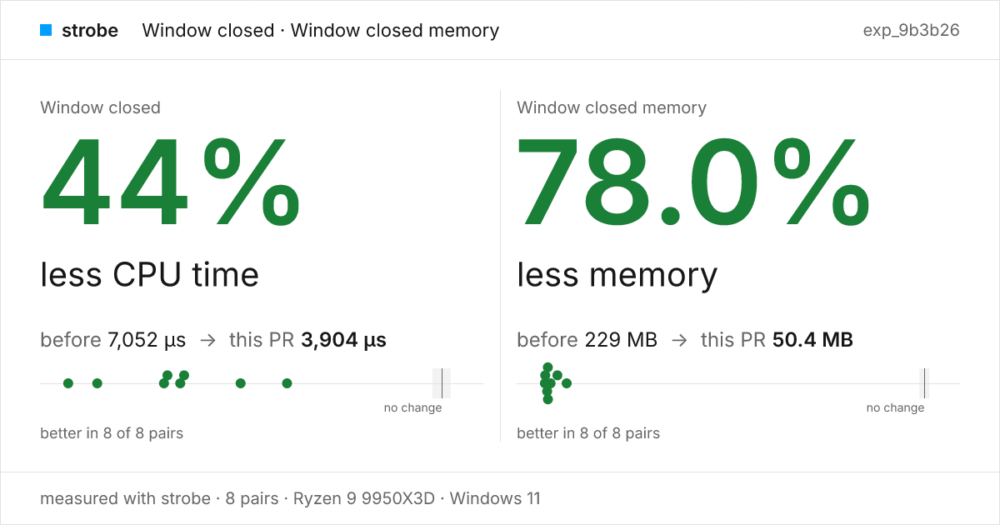

# strobe

strobe makes your app faster, and proves it. Your agent finds what's slow, fixes it, and knows for certain it worked, with numbers it can't fake.

One tool for web, Electron and native apps on Windows, macOS and Linux. It measures what your users actually feel and explains it all the way down: the line of code, the native stack, every thread, wake-up, allocation, frame, GPU and byte of VRAM.

```ts
// perf/scroll.bench.ts
import { bench, web } from "@hona/strobe"

export default bench({
  targets: { app: web() }, // each variant's build, served as strobe.json's build and serve say
  cases: {
    scroll: {
      primary: "main.work",
      run: ({ page }) => page.scroll("main", { by: 4000 }),
      reset: ({ page }) => page.scroll("main", { by: -4000 }),
    },
  },
})
```

<picture>
  <source media="(prefers-color-scheme: dark)" srcset="docs/card-dark.png">
  
</picture>

Ask your agent: *"did this branch make scrolling faster?"*

**Agent quick start:** read [skill/SKILL.md](skill/SKILL.md). `strobe up` installs it as the `strobe` skill.

Start in about two minutes, from your project's folder:

```sh
bun add -d @hona/strobe                                   # pins strobe for the project
bunx strobe init                                          # strobe.json and a runnable perf/smoke.bench.ts
bunx strobe bench perf/smoke.bench.ts --head . --check    # each case once: does it work?
```

`strobe init` reads your package.json, Cargo.toml or index.html and writes a bench for a web app, a
library, a server, a native app, an Electron app, a terminal program or a command-line tool (`--target`
picks one). It never replaces a file without `--force`, and prints what to run next.

What your agent runs:

```sh
bun add -d @hona/strobe && bunx strobe up                      # once per machine
strobe bench perf/scroll.bench.ts --base origin/main --head .   # did the branch help?
strobe report experiment exp_9b3b26 --format pr --update-pr 42  # the card above, in the PR
strobe record app:desktop --for 10s                             # what is the installed app doing?
strobe query rec_3f9a hotspots                                  # where did the time go?
strobe query rec_3f9a..rec_7c1d hotspots                        # what got slower between two recordings?
strobe record app:desktop --probes memory --for 60s             # is it leaking?
strobe look app:desktop                                         # what's on screen, as strobe sees it
strobe open rec_3f9a                                            # the whole recording in Perfetto
```

`app:desktop` is a profile in your repo's `strobe.json`: how to build and launch the app in a throwaway home, so benches never touch your real data. `strobe status` says what your machine can measure and which permission is missing.

In CI, the GitHub Action checks every case on each pull request, and holds exact counters (requests, bytes, DOM nodes, your own `count.*`) to the base commit's:

```yaml
- uses: anomalyco/strobe@v0.29
  with:
    bench: perf/scroll.bench.ts
    noworse: net.requests=0,dom.nodes=0
```

A shared runner's timings move with the jobs beside it, so strobe gives no timing verdict there. On a machine of your own (a self-hosted runner), `mode: compare` runs the A/B and puts the card above in the PR. Every input: [action.yml](action.yml); the design: [SPEC.md §26](SPEC.md#26-ci-the-github-action-actionyml).

Packages for Windows (x64, Arm64), macOS (Apple silicon, Intel) and Linux (x64, arm64).

Design: [SPEC.md](SPEC.md)
