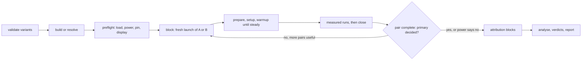
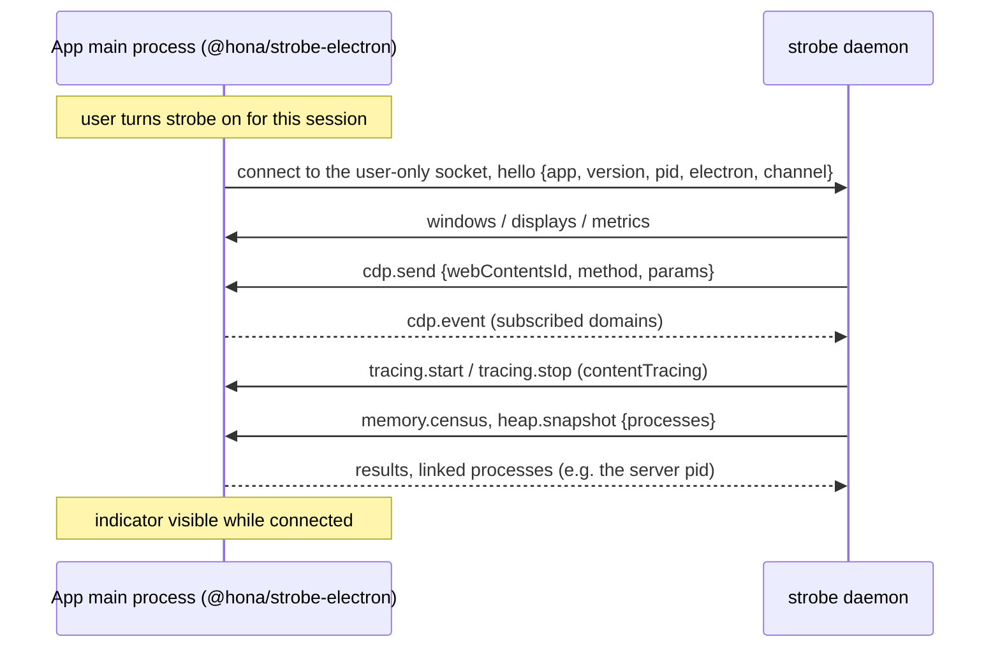

# strobe — spec

`strobe` measures and explains performance: a web page, an Electron app (installed or packaged,
launched in isolation from an app profile), a Bun or Node process, or any process by PID. It records
everything on one clock, refuses measurements it cannot defend, and gives people and agents a
verdict plus handles to drill into.

This file is the source of truth. If an implementation idea conflicts with it, stop and ask.
When a design change is agreed, update this file in the same change.

---

## 1. Rules (non-negotiable)

1. **Valid or nothing.** A number strobe cannot defend is not printed. Validators refuse a run
   (exit 4, §10.1); analysers warn next to the number (§10.2). Every number carries its unit,
   `n`, interval or `exact`, method, probe set, build and device.
2. **Measure the app, not strobe.** Low overhead first: no helper process where an OS API or a
   file read works; no polling where an event exists; budgets in §19 hold. strobe's own CPU, GPU
   and memory are a track in every recording.
3. **Timing and attribution never share a block.** Profilers, heap snapshots, allocation
   sampling, coverage, counters and instrumented builds change timing. They run in attribution
   blocks only (§8.1). A recording that mixes them is marked `mixed`, and its timing metrics
   are labelled `perturbed`.
4. **One primary metric per experiment**, declared before the run. Secondary metrics get a
   verdict only through the gate in §9.3; otherwise they are descriptive.
5. **No automated tests. Ever.** No unit, integration, e2e or snapshot tests, no test files, no
   test dependencies, no test steps in CI. Verification is the calibration page and A/A runs on
   real devices (§10.3, §10.4). CI only builds release binaries.
6. **Early iteration speed beats everything else.** Smallest change that works. No speculative
   abstraction.
7. **One concept, one name.** Each MCP tool is exactly a CLI command: same name, same
   arguments, same JSON as `--json`.
8. **Raw, general tools.** Five MCP tools (§17). New questions become views or arguments, not
   new tools.
9. **Local only.** Recordings never leave the machine unless the user copies them. Traces and
   heap snapshots can hold prompts, file contents and credentials: they are written owner-only,
   reports and MCP results carry aggregates, and string contents appear only with `--reveal`.
10. **Never break user space.** strobe writes only its own files and marked managed entries, all
    removed by `strobe leave`. It never changes a target's settings, profile or data. Launched
    targets get isolated homes; attached targets are left as they were on detach.
11. **One-time setup does every privileged step.** `strobe up` asks for the one UAC or sudo it
    needs. After that nothing prompts; `status` only reports problems.
12. **Rust stable, pragmatic dependencies.** Well-known crates are fine. Each dependency has a
    one-line reason in `Cargo.toml`. The budgets in §19 decide, not taste. No crate that needs a
    C compiler: every device builds with the plain Rust toolchain (adais has no C toolchain).
    One-time downloads shell out to `curl` (built into Windows 10+, macOS and Linux) instead of
    linking TLS.
13. **No backwards compatibility while pre-1.0.** Breaking changes are fine. No migration code.
14. **Normal speed only.** strobe never slows the target: no CPU throttling, no network
    throttling, no frame-rate caps in timing blocks. CPU throttling slows only the renderer's
    main thread, so the bottleneck moves where no real device has it. Small effects are found
    with more pairs, stress comes from bigger workloads (`params`), and slow hardware is measured
    on slow hardware (`--on`). The `Throttled` validator (§10.1) catches a slowed target from any
    cause.
15. **Generic: strobe knows no product it measures.** Apps under test are consumers. What one of
    them needs (its install path, env vars, seed files, the user state to guard, URL schemes it
    registers, how to build and serve it, its mocks and benches) lives in that app's own repo:
    `strobe.json` (`apps`, `build`, `serve`) and its bench files. Strobe has mechanisms, never a
    product's names. The only product-specific code is on the using side: registering strobe's
    MCP and skill with the agent harness that drives it (§5.3), as mesh does. `scripts/generic.ts`
    (the Check workflow) fails on a product's name in any file outside its explicit allowlist.

## 2. Invariants

- Windows 10+, macOS 13+, or Linux (glibc or musl), x64 or arm64.
- `gh` installed and authenticated (install and update, like mesh).
- `opencode` installed for MCP and skill registration. Not needed to measure.
- Chromium targets: an installed Chrome, Edge or Chromium, or Playwright's Chromium. strobe finds
  one; it never downloads a browser.
- Firefox targets (`--engine firefox`, optional): a stock Firefox from Mozilla (release, Developer
  Edition or Nightly; a distribution's package; Snap). Never Playwright's patched Firefox (§13.1).
- WebKit targets (`--engine webkit`, optional): Safari or Safari Technology Preview with remote
  automation on (macOS), WebKitGTK's or WPE's WebDriver and MiniBrowser from the distribution (Linux).
  None on Windows; never Playwright's WebKit build (§13.1).
- Deep mode (§13.4): one UAC (Windows) or one sudo (Linux) during `up`.

Tools may be installed but not on PATH (desktop-app shells). strobe looks in known install
locations, not only PATH.

## 3. Glossary

| Term | Meaning |
|---|---|
| target | What is measured (§5.1) |
| probe | One source of data: trace categories, CPU sampler, OS sampler, heap census, … (§8.1) |
| probe set | Named group of probes: `timing`, `attribution`, `memory`, `deep` |
| recording | Everything one capture produced, addressed by a handle `rec_…` |
| experiment | One `bench` invocation, addressed by `exp_…` |
| variant | One side of an experiment: a git ref, a directory, an installed app |
| bench file | A `.bench.ts` file: targets, params, setup and cases (§9.6) |
| case | One entry in a bench file's `cases`, with its `run` function |
| series | One case × target × params combination: the unit that gets a verdict |
| run | One call of a case's `run` (BenchmarkDotNet's iteration) |
| phase | A named span inside a run, such as `down` |
| block | One fresh launch of one variant: prepare, setup, warmup runs, measured runs, close |
| pair | Two adjacent blocks of different variants; order alternates A B, B A |
| timing / attribution block | A block with the `timing` probe set, or with profilers (§8.1) |
| primary | The metric the experiment is about, declared before the run |
| verdict | `faster`/`slower` (or `less`/`more`, `fewer`/`more`), `same`, `unclear`, `underpowered`, `refused`; with a margin, `no worse`/`worse` (§9.3) |
| validator | A check that refuses a run (§10.1) |
| analyser | A check that warns in the result (§10.2) |
| census | A consistent per-process memory account at one moment (§8.6) |
| bridge | `@hona/strobe-electron` inside an app's main process (§13.2) |
| accessibility tree | what an app exposes to the OS's assistive technology (UI Automation on Windows, the AX API on macOS, AT-SPI on Linux): strobe finds and waits on a native app's elements through it (§13.7) |
| calibration | The known-cost page every probe must recover (§10.3) |
| A/A | An experiment with the same build on both sides (§10.4) |
| implementation comparison | An experiment whose two sides are different targets of one bench file: two implementations of one app (§9.10) |
| journey | A case run on both implementations |
| parity gap | A journey one implementation cannot run: listed, never run or counted (§9.10) |
| fixture | A process both sides talk to (a server with seeded data), started per block outside both process sets (§9.10) |

## 4. Repo and files

### 4.1 Tool repo — `anomalyco/strobe`

```
Cargo.toml  build.rs
src/            one package: lib + bins strobe, strobew (Windows windowless); §4.3
viewer/         self-contained HTML report viewer (`viewer/report.html`), embedded
calibration/    the known-cost page (static), embedded
assets/fonts/   Inter Regular and SemiBold (Latin subset, SIL OFL 1.1, OFL.txt) for result cards, embedded
sdk/            TypeScript: @hona/strobe (the CLI launcher and bench SDK), @hona/strobe-web, @hona/strobe-electron, @hona/strobe-playwright
                (one Bun workspace)
skill/SKILL.md  the built-in skill, embedded (include_str!)
schema/         strobe.v1.json (project config), result.v1.json (experiment results); both shipped
                in @hona/strobe (`schema/`). bridge.v1.json comes with the bridge (§24.1, 0b)
install.sh  install.ps1
.github/workflows/release.yml   build + release only, no tests
.github/workflows/check.yml     clippy and build on every OS, and scripts/generic.ts (rule 15)
SPEC.md  AGENTS.md  README.md
```

### 4.2 Local state (per device, never in a repo)

State dir: `~/.local/share/strobe/` (respect `XDG_DATA_HOME`) on Linux and macOS;
`%LOCALAPPDATA%\strobe\` on Windows. Created `0700` / user-only ACL; `run/` too. Secrets (tokens) are
written `0600` from their creation (`host::paths::write_owner_only`). Every file strobe keeps is
written whole or not at all: into a temporary file beside it, flushed to disk, then renamed over it
(`host::paths::write_atomic`; on Windows a rename that a scanner holds up is tried again for about
2.5 s). A file written in pieces (a trace streamed from the target, a heap snapshot) goes the same
way (`host::paths::Atomic`, through `store::create`, `0600` like a secret: it holds the target's data
verbatim): an error midway leaves no file. A recording that fails or is refused before its
`meta.json` leaves no folder (`store::Draft`). Random ids and tokens come from the OS's random
source (`host::paths::csprng_hex`).

```
state.json          { "mcp_port", "helper", "engine", "last_calibration" }
mcp-token           MCP bearer token, user-only
experiments/<exp>/  result.json per experiment; index.jsonl lists them (§14.2)
recordings/<rec>/   §14.1
history/            tracked series per device, schedules (§25.6)
builds/<key>/       variant build cache (§9.5)
sdk/<build>/        the bench SDK the runner imports, one folder per strobe build (`STROBE_BUILD_ID`);
                    each use touches its `.used`, and other builds' folders unused for 30 days go
symbols/            source maps by debug ID, PDB cache
engine/<version>/   trace_processor (§15), sha256-checked
run/  log/          temp files; daemon.log, helper.log (rotated at 1 MB)
daemon-<build>.sock Linux/macOS daemon socket (Windows: named pipe, §16)
```

Installed binary: `~/.local/bin/strobe` (Linux/macOS); `%LOCALAPPDATA%\Programs\strobe\{strobe,strobew}.exe`
(Windows, on user PATH). The deep-mode helper lives where only an elevated step can write
(§13.4).

**macOS signing.** macOS keeps a privacy grant (Accessibility, called Device Control and Data Access
on macOS 27, and Screen Recording) for a binary's designated requirement. An ad-hoc signature's
requirement is its hash, which every release changes, so each update silently dropped the grants.
The Release workflow signs each macOS binary with a Developer ID Application certificate under the
hardened runtime (`packaging/macos/strobe.entitlements`: no exceptions), identifier
`dev.hona.strobe`, and notarizes it (`scripts/macos-sign.sh`), so the requirement is the identifier
and team and the grants survive updates. It needs five repository secrets: `MACOS_CERTIFICATE_P12`
(the certificate with its private key as a `.p12`, base64), `MACOS_CERTIFICATE_PASSWORD`,
`MACOS_NOTARY_KEY_P8` (an App Store Connect API key's `.p8` contents), `MACOS_NOTARY_KEY_ID` and
`MACOS_NOTARY_ISSUER_ID`. Without them the binaries ship ad-hoc signed and a tag build warns. A bare
executable cannot carry a stapled ticket: Gatekeeper looks it up online at its first run.

**Windows metadata.** Defender's machine-learning classifier quarantined unsigned builds as
`Trojan:Win32/Bearfoos.A!ml`: strobe does what droppers do (copies itself into Program Files with a
scheduled task, elevates once, suspends threads and reads other processes' memory, sets their
affinity, replaces its own executable). Each executable carries a version resource (CompanyName,
FileDescription, FileVersion, InternalName, LegalCopyright, OriginalFilename, ProductName,
ProductVersion from Cargo.toml) and an application manifest (`asInvoker`, Windows 10 and 11, no DPI
awareness: strobe sets that per thread). `build.rs` writes both as a COFF `.rsrc` object and links it:
no resource compiler. The binaries are not Authenticode-signed yet.

**Inherited and own grants.** macOS attributes a process's permissions to its responsible process.
On macOS 27 a child of a launchd daemon (a remote shell's, such as mesh) is AX-trusted through the
daemon, but Screen Recording is checked against the child's own binary: ScreenCaptureKit answered
-3801 ("user declined TCCs") with the daemon granted. `strobe status` says whose grant each
permission is (inherited from the process it names, or strobe's own) and, for that split, names
strobe's own executable (symlinks resolved) as the one to add in Screen & System Audio Recording.

### 4.3 Architecture (`src/`)

```
lib.rs          module declarations only
main.rs         bin `strobe`: parse args → app → exit code
bin/strobew.rs  Windows windowless build (daemon autostart)
cli/            argument parsing, help, text + JSON rendering
app/            commands (up, status, record, bench, query, report, top, update, leave, daemon)
model/          plain data: Target, Probe, Recording, Run, Metric, Verdict, Env, Validity
target/         finding and driving targets → chromium.rs (CDP), firefox.rs and bidi.rs (WebDriver
                BiDi), webkit.rs and webdriver.rs (WebDriver Classic), web.rs (a page in any engine:
                the WebBrowser and WebPage enums every page caller drives), wir.rs (an open Safari tab
                or WKWebView on a USB-cabled iPhone over Web Inspector, §13.1), bridge.rs, inspector.rs,
                process.rs, isolate.rs (isolated launches), electron.rs, android_chrome.rs (Chrome on a
                phone over adb, 13.1), webview.rs (apps on the OS's
                webview, §13.8), native.rs (native apps, §13.7), a11y/ (the OS accessibility client: uia.rs, ax.rs, atspi.rs; input:
                input.rs (posted messages), cg_input.rs (Quartz), xtest.rs; keys.rs shared), tty.rs
                (terminal programs on strobe's own pseudo-terminal and grid, §13.9; tty/image.rs draws
                the grid), events.rs (an app's STROBE_EVENTS stream)
driver/         the bench file's `page`: over CDP, or a native app's accessibility tree and
                message loop (native.rs), or a terminal's bytes (tty.rs)
font.rs         the embedded font every drawn image uses (cards, badges, terminal snapshots)
probe/          collecting → trace.rs, cpu.rs, alloc.rs, heap.rs, symbols.rs (source maps),
                census.rs, gecko.rs (Firefox's profiler and about:memory), webkit_inspector.rs
                (WebKit Inspector Timeline, ScriptProfiler, Heap v3 → V8 heapsnapshot, Memory and
                Network over wir), coverage.rs, os/{windows,linux,macos}.rs, gpu/{pdh,nvml,d3dkmt,drm,ioreport}.rs,
                stacks.rs (native stacks: `Deep`, one sampler per OS: kernel_profile.rs in the helper,
                suspend.rs on Windows, perf.rs on Linux, sample.rs on macOS), etw.rs (ETW sessions),
                helper.rs (the deep-mode helper, §13.4), present/ (what reached the screen, §7.2:
                windows.rs ETW present events, sck.rs ScreenCaptureKit, xpresent.rs X11 Present,
                frames.rs frame metrics). The helper runs present and stack sessions, and both use
                its access, so they live in one backend. video/ (`--video`, §8.8: wgc.rs Windows,
                avf.rs macOS, x11.rs Linux, screencast.rs a Chromium page's renderer, ffmpeg.rs the
                external encoder)
heapsnap.rs     V8 heap snapshots: streaming parse, dominators, classes, retainer paths, diff, leaks
metrics.rs      a block's trace → metric values
engine/         trace_processor: the only place that runs it (§15)
store/          experiments/ and recordings/: the only place that writes them (§14)
history/        tracked series (the only writer of history/) and change-point detection (§25)
runner/         the bench runner link: spawns `bun`, speaks the runner protocol (§9.6)
stats/          paired tests, intervals, modes, power, multiplicity (§9.3)
validity/       validators, analysers, calibration, A/A (§10)
symbol/         source maps, packages, owners, PDBs (§12)
report/         views → text, JSON, markdown, HTML (§11)
mcp/            MCP server: Streamable HTTP for the daemon, stdio (hidden)
host/           paths, processes, sockets, autostart, opencode registration, mesh, git, iOS devices,
                Android devices (adb.rs)
ui/             embedded viewer and calibration assets
```

- `cli`, `mcp` → `app` → everything else. Nothing outside `app/`, `cli` and `main` names `app` or
  `cli` (shared helpers such as `fmt.rs` live below `app`, which re-exports them). Backends
  (`target`, `probe`, `engine`, `store`, `symbol`) use each other only through their public entry
  points, never their internals: a probe drives the page through `target`'s CDP, writes through
  `store`, and reads the trace it just took through `engine::query` while the page is still open (a
  census's allocators, a layout shift's moved elements: the rows name nodes only the live page can
  resolve). Only `engine` runs trace_processor; only `store` writes `experiments/` and
  `recordings/` (`store::write_atomic`, `write_json`, `create` for streamed files, `Draft`). They
  return `model` types.
- One backend each until a second exists. No traits or plugin layers ahead of need.
- Idiomatic Rust: `pub(crate)` by default, `cargo fmt`, `cargo clippy` clean.

## 5. CLI

```
strobe <command> [flags]

Setup      up · update · leave
Use        status · record · bench · plan · config · query · report · open (§11.4) · look (§5.12) · top · track · history (§25)
Internal   daemon · mcp · helper (hidden)
Global     --json  -q/--quiet  -v/--verbose  -h/--help  -V/--version  --progress stderr|stdout|off
```

`strobe <command> --help` prints that command's lines of the help and every flag it reads, from the
flag table; `strobe --help` (or a command the help does not name) prints all of it.

`strobe config [<dir>]` checks a project's strobe.json without a bench, strictly read-only (it runs before
the power plan and CPU-set restores every other command does, and makes no state folder): the strict read every command
does (§9.5), then every app profile resolved for this OS as a launch resolves it (its executable,
its guards and `moved` folders, whose variables must be set: a profile that cannot be used here is a
usage error naming it), its kind, whether its executable is there yet (relative paths from the
project root, the folder of the nearest strobe.json) and `window: false`, and the build and serve
commands for this OS with the folders they run in: those are from the checkout's root (§9.5), whichever
folder of it holds strobe.json; a `build.output` given per OS without this OS is a problem.
It launches nothing.

Every flag strobe reads is in one table (`cli::FLAGS`, with whether it takes a value and which
commands read it); any other
flag is a usage error (exit 2) that names the closest one, never a setting silently ignored, and
so is an unknown short flag (`-x`; a negative number stays an argument). A switch takes
`--name`, `--name=true` or `--name=false` (off), nothing else. MCP tool schemas take their types
from the same table (§17). Durations take `500ms`, `10s`, `2m`, `2h`, `1d` (and a bare `0`); a
negative or non-finite one is refused, and so is a number without its unit (exit 2, `not a
duration: 2000; give a unit: 2000ms or 2000s`): `--for 2000` meant as milliseconds once recorded
for 33 minutes.

Progress lines of long commands go to stderr (stdout stays the result); `--progress stdout` (or
`STROBE_PROGRESS=stdout`) puts them on stdout, `off` drops them; with `--json` stdout never gets
them. Windows PowerShell 5.1 turns every stderr line of a native command it redirects (`2>&1`,
`*>`) into an error record and sets `$?` to false, and `powershell -Command` then exits 1 although
strobe exited 0: read strobe's own code from `$LASTEXITCODE`, or use `--progress stdout`. Checked on
adais: a successful `record --bench` exits 0 (`$LASTEXITCODE`), and its shell reported 1 only with
`2>&1`.

### 5.1 Targets

| Syntax | Meaning |
|---|---|
| `https://…`, `http://…` | a page in a strobe-launched Chromium (or `--engine firefox`: Firefox; `--engine webkit`: Safari, WebKitGTK or WPE): isolated profile, real GPU, fixed window (§13.1) |
| `cdp:<port>`, `cdp:ws://…` | a running CDP endpoint (Playwright's, a dev Electron's) |
| `app:<id>` | an app by its profile in strobe.json `apps`: an Electron app (§13.2) launched in an isolated home, or attached through its bridge (§13.3); a profile with `kind: "native"` is a native app (§13.7), one with `kind: "webview"` an app on the OS's webview (§13.8) |
| `exe:<path>` | launch a packaged Electron app in an isolated home; `--app <id>` borrows a profile for another build of that app; `--native` launches any executable as a native app (§13.7) |
| `node:<port>`, `bun:<port>` | an inspector endpoint (§13.5) |
| `pid:<n>`, `proc:<name>` | outside-in only: OS, GPU, OS present events, deep (§13.6). `proc:` takes the one process of that name whose parent is not of that name |
| `page.html`, `file:page.html` | a local page (`.html`, `.htm`, `.xhtml`, `.svg` that exists) in a strobe-launched Chromium at its `file://` address (the path's `%`, spaces, `?` and `#` escaped), as `https://…`; any other `file:` is an import |
| `file:<path>` | import an existing capture: a Chrome trace, `.cpuprofile`, `.heapsnapshot`, or a folder of them with a `manifest.json` (§8.7) |
| `<target>@<device>` | run on a mesh device through `mesh exec`; results come back tagged with the device |

### 5.2 Exit codes

| Code | Meaning |
|---|---|
| 0 | success; for `bench`, a verdict was reached |
| 1 | general error |
| 2 | usage error |
| 3 | needs a human (UAC, consent in the app, Safari's remote automation); the exact step is printed |
| 4 | refused: a validator failed; the result names it and the fix |
| 5 | inconclusive (`unclear` or `underpowered`), only with `--require-verdict` |
| 124 | timeout (also a bench whose `--unlock-wait` ran out: what finished is written, `--resume` goes on) |
| 130 | `bench` stopped (Ctrl-C, SIGINT, SIGTERM or `--stop`): what finished is written, `--resume` goes on |
| 255 | target or device unreachable |

### 5.3 `strobe up`

Idempotent; re-running is the repair command.

```
strobe up [--yes] [--check] [--skip <step,...>]
strobe up --mobile[=<serial>] --channel canary|dev|beta
```

`up --mobile --channel` does only this: it gives strobe that Chrome channel on the phone (installed;
kept in `<state>/phones.json` by the phone's hardware serial), the one step before `--mobile` runs on
a phone may force-stop it and clear the origins they load (13.1 "Chrome on a phone"). Never Chrome
itself (`--channel` takes no `stable`); one not installed is exit 3.

Steps (each checks first, prints ✓ / ! / ✗):

1. **Preflight** — OS, CPU and topology (CCDs, V-Cache by L3 size, P/E cores), power plan,
   GPUs (adapters, NVML), displays and refresh rates, `opencode`, browsers, installed apps.
2. **Engine** — download the pinned trace_processor (§15), verify sha256.
3. **Helper** — deep mode (§13.4): one UAC or sudo. Skippable (`--skip deep`). On Windows the one
   elevated step adds the user to Performance Log Users (present events in strobe's own process from
   the next logon) and installs the helper (present events until then, and native stacks).
4. **Daemon** — autostart registered, this build's daemon running, started through that service
   manager where there is one (§16). The line says how it starts at login, or why it does not.
5. **MCP** — register `strobe` in opencode's global config and make it live in every loaded
   location, exactly as mesh does (`opencode mcp add`, then `opencode api experimental.mcp.add`),
   with the token read from `{file:<state>/mcp-token}`.
6. **Skill** — write `~/.config/opencode/skills/strobe/SKILL.md` (strobe-owned folder, §18).
7. **Calibrate** — the quick calibration (§10.3) in a strobe-launched Chromium.

```
$ strobe up
strobe up · adais
  ✓ cpu        Ryzen 9 9950X3D · 16C/32T · CCD0 V-Cache (96 MB L3), CCD1 (32 MB L3)
  i power      Balanced (benches and timed recordings switch to High performance for the run, then back)
  ✓ gpu        RTX 5070 Ti · NVML ok · D3DKMT ok
  ✓ displays   2 · 144 Hz, 60 Hz
  ✓ targets    Chrome · 2 app profiles installed
  ✓ engine     trace_processor <version> · sha256 ok
  ! helper     deep mode needs admin: approve the UAC prompt
  ✓ daemon     running · starts at login
  ✓ mcp        registered "strobe" · live in 6 opencode locations
  ✓ skill      ~/.config/opencode/skills/strobe/SKILL.md
  ✓ calibrate  busy, alloc, idle within tolerance
```

### 5.4 `strobe status`

```
strobe status [--calibrate] [--fast] [--json]
```

It checks this device and takes no target (one is a usage error pointing at `look`).

Reports: environment (§9.4 provenance fields), a validity preflight (idle load per core for
3 s, power plan, battery, throttling, displays and the adapter driving each), daemon, helper,
engine, attachable targets (running apps and their bridge state, CDP endpoints found through
`DevToolsActivePort` files, installed apps), recordings disk use, last calibration.
`--calibrate` runs the full calibration (§10.3).

iOS devices (`ios` row, `ios.devices` and `ios.pages` in JSON): every phone the OS's usbmuxd sees,
read beside the idle-load sample within 2.5 s for all of them (`--fast`: 250 ms, without the
temperature or page listing): model (`ProductType`), iOS version, link (USB, Wi-Fi or both), battery
level and charging (lockdownd's battery domain), battery temperature (diagnostics_relay's
`AppleSmartBatteryPack` `BatteryData` on iOS 27+, falling back to `IOPMPowerSource` on earlier iOS,
kept only between 0 and 100 °C), locked (on the lock screen with a passcode), and on an unlocked USB
phone its inspectable Web Inspector pages (`wir:<short_udid>/safari/<page_id>`, with scrubbed URL,
title and whether another debugger is attached). A phone only on Wi-Fi is listed, not read. Never the
phone's name: a personal phone's name is its owner's. The JSON carries the full UDID, to select the
phone as a target; the text prints its last 8 characters (a current UDID's first 8 are the chip id,
the same for every phone of a model). No usbmuxd (Windows without Apple Mobile Device Service, Linux
without the usbmuxd package) is information, not a problem; Linux's usbmuxd runs only while a phone is
plugged in, so an installed one without a socket reads as no phone. strobe reads with the trust the
user already gave this computer (the pair record usbmuxd keeps) and is read-only toward the phone: it
never pairs, sets a value or installs anything; an untrusted phone says to unlock it and tap Trust.

Android devices (`android` row, `android.devices` in JSON; `strobe up` lists them too): every device
of an adb server that runs (status starts none: "no adb server runs" is information), each read in
one shell round trip (`adb::Facts`) within 3 s for all (`--fast`: 500 ms): manufacturer and model,
Android version, link (USB, Wi-Fi, emulator), battery level and whether it is on power, battery
temperature, thermal status, a screen that is off or locked, and what a run may do with it: an
emulator `check and look only (Emulator)`, a phone on Wi-Fi `untimed only (WirelessTransport)`. The
serial selects it (`--mobile=<serial>`, 13.1 "Chrome on a phone"). An unauthorized phone says to
accept "Allow USB debugging?". Information, never a problem.

### 5.5 `strobe record`

```
strobe record <target> [--probes <set|list>] [--for <duration> | --bench <file>#<case>]
                       [--ring <duration>] [--pin] [--name <text>] [--video] [--headless]
                       [--emulate mobile|touch] [--mobile[=<serial>]] [--json]
```

- `--mobile[=<serial>]` records a page (https://…, a local page) in Chrome on an Android phone or
  emulator over adb, at the phone's own screen with its touch (13.1 "Chrome on a phone"; on a phone,
  only in a Chrome channel given to strobe with `strobe up --mobile=<serial> --channel canary`). A timed
  recording refuses an emulator (`Emulator`), adb over Wi-Fi, Battery Saver and a low battery, waits up
  to 3 minutes for a hot phone, and refuses `Thermal` when it got hot during the recording; `--probes
  attribution` runs on an emulator. The recording keeps `phone`; `cpu.app.total` is refused
  `NotForTarget` (the page's processes are the phone's). Not with `--headless`, `--emulate`,
  `--os-frames`, an app, or `--probes memory`.

- `--emulate mobile|touch` launches a page as a phone or a desktop with a touch screen (13.1 "Emulated
  phones and touch screens"); without it a page is a desktop. Not with `--bench` (the bench target
  says what its page emulates), an attached browser or an app.
- `--video` films the recording (§8.8): the window's screen (headed) or a Chromium page's renderer
  (headless), its `timing` `perturbed`; with `--bench`, the check run's own recording holds it.

- One recording; returns its handle, validity and a summary.
- Default probe set: `timing`. `--probes attribution,memory` and friends per §8.1.
- `--for` records for a duration; neither it nor `--bench`: until Enter (CLI) or `timeout` (MCP).
- `--bench <file>#<case>` records a bench case (a case glob matches) on `--head` (default `.`),
  so a flow behind clicks or keys records as easily as a URL. It runs as `bench --check --why
  always`: setup, warmup until steady, then the measured runs under the attribution probes; it
  prints the recording handle per matching series. No `<target>` is needed: the bench file names it
  (`--target` picks one of its targets). `--gpu-cache` is refused there: the bench target's
  `gpuCache` decides, as in a bench. `--headless` runs a page case in a headless browser, as
  `bench --check --headless` does (§5.6): no display needed, frame and latency metrics refused.
  `record app:<id> --headless` (or `exe:`) is a usage error: an app draws its own window, and the
  flag once only skipped the lock check on it.
  `--engine` passes on as in a bench. A case its engine has no profiler for in strobe (a Firefox launch
  case, any WebKit case) runs its check and then refuses `EngineUnsupported` (exit 4) with why: there is
  no recording.
- `--engine firefox [--headless]` (or `webkit`: Safari headed only, WPE headless on Linux) records a
  page in that engine (§13.1) from outside: its processes' CPU
  in cycles (`cpu.app.total`, `cpu.work`), GPU use and VRAM from the OS sampler, private memory, DOM
  nodes, and headed the OS's presents of its processes (`frames.*`, §7.2), kept as `presents.json.gz`
  and `frames.json` so `query <rec> frames` reads them as a native recording's. Where cycles are not
  time on the device (Windows on Arm, §13.7) both CPU metrics are refused, as for a native app; a
  headless browser that drew in software reports no `gpu.vram`. A Playwright build named by
  `STROBE_FIREFOX` warns `PatchedBrowser`, and the recording says so (`patched_browser`).
  `--probes attribution` and `memory` refuse (`EngineUnsupported`): profilers, heap snapshots and the
  census are Chromium's DevTools. An attached endpoint or an app takes no `--engine` (usage error).
- `--ring 30s` starts a flight recorder in the daemon (a ring buffer of the last 30 s, timing
  probes only) and returns its id; `strobe record ring:<id>` dumps it into a recording.
- `file:<path>` imports (§8.7).
- A native app (`app:<id>` with a native profile, or `exe:<path> --native`) records one run from
  outside after a 3 s settle: CPU, thread wakes, IO, GPU, memory, the UI thread (`ui.cpu`,
  `ui.wakes`) and OS present events (§13.7). `--probes attribution` adds native stacks (§13.4).
  `--until-line <regex>` starts the recording when the app prints a matching line (stdout or stderr)
  instead of after the fixed settle, within 120 s; `--stop-line <regex>` ends it at one (`--for`
  caps it, else 10 minutes). A program that prints its states (`device released`) records each state
  without sleeps in the program or a script polling its output.
- `strobe run [--pin …] [--reserve-cpus on|off] [--power high|keep] -- <command> [args…]` runs an
  ad-hoc harness under a bench block's conditions: it takes the device's bench slot (so it never
  overlaps a timed block), switches to the fastest power plan, pins the command to the target's CPUs
  (`--pin auto`: as in §9.4; the child gets the mask before it runs, strobe's own threads keep
  theirs) and keeps this user's other processes off them (Windows and Linux, §9.4),
  and puts everything back when it exits; its exit code is strobe's. It measures nothing itself: the
  harness prints its own numbers. A harness timed the same build at 190 ms and 250–330 ms an hour
  later while other agents kept 60% of the CPUs busy; strobe's reservation covered only its benches.
- `strobe run --base "<command>" --head "<command>"` (`--aa --head "<command>"` for an A/A,
  `--check --head "<command>"` to run it once) is a paired A/B of two command lines with everything
  a bench has: blocks of fresh runs alternating, warmup until steady, Pocock looks, `--noworse`,
  `verdict_kind`, the slot, power, pin and reserved CPUs, `report` and the PR block. Each run starts
  the command and waits for its exit, measured from outside (§9.6 `cli()` targets): `cpu.work` (the
  default primary, `--primary` another), `run.duration`, `cpu.wakes`, `memory.peak`, `io.*`, and
  `metric.<name>` from the `strobe:metric <name>=<value>` lines it prints (`--metrics metric.x,…`
  declares them, so they are tested). It is `bench` on a file strobe writes (`<state>/run/cmd-<hash>/`)
  with `cmd:` variants; `--pairs`, `--runs`, `--equivalence`, `--max-time`, `--require-verdict` and
  `--id` are bench's. Checked on vps: a 20 M-iteration loop against 22 M read `cpu.work` +9.2%
  [+8.1 … +11] and `metric.loop_ms` +9.8% after 8 pairs (2.2 s). A/A, the same command on both sides:
  100 experiments with `cpu.work` primary said `same` 99 times and `better` once (1%); 150 with
  `run.duration` of a 6 ms command and a 0.3% bound (so almost nothing is `same`, and most went to
  12–40 pairs) said `better` 4 and `worse` 2 times (4.0%, nominal 5%).

### 5.6 `strobe bench`

```
strobe bench <file.bench.ts> --head <variant> [--base <variant>]
             [--filter <cases>] [--target <name>] [--params <k=v,...|all>]
             [--primary <metric>] [--equivalence <pct>] [--pairs auto|<n>] [--runs <n>]
             [--probes <set>] [--repeat <n>] [--pin auto|none|ccd0|ccd1|<cpus>] [--aa] [--check] [--blocks <n>]
             [--bisect <good>..<bad>] [--on <devices>] [--max-time <duration>]
             [--why auto|always|never] [--trace lean|full] [--power high|keep]
             [--reserve-cpus auto|on|off] [--noworse <pct>|<metric>=<pct>,…] [--plan [--effect <pct>] [--pilot]]
             [--unlock-wait <duration>] [--require-verdict] [--require-parity] [--engine chromium|firefox|webkit] [--headless]
             [--seed <n>] [--video] [--check --batch <n>] [--json]
strobe plan <file.bench.ts> …           the same as bench … --plan: estimate, run nothing (§9.1)
strobe bench --stop <exp>
strobe bench --resume <exp>
```

**Seed.** `--seed <n>` (a 32-bit unsigned integer) is the experiment's seed, from which every
case's `ctx.seed` and `ctx.random()` come (§9.6); without it strobe draws one from the OS's random
source. Either way it is printed on the first line (`strobe bench x.bench.ts · exp_… · seed 42`),
kept in `result.json` `plan.seed` (with `plan.used_random`: whether a hook read `ctx.seed` or called
`ctx.random()`), in each block recording's `meta.json` (`seed`) and `actions.json.gz` (§14.1), and in
the saved command line, so `--resume` replays the same workload (`state.json` also keeps whether
the runs before the stop used it, which the resumed runner does not know). The PR block's Rerun
drawer and a failed `--check`'s footer (`seed  42 …: add --seed 42 to replay the same workload`)
print it only when a hook used it. `record --bench … --seed <n>` and `strobe run --base … --head …`
pass it on; `plan` checks it; `record` of a target and `strobe run -- <command>` refuse it (usage
error): nothing seeds them. A bisect (§9.7) runs every step with one seed: `--seed`, else step 0's
when it already ran (a tracked change's confirmation), else one drawn once; its `result.json` keeps
it (`seed`). `track` (§25.2) runs its points, confirmations and bisects with one seed per repository
and bench file.

`--video` (§8.8): with `--check` the check block films its run (`series[].video.head`); on a
comparison, after every timed pair of a series, one untimed block per variant films a warmed run
(`series[].video.base`, `.head`, and `mixed` when their kinds differ). Never inside a timed block.

**Stopping and resuming.** Ctrl-C (SIGINT), SIGTERM or `strobe bench --stop <exp>` (from any shell,
or for a bench the daemon runs) stops a bench once its current block ends; waits (a locked session,
the bench slot, busy CPUs) end at once. A second Ctrl-C ends strobe at once. `--stop` and `--resume`
take an id or a unique prefix. `--stop` finds the bench's registration (§10.1) and says what it was
doing; one that was waiting stops within a second, which `--stop` waits to report as `stopped`. An
experiment no bench runs is a usage error that says whether it finished or ended (then `--resume`
goes on); `--resume` refuses one still running. A stop of a bisect stops the step that runs, and a
stop ends `track` and `bisect` (exit 130). Each invocation keeps its own progress log and stop files
(the daemon runs several at once); the daemon installs no signal handler, so SIGTERM ends it.
`--unlock-wait <duration>` caps each wait for an unlock of a series that needs a presenting window:
then the bench ends as a stop does, with exit 124 and a hint to resume once unlocked (checked on
adais, locked: exit 124 after `--unlock-wait 10s`). On macOS it caps each wait for nobody to use the
Mac for a minute (a block whose app lost the front while a person used the Mac) the same way, and
that wait prints a line a minute with the last input's age. Wherever it ends a bench it is a stop,
never a failure: a `--check` case (batched or not) is not run and `--resume` runs it, a series cut
mid-pairs reads "stopped after N pairs" (resumable), as do its counter or timing pass and the report's
stopped line, `--pixels-only` exits 124 too, and the block that met the wait had its recordings
discarded before it waited. Both keep the experiment's warm GPU cache
stores for `--resume`, and `track` and `bisect` take a bench that ended either way as that error,
never as a partial answer (a bisect step without its pairs would otherwise move `good`). `--stop`
and `--resume` together are a usage error. On Windows and in a
terminal the runner and the browser get the same Ctrl-C and end with it, so the block in flight is
dropped. What finished stays: the half pair goes, the finished pairs of the running series get
their comparison (no verdict unless a planned look had decided it), finished series keep theirs,
and the rest are listed as not run. The result (`result.json`, `report`, `--format pr`, which marks
it incomplete) is written and strobe exits 130. A failure after some pairs (a refused block, a
launch that kept failing) ends the same way, with that error's exit code. After every pair a bench
saves its command line and each series' finished blocks and pairs, or its result once done, in the
experiment's `state.json`; `--resume <exp>` runs the same command line again (the bench file and
directory variants as full paths, so from any folder) from there: finished series are kept, the
running one goes on from its next pair, and variants build again (unchanged ones from the cache).

**Launches that fail and pass.** A block whose launch failed for a reason that passes (the browser
did not open its debugging port, a DevTools call such as `Target.attachToTarget` got no reply, the
connection dropped) runs again, after 30 s and a wait for quiet CPUs, holding nothing meanwhile, up
to 3 times per block; a run that failed, or a validator, still ends it. Two such failures under load
(load average 35–70 on a shared Mac) once lost a 40-minute experiment with its finished pairs.

Every series in the file (case × target × params, narrowed by `--filter`, `--target` and
`--params`) gets its own verdict. `--filter` takes case names separated by commas; each is exact
unless it holds `*`, a glob over the whole name: `--filter window-closed` runs only that case,
`--filter "window-closed*"` also `window-closed-memory`. Before anything builds, strobe prints
the cases the filter runs and skips, and for an exact name that other cases start with, the glob
that would take them too; a filter that matches nothing is a usage error that lists the cases.
`--target` takes target names the same way (comma-separated, globs with `*`).
With `--base`: the A/B pipeline in §9. Without it: `--aa`
runs `--head` against itself (§10.4), `--probes memory --repeat <n>` is a leak run (§8.6), and
`--check` validates the file: one block per series on `--head`, one run per case, no warmup and
no statistics (`--check --base <target> --head <target>`: each case on those two targets, checked as
their implementation comparison measures them, 9.10). A case with a reset runs run → reset → run →
reset: the second run, unmeasured, proves a run can start from what the reset leaves (a reset to
about:blank, a relative `goto` after it) and gives the start check (`ResetIncomplete`) a second start
to compare; the case's values are the first, cold run's, except that when a process of the target
ended in it and strobe could not recover its CPU (§9.6) a case with a reset and `resetCheck` on
measures the run after the reset instead (` · run 2` on its line, §9.1). A case without a reset
keeps its cold run 1, and only the `cpu.*` that lost the process refuse `RunIncomplete` (a refused
primary fails the check). The second run is marked `warm:<i>` in the
trace (no view counts it), and none of it reaches the block: its `expect.same` reads, input counts
(`ops`), self cost and frames stay out. Each case passes, with its declared metrics' values from that run, or fails with
the refusal, the page's URL and its screenshot; the next case still runs, and any failure exits 1.
A failure keeps the fix strobe's driver gave (a missing permission and where to grant it) and
names the hook once (`setup: …`, not `setup: setup: …`). Under each case, `--check` prints the
last 10 lines the bench file's hooks wrote to the console during it (`console.log`/`error`; the
rest stay in the experiment's `runner.log`, whose path it names). Each passing case keeps its
block's recording and prints it (`rec  rec_… · strobe query rec_… threads`), and `query <exp> <view>`
on a check of one case answers from that recording (with several, it lists them).
**Many cases per launch** (`--check --batch N`): run cases that one launch can hold share it, its
`prepare` and its `setup`, up to N at a time, so a file of many small cases (a fuzzer's) checks in a
fraction of the time. Cases share a launch when they run on one target (so one engine, headless
mode, emulated device and motion) with the same params (a fixture's, a seed folder's and the hooks'
own), GPU cache, way of measuring (from outside or not) and `setupKey` (below), in the series' order (case names sorted,
then target and params; not the order the file lists them), up to and including the first with
`resetCheck: false`; a launch case, a
`cli()` case and a Linux series that counts instructions in a block of its own each keep a launch of
their own. Each case runs as alone: run → reset → run → reset when it has a reset (the file's
`reset`, `bench({ reset })`, when the case has none of its own). After each case strobe checks
before the next one runs: the page still answers (a renderer the case crashed fails it,
`RunIncomplete`), the app is still running, the profile's guard holds, the case's start check
against the launch's first start (`ResetIncomplete`, its message naming the case and its runs: "the
next case of the launch would start, after X's run 2 and its reset, from a different state than A's
run 1 did"), its `expect` after the runs (`WrongScreen`), the OS input it was given, the window's
size (`page.window`), the window's visibility and the browser's own processes. A case that fails ends
its launch, and the next case gets a fresh one; so does a case with `resetCheck: false` (it passes
or fails on its own, and no case may start from what it built). A later case is not run on a screen
its `expect` does not show, nor on another screen than the launch began on (another title, address
path or heading, or pixels 20 or more of 64 hash bits apart): it runs in a fresh launch, and the
case before gets the note `batch  after its reset the screen was not one <next> may start from …`.
A disturbed guard fails the case after which it was found, and stops the bench. What the start check
(`ResetIncomplete`) and the screen compare is all a batch holds the cases to: a case can still leave
behind what neither sees, and the next case then starts from it. Not checked: the page's DOM beyond
its editable controls, toggles, title, address, headings and pixels; JavaScript globals and the heap;
event listeners, timers and pending work; `localStorage`, `sessionStorage`, IndexedDB, the Cache API,
cookies and service workers; the HTTP and GPU caches; a native app's state beyond its tree's editable
controls and toggles. A file whose cases share such state checks each case alone (no `--batch`).
A launch that fails before any case ran (its launch, prepare or setup) fails its first case, as
without `--batch`; three such launches in a row stop the bench (exit 1), as does a disturbed
guard. `prepare`, a `url` function and `setup` run once for a launch's cases. A file whose cases
need different setups says what its setup depends on with `setupKey` (§9.6): before anything builds
(in every mode, with or without `--batch`) strobe asks the runner for each series' key as canonical
text (`setup_keys`), and a key that is not
plain JSON (a function, symbol, BigInt, non-finite number, class instance or a value that refers
back to itself) or a `setupKey` that throws is a usage error (exit 2) naming the series and where in
the key; `undefined` is a key of its own, not `null`'s. A launch hook that reads what differs per
case (`ctx.case`, and `ctx.seed` and `ctx.random()`, which come from the case's seed) would set every
case of its launch up as the first: in a file with `setupKey` that is refused (usage error, exit 2,
at its first launch, naming the hook and the field: move the choice into `setupKey` and read
`ctx.setupKey`); in a file without one the launch runs only its first case, the cases that would
have shared it run a launch each, the first case gets the note `batch  the bench file's setup reads
ctx.case …`, the experiment one `Batch` info line per hook and field, and `result.json`'s
`batch.unbatched_cases` counts the cases that ran so. `run` and `reset` get each case's own
`ctx.case`, `ctx.seed` and `ctx.random()`. A launch
keeps one recording, its trace marked `case:<i>:<name>:start|end` around each case, its runs
numbered across its cases (`run:<i>`), its `meta.json` `batch` listing each case's label, measured
runs and values (`query <rec> summary` lists them, and `query <exp> actions` shows each case only
its own actions), its action log naming each run's and reset's case (§9.6), and with `--video` one
film of the launch with each case's span. `result.json` has `batch` (`size`, `launches`, `cases`,
`failed_launches`, `launch_ms_mean`: a launch's own time besides its cases, `saved_ms`: that
time for each case after a launch's first, and `unbatched_cases`) and each series `batch_id` (its launch, from 1) and
`batch_seq` (its place there); the text marks each case `· launch 3.2` and ends with `batch  40
cases in 10 launches (--batch 10): about 3.1 min saved against a launch per case (…)`. A later
case runs in a page or app the cases before it warmed: its values are a check's, not a cold
launch's. `--batch` is a usage error without `--check`, and with `--why always`, `--pixels`,
`--pixels-only`, `--probes memory`, `--blocks`, `--aa` and `--base`: a timed block is one fresh
launch per case (the unit of a verdict), and the others are one case's block each.
`--check --why always` also runs one attribution block per passing series on `--head` (warmed as in
a bench, then `--runs` measured runs, default 5; views name the warmup runs the trace also holds)
and prints its recording, to profile one build before there is anything to compare.
`--headless` (or a page target's `headless: true`) runs page (`web`, `url`) targets in a headless
browser, in `--check` and in timed blocks alike: it draws to no display, so it runs through a locked
session or on a device without one, and keeps what needs no display (CPU, main-thread work,
counters, phases, memory, milestones, and strobe's own input pacing `input.rate` and `input.gap.p95`)
while frames, input-to-screen latencies, scrolling, canvas frames, the display's rate, a launch's
pixels (`launch.painted`, `launch.settled`) and GPU use are refused `Headless` ("the page ran
headless"), each declared one (`--noworse` keys included); a software rasterizer refuses nothing
there but GPU memory, which no GPU held. The report says "headless (no display)" where it would name
the display's refresh, and the result has no `refresh_hz` when every series ran headless. A
primary among them refuses its series before anything builds (`Headless`, naming CPU primaries to use
instead; see "Refused series" below): no frame or latency verdict ever comes from a headless browser, while a CPU verdict
(`cpu.work`, `main.work`) of a headless page is a CPU verdict of that headless page, and the series and
the ledger say headless (a change of a page's engine, browser or mode is listed among what changed
between attempts). `--headless` on a native, app, exe or command target is a usage error, in `--plan` too.
`record --bench … --headless` is the same for one case.
`--engine <e>` picks the browser engine of page targets (§13.1): when the bench file declares targets
of engine `e` (`web({ engine: "firefox" })`), only those run; otherwise every page target runs in
`e`. A run that would include an app, exe, native, command or script target under `--engine` is a usage
error (narrow it with `--target`). `webkit` refuses on Windows for good (`EngineUnsupported`: no WebKit
browser runs there for people), and with `--headless` on macOS (Safari has no headless mode); on Linux
`--headless` picks WPE WebKit, headed WebKitGTK (§13.1). A primary the engine cannot measure
refuses its series before anything builds (`EngineUnsupported`, with the closest metric it can), as does
a launch case on WebKit (no preload script); `--probes attribution|memory` on a WebKit page refuses
the run. Declared secondaries the engine cannot measure are refused per block.
**On a phone** (`--mobile[=<serial>]`, 13.1 "Chrome on a phone"): the file's phone targets (`emulate:
"mobile"`) run in Chrome on an Android phone or emulator instead of being emulated; every other series
is refused `NotForTarget` before anything builds. A timed bench (anything but `--check` and
`--pixels-only`) refuses an emulator, a phone on Wi-Fi, Battery Saver or a low battery before anything
builds; each block then holds the phone's slot and stay-awake setting, and a hot phone (`Thermal`,
before the block or during it) is waited out holding nothing and the block runs again. A phone block
reads nothing of this computer's (no OS sampler, process snapshots, CPU reservation or power-plan
switch). `bench --plan --mobile` estimates from earlier runs on the same phone.
**Refused series:** a series refused before anything builds (one case's Chromium-only primary in a
file run on Firefox) is listed, never run, and the rest of the file runs: `--check` prints `refused
<series>  <validator>: <why>` with its fix and counts it apart from the cases that passed or failed
(exit 0 when the rest pass); a comparison lists it `not run: <validator>: <why> · fix: …` with its
primary refused (`verdict_kind: refused`, the refusal in `primary.refusal`, series `kind: "refused"`),
undecided, and exits 0 unless `--require-verdict`, which exits 4 on it as on a parity gap; `--plan`
lists it with no time. A comparison's series whose primary is refused after its pairs (a one-sided
`Background`, lock states that differ) keeps its pairs and its kind, shows its primary `refused
(<validator>)`, and counts as `refused` (never as a gap) where journeys are counted
(`family::refused_at_run`). Either way the bench exits 0 unless every compared series' primary is
refused (then 4, with `result.json` written) or `--require-verdict` (4). Its result keeps the series' `headless`, `engine`, `target_kind`, `journey` and
`side_name`; the summary leaves out the series' label, which every listing prints beside it. In an
implementation comparison both sides' targets are checked (the summary names the side) and a refused
journey is not compared: it counts toward neither side nor the family's Holm denominator, as a gap.
The parity matrix shows `refused <validator>`, reports `Not run (<validator>)` with the summary and the
fix (and no pair panels), a heading of "Not measured" only when no series decided, and `track` records
no point for it. Gaps are not checked. When every series is refused, the run is refused (exit 4) with
the first series' refusal, its label in front. The engine, the browser's version and headless go into the rerun ledger's
identity (§14.2) and track's fingerprints (§25): a run in another engine, version or mode is another
experiment and another series.
`--blocks N` measures `--head` alone: N timed blocks, each warmed until steady as a bench's, and
their values, with nothing compared and nothing decided; the text gives the primary per block and the
blocks' median with the median's own distribution-free interval (order statistics, the sign
test's: `stats::median_interval`; a Hodges–Lehmann interval beside a median could leave the median
out, as 134 of 400 skewed samples of 26–40 values did in `scripts/dev/stats-check.ts`). It is what `track` records for a commit
(§25.2); with `--base`, `--aa`, `--check`, `--probes memory`, or anything that compares or decides
(`--require-verdict`, `--plan`, `--noworse`, `--pairs`, `--pixels`, `--pixels-only`) it is a usage
error, as is N that is not a whole number from 1. The primary is refused as a comparison would refuse
it (rule 1): a block's refusal, `TailTooShort` when a block had too few of a percentile's events,
`NoPhase` when a measured run never entered its phase; and one build's analysers run on its blocks
(`HighVariance`, `MultimodalDistribution`, `NotSteady`, `Background`, `StateDrift`, `DisplayOff`).
A refused primary gives `track` no point. `report` draws nothing for it (no comparison to show): its
blocks are in its `result.json`. Its timed blocks run no profiler (rule 3); `--blocks N --why always`
then runs one attribution block per series on `--head`, as `--check --why always` does (warmed, then
`--runs` measured runs), kept as the series' `attribution.head` and printed (`why    attribution
block: head rec_…`). `--why auto` runs none (nothing compared, so nothing to explain); a `--why` value other than
`auto`, `always` or `never`, and a `cli()` case with `--why always` in a check or `--blocks N`, are
usage errors before any series runs. A stop, or an unlock wait that ran out, during that attribution
block ends the bench as in a comparison. `query <exp> <view>` of a `--blocks` run (beside series
refused before they ran or not run) answers from its one attribution recording, lists them when
there are several, and with none says
that timed blocks keep no profile and names `--why always`; `query <rec> hotspots` (and `alloc`,
`layout`, `style`, `gc`) of a bench's timed block says the same, naming its experiment, where
other recordings still say `record --probes attribution`.
`--base <target>[=<variant>] --head <target>[=<variant>]` (or `target:<name>…`) names two targets of
the bench file: an implementation comparison (§9.10).
`--head` alone is an error that suggests `--base`, `--blocks` or `--check`. `--runs` is the measured runs per
block (default 5). `--params all` adds the `more` values of every parameter (§9.6). Variants are
described in §9.5. `--bisect` walks a commit range (§9.7). `--on` runs on mesh devices (§9.8).

Text output (a full example):

```
strobe bench timeline.bench.ts · scroll · desktop · turns=200   base origin/dev@8b4d98c   head lazy-tooltip@98acaa3
env    Windows 11 26100 · Ryzen 9 9950X3D 16C/32T · RTX 5070 Ti
       app:desktop (isolated launch) · window 1600×1000 @1.5x · display 144 Hz
plan   pinned CCD0 (V-Cache) · power plan High performance (restored) · visible, unoccluded
blocks 8 pairs (16 fresh launches) · warmup until steady · 5 runs per block · stopped: primary decided
probes timing: frames, toplevel threads, os, gpu · overhead 0.6% main thread

metric                         base       head       Δ        95% CI           verdict
★ frames.presented.p95         10.4 ms    9.6 ms     −7.7%    −11.0 … −4.2     faster
  frames.dropped               41         33         −8       −14 … −2         fewer
  main.script.self             412 ms     362 ms     −12%     −15 … −9         faster
  alloc.bytes   exact (A/A)    160 MB     115 MB     −28%     exact            less
  gpu.process.private          302 MB     301 MB     −0.3%    −1.2 … +0.6      same (±2%)
  frames.presented.p99.5       —          —                                    refused: 1,310 frames < 2,000

★ primary, declared before the run · secondaries gated on the primary, Holm-corrected

warnings
! MultimodalDistribution  main.script.self: 2 modes (mValue 3.4) before pinning; pinned run is unimodal
! Background              block 5: MsMpEng.exe 31% on CPU 28–29 for 320 ms; block kept, flagged
i Attribution             separate blocks: hotspots, allocation sites, counters → rec_91c0
```

Each series' `warnings` print under it; the experiment's own (`Rerun`, `Battery`, `ReservedCpus`,
`StaleCalibration`, …) print once, after every series (`warnings (the experiment's)`). The `window`
part of a series' line is its own window (`window` in its result, from its blocks' content area,
else the window it asked for, with its scale and emulation), never the last block's of another
series. A `url()` target's series built from folders or refs is named by its page (`<href> on both
sides`), since no build of it ran.

### 5.7 `strobe query`

```
strobe query <handle | a..b | exp_…> <view> [view arguments] [--top <n>] [--max-bytes <n>] [--json]
strobe query <handle> sql "<query>"
```

Views in §11.1. `a..b` compares two recordings, one view side by side and per run. `exp_…` reads an
experiment, including one still running (`progress`); a two-recording view of an experiment
(`query exp_… hotspots`) answers with each series' base..head attribution recordings.

### 5.8 `strobe report`

```
strobe report <view> <handle | exp_…>… [--format md|html|pr] [--out <path>] [--open] [--json]
strobe report experiment <exp_…> --format pr --update-pr <n> [-R owner/repo] [--force] [--no-card]
strobe report experiment <exp_…> --format card|badge [--out <file.png|file.svg>] [--theme light|dark|auto] [--badge-url]
```

Writes a self-contained artifact from a view in the catalog (§11.2) and prints its path.
`--open` opens it in the system browser. Agents show the path with the Review pane preview.

### 5.9 `strobe top`

Live terminal view: per-core load with CCD and frequency, process tree with CPU, memory, GPU
engines and VRAM, the focused target's frames when attached. Same samplers as the OS probes.

### 5.10 `strobe update` / `strobe leave`

- `update [<x.y.z>] [--from <path>] [--check]`: install the latest published release over the
  installed copy, or that version, or with `--from` a local build (a strobe executable or the
  folder holding it and strobew). A release comes from npm (`@hona/strobe-<platform>-<arch>`, the
  package `@hona/strobe` installs), its tarball checked against the registry's sha512 integrity.
  The running strobe copies each binary beside the installed one and swaps it in by rename (Windows
  lets a running executable be renamed, not overwritten; the old copy stays as `*.old` until nothing
  runs it, whatever the new build's own install code does), then runs each new copy (`--version`,
  the build id checked): a copy that does not run once in the install folder (an antivirus
  quarantined or blocked it; Defender has flagged unsigned builds) puts every previous binary back
  first, then fails with the reason, how to allow it, and what the rollback did (each binary that
  could not go back is named) (checked on vps with the install folder on a noexec
  mount: the previous binary came back byte for byte). `up` installs the same way. It then stops
  the daemon unless the daemon is running a bench. Then the installed new build runs its own `up --skip calibrate`: it writes its
  skill and MCP registration, starts its daemon, and refreshes the deep-mode helper only where one
  is installed (its UAC prompt only when it is out of date). The same build already installed
  (the same build id, below; the same bytes for copies without one): nothing to do. A daemon left
  running its bench restarts as the installed build once no bench runs in it (it checks once a
  minute and runs the installed copy's `up --skip deep,mcp,calibrate`; only a daemon running from
  the install folder does).

  **Build id.** `build.rs` hashes every source file of the binaries (FNV-1a over `src`, the bench
  SDK, the viewer, the skill, the calibration page, `Cargo.toml`, `Cargo.lock`), the target and the
  profile into `STROBE_BUILD_ID`. `strobe` and `strobew` come from one run of it, so they carry the
  same id, where a hash of each executable differed and the daemon (strobew on Windows) never matched
  the CLI. The id sits in the executable behind a `strobe-build-id:` marker, so `up` and `update` read
  an installed copy's id without running it. `strobe --version` prints `strobe 0.6.0 (a1b2c3d4e5,
  build 0123456789abcdef)`, `/health` the daemon's id, `status` whether the daemon is this build, and
  every bench's first line its version and commit. `--check` says what is installed and what is available. `--on all` (every mesh
  device) is not built. Without a version or `--from`, an installed copy newer than the release, or
  a local build of the same version (other bytes), stays, with a usage error that says so: an
  update once put 0.4.0 over the main build another session's bench used, which then failed on an
  unknown metric. `--force` replaces it anyway.
- `leave [--yes]`: undo `up` (refused while the daemon runs a bench: `bench --stop` it first): MCP
  registration, autostart (it asks the daemon to quit and waits up to 5 s for it, then
  removes the Run key, boots out and deletes the LaunchAgent, or disables and deletes the systemd
  unit), skill folder, helper, state dir (recordings included, after confirmation). Leaves the
  binary. The MCP entry in opencode's config is found by parsing its JSONC (strings, comments,
  trailing commas) as `mcp.strobe`, and cut or given `"oauth": false` in place; a `"strobe"`
  anywhere else is left alone.

### 5.11 `strobe daemon` / `strobe mcp` / `strobe helper` / `strobe stats` (hidden)

`daemon`: §16. `mcp`: the MCP server on stdio, for debugging. `helper`: §13.4. `stats`: known-answer
checks of §9.3 without a bench: one JSON request a line on stdin (`{"op": "wilcoxon", "d": […]}`,
`hl`, `theil_sen`, `compare` with `metric`, `pairs`, `bound` and `noworse`, `repeated_p`,
`pairs_needed`, `pairs_for`, `family_min_pairs`, `median_interval`, `pct`, `pct_ci`, `pct_vs`,
`bound`, `value`), one JSON answer a line on stdout, with the same code a bench runs; it reads and
writes nothing else. `scripts/dev/stats-check.ts` feeds it synthetic pairs and checks the answers
against brute force. `simulate` (`trials`, `seed`, `effect` or `effects` with `journeys`, `noise`
`{kind: normal|t3|spike, sigma, p}` per block, `pairs`, `bound`, `noworse`, `first`, `discard`,
`order`, `secondaries`, `looks` with `confidence`) runs synthetic series through the bench's own
decision code (`bench::sequential`: looks, futility, run-on, closing verdict, gate and Holm; a
family through `family::Board`) and counts verdicts, coverage and family claims; its counts depend
only on the seed. `scripts/dev/stats-sim.ts` runs the rows §9 quotes.

### 5.12 `strobe look`

`look <url | file> [--until <selector>] [--wait 1s] [--size 1280x800] [--out <png>] [--chars 4000]
[--full | --element <selector>] [--headed] [--timeout 30s]`: a page in a fresh headless Chromium (strobe's usual flags and a
throwaway profile), nothing measured, for checking that a UI loads and says what it should (an
agent on a locked session, a report or tool page) without writing a browser script. `--until` takes
the page selector grammar (§9.6) and waits as `waitFor` does. After the load event (and `--until`'s
element visible, then `--wait`) it prints the title, the address, the open dialogs and headings a
case's `expect.heading` checks (the same probe, §9.6), the console messages and uncaught exceptions with where they came from, the
page's visible text (`innerText`, the first `--chars`), and writes a screenshot (`--full`: the whole
page; `--element`: only the first visible element the selector matches, at full size wherever it is
on the page, so one section of a long report reads; a selector that matches nothing is a usage
error). A local file opens as `file://`. A page-only flag given to a native look, or an app-only one
(`--keys`, `--build`, `--app`, `--home`) to a page's, is a usage error rather than ignored. Exit 124 when the load event or `--until` never came; the
page's own errors are listed, not an exit code. It is a CLI command only, not an MCP tool (§17): it
answers no measurement question. `--mobile[=<serial>]`: the page in Chrome on an Android phone or
emulator (13.1 "Chrome on a phone"), at the phone's own screen (`--size`, `--scale` and `--headed`
are usage errors); a local file is served to the phone from its folder; the load line names the
phone, its viewport and device pixel ratio, and the JSON keeps `phone`.

`look app:<id> | exe:<path> [--app <id>] [--build] [--until <selector>] [--wait 2s] [--keys 40] [--timeout
60s]`: a native app launched in an isolated home as a bench block launches it (its profile from
`strobe.json`), nothing measured, then closed with its home: after its main window opens (and
`--until`'s element shows, then `--wait`) it prints the windows' titles, the accessibility tree's
window names, open dialogs and headings (what a case's `expect: { title, heading }` matches, read the
same way, §9.6), and the visible elements that carry a key, with role and name. The tree reads on a
locked session too (input does not; Windows reads the window's pixels there too), so an `expect` can be
checked before an unlock. `--until image=<png>[,threshold=<t>][,scale=<s>]` (on a page too; the path
relative to where strobe runs) waits for an image anchor (§9.6 "Image anchors") instead and lists every
place it shows (`image`: score and rect in the client area or viewport); one that never shows says where
the best place was (`AnchorNotFound`). A `tty:` look refuses it `NotForTarget`. Exit
124 when the tree or `--until` could not be read. When the executable is missing it says so and
names the newest build of it a bench made (a directory or git-ref variant's output in strobe's
`builds/out`), with the `look exe:<path> --app <id>` that opens it. `--build` (with `app:<id>`) first
builds the checkout strobe runs in with strobe.json's `build`, as a bench of that folder builds it
(an unchanged one is reused), and looks at that executable. A look stopped midway (Ctrl-C, SIGINT,
SIGTERM), of a page or an app, ends every launch it owns (each one's tree, then its group or job:
`spawn::end_launches`, which takes the launch registry `Owned::end` also takes, so a stop and a close
never race), what still runs stamped with the app's home, and removes a home strobe made, before it
exits 130 (`isolate::end_on_stop`; the watcher ends before the look closes what it launched). A
browser profile left by a stop goes with the next strobe's `reap_dead_owners`.

`look tty:<command> [--size 120x40] [--until text=<text>] [--press <key>] [--type <text>] [--wait 1s]
[--timeout 30s] [--home <seed>]`: the command on strobe's own terminal (§13.9) in an isolated home, as
a `tty()` block starts it, in the folder strobe runs in, nothing measured. Once `--until`'s text shows
it sends `--press` (one key or chord) and `--type`, waits until the grid holds still for `--wait`, and
prints the terminal's title, when the program first drew and when `--until` showed, its updates and
synchronized frames, the bytes it sent, the modes it set (mouse reporting and SGR, the progressive
keyboard flags it pushed, cursor keys) and the grid's rows. Exit 124 when `--until` never showed, the
grid never held still or the program exited. Runs on a locked session and on a server without a
display.

## 6. Clock

One monotonic timeline per recording.

- Chromium: trace timestamps (base::TimeTicks). strobe calls `Tracing.recordClockSyncMarker`
  at start and end and records the OS monotonic time of each call.
- OS, GPU and helper samples: `QueryPerformanceCounter` (Windows), `CLOCK_MONOTONIC` (Linux),
  `mach_absolute_time` (macOS: the clock Metal's presented times, CoreAnimation and CVDisplayLink
  report in; it stops while the machine sleeps, which no valid run spans).
- strobe's own trace packets carry a `ClockSnapshot` that maps its clock to the trace clock.
- A recording whose sync markers disagree by more than 1 ms with the mapped OS clock fails
  `ClockUnsynced` (§10.1).

## 7. Metrics

### 7.1 Names and properties

Dotted names: `<area>.<thing>[.<stat>]`, for example `frames.presented.p95`,
`main.script.self`, `alloc.bytes`, `gc.count`, `gpu.process.private`, `cpu.process.total`.

Each metric declares:

| Property | Values |
|---|---|
| unit | `ms`, `bytes`, `count`, `score`, `%`, `Hz`, `W`, `MB/s`, `mJ` (energy per run), `instructions` (per run), `/s` (wakes per second), `value` (a number a command printed, in its own units: `metric.<name>`, §9.6) |
| better | `lower` or `higher` (`metric.<name>`: as the command's lines say, default `lower`) |
| kind | `timed` (wall or CPU time), `sampled` (statistical estimate), `exact` (a count, compared exactly when it is stable, §9.3) |
| scale | `ratio` (compare log ratios) or `absolute` (compare differences); counts and scores are absolute, since 0 has no ratio |
| minimum n | e.g. a percentile p needs `⌈10 / (1 − p)⌉` frames per block |
| phase | which phases it covers; default the whole run |
| across | how it compares between two implementations (§9.10): `compared` (the same instrument reads the same quantity on any implementation), `care` (only as a total, with a note saying what it sums on each side), `per_side` (one engine's own: kept per side, never compared across engines) |

The catalog lives in `src/model.rs` and in `strobe query <h> summary --catalog`. Families resolve
by their base: `count.<name>` (what `ctx.count` or the page counted, §8.4), `net.requests` and
`net.bytes` with an optional `{<url glob>}` (§8.1), `phase.<name>` and `span.<name>` (§7.3),
`metric.<name>` (what a `cli()` target's command printed, §9.6), and `launch.<milestone>` (§9.6). Metrics a
series declares beyond the defaults may switch on what measures them: `count.*` installs the page
counter, `canvas.*` the canvas frame hook (§8.4), `gpu.compile` the trace's Dawn categories, `net.*` the Network domain, `layout.shift` the trace's `loading` category, `main.gc` its
`disabled-by-default-v8.gc` category. Only that series' blocks pay for it, base and head alike.

### 7.2 Frames

- A **frame** is a frame Chromium presented, from its frame reporting in the trace (the exact
  categories are settled in the phase 0 spike, §21). Not a `requestAnimationFrame` callback.
- **Dropped vsyncs**: vsync intervals in a phase with no presented frame while there was
  pending work.
- **Frame cost**: from the frame's begin to its presentation.
- **Budget**: the refresh interval of the display the window is on (§13.1). No display, no
  budget metrics (`NoDisplayForBudget`).
- `requestAnimationFrame` gaps, when wanted, are a separate metric named `raf.gap.*`.
- **No headless frame metric.** With no display the compositor still begins frames off a clock of its
  own (no vsync, no screen) and submits them where nobody sees. A frame's span from begin to submit there
  holds the wait for that clock's next begin whenever the main thread's part misses it: a page spinning
  2 ms a frame read 2.5 ms in one run and 16.9 ms (one interval of the clock's 60 a second) in another.
  Its spread is the synthetic clock's, not the page's, so strobe keeps no such metric (rule 1). What a
  headless page's frames cost its main thread is `main.paint`, `main.style` and `main.layout` (§8.3),
  timed from the work itself.
- **Pages in another engine** (Firefox, WebKit, headed): the browser reports no frames of its own to
  strobe, so a page's frames are the OS's presents of its processes, exactly as a native app's (below and
  §7.4): Windows gives intervals and drops, macOS and Linux X11 counts only. `frames.presented.p*`
  (begin to screen) is refused `EngineUnsupported`. Its `interaction.*` and `scroll.latency.*` join
  strobe's own inputs (a click's release, each key press, a scroll's first wheel step, host clock, taken
  right before strobe sends them, as for native targets) to the first present after them, counted only
  when the page changed within a second (a DOM mutation, an `input` or `change` event, a scroll: an
  observer strobe installs only for a series that declares such a metric; the page's epoch milliseconds,
  whole ones in Firefox and WebKit, are mapped to the host clock and taken as the end of their
  millisecond). The start includes the WebDriver command's way into the browser, as a person's input
  includes the OS's; it is never the page's own event time, which would leave out a blocked main
  thread's queueing (Safari's WebDriver events carry a `timeStamp` on another clock besides). Never the page's Event Timing, whose 16 ms threshold censors fast
  inputs. Headless there are none: refused `Headless`.
- **Where a frame's time went** (Chromium pages and Electron apps): each `PipelineReporter` slice in the
  lean trace carries its stages as children, which tile it. A presented frame splits into its
  renderer side (`BeginImplFrameToSendBeginMainFrame`, `SendBeginMainFrameToCommit`, `Commit`,
  `Activation`, and `EndActivateToSubmitCompositorFrame` or, with the display tree in the GPU
  process, `EndActivateToSubmitUpdateDisplayTree`: the compositor and main threads) and its GPU
  process side (`EndCommitToActivation`, where tiles raster, plus the display compositor's
  `StartDrawToSwapStart` and the swap, `Swap` or its platform's parts `SwapStartToSwapEnd`,
  `SwapStartToBufferAvailable` and `BufferAvailableToBufferReady`, under
  `SubmitCompositorFrameToPresentationCompositorFrame` or
  `SubmitUpdateDisplayTreeToPresentationCompositorFrame`). The waits in between are in neither: the
  frame in flight to the display compositor, its deadline, the buffer's latch, and the display after
  the swap (on adais, `SwapEndToPresentationCompositorFrame` averaged 4.3 ms of a 6.9 ms frame, the
  vsync wait). `frames.renderer.p95` and `frames.viz.p95` are the 95th percentiles of the two sides'
  stage spans over the presented frames whose reports carry both (`frames.split.n`, their minimum n
  as other p95s). They name stages, not engines: a stage is a span of the pipeline, queueing
  included, not CPU or GPU busy time, so neither says a frame was CPU- or GPU-bound (no such share is
  given). Invariant: the two sides of a frame never add up to more than the frame; a block with any
  frame that breaks it splits none (`frames.split.bad`), and a block where under 95% of the presented
  frames carry both sides splits none either (a split of the frames that carry stages would describe
  another set of frames); both refuse the two (`NoPresentSource`, saying which and how many). A native
  app's presents carry no stages (`NotForTarget`). Both are one engine's own (`per_side`, §9.10).
  `query <rec> frames` prints the split and each worst frame's stages with their children. Checked on
  two 100 s lean recordings of pages (adais, 165 Hz): every presented frame in their traces carried
  both sides (6,716 of 6,716, and 26,393 of 26,393), none broke the invariant. The first: renderer p95
  0.94 ms, GPU process p95 2.14 ms, and its worst frame (97 ms) spent 91 ms in the display
  compositor's draw (`StartDrawToSwapStart`); the second: renderer p95 6.25 ms, GPU process p95
  0.74 ms.
- **Native windows and any process from outside** (Windows): a frame is a present the OS put on the
  screen, from its present events (§8.1 `presents`): one record per present with its start, the
  screen time of its scanout (`displayed`), or `discarded` (replaced before scanout). "One present
  per surface per composed frame" keys each present by its window, else (a composition swapchain,
  which has no window) its composition surface, else its process and swapchain; never window 0.
  At the session's first completed present, only presents that started before every provider ran
  are dropped as partial. The app's processes' presents are its frames; from outside there is no
  frame begin, so `frames.presented.*` (begin to screen) is refused.
- **Inputs to the screen** (the generic path, for any native app strobe drives): strobe stamps each
  input it sends (host clock); its frame is the first present of the app's processes that started
  after it, no earlier than the change it shows, and reached the screen (a discarded one is passed
  over: a later one shows it). An input counts only when no present of the app began or reached the
  screen in the two refreshes before it, and every earlier input's frame was on the screen before it:
  at rest, the next present is the input's; an app already drawing, a frame still on its way (a
  click's pressed look), or an earlier key whose frame has not begun yet (keys sent faster than the
  app shows them share its frames) may present a frame begun before the input, so that input is not
  counted, and neither is one after which the app's accessibility tree did not change (§7.4). The driver holds a click's press, and waits before a measured input,
  until the app settles (at most 300 ms), so a static pressed look is on the screen first. An
  accessibility event carries no source time, so a native frame is bounded only by the input: a frame
  the app draws at once for another reason (an unpress, a periodic redraw) before an asynchronous
  update is taken as the reaction (§7.4).
  An input with no displayed present within a second is unmatched; over 5% of them with no events
  lost refuses `interaction.*` (`PresentsUnmatched`). `interaction.*` is screen time − input time.
- **Refresh**: `display.hz` and the refresh period are the target window's display path's
  (`MonitorFromWindow` → `QueryDisplayConfig`: its `VidPnTargetId` and nominal rate): the median
  spacing of that path's vertical blanks (`VSyncDPC` and, on multi-plane drivers,
  `VSyncDPCMultiPlane`), or its nominal rate when they are too few or disagree by over 10%. With no
  window, only when every display runs at one rate (`NoPresentSource` otherwise).
- **Drops and intervals from screen times**: a frame is pending from its begin (outside-in: its
  present call's start). Between two frames shown at `a` and `b`, the refreshes in between were
  missed when `b` was pending before `a` plus half a refresh (an animation that fell behind); a
  later begin is the app at rest, so the gap is neither an interval nor a drop (as
  `STATE_NO_UPDATE_DESIRED` resets Chromium's intervals). `frames.dropped` adds discarded presents.
  Outside-in, a frame the app itself started late looks like rest: only a toolkit's begin times
  tell them apart.
- **Gaps are their own n**: `frames.interval.*` are percentiles of the gaps, so `TailTooShort`
  counts the gaps (`frames.interval.n`, every target), not the frames: a page that updates in
  isolated frames (one frame, then nothing wanted) has many frames and no gap. Checked with
  `scripts/dev/derive` (`gaps`: 10 isolated updates and 5 pairs, headless): `frames.n` 20,
  `frames.interval.n` 5; the 20 frames met `frames.interval.p50`'s minimum of 20, its 5 gaps do not.
- **Quantization**: anything that ends on a presented frame (`run.duration` with an `until`,
  `interaction.*`) moves in whole vsyncs (6.06 ms at 165 Hz): a tab switch measured 40 or 47 ms
  and nothing between. Such a metric is the user's truth but decides slowly; pick `main.work`
  (renderer main-thread task time per run, continuous) as the primary when the question is "does
  this cost less", and keep the duration as a secondary.

### 7.3 Phases

Bench files (`phase(name, fn)`, §9.6) and `@hona/strobe-web` (`phase(name)`) emit phase marks.
Run and phase boundaries are `performance.mark` calls in the page (`strobe:<block>:<kind>:…`),
one `Runtime.evaluate` per boundary, placed before the first input and after `until` resolves.
They land on the trace clock, so windows need no clock mapping. Every metric can be sliced by
phase. A headed page's run ends on the page's next frame (what its last step drew); a headless page's
run ends at its last step, and strobe waits for that frame after the run's end mark, untimed: a
headless page's frames come from a clock of the browser's own (two animation frames took 60 to 165 ms
on a locked Windows machine, 8 to 18 ms on vps), never a display's (7.2). A headless run whose last
step changes the page without waiting for what it shows passes `{ until: "frame" }` to that step.
strobe reads the Performance domain's counters after that frame, so `main.work` and its parts hold the
work the run left for it every time, as a headed run's span holds its frame (they answer on the page's
main thread: read before it, a frame that had begun was in them and one that had not was not, so a
7 ms run on vps read `main.work` 43 ms and `main.busy` 610%). The Performance domain's `main.busy`,
in every page block, divides `main.work` by the wall time its counters covered, from asking for the
first reading to the last answer (the run, its edges' reads and, headless, that frame), never by the
run's alone, which holds less than the counters can. A run whose counted task time still passes the
wall time the counters covered had another run's work counted in it (vps, headless: a 4 ms run whose
2,000 cells' layout spilled into the next read 385%): `main.busy` of that block is refused
`RunIncomplete`, never printed. When the frame did at least 1.0 ms and 5% of `main.work`
of style and layout after the run's own reading, or layouts where the run's `layout.count` or
`main.layout` reads 0, and the series declares a metric read before that frame, the series warns
`HeadlessFrame` with the time and those metrics (a step that wrote 2,000 cells' widths through
`page.eval` and read nothing: 7.53 ms left to the frame on adais; the same change through a click is
laid out inside the run, no warning). Read before the frame: `run.duration`, `cpu.*` (the run's edge;
not `cpu.wakes`, whose threads' switches are read after the frame), and the trace's metrics over the run (`main.paint`, `main.gc`, `layout.shift`, `gpu.compile`; with a
full trace also `main.busy` and `main.tasks.long`). The counters' metrics hold the frame in every
trace set (`main.work`, `main.script`, `main.layout`, `main.style`, `layout.count`, `style.count`, and
a lean block's `main.busy`), so a series that declares only them gets no warning. An element wait
ends at the first element it finds (and on a late frame, once the frame drew it): the frame after it
can still hold the step's work (siblings' layout, effects run on mount), so a step that waits for an
element and whose work the frame finishes passes `{ until: [selector, "frame"] }` (§9.6): the element,
then the frame after it, inside the run. strobe never adds a frame to element waits by itself: they
also aim every input, and a headless frame costs 8 to 18 ms on vps and 60 to 165 ms with the display
off on Windows per wait. A native app's phase marks are strobe's own, stamped on the host clock (the clock of its
inputs, OS present events and native samples) and kept in the recording's `frames.json`;
`query <rec> hotspots --phase <name>` ranks the native samples inside that phase (§13.7).

`phase.<name>` is a phase's own wall time per run (ms, timed, lower is better), summed when a run
enters it more than once: from the trace marks on pages, from strobe's host-clock marks on native
and script targets. Each key's edges pair in time order (`metrics::phase_stretches`, and in the
trace `metrics::windows_sql`): a phase entered twice in a row is two stretches, and one entered
again inside itself (a recursive or concurrent `phase` of one name) counts its time once, as
overlapping spans do; `query frames`, `query hotspots --phase`, the video's markers and `strobe open`
pair them the same way. A trace window holds every renderer process a mark of the block landed in
inside it (`_wp`): after a cross-site `goto` strobe marks the run in the new document, and every
top-level document marks its own start (`strobe:<token>:doc`, an init script; no window pairs it),
so the run's frames, tasks, inputs and spans in each renderer the page was in stay the run's, one it
reached by itself too. `two hops` (the page goes to a second site and on by itself to a third,
headless): 17 presented, 3 in the second renderer and 14 in the third by the trace, where the end
mark alone gave 14 and the start's renderer alone 0. Checked with
`scripts/dev/derive` (`phases`): 100 ms then 50 ms read `phase.twice` 153.5 ms, where pairing every
start with every end of one name read 305.1 ms; a phase of 80 ms inside itself read 82.9 ms (328.4 ms
before). `other site` (300 ms of animation on each side of a `goto` to another site, headless):
`query frames` 10 presented (6 in the first renderer, 4 in the second, by the trace), where the
first renderer's 6 alone were the run's before. strobe stamps both edges when the runner reports them, so a bench file can time
a span inside a run (a command to its reply, a request to the state it waits for) without reporting
a number of its own. A declared `phase.<name>` that no measured run entered is refused (`NoPhase`).
On a locked session it is an offscreen metric, like `run.duration`.

`span.<name>` is the app's own spans: the page's `performance.measure(name)` calls (pages and
Electron apps) that overlap the run, as the time they cover inside it per run (ms, timed, lower is
better): a measure that ends after the run's end mark, or began before its start, counts up to that
edge (it used to be dropped, so a measure that ended 1 µs late read 0 or `NoSpan`); overlapping
measures of one name count once, as nested GC slices do for `main.gc`, and a run that measured none
reads 0. A 0 ms measure counts as measured (a measure is an async slice; a
mark is an instant on its thread's own track). The browser timestamps them (`blink.user_timing`,
already in the lean trace set, so declaring one costs nothing), so the bench file still cannot
invent a number. A declared span that no measured run's page measured is refused (`NoSpan`), as is
one on a target with no page (native, script). Checked on adais and air, headless: ten 5 ms measures
a second read 50.6 to 55.0 ms per 1 s run; the same stretch measured twice read the same; ten 0 ms
measures read 0.00 ms, not refused.

### 7.4 Native apps

What strobe reads from a native app (§13.7), per run:

- **From outside, always:** `cpu.work` and `cpu.app.total` (the cycles of the app's processes: its
  tree and everything launched for its home with their trees, §13.2, over the cycle clock, §13.6), `cpu.wakes`
  (context switches of the tree's threads per second: each a switch in to run, after a wait (a
  timer, an event, IO) or a preemption; at rest nearly all are waits. Driver and OS pool threads
  inside the app's processes count too, and a handoff between two of its threads counts twice. From
  two `NtQuerySystemInformation(SystemProcessInformation)` snapshots around the run, a thread or
  process born in the run counting from zero; one that exits in the run takes its last wakes with it,
  so the count is a lower bound then. A thread is its id and its start (Windows' create time, Linux's
  `stat` start, a macOS process's start): a thread under a reused id is another thread, from zero,
  and Windows' 32-bit count wraps rather than reading as a reset (which billed a thread's whole
  lifetime of CPU to one run). macOS holds a process's count at 2^31 − 1: past it `cpu.wakes` is
  refused `NoCounter`, never 0/s), `io.read` and `io.write` (bytes through read and write
  calls, the same snapshots; a file mapped into memory and read or written through its pages and
  console IO are not counted),
  `gpu.process.3d` (3D engine time summed over every adapter the processes used: one that draws on
  one GPU and computes on another uses both), `gpu.vram` (dedicated), `gpu.shared` (GPU memory in
  system memory: all of an integrated GPU's), `memory.app.private` (Windows: the commit charge, which
  includes the commit Windows charges for the processes' GPU allocations), `memory.app.host` (what the
  processes allocated in their own address space, without GPU memory: §8.6), `run.duration`. Per thread: wakes
  per second and CPU per run from the thread's cycle counter, named by `GetThreadDescription`, with
  the module it started in (its Win32 start address, `ThreadQuerySetWin32StartAddress`) and whose it
  is: `app`, `driver` (from the driver store, such as a GPU driver's workers) or `os` (the Windows
  folder: its thread pool and services) (`query <rec> threads`). Linux keeps no start address: the
  module is the first one named reading down from the top of the thread's stack (its oldest frames,
  with glibc's thread descriptor and its start routine above them), past the C and C++ runtimes'
  thread entry, through `/proc/<pid>/task/<tid>/syscall` (its stack pointer) and
  `process_vm_readv`, which ptrace's rule allows for what strobe started; a main thread is its
  executable's, and a thread on a CPU at the moment or a runtime with stacks of its own (Go) stays
  unknown. `driver` there is a DRI, Vulkan, Mesa or NVIDIA library (`*_dri.so`, a `dri/` folder,
  `libvulkan*`, `libgallium*`, `libEGL_mesa`, `libGLX_mesa`, `libnvidia*`, `libcuda*`, `libdrm*`)
  and `os` the C runtime or a session service's client (GLib's and D-Bus's workers, PulseAudio,
  PipeWire, ALSA, JACK, systemd). macOS keeps no start a user can read and counts wakes per process:
  each process row is named by its executable, `driver` from `/System/Library/Extensions` or
  `/Library/Extensions` and `os` from `/System`, `/usr/lib` or `/usr/libexec` (checked on vps: a
  GLib daemon's `gmain`, `gdbus` and pool threads read `os`, a Bun app's threads `app`; on air,
  Finder's row reads `os`). The `wakes-while-idle` insight
  counts the app's own threads and names driver and OS threads apart. Every adapter the app used is
  recorded (`ctx.gpu.devices`), each with its own engine use.
- **A thread timeline** (native `record`, `record pid:`, and native bench blocks that are not timed:
  `--check` and attribution): a thread of strobe's takes the same system snapshot every second from
  the launch (or the recording's start) to the last run's end, over the tree (and what runs from
  its home, read every 5 s), and keeps each thread's CPU (its kernel and user times: Windows counts
  them in 15.6 ms clock ticks, within a few percent over a second) and wakes per second, when it
  first and last showed, its name and its start module, read while it ran (`timeline.json.gz`). `query <rec> threads --timeline` draws one column per second (coarser
  past two minutes) per thread with the runs marked, so work that starts late and stops shows when
  it ran ("a driver thread from 23 s to 52 s"), and threads that exited are listed (`query <rec>
  threads` names them below the per-run list, with their CPU over the recording). A thread's CPU
  between its last snapshot and its exit is missing (at most one interval). Its own CPU is in the
  file: the system snapshot dominates (about 9 ms a second on adais with 350 processes and 8,000
  threads), which is over the samplers' budget (§19), so timed blocks have none.
- **The UI thread, from outside:** the thread that owns the main window is the app's UI thread (on
  macOS and Linux no thread owns a window: it is the process's main thread, where AppKit must run and
  X11 toolkits do).
  `ui.cpu` is its CPU per run from its cycle counter (the primary for "does this UI change cost
  less" from outside: continuous, not quantized to frames) and `ui.wakes` its context switches per
  second. The bridge's split of UI work into view, layout, text, paint and encode is gone: where the
  UI thread's time goes comes from native stacks in attribution blocks (§13.4), by function, file or
  package, per phase (`query <rec> hotspots --thread <name> --phase <name>`).
- **Presented frames** (`frames.interval.*`, `frames.dropped*`, `frames.discarded`,
  `frames.presented.count`, `display.hz`) on Windows from the OS's present events (§7.2) of the
  app's processes; on macOS from ScreenCaptureKit and on Linux X11 from X Present (§13.6), which tell
  when a frame was shown but not when it was handed over, so there `frames.interval.*` and
  `frames.dropped*` are refused with that reason and the rest (counts, `frames.discarded` from
  `Skip`, `display.hz` from the display's mode) stands. Every native block with a window runs a present session when access allows (page
  waits read it live). `frames.presented.p*` (a frame's begin to its screen time) is refused: only a
  toolkit knows when it began a frame. A run in which the app presented more frames than the display
  refreshed, plus ten, refuses the frame metrics (`UnpacedSpin`); counted over the run's timed
  stretches, where its frames come from (an idle `ctx.untimed` stretch would thin a spin out of the
  timed part, and a spin only in one would refuse paced frames), as is the `UnpacedSpin` warning's rate.
- **Interaction latency** (`interaction.p50|p95`, `interaction.n`; `scroll.latency.p50|p95`,
  `scroll.n`), from strobe's own inputs (§13.7) to the presents that showed them:
  - Inputs: a single click (below: its release, or its press when the app acted on the press), a
    mouse button's release by `up`, each key going down in `type`, `press` and `down`, and
    for `scroll.latency.*` the first wheel step of each `scroll` or `wheel`. Moves, hovers, mouse
    button presses, key releases, a drag's end, the releases `release_all` sends between runs, and a
    double or triple click's releases are never samples: a multi-click's presses follow a frame apart,
    so its pressed looks are still on their way at each release, and settling inside the gesture
    would stretch it past the OS's double-click time. Inputs given through accessibility actions
    (`page.act`) skip hit testing and pointer handling: they are never samples, and a series whose
    runs only acted refuses `interaction.*`
    (`PatternInput`).
  - The driver lets the target settle around them, on its own live copy of the present events
    (`driver::settle`): before a press, a measured input (each key of `type`, a `press` after the
    click into its field, a key or button `down`/`up`) or a scroll's first step, until no present of
    the target began or reached the screen in the last 2 refreshes plus 30 ms for the events to reach
    strobe, at most 300 ms. Before each key of `type` after the first (`driver::settle_key`), the first
    frame begun after the last key reaches the screen, then the settle, both inside one 300 ms budget
    (or `delay`, counted from the last key, when longer); once a key's settle ends still drawing (an
    animation that never rests), the call's later keys go `delay` apart without waiting (they are no
    samples either way). Where strobe follows no presents (headed Chromium, whose trace times each
    key's events, and every headless page, which draws to no display but still runs its animation
    frames), the page's own frames pace the keys the same way: the frame after the key, then until a
    frame passes with no DOM change (`__strobe.settled`, a timer when the page draws no frames), in
    the same budget. `type(sel, text, { burst: true })` sends the keys `delay` apart with no pacing;
    each key is marked (`frames::Sent::burst`), and `interaction.*` refuses `AmbiguousInteraction` for
    a block whose runs typed in a burst, in every engine and app (no frame is any one key's reaction;
    the fix names `cpu.work`, `main.work`, `ui.cpu`, `run.duration` or a phase). Sent back to back
    (0.14), the 9 keys of a search field that draws for 100 ms after each went out within about 10 ms,
    and 7 counted with a p50 of 9.7 ms: the frames already under way for the keys before them (none of
    the 9 was at rest); paced, all 9 are samples (p50 36.9 ms; `scripts/dev/type.bench.ts` on air). A
    caret's blink is one frame every 530-650 ms (Firefox, the fixture's caret mark; macOS 27's own text
    caret draws no frame strobe sees as the app's), so a quiet gap comes between blinks; a blink that
    began in the 2 refreshes before a key still makes that key no sample (its frame reached strobe
    after the key went out: 8 of 9 in a Firefox page field). A single click's press is held that way, at least 60 ms, so its pressed
    look (`:active`, a highlight) is on the screen and settled before the release; when the settle
    before the press already hit the cap (the target animates), the press is held the 60 ms only, not
    a second 300 ms. A double or triple click's presses are a frame apart with no settling. A click
    into a field before keys (`type`, `press` with a selector) settles at least 2 refreshes after its
    release, since its first frame may not have begun yet. A target still drawing after 300 ms (a
    ripple, a transition, a caret, an animation) is not at rest, and the input goes out anyway and is
    no sample (below). A blind 60 ms hold refused most clicks: the pressed look reached the screen
    35–50 ms after the press (Safari, Firefox on air), within the 2 refreshes before the release. The
    settle reads the latest present without looking for new windows (reading the window list every
    poll raised the macOS capture's consumer past its budget); each run re-tracks the target's windows
    once before it starts, outside its span. The macOS capture streams no window under 32 points a
    side (a tooltip, a badge): a stream opened mid-block for a browser's 66×20 tooltip did the same.
  - An input reacts when the app changed its accessibility tree (a structure, property or focus event
    from its windows) within 1 s after strobe posted it. An input that changes no tree (a press
    highlight, a hover, a key the app ignores) is not a sample, so no later frame of something else
    (a caret blink, a timer) is ever attributed to it. A reaction that changes only pixels is measured
    when the input's `until` waits on them (`{ pixels: { changed } }` or an image, §9.6 "Image anchors"):
    the pixel proof replaces the tree change, and the sample is the one present of the app that reached
    the screen between the last capture without the reaction and the first with it (two or more: busy,
    no sample; none: unshown). As for any input, it counts only with the app at rest when it was sent
    and every earlier input's frame on the screen, and only a frame begun after the input's first edge
    (one already on its way cannot show it): else busy. A click's sample is from its press when that
    frame began before the release (as a tree's `pressed` decides it, by the frame's begin, not its
    screen time: a press-acting control whose frame began before a 60 ms hold and reached the screen
    2 ms after the release reads 62 ms, not 2 ms), else from the release. A capture of the compositor's frame (Windows) or of the window server's
    copy of the window (macOS) holds a frame before the display shows it, so the first with the reaction
    counts up to a refresh after it ends: on air a reaction was in a capture that ended 9.8 ms before
    ScreenCaptureKit's displayed frame of it, which a bound at the capture's end left unshown. Without
    one, an app with no accessibility tree has no `interaction.*`.
  - Its latency is from the post time (host clock) to the screen time of the first present of the
    app's processes that started after it, and no earlier than its first change can have happened,
    and reached the screen, within 1 s. A frame begun before the model changed cannot show the change:
    a pressed look undone at the release (`:active` reverting a refresh later) is not the frame of a
    reaction that changes the model 100 ms on. Each change is kept as the earliest and latest it can
    have happened: a page's change (`CHANGES_SCRIPT`) between the host-clock reads around the page's
    clock; an accessibility event only by when strobe heard of it, with no earliest, since events
    carry no source time and a provider may announce a change long after drawing it (one toolkit's tree
    on macOS: 350–440 ms after its pane switch began to draw at 87 ms; bounding by the event took the
    frame at 420 ms). The latest decides whether it followed the input; the earliest bounds the frame.
    So a native app's frame may precede its change: the residual exposure is a frame the app draws at
    once and for another reason, before an asynchronous update (an immediate unpress frame, a
    periodic redraw), matched as the reaction. The settled press hold removes the pressed look's own
    frames; an unpress frame drawn with no model change is still taken. Pages have no such exposure:
    in an implementation comparison of a page with a native app, the page's side is bounded by its
    changes and the native side is not, so a native side whose app redraws at once may read faster
    (§9.10). After each native run, strobe waits (outside its span, before releasing keys, its reset or
    the next run) until the app announced a change after the run's last measured input, or a second
    after that input passed, and the run's changes end there: none of another step's join it, with a
    reset or without, and nothing is waited when the change already came. Each input is resolved on
    its own after the run: nothing pending carries over between inputs, runs or a reset, and a present
    after several inputs is the reaction of each (latency from each).
  - Changes are claimed in order: each input takes the first change (by when it is known to have
    happened) that no earlier input took, so a change announced late for one input is never another's
    too.
  - The press edge: many controls act on the mouse press, not the release (tabs, menus, sidebars,
    games, most native list and segment controls). The reaction then comes during the press hold,
    before the release, and a sample at the release has nothing left to show (one consumer's sidebar
    gave one sample a run, whatever the bench did). So a single click that acted on its press is one
    sample from its press: its latency is from the press to the first present that began after the
    press and no earlier than its change's earliest, and the at-rest check applies at the press (the
    settle before the press already waits for it). Otherwise it is the release's sample, as above;
    never both (`interaction.n.press` says how many of a block's samples were presses, `--check`
    prints it beside `interaction.p50` and `p95`, and `query <rec> frames` labels them `press`). A
    click acted on its press when, from what is provable:
    - its model changed between the press and the release, by a change that is no press feedback
      (focus moving: UI Automation's focus event and `HasKeyboardFocus`, AX's focused-element and
      focused-window notifications, AT-SPI's `Focus` events and `focused` state; and AT-SPI's
      `pressed` state, while `armed` is no change at all): a push button takes focus on the press
      and acts on the release;
    - and its model did not change again between the release and the next input (within a second):
      a release-acting control that shows press feedback in its model (a ripple element,
      `data-pressed`) is the release's sample, never its highlight's;
    - and a frame that shows the change began before the release: a reaction drawn only after it is
      timed from the release, not charged the hold;
    - and (an accessibility tree) every earlier input within a second already had its change before
      this press: a change in the hold may otherwise be one of theirs announced late (the toolkit
      above: 350–440 ms), so the click is no sample, counted as drawing (`AmbiguousInteraction` when
      over half are).
    A page says the first two in its own order of events (`CHANGES_SCRIPT`): a capture listener on its
    trusted `pointerdown` opens a press, one on `pointerup` or `pointercancel` closes it and opens the
    time after the release until the next trusted press, key or wheel turn, and each change the
    page's observers report marks whichever is open, so a mutation the press's own handlers made, or
    one queued after it, marks the press, and one from before it (the move's hover) cannot. strobe
    matches each click to the first of the page's presses not yet matched that can have followed its
    press and come before its next input, so a page whose main thread was busy past the release still
    has its press (seen late, in order). Clock bounds alone could not tell: Firefox's mousedown
    handler changed the page 1 to 3 ms after strobe sent the press, inside the 3.4 ms width of a
    change's bounds, so neither click of a check run counted as a press (air). Without the page's word
    (an accessibility tree, or a page that saw no trusted press), a change follows the press when it
    is known to (a page's earliest after it; an accessibility event heard after it, as for any input)
    and happened before the release when its latest is before it. A provider that announces late can
    announce a press's change after the release (the hold lasts 60–300 ms): that click stays a release
    sample, which has nothing new to show and is then usually no sample at all; a case lets the app
    go idle between its clicks (`ctx.untimed(() => page.idle())`, §9.6). The hold's timer starts at
    the press, and its settle never refuses: a press reaction still drawing at the release lengthens
    the hold at most to 300 ms and changes no press sample. Chromium times every event to the frame
    that showed it from its own trace (`EventLatency`), so there a click is two samples, its press and
    its release, each when it showed a frame; `interaction.n.press` counts the press events among
    them. Two pages on different engines are different instruments (Chromium's trace against OS
    presents): an implementation comparison of them measures both from outside (§9.10).
  - Refused when ambiguous: an input sent while the app was drawing is not a sample, since the next
    frame may be that drawing's: a present that began before the input and began or reached the
    screen within the 2 refreshes before it (one begun before and shown after the input is on its way
    at the input, whatever the source: macOS and X11 see only screen times, Windows sees the present
    call after the frame's work). More than half of a block's inputs like that refuses `interaction.*`
    (`AmbiguousInteraction`). `interaction.p95` needs 20 samples a block, as `scroll.latency.p95` does
    (`TailTooShort`: one sample is its own 95th percentile); `interaction.p50` takes one. Each timed
    block applies every percentile's minimum n itself: a value below it is dropped and refused, so a
    primary like that fails the first block, and a refused primary decides nothing (secondaries stay
    untested, no attribution, `--require-verdict` exits 4); a refused comparison carries no numbers
    (they print —). `--check` prints such a percentile as `interaction.p95 — (3 inputs < 20 in 1
    check run)` and still passes. No reacting input
    or no shown frame refuses it (`NoPresentSource`, with the reason), as does a block without
    present events.
  - It is testable: `probe::present::frames::reactions` takes the posted inputs, the change times and the
    presents, all on the host clock, and `query <rec> frames` shows per run which inputs counted and
    why the others did not.
- Every metric a native target cannot measure is listed refused with its reason, never dropped.

### 7.5 Counters: energy, instructions, idle wakes

What the OS counts per process beyond time, read beside the wakes at both ends of each run (summed
over the target's processes, as `cpu.work` is) in page, native and script blocks, and in a `record`
of a native app or a `record pid:` (a page's `record` reads none). Never estimated: where the OS does
not measure it per process, the metric is refused with the reason (`NoCounter`); a launch case reads
none and refuses a declared one (`NoCounter`: counters are read around a case's runs).

| Metric | macOS | Linux | Windows |
|---|---|---|---|
| `energy.cpu` (mJ per run) | `proc_pid_rusage(RUSAGE_INFO_V6)` `ri_energy_nj`: the energy of the CPU cores (performance and efficiency, user and kernel mode) that the kernel charges each thread from Apple silicon's energy counters at its context switches; not the GPU, Neural Engine, display, memory or IO. Refused on an Intel Mac | refused: RAPL counts a whole package (every process on it, strobe too), so no share of it is the app's; strobe never multiplies CPU time by a power | refused: no per-process measurement an unprivileged process can read (E3's figures are a model's estimates) |
| `cpu.instructions` (per run) | `ri_instructions` (user and kernel mode), always, in every block | `perf_event_open` `PERF_COUNT_HW_INSTRUCTIONS`, user mode only (what `perf_event_paranoid` 2 allows), in counter blocks only | refused (the kernel trace's PMC counters on context switches would give it; not collected) |
| `cpu.idle_wakes` (/s) | `ri_pkg_idle_wkups`: wakes of the CPU package from idle, what Activity Monitor's Energy Impact weighs | refused: no per-process count | refused |

- **Whole runs or nothing.** macOS counts a process from its start: one started during the run counts
  from zero (it started after the run's processes were listed: the wall clock is read before the
  list, so a child started between the list and the read still counts), one that exited during it
  took its counts with it (XNU keeps no child instructions or energy), and one that joined the set
  late (a helper found in the app's home) was never read at the run's start. Either of the last two
  refuses the run's counters (`NoCounter`, naming the process) instead of a short count. A child
  that started and ended inside the run, seen by no snapshot, shows as its parent's reaped-child CPU
  time growing (`ri_child_user_time`, `ri_child_system_time`): that refuses `cpu.instructions` and
  `energy.cpu`, while `cpu.idle_wakes` adds the parent's `ri_child_pkg_idle_wkups` and stands (on
  air a run that spawned one shell read 5.56 M instructions before this rule; Linux counted the same
  run's shell in its parent's group: 2.32 G, A/A 0.0%). A child still unreaped (a zombie) at the
  run's end is in no snapshot and not yet in its parent's child time: its counts are missed.
- **Linux counter blocks.** The perf events cost the target at each of its context switches (in a VM
  4.4 µs a switch: 2000 short sleeps cost 36.8 ms of CPU per run with them, 19.3 ms without), so a
  timing block never opens them (rule 3). A series that declares `cpu.instructions` gets counter
  blocks, as attribution blocks are kept apart: perf events on, no trace and no present session,
  their time metrics dropped.
  - Counters only (no declared time or frame metric): the paired loop runs on counter blocks; the
    default secondaries' time metrics have no value there.
  - Counters and times: the timing pairs stay clean, then K paired counter blocks follow (base and
    head alternating, warmed up like any block), K the pairs Holm's first step needs across every
    tested secondary (Holm corrects across both kinds together: those the paired loop's blocks have
    and those the pass measures), at least the first look, at most
    the pairs the series ran. With `cpu.instructions` the primary, it is decided on counter blocks
    first and K clean timing pairs follow. The result keeps the other blocks under `pass`, and an info
    line says `Counters  separate blocks: … → K pairs`. Every comparison, the descriptive ones too,
    reads the blocks of the kind that measures its metric, and the lock state (`SessionLocked`) and an
    implementation comparison's latency skew are judged over both kinds' pairs.
  - `--blocks N` runs N blocks of each kind and joins each counter block's counts to its timing
    block; `--check` runs one untimed counter block (beside the untimed block, for a series of both).
  - macOS and Windows have no counter blocks: rusage is free, and Windows refuses.
- **Linux perf events.** One owner per counter block (`wakes::Perf`): a counting event with `inherit`
  on each thread of each of the target's processes at its first snapshot (strobe's open-file limit
  raised to its hard limit), so the threads and processes they start later count in them, live or
  exited, never twice. A process's threads are listed before and after its events open; when one
  started meanwhile (it may have inherited an event, or not) the group opens again, at most 3 times,
  else the run refuses. Every process alive is listed before and after a snapshot's groups open: a
  later child is counted in its parent's group when it is in neither list, gets a group of its own
  when it was alive before, and refuses when it started while they opened. After the first snapshot
  a new process whose parent is not counted (reparented to an init, or started outside the counted
  processes) refuses: it may count in a group strobe holds, or in none. Groups stay open between runs
  and close when the block ends. Refused besides: `perf_event_paranoid` above 2 (the fix names the
  sysctl or CAP_PERFMON), a CPU with no hardware counter (a VM without a virtual PMU), a process that
  refuses perf events (not dumpable: a sandboxed renderer), and any run whose counters were
  multiplexed (time running below time enabled): no count is ever scaled. The count is user mode
  only, so the switches' kernel work is not in it.
- **Validated** (a script target's planted loop, 1× vs 2×; 8 pairs each): air (M4) `cpu.instructions`
  +100% [+99 … +100], `energy.cpu` +99% [+93 … +106], `cpu.work` +101%; vps (2 vCPU VM)
  `cpu.instructions` +100% [+100 … +100], `cpu.work` +104%. A/A per-block spread (CV over 16 blocks):
  air instructions 0.095% vs `cpu.work` 0.43% (energy 1.3%); vps instructions 0.022% vs 0.56%.
  With counter blocks on vps: `cpu.instructions` primary with `cpu.work` (8 counter pairs, then 8
  timing pairs) read +100% [+100 … +100] and `cpu.work` +104% [+103 … +105]; `cpu.work` primary with
  `cpu.instructions` (8 timing pairs, then 8 counter pairs) +104% [+104 … +105] and +100%;
  `--blocks 2` joined 480.3 and 480.2 M instructions to timing blocks of 70.3 and 70.1 ms; `--check`
  of a series of both showed both.

## 8. Probes

### 8.1 Probe sets

| Probe | What | Source | Block | Cost |
|---|---|---|---|---|
| `frames` | presented frames, frame phases, vsync | trace | timing | low |
| `threads` | top-level tasks per thread by category, long tasks | trace | timing | low |
| `os` | process tree CPU and memory, threads, per-core, IO | OS sampler (§13.6) | timing | low |
| `gpu` | engines and VRAM per process, device clocks, power, PCIe | GPU sampler | timing | low |
| `cpu` | JS stacks at 200 µs (400 µs on Windows) with line ticks | V8 profiler | attribution | med |
| `alloc` | allocation sampling with stacks | HeapProfiler.startSampling | attribution | low–med |
| `invalidation` | forced layouts and style invalidations with JS stacks | trace | attribution | med |
| `counters` | `count.<name>`: `ctx.count` in the bench file and the page's counter global (§8.4), per run | runner, page | timing, when declared | low |
| `network` | `net.requests` and `net.bytes` per run, optionally by URL glob | Network domain | timing, when declared | low |
| `shifts` | `layout.shift` per run; the largest shifts and the elements they moved | trace (`loading`), DOM | timing, when declared; names in attribution | low |
| `coverage` | exact call and block counts | Profiler.startPreciseCoverage | attribution | high |
| `census` | per-process memory account (§8.6) | bridge, CDP, OS, memory-infra | attribution | med |
| `heap` | heap snapshots per runtime (§8.6) | bridge, CDP, inspector | attribution | high, pauses |
| `presents` | presents to the screen: displayed (scanout time) or discarded, vertical blanks | ETW real-time session (§13.4; its consumer thread runs at above-normal priority on strobe's CPUs) | timing | low |
| `deep` | native stacks, context switches, core residency | helper (§13.4) | attribution | med |
| `waits` | `deep` plus off-CPU waits: each switch-out and switch-in of the target's threads with the stack it waited at, and who woke it with theirs (§11.1 `waits`) | Linux perf tracepoints; Windows the helper's CSwitch and ReadyThread | attribution, when asked (`--probes waits`) | high: at every context switch |

Sets: `timing` = frames, threads, os, gpu. `attribution` = cpu, alloc, invalidation,
counters. `memory` = census, heap. `deep` = deep. Probes can be listed one by one. In Firefox,
`attribution` is the Gecko profiler with its markers and about:memory, and `memory` about:memory alone
(8.3, 8.6).

Bench timing blocks trace **lean**: only `disabled-by-default-devtools.timeline.frame`
(PipelineReporter), `input.scrolling` (EventLatency, every input type), `blink.user_timing`
(marks) and `__metadata`. The full timeline set records `RunTask` on every thread of every process
(340,000 of 1.1 million slices in a 22 s scroll block), which costs the target main-thread time:
lean traces measured scroll `main.busy` 12% lower on the same build, and cut trace plus analysis
from 4.0 s to under 1 s per block. Renderer main-thread busy then comes from
`Performance.getMetrics` `TaskDuration` per run (it agreed with the trace's `RunTask` sum within
0.06 pp on every block checked). `--trace full` keeps the full set; `record` and attribution blocks
always trace full. A timed block that traced the full set says so: its recording's `timing` is
`full-trace` (a lean one's `clean`), the plan line ends `· full trace` (`plan.trace`), a
Chromium-family series warns `ProbeOverhead` once, and `query a..b` of a lean and a full-trace
recording warns that their times do not compare. Measured (8 alternating blocks each, headless): on
adais `main.work` +0.8% on a click and +35% on an idle page, `cpu.work` +3.5%; on vps (unpinned)
+1.2%, +15% and idle `cpu.work` +38%.

A trace whose buffer filled (200 MB; 1 GB for attribution and memory sets; Chromium's
`Tracing.tracingComplete` says `dataLossOccurred`) is written and then refused `RunIncomplete`:
Chromium drops what comes after, so the later runs' frames, tasks and marks are missing and every
count from it would be short. It used to warn on stderr and keep the recording valid (a 20 s
`record` of a page writing 20,000 user timing marks a frame lost its end mark: valid, with no
`main.*` and no refusal).

### 8.2 Overhead

Every experiment measures its timing overhead: one empty-probe block per variant (the case with
probes off, timing taken from OS counters only) against the same block with the timing probes.
The difference is printed as `overhead`. Above 2% of main-thread time fails `ProbeOverhead`
(§10.2).

### 8.3 CPU samples

200 µs interval on macOS and Linux, 400 µs on Windows (`probe::cpu::interval_us`: pages, an
Electron app's main process, script targets' `--cpu-prof-interval`), line ticks kept (at 50 µs the
profiler raised a JS-heavy run's main-thread work by 35–45%, enough that one profiled launch moved
against the timed pairs it was meant to explain). Windows' timers go no finer than about 0.5 ms and
V8's sampler there wakes on the tick after its interval: Chromium on adais kept 0.52 ms when asked
for 200, 300, 400 or 450 µs, 1.0 ms when asked for 500 µs and 1.5 ms for 1 ms, so 400 µs is the finest
it keeps without asking for much more than it gives. Every hotspot row carries its sample count and
an interval for its share. Native time stays `(program)` unless `deep` resolves it (§12.3).

**Interval kept** (`probe::cpu::Sampling`): a sampler need not keep the interval asked of it, so
strobe reports the one it kept: the median gap between consecutive samples of the page's main thread
by time (the gap half the sampled time lies in gaps up to; a regular sampler's plain median, while
by count a burst of extra samples decided it: a Windows V8 profile asked 200 µs held 915,000 gaps of
5 µs, 11% of its time, beside 60,000 of 0.3–1 ms, 78%, and read 0.01 ms where its time was sampled
every 0.53 ms) in the attribution block (V8: the page's `timeDeltas`, never an app's main process's `cpu-main`;
Firefox: its main threads' samples inside the measured runs), gaps over 50 ms left out (the thread was
not sampled then: a runtime that skips ticks while idle, a paused process). Every attribution
recording of a page keeps it in `meta.json` (`sampling`: `asked_us`, `median_us`, `gaps`; a Firefox
one also in `gecko.json`), and every view says it: the block's line, the experiment's text and its
result (`head JavaScript sampled every 2.0 ms (asked 1 ms: 2.0× coarser)`; `attribution_sampling`:
the one sampling of a `--check`, else per variant, null when none), `record` and `record --bench` and
`query <rec> summary` (`samples` line), `query hotspots` and Firefox's `query threads` (header, and
`sampling` in their JSON; hotspots' `interval_us` is the median kept). A script target's profile
covers its whole host process, no page's thread: it gets none. A recording from before 2026-11-07
reads its own profiles' median gap, asked 200 µs as they all were. Checked on adais (Windows 11,
headless, 2026-11-07): Chromium kept 0.52 ms asked 400 µs; Firefox 159 2.0 ms asked 1 ms; Nightly 162
0.53 ms asked 0.5 ms. What strobe claims from a profile holds at the interval kept: a sample weighs
the gap to the next one (as V8 counts it), so a function's self time and the sampling interval of a
change (`a..b`, Σ Δt²) are the kept gaps', not the asked interval's; a profile's last sample weighs
its median gap (V8 and Firefox alike, in the views and in `strobe open`). What a coarser interval
loses is the short: a function that runs for less than one gap shows only when a sample lands in it.
Where the kept interval is more than 1.5 times the asked one, the text says how much coarser,
`query hotspots` says what that costs, and the block adds an `Attribution` note (so `--json`,
`--quiet` and the summary carry it); the `±` beside each row's share (from its sample count) says how
sure it is.

**What a Chromium attribution block profiles**: each measured run whole and only it, one CPU and one
allocation profile per timed part of a run (`cpu-<k>.cpuprofile`, `alloc-<k>.heapprofile`), started
just before the run's span opens and stopped just after it closes, never across its reset, and
stopped at a `ctx.untimed` stretch's start and started again at its end (a run spinning 300 ms untimed
read 1.3 s of that spin in its profile before; none now). Both profilers go on through the run's own
navigations in one renderer (checked on vps and adais, about:blank → http and http → http: the
load-time function sampled every time, its allocations too), so a load case's profile holds the
page's load-time JavaScript. Each start reads the page's renderer (`Runtime.getIsolateId`); a run
whose page is in another one at its end, after a `goto`, or at a stretch's start (a cross-site
navigation under site isolation, A → B → A included), or whose renderer could not be read, left the
profilers with the first: the block is refused `RunIncomplete`. Firefox's profiler runs from the
steady point to the end of the runs, cut to the measured spans.

**Source maps**: after the runs, while the target still serves its scripts, strobe reads each http(s)
or file script and its map itself, because the page may be on about:blank after a reset. A file only
for a page that was a file. For a page not on this machine, no local, link-local or private address,
whatever name leads there. A map only from the scheme its script came from, with no redirect, under
128 MiB, and only a JSON object. strobe reads the map from the served folder on disk when it serves
the page (a loopback address, on the same origin) and the script there matches the served one byte
for byte; paths stay inside that folder. Otherwise it reads the map from the server. A script on a
custom protocol, or one the server refused strobe (a cookie-gated map), is read through the page. It
stores the maps in the recording (`maps/index.json`, gzip files). Next to each map it stores the
script's line starts and V8's function ranges (`Profiler.getBestEffortCoverage`, which starts
nothing), read right after the last measured run (and after every profiled run of a case with a
reset, before the reset leaves the page), before each `goto` inside a profiled run (the document it
leaves holds its scripts) and at each untimed stretch's start. Every view
resolves frames at query time, so CPU samples, allocation sites and trace stacks resolve alike:
`{ name, name_from, file, line, column, url, source_mapped }`, where `file` is the absolute path on
disk when strobe knows the folder the origin serves (strobe.json `serve.dir`, else `build.output`;
`record --served <dir>`) and the file exists, else the source path exactly as the map records it;
line and column are 1-based. A function frame (a CPU or allocation profile's: V8 places both at the
function's start, checked) is named by its original declaration where strobe can read it, on disk,
else in the source the map carries (`sourcesContent`; some bundlers write maps with no `names` at
all): `function name(`, a method `name(` with TypeScript's modifiers (`private`, `public`,
`protected`, `override`, `readonly`, `static`, `export`), `name = (…) =>` and `name: Type = (…) =>`,
generic `name<T>(` and `<T,>(…) =>`, with `name_from: "source"`. Else the map's name at the
function's start (`name_from: "map"`), except where the source shows the function anonymous: a
callback in an argument list or at a call's callee, an arrow placed at its own parameter, or a map
name that is the function's first parameter or one found further along the line (maps often name an
arrow by its first parameter: `(event) =>` minified to `e=>`). A call site's position is never read
as a declaration: a call site (trace stacks) is located at the call itself and named after the
innermost function range that contains it, resolved the same way; a Firefox stack frame says which
function it is in, so it is named after that function's start. A build without maps keeps minified
names. Checked against 0.11.0's names on eight recordings: Bun bundles without `names` now read
`plantedHotFunction`, `spin`, `spinMultiline` (were `c`, `o`, `U`); esbuild's maps that named
functions by a parameter (`ms`, `dt`, `ctx`, `scene`) now read `spin`, `spinStatic`, `frame`, `draw`;
two recordings of a web app whose sources are on disk read the same names as before, row for row.

**Allocations** (`alloc`): `HeapProfiler.startSampling` every 32 KB on average, objects already
collected by minor or major GC included, so short-lived garbage counts; `query alloc` ranks bytes by
function, file or package with full stacks. Stacks keep their innermost 128 frames: the profile is a
tree nested two levels per frame, and Chrome's protocol serializer refuses replies nested deeper than
300 levels. strobe parses CDP replies and stored profiles without a nesting limit (serde_json stops at
128 by default, which dropped such a reply and left the command waiting out its timeout), and a reply
it cannot parse fails its command at once.

**Forced layout and GC** (`invalidation`): attribution traces carry `Layout` and `UpdateLayoutTree`
with the JavaScript stack that forced them (`devtools.timeline.stack`) and every V8 GC phase.
`query layout` ranks forced layouts and style recalculations by call site; `query gc` gives
collections, main-thread GC time (union of GC slices, incremental marking included) and helper
thread GC time per measured run.

**Firefox** (`probe::gecko`; attribution blocks and `record --engine firefox --probes attribution`).
Firefox's own Gecko profiler, started at the steady point with WebDriver BiDi's `moz:profiler.start`
(the chrome scope's `Services.profiler` where a Firefox lacks the module), with JavaScript, native
stack walking and CPU use, on each process's main thread, the compositor, WebRender's renderer and DOM
workers, every 200 µs on macOS and Linux (their samplers sleep in `nanosleep` and `usleep`). On Windows
the interval follows the Firefox version (`probe::gecko::interval_us`, from the BiDi session's
`browserVersion`; one strobe cannot read counts as the older): through Firefox 160, 1 ms, because
`SamplerThread::SleepMicro` (`platform-win32.cpp`) busy-waits through any interval under 1 ms on
purpose (bug 1349801; open bug 1574815), one core per profiled process (10.2 cores for a page's
Firefox 159 on adais at 0.5 ms or 0.2 ms, 0.3-0.4 at 1 ms, §19), and its 1 ms is a `Sleep(1)` that
samples every 2 ms; from Firefox 161, 500 µs, as the sampler waits on a high-resolution waitable timer
(bug 2082760) and Windows' finest timer is about 0.5 ms (Nightly 162 kept 0.54 ms when asked for
0.2 ms). Strobe reports the interval kept, not the one asked (Interval kept, above): the profile's
`meta.interval` says the one asked. `moz:profiler.stop` saves into
the downloads folder, which `user.js` points at the launch's own profile (never the user's). Every
process records its start on the host's monotonic clock (`startTimeAsQueryPerformanceCounterValue`,
`startTimeAsClockMonotonicNanosecondsSinceBoot`, `startTimeAsMachAbsoluteTimeNanoseconds`, read as
integers; checked in Firefox 159 on Windows, Linux and macOS), so every sample and marker lands on
strobe's clock (in i64 ns) and counts only inside a measured run's own host-clock span; a profile
without that start refuses `ClockUnsynced`. strobe marks each measured run in the page
(`performance.mark` just before and after it, outside its span): every measured run must have both
marks in the profile, else `RunIncomplete` (a full buffer drops its oldest data, a start mark
first), and they must bracket the run's span within 1 ms, else `ClockUnsynced`, which checks the
profile's clock against strobe's every time. The page's processes are those holding the marks (a run
that loads another site moves the page). A measured run with no sample of the page's main thread
refuses `RunIncomplete`. The recording keeps the profile as Firefox wrote it (`gecko-profile.json.gz`,
owner-only, which the Firefox Profiler opens) and what strobe read from it:

- `cpu-g<thread>-r<run>.cpuprofile`: one V8-format profile per page thread (main and DOM workers) and
  measured run, so `hotspots`, `a..b`, the diff flame and the reports read them as Chromium's. The
  page's JavaScript sits at its function's start (SpiderMonkey places a function at its parameter list
  as V8 does) and resolves through the stored maps; the browser's labels for its own work (`Reflow
  /path`, `Styles`, `get HTMLElement.offsetWidth`, `Minor GC`; a URL in a label is cut to its path, so
  a row matches across runs served on other ports) and its own scripts (chrome, resource and
  self-hosted, named with their file) are frames without a script; native frames fold into the frame
  above them (Firefox ships no symbols); `(idle)` where the stack is in the Idle category, `(program)`
  where only native code ran, `(profiler)` where the profiler captured a marker's stack. A sample
  weighs the time to the next one (as V8 counts it), cut to the run's span and to 50 ms (the sampler
  is late at times: 1 ms at the 99th percentile on a busy adais, up to 30 ms; past that the thread was
  not being sampled); a thread's last sample weighs the median gap of the page's main threads (the
  interval kept). Times are whole µs on a rounded
  timeline: each sample's weight is the next delta, the last one's a trailing delta (`timeDeltas` is
  one longer than `samples`); where the 50 ms cut a weight, the timeline closes the gap.
- `gecko.json`: the rows the views read from a trace's SQL, from the page's main threads: `Reflow`
  intervals as layouts and `Styles` as style recalcs (`query layout`: forced when the page's script
  is on the stack, a reflow's own, a style recalc's from the `DoFlushPendingNotifications` around
  it; a frame Firefox gives no running line for, as the innermost JIT-compiled one of a marker's stack
  in Firefox 159, is located at its function's start, which `query layout` says); `GCMinor` with the
  nursery's freed bytes, `GCSlice` (main-thread pauses) and `GCMajor` (counted once, with no time of
  its own: its slices are its pauses) for `query gc`, whose helper-thread time reads `—` (Firefox marks
  none); style, layout and display-list building per run for the summary; `LongTask` markers for
  insights; and every sampled thread's CPU over the measured runs, from the CPU each sample carries
  (`threadCPUDelta`: ns on Windows and Linux, µs on macOS), which `query threads` and `a..b threads`
  read (a sample carries the CPU since the one before, so a run's CPU is exact to one gap at each of
  its edges, which the view's header says with the interval kept); `interval_us` (the one asked) and
  `sampling` (asked, kept, and the gaps it is the median of).
- Not from Firefox: allocation samples (`query alloc`), heap snapshots (`heap`, `leaks`) and style
  invalidation tracking (`style`: Firefox records only each restyle's first cause) refuse
  `EngineUnsupported` (exit 4) with what answers instead; neither views nor reports suggest them, or
  `query sql`, for a Firefox recording.

A Firefox attribution block's `meta.json` says `timing: perturbed`, as every attribution block does
(rule 3). Calibration (a page bundled and minified by Bun with a linked map that has no `names`; a
click runs a 60 ms planted hot function, 40 planted forced reflows that write two styles and read
`offsetWidth`, and object churn), headless: on adais (Windows) and air (macOS)
`plantedHotFunction ../src/app.ts:11:35` is the first row after `(idle)` (292 ms over 5 runs of
60 ms); on vps (a 2-core Linux VM) it reads 292 ms too, but the planted reflows cost more there
(the `Reflow` label 342 ms) and rank above it. `query layout` counts exactly 40 forced layouts and
40 forced style recalcs per run on all three, all at `plantedForcedReflow ../src/app.ts:20:36`, and
`query gc` 3 minor collections per run (6 on vps).

**Where work went, in every block**: `Performance.getMetrics` at each run's start and end gives
`main.script`, `main.layout`, `main.style` (ms per run) and `layout.count`, `style.count`, cheap
enough for timing blocks, so they carry intervals like any descriptive metric. Beside them
`main.paint` (ms per run, Chromium): prepaint and paint on the renderer main thread, from the trace
every page block takes. Each frame report (`PipelineReporter`) whose main thread ran carries a
`SendBeginMainFrameToCommit` stage with its `send_begin_mainframe_to_commit_breakdown` (µs per
lifecycle step); `main.paint` sums its `prepaint_us` and `paint_us` over the run's renderer's
stages whose own slice starts inside the run's window and outside its `ctx.untimed` stretches (the
report around it may have begun before the run), 0 for a run that
painted nothing. A FORKED report (the compositor's part while the main thread's is pending) carries
no breakdown, so no frame counts twice. The block's value is the median over its runs. It is the main
thread's work, never a frame's wait for a clock, so it holds headless too (where frames are refused
`Headless`) and at background priority (kept, with the `BackgroundPriority` warning, as `main.work`);
Firefox and WebKit refuse it `EngineUnsupported`, as every `main.*`.
**Complete over short** (for every view, because agents act on it): a frame is located by its absolute
file, line and column, never a shortened path; hotspots by function carry their three heaviest
full call stacks (root to leaf, every frame located), and the text view prints the heaviest one in
full. Displays may abbreviate; the record does not.

### 8.4 Counters

A counter is an exact metric per run, `count.<name>`. Two sources add to it:

- **Bench file:** `ctx.count(name, n = 1)` during `run`. Outside a run it counts nothing.
- **Page:** `globalThis.__strobeCount?.(name, n)` in app code (what `@hona/strobe-web`'s `count` calls).
  When strobe is not attached it costs one optional call. strobe installs the global with
  `Page.addScriptToEvaluateOnNewDocument` only in blocks of a series that declares a `count.*`
  metric, resets the totals before each run's start mark, and reads them after its end mark, so
  neither costs the run anything. A run that loads a page reads the departing document's totals
  first, as for `main.work`. In Firefox (§13.1) the global comes from a BiDi preload script and the
  marks are strobe's own on the host clock, with no trace; the totals are read the same way, but a
  document the page replaces by itself (a link, `location.assign`) rather than through `page.goto`
  takes its uncounted totals with it. In WebKit (WebDriver Classic: no preload) the global arrives only
  once strobe first touches a document, after the page's own scripts, so `count.*` (and `canvas.*`) of a
  run that loaded a page are refused `EngineUnsupported`; keep such runs on one page.

A counter the page never touched reads 0. Compare builds that both count: a base without the
counter reads 0, not "unknown".

**GPU compiles** (`gpu.compile`): the time the browser's GPU process spends creating pipelines
(`DeviceBase::APICreate*Pipeline*`) and compiling shaders (`*Compile*`), per run, on any of its
threads, outermost slices only so a compile inside a pipeline counts once, each cut to the run's
timed time (the GPU process compiles on its own threads, across the run's end or an untimed
stretch's edge: only the part inside counts, never the whole slice). It reads the Dawn trace
category, on only for a series that declares it. A pipeline whose shaders come from the cache
still costs its creation. The page's own threads never show this: a game's first frame once froze
4.4 s here while its main thread was idle. `strobe query <rec> gpu` lists the GPU process's work by
name from attribution traces (which carry the Dawn category).

**Canvas frames** (`canvas.frames`, `canvas.interval.p50|p95|p99|max`): the page's own frames, at its own
frame rate. Presented frames count compositor vsyncs, so a game drawing 60 frames a second on a
165 Hz display, or a 30 fps idle animation, reads as the display's rate there. strobe installs a
wrapper on `GPUCanvasContext.prototype.getCurrentTexture` at document start, only for a series that
declares a `canvas.*` metric. Each task that takes a texture is one frame, however many canvases it
draws. `canvas.frames` is per run. The interval percentiles pool the gaps between consecutive
frames over the measured runs, as `frames.interval` pools presented frames, and need their minimum
n of gaps (`TailTooShort`). A gap never spans two documents. WebGPU canvases only for now: a WebGL
or 2D canvas has no per-frame call to hook. A page without WebGPU (an engine or OS that does not ship
it, or an origin that is not a secure context: no `GPUCanvasContext` in the page) refuses
`canvas.*` (`EngineUnsupported`), never reads 0.

**Network** (`net.requests`, `net.bytes`): the Network domain, enabled only for a series that
declares a `net.*` metric. A request belongs to the run whose span it started in; its bytes on
the wire (`loadingFinished.encodedDataLength`, else its chunks so far) may arrive after the run
and still count for it. Each hop of a redirect is a request of its own, with its own URL and bytes
(CDP: the hop's `redirectResponse.encodedDataLength`; BiDi: each hop's `responseCompleted`), and of
the run its first hop started in whenever the next comes: a glob matches the hops whose URL it
matches, never a whole chain by one hop's URL. Checked with `scripts/dev/derive` (`redirect`, a 302
to 10,000 bytes): `net.requests` 2, `net.bytes{/hop}` 123, `net.bytes{/payload}` 10,130, where
both globs read the final hop's 10,130 before. `data:` and `blob:` requests are not network requests. A glob without
`://` matches the URL's path; `*` stays within a path segment, `**` crosses them, and the query
string never takes part: `net.requests{/api/session/*/message}`. Firefox: WebDriver BiDi's
`network.beforeRequestSent` and `network.responseCompleted` (`bytesReceived`) of the page's browsing
context, the same rules; never Resource Timing's `transferSize` (zero across origins). WebKit: WebDriver
Classic reports no requests, so `net.*` is refused `EngineUnsupported`.

**Garbage collection** (`main.gc`): the time V8's `V8.GC_*` slices on the renderer main thread
cover in the run's timed time (a GC slice inside another counts once, directly or under a slice of
another name: the union of their spans, not their sum), the pauses a frame waits through. A slice
across an edge counts its part inside (on the main thread none can be: strobe's marks are tasks
there, as are the pauses). The one main-thread task that does cross an edge is strobe's own: the
`Runtime.evaluate` task that writes the run's start (or end) mark begins before it and ends after,
so its part after `t0` (before `t1`), a fraction of a millisecond, counts in `main.busy`. Concurrent marking on helper threads is not in it. An allocation fix shows here and in
`main.work`; the attribution view `query <rec> gc` names the phases.

**Layout shift** (`layout.shift`): the sum of `LayoutShift` scores in the run's span, from the
trace's `loading` category. Shifts right after input count: a run starts with its input, and a
tab that jumps after a click is what the metric is for. Attribution blocks of such a series keep
the five largest shifts with the elements they moved (named over `DOM.describeNode` while the
page is open), shown by `query <rec> shifts` and in the bench's why lines: the shifts the metric
sums, with its score (weighted for a frame's shift, as it is) and none from an untimed stretch (they
once listed one there beside a `layout.shift` of 0).

### 8.5 OS and GPU sampling

One sampler thread, 100 ms ticks: per-CPU busy, and GPU engine time and VRAM for the target's
process set (§13.2: its tree and everything launched for its home, so an app's detached service is
counted). CPU frequency and Task Manager's utility once a second. The set is re-read every second,
or less often so the re-read stays under 0.2% of a core (the first read, which reads every
process's stamp once, does not set the pace). A process without a stamp is read again only while it
is under 2 s old by its own start time (§13.2): read again for 2 s after strobe first saw it, every
process that ran before the first scan was read again at the next one, which had made the sampler 1.0%
of a core instead of 0.17% in a 5 s block on adais. The re-read takes the set's pids from the
processes' stat lines alone (Linux: no `smaps_rollup`, no executable link), and Linux reads GPU
statistics only when a device has a render node (`renderD*`): a display-only device (a VM's
bochs-drm or hyperv_drm framebuffer, simpledrm) runs no process's GPU work, and listing every target
process's file descriptors each second for its DRM files was most of the cost there. On vps
(KVM, 2 vCPUs, a headless page's 9-17 s blocks) the sampler read 0.57-0.65% of a core: the set's
re-read 0.21-0.26% (about 20 ms each, almost all of it the browser processes' `smaps_rollup` it
never used), the DRM file scan of the display-only device 0.19-0.23%, `/proc/stat` each tick 0.08%,
strobe's own readings 0.05%; hypervisor steal over those blocks was 0 (`/proc/stat`), so none of it
was steal billed to the thread (KVM's steal clock keeps steal out of a thread's CPU time anyway).
With both changes the same blocks read 0.31-0.40% (six blocks). Budget: 0.5% of one core, and the sampler measures its
own CPU cycle-exact (rule 2); on adais it costs 0.23–0.42%. Samplers read OS APIs directly and never
spawn processes (§13.6). On macOS the per-process GPU reader keeps the accelerators and the set's
GPU clients open between ticks (each client's owner is read once, every client is listed again each
second and when the set changes), so a tick reads only those clients' GPU time (about 25 µs on air,
where matching the accelerators twice and walking all 71 GPU clients had cost 0.2 ms a tick, and
every client's owner 0.3 ms a second). Bench blocks and
recordings report `gpu.process.3d` (per run) and `gpu.vram` (after the runs); processes the sampler
cannot open are listed, never counted as 0.

The same sampler reads strobe's own process (rule 2): each tick every thread's CPU (% of one core,
from the process's cycles against the TSC); about once a second, and at its last tick, its GPU engine
time over the span since the last such reading (a per-process GPU reader of its own: on Windows a
D3DKMT query per engine of every adapter strobe opened, which each tick had cost more than the rest of
the tick) and its private memory as `memory.app.private` counts a target's (Windows' private commit,
macOS's physical footprint, Linux's `smaps_rollup` anonymous and swapped pages, 94 µs a read on vps).
Each reading stays on the tick that took it, with the span it covers; a window weights each by its
overlap. strobe's own process is in no target's set (`host::process_set` leaves it out unless it is
the root). A recording keeps them under `os.strobe` in `meta.json` (means over the recording, peak
memory, and each tick), and `strobe open` draws them as the track "strobe itself (its own process)"
(§11.4).

### 8.6 Memory: census and heap snapshots

The memory probes generalize what a good in-app "capture heap snapshots" command writes (one
folder with a backend's heap, every window's heap, the main process's heap, a memory-infra dump,
per-window page stats, `app.getAppMetrics()` before and after, and GPU info) and add what makes
it a measurement.

**Census** (attribution, one moment):

| Layer | Source | Notes |
|---|---|---|
| OS | private bytes, working set, commit per process | the truth for "how much RAM" |
| Chromium allocators | memory-infra dump | use effective sizes from the dump's ownership edges; never sum allocators (cc, skia, gpu and web_cache overlap malloc, discardable and shared memory) |
| JS heaps | V8 heap statistics per renderer and main; the server's `process.memoryUsage()` | post-GC only when the census forces a GC |
| GPU | per-process dedicated and shared VRAM (§13.6) | |
| page | elements, canvases, images | labelled `estimate` (decoded image sizes are not known from the page) |
| unexplained | OS private − known layers | always shown; growth here means native memory |

Rules:

- Census readings come first. A process's readings taken after a heap snapshot of that process
  are discarded (`CensusContaminated`): a snapshot raises the memory of the process it
  serializes.
- All processes' OS readings in one census are taken within 100 ms of each other.
- `performance.memory` is quantized unless the app runs with `--enable-precise-memory-info`;
  without it strobe does not report it.

As built (`probe::census`): the page's JS heap after a forced GC (`Runtime.getHeapUsage`), its DOM
counters (`Memory.getDOMCounters`), and every target process's OS private bytes and working set
labelled with Chromium's process type (`SystemInfo.getProcessInfo`). The allocator layer is a
detailed memory-infra dump through a short trace of its own, read as effective sizes per process:
top-level allocators are layers, their children allocators; the `tracing` allocator (the dump's own
trace buffers) is left out. Taken at each point of a memory recording, after every run of a leak
run (with a dump at S0 and S2 only) and once at the end of every attribution block (before its
heap snapshot). GPU and page (images, canvases) layers are not built. The page's renderer is the
process that made a `performance.mark` the page makes inside the dump's trace (`blink.user_timing`),
kept as the census's `page_pid`; `query memory` labels it `renderer (page)` and puts the
CensusContaminated `*` on it. A census from before that mark names it only when sizes leave one
choice (the only renderer, or the only one whose V8 layer holds 90% of the page's used heap);
otherwise the view says the page's renderer is not known, never the nearest by size (which named a
1 MB V8 beside the page's 21 MB one). Allocators over a process's OS private bytes leave its
`unexplained` empty (`—`), never negative.

**Heap snapshots** (attribution only):

- One process at a time: a snapshot can double a process's memory.
  Main last when the bridge serializes its own process.
- Post-GC by construction. Never in a timing block; the target pauses while it serializes.
- Sensitive (rule 9): stored gzip, owner-only. Views return classes, counts, sizes, dominators
  and retainer paths with string values redacted.
- Compared only within one runtime: a renderer's V8 snapshot, the Electron main process's, and
  the Bun server's are separate series.

**Leaks over time** (`strobe record <target> --probes memory --for <d>`, built): no trace; at the start, the
middle and the end, a post-GC census (JS heap, DOM nodes; OS private bytes at the start only,
since a snapshot inflates its process) and then a snapshot (S0, S1, S2). `query <rec> leaks` lists
objects allocated between S0 and S1 that are alive in S2, by class, with retainer paths;
`js.heap.growth` and `dom.nodes.growth` are per minute over windows where strobe never stopped the
page: each half's wait, from a baseline read after the snapshot before it (one macrotask first, so
what queued during the snapshot runs before it: `Runtime.evaluate` of `new Promise(r =>
setTimeout(r, 0))`, then a forced collection, the heap and the DOM nodes) to the next census's
reading (stamped just before its forced collection), before that census's dump and snapshot:
((C1 − B0) + (C2 − B1)) over the two windows' time (`growth_ms`, each in `growth_windows`). A
snapshot freezes the page for seconds, and a page driven by time (a timer that runs its missed ticks,
a socket's queued messages, a step scaled by elapsed time) makes up for it afterwards, so a span
holding a snapshot is wrong either way: per wall minute it read 3× low (snapshots of a large heap
twice the recording's length), and per minute less the freeze high (+6% to +10% on adais, up to +200%
when the snapshots outlast `--for`). On `wir:` the rate is still over the span between the first and
last snapshot, less the middle `Heap.snapshot` call: WebKit gives the heap only through a snapshot, so
there is no reading outside one to start a window from. Under 2 s of that time (`--for` under 2 s)
both rates are refused `RunIncomplete` and the summary shows none (a rate per minute would stretch
it over 30 times: `wir:` at `--for 0s` once printed +976,562 MB a minute). `query <rec> heap` reads S2.

**Leaks** (`strobe bench <file> --head <variant> --probes memory --repeat <N>`, built; `--base` is
optional and gets its own leak run, nothing is paired), in one block with no trace:

1. Warm up until steady, then census and snapshot S0.
2. Call `run` (and `reset`) N times (default 10), a post-GC census after each; S1. N more times; S2.
3. Growth per run of the post-GC JS heap and of DOM nodes is the Theil–Sen slope over the 2N + 1
   censuses with Sen's 95% interval, and per half (runs 1–N, N–2N). Objects allocated between S0
   and S1 that survive in S2, by class with retainer paths, are the suspects; they split into the
   app's objects (objects, closures, arrays, strings, DOM) and the engine's (compiled code, hidden
   internals, object shapes), which grow while the JIT compiles and optimizes.
4. Verdict per layer against a bound per run (max(16 KB, 0.1% of the heap); 1 DOM node):
   `leaks <size>/run` when the whole interval is above the bound, the last N runs still grow and the
   app's suspects hold more than the bound per run; `no app leak: … V8's compiled code and internals`
   when the heap grows but the app's suspects stay within the bound; `grows, then levels off` when
   only the first N runs grow (a cache filling up); `no growth` within the bound; else `unclear`.
   OS memory per process is in each census, but the snapshotted renderer's readings after S0 are
   marked `os_after_snapshot` (CensusContaminated).

Checked on a planted leak (800 objects kept per click, 5 clicks per run, N = 5): `leaks +356 KB/run
[+345 … +378]`, 20,000 suspects of the planted class. A real scroll case without a leak grows about
+30 KB/run, all compiled code: `no app leak`.

**Native memory by what holds it** (`probe::memory`, built). A native app's private bytes are not its
host memory: on Windows the commit charge includes the commit Windows charges for the process's GPU
allocations, so a tray app holding a 725 MB model in VRAM read 841 MB "private" with 101 MB of its own.
A reading splits each process of the tree, at sample points between runs (it walks the process's
address space, which holds its memory lock for a moment; never inside a timed run):

| Part | Windows (`VirtualQueryEx`, committed regions) | Linux (`/proc/<pid>/smaps`) |
|---|---|---|
| `private` (`memory.app.private`) | the commit charge (`PrivateUsage`) | anonymous resident + swapped pages (`Anonymous` + `Swap`, as `smaps_rollup`) |
| `host` (`memory.app.host`) | committed `MEM_PRIVATE` regions, write-combined and uncached ones left out | private pages of anonymous mappings (heap, stacks, `[anon:…]`) |
| `gpu mapped` | committed regions mapped write-combined or uncached: a GPU driver's CPU view of the memory it allocated for the process (checked: an NVIDIA Vulkan app's VRAM, 727 MB against `gpu.vram` 725 MB) | resident pages of GPU device mappings (`/dev/dri/*`, `/dev/nvidia*`, …) |
| `unmapped` | commit charge the walk cannot place: charge − private regions − copy-on-write pages of images and views (page tables, commit a driver holds) | — |
| `shared` | committed views of pagefile-backed sections | resident shared memory (shared anonymous mappings, `/dev/shm`, memfd, SysV); a file mapped shared is in `files` |
| `files`, `image` | committed views of data files; images (code and their data) | resident pages of other files; of files with an executable mapping |
| working set | `WorkingSetSize` and `PrivateWorkingSetSize` (Windows 11) | `Rss`; private resident |

`memory.app.host` is given only when every process of the tree was read (a process strobe cannot open
is listed, never counted as 0). macOS gives another process's regions only to a debugger (its task
port), so there is no reading there; `memory.app.private` is the physical footprint, GPU allocations
included. Readings are taken at the end of the last measured run of every native bench block
(before its reset, §9.6) and after `record exe:`,
`record app:` and `record pid:` windows, stored in `memory.json`; `query <rec> memory` shows a reading
by process (default) or by part (`--by layer`), `--at <i>` picks one, `a..b memory` diffs two by part.

**Native leak runs** (`bench <file> --probes memory --repeat <N>` on a native target, built): warmup
until steady, a reading, then 2N runs with a reading after each; growth per run of the tree's host
memory (and of its private bytes) is the Theil–Sen slope over the 2N + 1 readings with Sen's interval,
judged as for the JS heap against max(16 KB, 0.1% of host memory) per run. A native allocator keeps
freed memory for reuse, so a heap that fills and holds reads `grows, then levels off`. No snapshots:
the readings say how much, not which objects. Checked on a planted leak (a windowless app keeping 1 MB
every 250 ms, 1 s runs, N = 4): `leaks +5.2 MB/run [+4.8 … +5.8]`; the same app without the leak:
`unclear: +0 B … +201 KB/run`.

**Firefox: about:memory** (`probe::gecko::census`, built). `nsIMemoryInfoDumper` in the chrome scope
writes every process's memory reports after about:memory's "Minimize memory usage" (GC and CC in
every process first); the report is kept beside the recording (`memory-<n>.json.gz`). An attribution
block and `record --probes attribution` take it once, right before the profiler starts: after a
profile the profiler keeps its own memory (on Linux its unwinder's tables, 40-48 MB in every process
on vps), which would read as the browser's; its `explicit/profiler` reports are left out of the
layers anyway. A leak run takes it at S0 and after every run, with no profiler. Each census says when
it was taken (`taken`), which `query memory` prints. As a census: every process's OS private bytes and
working set with Firefox's process type (the page's content process, the `osPid` of strobe's own
browsing context found by its BiDi id through the remote agent's `NavigableManager`, is `renderer`);
the report and this file are owner-only (rule 9: about:memory names every page the browser holds); per process the
`explicit/` tree by layer (its first level, plus `heap-unclassified`: heap allocated that no report
claims) and by allocator (its second level), which `query memory --by layer|allocator` shows; the
page's JavaScript memory (its window's `js-zone` and `js-realm` reports: objects, strings, shapes,
scripts and their buffers; `unused-gc-things` counts toward the total only; SpiderMonkey reports JIT
code per runtime, so none is in it); DOM nodes in the document, DOM bytes and `orphan-nodes` bytes
(nodes no document holds). No heap snapshot: Firefox takes them inside the content process
(`ChromeUtils.saveHeapSnapshot`), which BiDi's chrome scope does not reach, so `heap` and `leaks`
refuse `EngineUnsupported`.

**Firefox leak runs** (`bench <file> --engine firefox --probes memory --repeat <N>`, built): as
Chromium's, with about:memory as the census: growth per run of the page's JavaScript memory and of
DOM nodes, judged against the same bounds. No snapshots, so no suspects and no `no app leak` split
(the series holds no JIT code to split off). DOM nodes are the document's: a detached node shows only
in the census's `orphan-nodes` bytes, which the leak run's text names. A census that could not name the
page's content process has no page JavaScript memory: the leak run refuses `RunIncomplete`.
`record --engine firefox --probes memory` refuses `EngineUnsupported` and names the leak run. Checked on adais (N = 6): a 100 KB `Uint8Array` kept per
run read `leaks +100 KB/run [+100 … +100]`, a kept 12,800-element array `+104 KB/run` (100 KB of
elements and their capacity), 2,000 small objects per run `+316 KB/run`, and the same page's work
case without a leak `no growth`; the array case read `+104 KB/run` on air too.

### 8.7 Imports (`file:`)

`strobe record file:<path>` turns an existing capture into a recording: a Chrome trace (JSON or
proto), a `.cpuprofile`, a `.heapsnapshot`, or a folder of them (read through its
`manifest.json`). Imported recordings get `valid: unknown`: nothing proves how they were taken.
They work with every view, never with `bench`.

### 8.8 Video (`--video`)

A video of what the target showed, for a person to watch beside the numbers (`probe::video`,
`app::video`). Every source costs CPU and GPU time in strobe, the OS's compositor or encoder, or the
target's own renderer, so a video is taken only where nothing is timed (rule 3): `record --video`
(its `timing` is `perturbed`), `bench --check --video` (the check block films its run), and
`bench --video` on a comparison: every timed pair runs clean first, then one untimed video block per
variant (warmed, one measured run, kept, in no verdict), each side through the same capture. A
filmed `--check` case's line says `· perturbed (filmed)`, its `self` line adds `encoder` (the encoder
process's CPU over the video's span: ffmpeg's 281 ms over a 2.1 s headless film on adais, 13% of a
core). Chromium's screencast starts and ends processes of the browser in the run (adais: one living
~100 ms in a filmed click run), so a filmed block's `cpu.*` can be refused `RunIncomplete`; that
refusal names the film (`run --check without --video to check cpu.*`) and fails no check.

Two kinds, named in `video.json` (`kind`), never compared side by side when they differ (the
series gets `video.mixed` and a `Video` warning):

| kind | source | works |
|---|---|---|
| `screen` | the OS's composited copy of the window: Windows.Graphics.Capture (Windows 10 1903+; no cursor, no border on 11) into the GPU's video processor (scale, NV12) and Media Foundation's H.264 encoder (the GPU's when it has one, else software); a ScreenCaptureKit stream of the window alone (`initWithDesktopIndependentWindow:`, 4:2:0) into AVAssetWriter H.264 (macOS 13+); the X server's copy of the window (`GetImage`) at 30 fps into ffmpeg (Linux X11) | headed targets with a window: native apps, headed pages, Electron and webview apps |
| `renderer` | a Chromium page's own compositor frames: DevTools `Page.startScreencast` (JPEG, at most 1280 px), each at its swap time (`metadata.timestamp`, the page's wall clock, a phone's own for a phone's page, mapped to the host clock through the page's `performance.timeOrigin + performance.now()` read over DevTools at the start, the closest of five round trips; half that round trip adds to the video's precision; when that is 5 ms or more from the page's `Date.now()` (its monotonic part stopped while the device slept since the page loaded), `Date.now()` instead, and its millisecond adds too), in a Matroska stream of millisecond times into ffmpeg at a constant 30 fps (as Playwright's `recordVideo` feeds its ffmpeg) | Chromium, Electron, WebView2 over CDP; headless and on a locked session. Not proof that a frame reached a display |

A headless page films its renderer; a headed one films the screen, and falls back to its renderer
(saying why in `note`) when the OS capture cannot start. Refused (`record` exits 4; a bench says it
once, `Video`, and goes on): a target with no window (`window: false`, script, cli: `NotForTarget`),
an attached target (`cdp:`, `pid:`: `NotForTarget`), a headless page in Firefox or WebKit (`Headless`:
stock builds have no screencast; Playwright films its own patched Firefox through Juggler's
`Page.startScreencast` and its patched WebKit through `Screencast.startScreencast`, and its BiDi path
polls `browsingContext.captureScreenshot` every 40 ms stamped on arrival, which re-renders the page
per frame and is not a frame time), a native Wayland window of the user's compositor
(`NoPresentSource`: another client's pixels come only through the portal's picker, rule 11; on
strobe's own compositor, §13.7, the window is filmed from screencopy), no ffmpeg where one is needed
(`NoPresentSource` with how to install it), and on macOS no Screen Recording permission. A
`launch` case is not filmed (said once): it starts before the window or page every source films
from exists, so its video would miss the launch it times.

- Files: `video.mp4` (H.264; WebM VP9/VP8 when the only ffmpeg has no libx264, as Playwright's
  own build) and `video.json`, both in the block's recording, the video owner-only (`store::adopt`,
  rule 9), counted in the recordings' disk use like any file there. At most 1280 px on the long edge,
  at most 60 fps: OS captures write each frame at its own time (Windows holds a frame that comes
  within 1/60 s of the last and writes it 1/60 s after it, up to 16.7 ms late); ffmpeg writes a
  constant 30 fps, repeating a frame until the next (a frame lands up to half a frame from its time).
  Media time 0 is the capture's start: the first frame (the window or page as it was) stands from
  there, so no run or input sits before the video on an idle window. The last frame is held to the
  end of the recording. A video block warms up as a timing block does and films the run after the
  steady pair, never the cold first run. The file is written in a run-folder scratch directory
  (`probe::video::Scratch`) removed whatever happens (a failed capture, no frame, a block that
  ended early). Windows: a GPU encoder that fails its first frame gives way to Media Foundation's
  software encoder, which writes the file from the start.
- `video.json`: `file`, `kind`, `about`, `source`, `encoder`, `note`, `width`, `height`, `t0_ns`
  and `t1_ns` (host clock at media time 0 and at the end), `fps` (constant) or `max_fps`,
  `precision_ms`, `frames` (what the file holds) and `source_frames` (what the source delivered),
  strobe's capture CPU (`cpu_ms`, `setup_cpu_ms`) and an ffmpeg encoder's (`encoder_cpu_ms`, from its
  own `wait4` rusage or process handle); `runs` (`run`, `start_s`, `end_s`, `measured`: warmup runs
  too) and `markers` (`t_s`, `press_s`, `end_s`, `kind`, `label`, `reaction_s`) on media time. A
  marker is a page call the block served (its name and what it aimed at: an element, a key, a
  position, a page's address without its query; typed text only by its length), at the input strobe
  sent inside it when the driver or the OS input logged one, else at the call's start; phases from
  strobe's host-clock edges (with a trace too: strobe notes each edge's host time beside the trace's
  mark); `reaction_s` from the recording's action log (`actions.json.gz`, its sample's latency, from
  the press for a sample timed from one), written before the video so it is there.
- Usage errors, never ignored: `--video` with `--blocks`, `--pixels-only`, `--probes memory` or
  `--bisect`, and `record --video` of a `file:` import. `--video` is no part of the rerun ledger's
  identity (it changes no timed block). An implementation comparison judges each side's target on
  its own (one may be filmed, the other said why not); a stop (130) or a lock wait that ran out
  (124) during the video or attribution blocks ends the bench as during the pairs.
- A locked Windows session: Windows.Graphics.Capture kept delivering a window's frames (a native
  fixture at 20 fps, 55 frames in 3.3 s, on adais), so a native series that runs locked is filmed;
  its `note` says these are the compositor's frames while the display showed the lock screen.
- Cost, measured: adais (Windows 11, RTX 5070 Ti), a 466×312 native window at 20 fps, Media
  Foundation on the GPU's encoder: the capture thread 15 ms of CPU over 3.3 s (0.45% of a core)
  after a one-time 290 ms setup (device, encoder), and strobe's whole process in the check run 4.5%
  → 6.6% of a core (Media Foundation's threads are in it; two runs each). A headless page's renderer
  at 1280×744: strobe's thread 9 ms and ffmpeg (libx264) 406 ms of CPU over 3.2 s (13% of a core).
  vps (2 vCPU VM): Playwright's ffmpeg (VP8) 3.1 s of CPU over 3.5 s. air (M4, headless page at
  60 fps, 1280×750): strobe's thread 6 ms, Homebrew's ffmpeg (libx264) 470 ms over 2.9 s. The capture thread waits for
  the GPU's copy by sleeping: the driver's own wait spun (350 ms over the same 3.3 s).

## 9. Experiments (`bench`)

### 9.1 Pipeline

Per series (case × target × params):



- **Block**: one fresh launch of one variant with a fresh isolated profile or home: `prepare`,
  `setup`, warmup runs, measured runs (`--runs`, default 5), close. Two builds never run at the
  same time.
- **Order**: blocks alternate A B, B A, A B, …, so drift and launch-to-launch noise hit both
  variants equally (as `packages/desktop/script/bench-startup.ts --compare` does).
- **Warmup** decides on work, never wall time: a fixed-speed scroll or paced typing takes the same
  time cold or warm, while the work it costs settles over 1–4 runs (measured: scroll's main thread
  17.3% → 15.7% after one run; streaming 7.2% → 5.4% after three). After every run strobe reads the
  renderer's main-thread task time (`Performance.getMetrics` `TaskDuration`, a cumulative counter).
  The counter starts again with every document, so when a run loads a page (`goto`), strobe reads it
  just before the old document goes and adds that part to the run: a load is one run, never a negative one.
  Warmup ends when two consecutive runs do the same work within 5% or within 1 ms (an idle run does
  about 3 ms, where 5% is noise and warmup once ran 55 s); both count as measured, and the block runs
  until `--runs` are measured. Runs before are relabelled `warm:<i>` in the trace. For a page the
  work is the renderer's task time and, where it was read whole, the browser's process tree's CPU
  too: Chromium's after-startup chores (its network and storage services' deferred work, about 230
  ms of CPU just after the first page loads) leave the renderer alone. Two runs agree only when a
  process of the target ended in both or in neither (pages, native and terminal targets): Chromium
  on Windows starts a utility process for its processor metrics just after the first load and ends
  it at once. A `--check` stays one cold run, except that when a process of the target ended in it
  and its CPU was not recovered (§9.6), the case has a reset with `resetCheck` on and it is no pixels or filmed block, the run after the
  reset is measured instead, once. That run is warm, so the check says so: ` · run 2` on the
  case's line, a `run` line under it, the count in the closing line, and `measured_run` 1 in
  result.json. A case without a reset keeps run 1, and only the `cpu.*` that lost the process
  refuse `RunIncomplete` (a refused primary fails the check): its run 2 would start where run 1
  ended, another stretch of the target. A game's 8 s wait, whose round goes on without a reset,
  read `main.work` 125 ms in 0.20.0 (run 1) and 181–191 ms in 0.21.0, which measured run 2 there
  unsaid; its first 8 s read 121–124 ms in both and the 8 s after 8 s of play 182–184 ms in both.
  After 10 unsteady runs strobe measures anyway and warns `NotSteady`, saying which way: work that
  grew run after run (Spearman over 0.5 across the warmup runs and the last 5% over the first;
  `warmup.unsteady` 2) is state the runs leave (add a reset, or, with one, fix what it leaves behind:
  DOM, listeners, caches); work that only swung (`warmup.unsteady` 1) is jitter (pin the CPUs, quiet
  the machine, more work per run). Attribution blocks profile the measured runs after the steady
  point, each run whole and only the run (below).
- **Warm-up blocks**: before pair 0 every timed series discards one block per side: GPU shader
  caches' (`gpuCache`, up to 3), a launch case's first launch, and for every other run or command
  case one block, since a series' first block ran slow, always on base (pair 0 goes base first):
  ln(head / base) at pair 0 averaged −3.4% over 100 A/A experiments of a 1.7 ms command on a VM
  (about 5 standard errors; every later pair within ±1.5%) and −0.3% on a desktop, from the power
  plan just switched and the CPUs just cleared. The rank test shrugs off one pair, but the error no
  longer split evenly: simulated with a +3.4% first block at σ 6%, false `faster` 2.53% against
  `slower` 1.45% (1.75% and 1.71% with the blocks discarded), and a `--noworse 0%` A/A's `no worse`
  3.9% with a +30% first block (2.1% discarded). The series keeps what they read (`warmup_values`;
  for GPU warming, its last block's). A warm-up block runs as the timed blocks do (their trace set
  and counting). `--blocks N` (a tracked point) gets one too; a `--pairs N` smoke run below 6 pairs
  (no verdicts) gets none.
  Checked on vps (100 A/A of the same command, 2026-11-08): pair 0 now −0.57% (standard error
  0.67%; −3.38% before), every pair within ±1.3%, and the discarded base block read 3.3% (se 0.9%)
  above pair 0's base: the slow first block is the one thrown away.
- **Pinning** (`--pin auto` by default, §9.4) may narrow the target to fewer CPUs than the machine
  has; results from before that rule are not comparable on such machines.
- **Stop rule** (`--pairs auto`): verdicts only at planned looks, after pairs 8, 12, 18, 26 and
  40, each with a 98.42% interval (Pocock's constant level for 5 looks, 5% overall). Looking after
  every pair at 95% inflates false positives: simulated A/A runs came out "different" 10.9% of the
  time when the noise is near the bound (a pair's difference σ 2%; 4.0% at σ 1%), and one did on adais (scroll, +0.7% [+0.1 … +3.7] at
  pair 7). Five Pocock looks keep it at 1.6–4.2% (each side 0.7–2.2%; normal, t₃ and spiky noise,
  12,000 series a row) and still decide a 3% effect by pair 8–9. These rows, and every other
  simulation this section quotes, run through the bench's own decision code (`bench::sequential`)
  with `bun scripts/dev/stats-sim.ts <strobe>` (the hidden `strobe stats` `simulate`, §5.11). At a
  look: stop when the primary has a verdict; from 12 pairs, stop as `underpowered` when the pairs
  needed exceed 40, or at `--max-time`: the experiment's deadline, and from the first look each
  series' own share of it, the time left when the series began divided among the series still to
  run (itself included), so the first series cannot spend the others' time and one that ends early
  leaves its time to those after it. The pairs a decided primary runs on for its secondaries end at
  either too (the primary keeps its verdict), and no series starts once the deadline passed (the
  `MaxTime` warning names them; the experiment is not decided). Pairs needed are projected from a robust spread of the
  differences (1.4826·MAD; where over half the differences are one value, as a quantized metric's
  are, and the MAD is 0, the mean absolute deviation × √(π/2), since a spread of 0 projected 7 pairs
  for any series and so never stopped one), not the interval width: early intervals are [min, max] of few Walsh
  averages, and one odd pair once stopped a series (a tab switch, "~78 pairs needed") that its
  A/A twin decided as `same` at 19. The stop asks for the likely case (an even chance that the
  interval clears its boundary: give up only when even that needs more than the last look, and the
  ETA aims there); every `needed_pairs` a comparison keeps or prints, the pairs an `underpowered`
  verdict names among them, is for an 80% chance from the same robust spread, as `plan`'s are, so the
  two never differ by the factor (z + z₀.₈)²/z² ≈ 1.8 they once did, and a series whose 80% figure
  exceeds its pairs is `underpowered`, not `unclear`. `--pairs N` is one look at N at 95%. Secondaries and
  descriptive rows use 95% intervals at the final pair. When the primary is decided at a look with
  fewer pairs than the tested secondaries need to clear Holm (2·2⁻ⁿ ≤ 0.05/tests: 9 pairs from 7
  tests), the series runs on to that many pairs for them and keeps the primary's verdict from its
  look (`--pairs N` runs exactly N). The primary's estimate and interval are that look's too: the
  series keeps `primary_pairs` (the pairs they come from) beside `pairs`, and the text says so, so a
  tally or plot of the primary reads the first `primary_pairs` pairs. A checkpoint keeps the look
  (`decided_n`), so `--resume` keeps the verdict rather than taking one again at a later look. A share primary (`%`, not CPU) at 80% or more on both sides at a
  look without a verdict stops as `saturated`: at its ceiling it moves with nothing the builds do
  (91.4% vs 91.6% dropped frames at background priority added looks at 2.5 min a pair), so the
  verdict says to choose another primary. A series that reaches the last look undecided says so:
  `unclear after 40 pairs, the last planned look`.
- **Attribution blocks**: one per variant after timing, same case, with the attribution probes,
  only when the primary differs (`--why auto`): a `same` or `underpowered` result has nothing to
  explain. `--why always` runs them for every series, `--why never` skips them.
- **Plan** (`strobe plan <file>` = `bench <file> --plan`, with `bench`'s `--base`, `--head`,
  `--filter`, `--target`, `--params`, `--pairs`, `--noworse`; nothing runs): per series, the pairs and
  minutes a bench needs to decide at the expected effect, before anything builds. Inputs, in order
  of preference:
  - *Spread*: the primary's per-pair differences in earlier experiments of the same series (bench
    file name, series label, primary) on this device, each centred on its own median and pooled
    (1.4826·MAD, `stats::spread`), all in the newest experiment's scale (log ratios or differences,
    never both; differences scaled to its base); with fewer than 4 such pairs, other series measuring that metric on the same kind
    of target (labelled as such); else unknown. A `metric.<name>` is better in the direction those
    experiments' lines gave (`higher`), else the catalog's. `--pilot` first runs 4 pairs per series (an A/A on
    head without `--base`, no attribution), stored like any experiment, and plans from them.
  - *Block time*: the mean of the earlier blocks' steps, else a `--check` of the case plus its
    warmup and runs (rough), else 22 s (a guess, said as one). Warm-up blocks (`gpuCache`) and a
    launch case's discarded launches from the earlier series' `warmup_blocks`, else two.
  - *Expected effect*: `--effect <pct>`, else what the latest run of the series measured, else 0.
  - *Pairs*: for an 80% chance that the look's interval clears the deciding boundary (0 or the
    equivalence bound; the margin in non-inferiority), `((z₁₋α/₂ + z₀.₈)·σ / distance)² / 0.955`
    with the look's level and at least the pairs whose interval reaches it (7 at a look's 98.42%),
    rounded up to the next planned look, to the pairs Holm needs (counting no measure kept per
    side) and, for an implementation comparison's journey expected better or worse, to
    `family_min_pairs`; an effect no look reaches is `underpowered`, which the bench says at about 12 pairs. The smallest
    effect 40 pairs decide (80%) is printed beside it.
  - *Builds*: a directory whose build key is unchanged, or a git ref whose worktree was built, is
    reused; otherwise the last time that build command took here (`builds/times.json`), else
    unknown. *Queue*: other benches registered on the device's slot with the time their own ETA
    says is left (blocks take turns, so up to that much longer).
  `bench` prints the same plan when it starts (`plan` lines), keeps it in `result.json`
  (`plan.estimate`), and after every pair prints an ETA: the pairs to the look the live projection
  reaches (or to where it gives up), at the series' mean pair time so far, plus the planned time of
  the series after it. The ETA goes into the bench's slot registration for other benches' plans.
- **Time**: every block logs how long each step took (launch, attach, prepare, load, checks,
  setup, warmup, runs, trace, analyse, close); the result keeps the mean per step and the
  series' wall time, so where a bench's time goes is never a guess. On adais (October 2026) a
  2.7 s scroll case costs 22 s per block, of which 1.6 s is not runs.

### 9.2 Unit of analysis

- Each block yields one value per metric: the median of its measured runs. Frame metrics pool
  the frames of all measured runs in the block, so tail percentiles get the most frames.
- Per pair, `d = ln(head / base)` for `ratio` metrics, `head − base` for `absolute` ones.
- A percentile below its minimum n per block is refused for that metric (`TailTooShort`).
- Launch-to-launch variance is inside every pair by construction: intervals describe what a
  fresh start of each build does.

### 9.3 Statistics

- **Test and interval**: Wilcoxon signed-rank on `d` (zeros dropped; tied |d| share their mid-rank
  and the null distribution is that of those ranks, exact up to n = 400 from the doubled ranks'
  distribution built as probabilities, the normal approximation above with the tie-corrected
  variance `n(n+1)(2n+1)/24 − Σ(t³−t)/48` and its tail from erfc, never `1 − Φ`), Hodges–Lehmann
  estimate, distribution-free interval from Walsh averages. Default 95%. Quantized metrics tie
  often: the untied distribution with a rounded statistic gave p 0.039 for `d = [1, 0, 1, 3, 1, 0,
  1, 1, −1, 2]`, whose exact p is 0.055 (a false Holm rejection), and a normal tail with a 0.5
  continuity correction 0.044 for 60 pairs all tied with 39 up (sign test: 0.027); `1 − Φ(z)`
  rounded to 0 from z ≈ 8.3 (`scripts/dev/stats-check.ts`, `strobe stats`, §5.11).
- **Equivalence**: a bound per metric (default ±2%). `same` when the interval lies inside it. A
  metric compared by difference (a count, a score, anything with a 0 in a pair) takes the bound as
  that fraction of base's median, of head's when base's is 0; only a count (unit `count`, or an
  exact counter) is floored at half a count, its smallest step. A score has no smallest step: a
  floor of 0.5 once made a layout shift of 0 → 0.30 `jumpier (small)` and 0 → 0.1 in some runs
  `same (±0.5)`. An interval of exactly 0 (every pair the same) is `same (±0)` at any bound. The
  bound prints as given (`same (±0.3%)`, `no worse (≤1.5%)`), never rounded to whole percent.
- **Verdicts**: interval entirely on the better side of 0 → `faster` (`less`, `fewer`); tagged
  `small` when it also overlaps the bound. Entirely on the worse side → `slower`. Inside the
  bound → `same`. Otherwise `unclear`.
- **Coverage**: the interval is `[W(c), W(m−1−c)]` of the m sorted Walsh averages (0-based), with
  c the largest value where `P(T ≤ c) ≤ α/2`; it covers `1 − 2·P(T ≤ c)` (96.9% at 6 pairs). A
  verdict needs an interval that reaches the confidence level. Below 6 pairs no such c exists:
  `[min, max]` covers only `1 − 2^(1−n)` (50% at 2 pairs, 94% at 5), so it never gets a verdict;
  `--pairs N` below 6 is a smoke run (`FewPairs`).
- **Gate**: secondary metrics get verdict words only after the primary has a verdict
  (`faster`, `slower` or `same`; `no worse` or `worse` in non-inferiority), with Holm correction
  across secondaries. Otherwise they show intervals without verdicts. The primary declared among a
  case's metrics too (`--primary metric.x --metrics metric.x,…`) stays the primary alone: a case's
  metrics are read once each and without the primary, so it is never also a secondary (printed twice,
  at 95% and at its look's level, and one more Holm test), and `plan`'s Holm pairs, `--check`'s
  declared list and the bench count the same metrics (`--metrics a,a` is `a`). The Holm family is the
  secondaries actually tested: a refused row (its block's refusal, `NotComparable`, a run-time
  refusal such as `latency_skew`) and a stable exact counter are not in it, and neither sizes the
  pairs a decided primary runs on for Holm (`tested_names`). Holm runs after every refusal, so a
  primary refused after its blocks leaves its secondaries untested. A refused row once joined with p
  1 and wiped a valid secondary's verdict (p 0.03 against 0.05/2).
- **Direction**: every comparison keeps the direction it counted better (`better`: `lower` or
  `higher`) and its words (`words`: `[better, worse]`), since a `metric.<name>` whose lines say
  `higher` is better higher whatever the catalog says. Readers take them from the comparison
  (`stats::better_in`, `stats::words_in`), never from `model::metric` alone, which had a win of such
  a metric drawn and tracked as a regression.
- **Non-inferiority** (`--noworse 2%`, or a case's `noworse`): the question "is head at most X%
  worse than base?", which refactors and dependency bumps ask, instead of "did it change?". Let θ
  be the true per-pair difference oriented so that positive is worse, and δ the margin in the same
  scale (`ln(1 + X)` for a ratio metric where lower is better, `−ln(1 − X)` where higher is better;
  for a metric compared by difference, `X` of base's median in its unit, floored at 0.5 for a count
  only, as the equivalence bound).
  - **Claims**: `no worse (≤X%)` rejects H₀: θ ≥ δ; `worse (>X%)` rejects H₀: θ ≤ δ. Otherwise
    `unclear`. Both are one-sided tests read off the same interval the two-sided design prints: at
    a look, `no worse` when the interval's worse end is inside the margin, `worse` when its better
    end is beyond it. A `no worse` whose interval also excludes 0 says which way:
    `no worse (≤2%, faster)` or `no worse (≤2%, but slower)` (measurably slower, within the margin).
  - **Error spending**: the same five Pocock looks (8, 12, 18, 26, 40 pairs) at the same nominal
    98.42%, so each side of an interval carries α/2 = 0.79% per look and each claim's error over all
    looks stays at 2.5% one-sided (the two-sided Pocock constant 2.413 for 5% over five looks crosses
    one boundary with probability 2.5%). The claims sit on opposite sides of δ: away from δ only one
    of their nulls is true and a wrong verdict has at most 2.5%; exactly at δ both are, and either
    verdict is wrong, 2.5% each. This is the regulatory
    convention for non-inferiority (one-sided 2.5%), and it keeps verdict and printed interval in
    agreement: a reader checks `no worse` against the interval's end. `--pairs N` is one look at
    95%, the same 2.5% per side.
  - **Stopping**: at a look the series stops on either claim. Futility (`underpowered`) and
    `saturated` work as in the two-sided design, with the pairs still needed projected from the
    distance between the differences' median and δ (1.4826·MAD spread). A series that reaches 40
    pairs undecided is `unclear after 40 pairs, the last planned look: the difference sits on the
    margin`.
  - **Gate and Holm**: a primary in non-inferiority counts as decided for the gate with `no worse`
    or `worse`. A secondary with a margin (`noworse: { "cpu.wakes": "5%" }`, or `--noworse
    cpu.wakes=5%`) is tested, declared or not: its p-value is the two-sided signed-rank test of
    `d − δ` (θ = δ), which is two one-sided tests at 2.5% each; it joins the other secondaries' two-sided
    p-values in one Holm family at 5%, and keeps its verdict when Holm rejects and its 95% interval
    clears the margin. Exact counters compare their exact difference with the margin, outside Holm.
  - **Checked** (`scripts/dev/stats-sim.ts --only noworse`: 4,000 sequential series per row through
    `bench::sequential`, normal and t₃ differences, σ of a pair's difference 1% and 3%): at the
    boundary θ = δ each claim came out 1.7–2.7% (nominal 2.5%; standard error 0.25%), for lower- and
    higher-is-better metrics, and in an A/A with margin 0% (the boundary again: 1.8% and 2.2%). At
    θ = 0, σ 3%, margin 2%: `no worse` in 73% of series after 16 pairs on average, where two-sided
    equivalence (±2%) said `same` in 58% after 23 (the rest `underpowered`, the futility stop); with
    t₃ tails 90% against 88%. (t₃ here is a block's Student t with 3 degrees of freedom scaled to
    standard deviation σ: the same σ puts most blocks closer together than a normal does, with a few
    far out, and the rank test and Hodges–Lehmann interval read the bulk, so t₃ rows decide more often
    than normal rows at the same σ.) A true +5% with margin 2% was `worse` in 94% (σ 3%) and 100% (σ 1%).
    The figures this bullet quoted before (94% against 87%, t₃ 77% against 53%, 97–100%) came from
    a harness outside the repository and are not reproduced. `--aa --noworse 0%` on a device is the A/A
    for this mode: each claim must stay near 2.5%.
- **Families of journeys** (an implementation comparison, `comparison: "implementations"`): each
  journey keeps its own sequential verdict; `--filter` never changes one. The scoreboard ("better in
  4 of 5 compared journeys") is a family claim (`app/family.rs` over `stats::family`):
  - **Repeated p** (`stats::repeated_p`, Jennison and Turnbull's repeated-confidence-interval
    p-value): the smallest overall α at which the series' Pocock interval at the analysis where it
    stopped excludes 0. The nominal two-sided signed-rank p there is the per-look level of a boundary
    c; α is the chance that a series with no difference crosses ±c at any planned look (Brownian
    motion seen at the looks' pairs, summed crossing by crossing, Simpson's rule on 161 points,
    ~2 ms), with the stop counted as a look of its own when it is not one. One look (`--pairs N`): α
    is the nominal p. The five looks at nominal 1.58% come to 5.1% overall (their spacing is uneven).
    A primary in non-inferiority is tested against its margin (`d − δ`, as its verdict was); every
    pair with both values counts (one with a 0 after a look whose pairs were all positive turns the
    series to differences rather than being dropped); and a better or worse verdict whose pairs lean
    the other way by the end (it ran on past its look) has repeated p 1, so Holm never confirms a
    direction its data no longer show.
  - **Holm** across the compared journeys at 5% on the repeated p, the same rule both ways: a
    journey decided better (worse) on its own counts as `better` (`worse`) only when Holm rejects it,
    else as `unclear` (`better_alone`, `worse_alone`), so swapping the sides swaps the counts. An
    unconfirmed regression still stands in the report's caution, labelled "Unconfirmed regression
    (this journey alone, not after Holm across M)". One compared journey has no family: its own
    verdict counts. `same` counts `same` and `no worse`; better + worse + same + unclear = compared.
    Gaps are counted apart and never compared, and so is every series that compared nothing: one
    refused before it ran, one stopped before its first pair (`not_run`), a leak run or `--blocks`
    series, and one whose primary was refused at run time (`family::not_compared`; they once counted
    as compared and `unclear`). A stable counter compared exactly has p 0 when decided.
  - **family_min_pairs(M)**: the fewest pairs at which n-of-n pairs one way clear Holm's first step
    across M journeys (`stats::family_min_pairs`: 9 pairs for M = 2–3, 10 for 4–6, 11 for 7–12, 12
    for 13–16; 8 of 8 pairs has repeated p 2.7%, enough for one journey only). A journey decided
    better or worse at an earlier look runs on to it, like `holm_pairs` for secondaries.
  - **No worse in all** (`--noworse X%` on every journey): an intersection–union claim, every compared
    journey `no worse` at its own 2.5% one-sided, with no multiplicity correction (Berger 1982).
  - **Checked** (`scripts/dev/stats-sim.ts --only family`: 2,000 families per row, each journey
    through `bench::sequential` and the family through `family::Board`, as a result.json reads;
    normal and t₃ log-ratio differences, σ of a pair's difference 1% and 3%, looks 8–40 at 98.42%,
    runs on to family_min_pairs): A/A families of 3, 5, 8 and 10 journeys counted any journey
    `better` in 0.25–1.75% and any `worse` in 0.2–1.55% (each FWER ≤ 5%); one journey exactly at a
    5% margin and the rest at 0: "no worse in all" 1.6% (nominal ≤ 2.5%); every journey truly −30%
    (σ 3%): all M counted in 100% of families for M = 3, 5, 7, 10 (they run on to family_min_pairs,
    9–11 pairs); three true −20% journeys among eight: all three counted, a null counted better in
    1.3% and worse in 0.9% of families. The figures quoted here before (a harness outside the
    repository: 0.25–1.4%, 0.25–2.0%, 1.9–2.7%, 2.4%) agree within their noise. Mirror (the same draws with the sides swapped, six journeys: two −20%, two
    +20%, two 0): `better` and `worse` swapped in every one of 500 families; in 14 a null journey
    read `same` on one side and `unclear` on the other, because the ±2% bound is set on the ratio
    (ln 0.98 to ln 1.02 is not symmetric), which stops one side's series at an earlier look.
- **Exact metrics**: a counter (`kind: exact`) that holds one value on each side in every block,
  from 6 pairs (`stats::EXACT_MIN_PAIRS`: the fewest at which anything gets a verdict, and more than
  the 3 an A/A needs to call a counter stable, §10.4), is compared exactly: the difference is the
  answer, printed as `exact`, with `same (exact)` or a direction word. It needs no test, so it skips
  Holm and the primary's gate. A counter that varies between blocks is compared like a timed metric,
  by difference, and warns `CounterUnstable` (§10.2). Two pairs once decided `more (exact)` in a
  `--pairs 2` smoke run, which promises no verdicts.
- **Modes**: mValue per variant on run values (threshold 3.2, as BenchmarkDotNet). On a
  multimodal result strobe names the likely cause from recorded data (core residency, GC in the
  window, background load).
- **Outliers**: never removed. The primary's block values past a side's Tukey fences (1.5 × IQR
  beyond the quartiles, from 5 blocks a side) are listed by the `Outliers` analyser (info); the rank
  test is robust to them.
- **Digits**: printed precision follows the interval width (`fmt::pct_ci`): an estimate and its
  interval as percentages share the decimals that show the width's significant digits (as the
  Particle Data Group rounds an uncertainty: two when its leading digits are 100–354, else one), and
  a number that would round to 0 there keeps its own first digit: `+0.030% [+0.020% … +0.040%]`
  (once `+0.0% [+0.0% … +0.0%]` for a decided change), `+5.0% [+4.6% … +5.4%]`, `+1.0% [+0.4% …
  +2.0%]` (one digit alone printed `[+1% … +2%]`), `+7% [−51% … +116%]`. A lone percentage never prints a nonzero change as 0.0% (`fmt::pct`); one
  printed beside a threshold gets the decimals that tell them apart (`fmt::pct_vs`: `+15.2% > 15%`,
  not `+15% > 15%`); a bound or margin prints as given (`fmt::bound`). A value under 0.01 in its unit
  shows its first significant digit (a layout shift of 0.003, not 0.00).

### 9.4 Noise control and provenance

| Control | Windows | Linux | macOS |
|---|---|---|---|
| pin the target's process tree (`--pin`; `auto` below) to a CCD or CPU list | process affinity, inherited by children | `sched_setaffinity` | not available: recorded as unpinned |
| power plan: the fastest the device offers for every bench and timed recording (`--power high`, the default), the user's own back after it, also after a crash or kill; `--power keep` opts out; on battery the plan is kept. Either way the context notes say so; a bench's progress says when it switched the plan (not when the plan was already the fastest), and a timed `record` says it in its result (a lone progress line on stderr read like an error) | the active vendor's High performance scheme (AMD Ryzen Balanced → AMD Ryzen High Performance), else Windows' High performance, else Ultimate performance, else on a Balanced-only device Windows 11's Best performance power mode (`powercfg /setactive`, powrprof `PowerSetActiveOverlayScheme`); the scheme and power mode to restore are journaled in `<state>/power.json` first, and any strobe that starts restores a journal whose strobe is gone (gone: that one pid is no longer a strobe executable; a command that only reads strobe's files, `query`, `report`, `history`, `plan`, `status`, leaves the journal to the next one that measures, since a bench runs those as its commands) | the `performance` cpufreq governor on every policy, journaled and restored the same way; it needs root, so an unprivileged strobe keeps the governor and says why | nothing to switch: the env line shows Low Power Mode and a thermal state above nominal |
| keep this user's other processes off the target's CPUs during each timed block (`--reserve-cpus`, below) | process default CPU sets, swept every 200 ms, journaled | each thread's affinity (`sched_setaffinity`, no root), swept every 200 ms, journaled | not available: no CPU affinity |
| background load per core, before and during | PDH | `/proc/stat` | `host_processor_info` |
| window visible and unoccluded, every block | `IsIconic`, `IsWindowVisible`, DWM cloak, `document.visibilityState` | X11 map state, `_NET_WM_STATE_HIDDEN`, coverage by windows above it; `visibilityState` | `kCGWindowIsOnscreen`, coverage by other apps' windows in front; `visibilityState` |
| throttling | frequency below the expected range (PDH % of maximum frequency) | `cpuinfo_avg_freq` where the kernel has it | thermal state in the env line; analyser only |
| battery | `GetSystemPowerStatus` | `/sys/class/power_supply` | IOKit |

**Per-run machine state only while blocks run.** A bench switches the power plan, keeps the machine
awake and reserves CPUs only for its blocks: the plan switches (then 3 s to settle) and keep-awake
starts when it takes the bench slot for a block, and both stay for its next block while nothing
else happens in between. When it builds, waits for an unlock, queues behind another bench, or hands
the slot to one, the user's plan is back and the machine sleeps as their settings say: a bench left
waiting for days changes nothing. Reserved CPUs last one block each. The env line names the plan
the blocks ran on.

strobe pins the target itself, so High performance's unparked cores cost it nothing: an X3D CCD's
V-Cache preference holds through `--pin`. The plan used (with its power mode) is in every
experiment's env line and `report --format pr` footer.

Builds run unpinned (strobe's own pin, which a build inherits, is lifted for them), and after a build
strobe waits up to 30 s for the CPUs to go quiet before any timed block.

**`--pin auto`** (the default). Within the CPUs strobe may use (its affinity at startup: cpusets,
`taskset`, offline CPUs): L3 groups that differ (3D V-Cache): the target on the largest. Equal L3
groups: the first, when it holds 4 or more cores of one kind. A hybrid CPU: the target on its fastest
cores when there are 4 or more, strobe and the runner on the slower ones (their timestamps come from
the kernel or the browser, not from strobe's CPU speed); otherwise unpinned. One kind of core:
max(1, min(2, cores/4)) whole physical cores (SMT siblings together, the last ones) go to strobe and
the runner, the target gets the rest; with fewer than 4 cores, unpinned. A vCPU that reports no SMT
siblings counts as its own core. CPUs numbered 64 or more, or more than one Windows processor group:
unpinned. The plan line names the CPUs and why (`CPUs 0-5 · 2 of 8 cores kept apart · strobe and the
runner on CPUs 6-7`); when unpinned it names the `--pin` list that would pin anyway. `--reserve-cpus`
moves the user's other processes to strobe's CPUs, and the `ReservedCpus` note says what it moved, or
why it moved nothing: the reservation's own error (root, more than 64 CPUs), `--pin none`, or
"`--pin auto` left the target unpinned (…)" with the reason. macOS: unpinned, no note. Physical
cores: Linux `cpuN/topology/thread_siblings_list` (core kinds from `/sys/devices/cpu_atom/cpus`, else
`cpu_capacity`); Windows `GetLogicalProcessorInformationEx(RelationProcessorCore)` with
`EfficiencyClass`. `--pin auto` may give the target fewer CPUs than earlier strobes did (2 cores fewer
on a homogeneous one-L3 machine, the efficiency cores on a hybrid CPU, or pinned where it was
unpinned): results from before this rule are not comparable on such machines, and the pin label in
every result's plan and the rerun ledger's flags show which rule ran.

**Reserved CPUs** (`--reserve-cpus auto|on|off`, Windows and Linux). Pinning keeps the target on its CPUs; it
does not keep anything else off them, and agents, builds and editors left to the scheduler land there.
For the length of each timed block (`auto`, the default: A/B, A/A and bisect blocks; not `--check`,
attribution, leak or pixels blocks; `on` adds those), strobe gives every other process of this user
in this session a default CPU set without the target's CPUs, and gives each its own back when the
block ends:

- Left alone: other users' and system processes, protected processes, strobe's own tree (the target,
  the runner, servers), other strobe processes, and processes whose affinity already lies inside the
  target's CPUs (pinned there on purpose) or outside them. A process that already had a default CPU
  set keeps the part of it outside the target's CPUs. Elevated processes of this user cannot be
  opened by an unelevated strobe: they stay and are named.
- New processes (a build spawning compilers): CPU sets are not inherited, so a thread on strobe's CPUs
  diffs the process list every 200 ms and moves what started since; a new process runs on the
  target's CPUs for at most that long. Its own cost is measured per block (`overhead_pct`, % of one
  core, on strobe's CPUs; `setup_ms`, the first sweep before the block starts). On adais with about
  420 processes and many agents: 13–18 ms to move 225–250 processes before a block, then 3.3–3.5%
  of one core for the sweeps (a system process snapshot each 200 ms; sweeps that find nothing new
  stop there).
- CPU sets, not affinity masks: they need only `PROCESS_SET_LIMITED_INFORMATION`, restore exactly
  (changing a process's affinity overwrites every thread's own mask, which nothing can put back), and
  held as hard as affinity here (24 busy threads with a 16-CPU set ran 0% on the other CPUs, also with
  those 16 CPUs fully loaded). Threads that selected CPU sets themselves or set an affinity mask keep
  them; such a thread's work stays visible as `cpu.foreign` (`Background`).
- Restored only where the set is still strobe's: a process whose set something else changed since
  keeps that one. What changes is journaled in `<state>/reserve.json` before the first change, and any
  strobe that starts restores a journal whose strobe is gone (killed, crashed).
- Context: every block records what it moved (`reserve`), the experiment's `plan.reserve` merges
  them, and a `ReservedCpus` note (in the text result and `report --format pr`) says how many
  processes moved per block, which could not, and the sweep's cost; the PR footer says "other
  processes kept off CPUs <list>". An unpinned target (`--pin none`, or `--pin auto` that cannot pin)
  reserves nothing and says why.
- **Linux:** affinity is per thread and inherited, and `sched_setaffinity` needs only the same user.
  As root every system daemon would be "this user's", so a root strobe reserves nothing and says so
  (run benches as a normal user). Each thread of this user's other processes that runs on the
  target's CPUs and others gets its own mask without the target's CPUs; a thread pinned inside them
  or already outside is left alone, as are realtime threads (`SCHED_FIFO`, `SCHED_RR`,
  `SCHED_DEADLINE`: an audio callback must not glitch), kernel threads, PID 1, strobe's tree and
  other strobe processes. Threads and processes a moved thread starts inherit the narrowed mask, so
  the sweep (new PIDs in `/proc` every 200 ms; nothing else is read for a sweep that finds none) only
  has to catch processes started from elsewhere. At the block's end each thread gets its own mask
  back where it still has strobe's; a thread or process started during the block from a narrowed
  thread gets the mask of the thread it came from, and a last pass gives the same to processes
  started during the block that no sweep saw (started in its last 200 ms, or reparented away from a
  moved parent) whose threads hold a narrowed mask (one that set exactly that mask itself would be
  widened back too). Journaled before any change (each thread's mask and strobe's, when the block
  began, and strobe's pid with its start time, written whole through `write_atomic`), and restored,
  last pass included, by the next strobe once that pid with that start time is gone. Masks cover the
  first 64 CPUs: a machine with a CPU numbered 64 or more (`/sys/devices/system/cpu/online`)
  reserves nothing and says why. On vps (2 vCPU, root before the root rule, `--pin 1`, a build
  running beside): 32–46 processes moved per block (93 more started during 24 blocks, moved within
  200 ms), 4–9 ms before each block, the sweep 0.16–0.22% of a core; every task's mask was back after
  `strobe run`, and after a `kill -9` mid-block the next `strobe` put them back.

`auto` is the default because the reservation changes nothing the target sees (its CPUs, its plan,
its process tree) while it removes the largest source of noise on a shared machine, it lasts only
while a block runs, and it is undone even after a kill. Processes moved slow down only by the CPUs
they lose for that time.

Provenance stored with every experiment and recording: CPU, topology, pinning, power plan, OS build, GPU and driver,
displays and the adapter driving the window, window size and scale, browser or Electron and
Chromium versions, launch flags, git SHAs, build command and env hash, probe set and overhead,
validity verdict, strobe version.

### 9.5 Variants and builds

Project config `strobe.json` (schema `schema/strobe.v1.json`, shipped in
`@hona/strobe` as `node_modules/@hona/strobe/schema/strobe.v1.json`). It is the consumer's file, in
the consumer's repo (rule 15). The project is the nearest folder upward from the bench file that holds
a strobe.json (a package's own in a monorepo wins over the repository's), else the git root. A user's
own `<state>/strobe.json` sits under it, for app profiles they use from anywhere; `apps` merge per app.

`build.cwd`, `build.output`, `serve.cwd` and `serve.dir` are relative to the variant's root: its
checkout's root, wherever its strobe.json sits. A git ref's worktree is the repository's root; a
folder variant inside a checkout is that checkout, whichever folder of it was named (`--head .` from
a package folder builds what `--head .` from the repository root builds, in the same place).

strobe.json is JSON with comments: `//` and `/* */` comments and trailing commas, outside strings.
It is read strictly. A file that does not parse fails with its path, line and column (exit 2). So
do a key strobe does not read and a value of the wrong type, at the top level, in `build` (and its
per-OS overlays), `serve`, `metrics`, `symbols`, an app profile or one of its `guard` entries: a
typo (`"gaurd"`), a guard written as an object or without its `file`, `"build": "cargo build"`, an
`env` value that is a number or an `exe` keyed `darwin` would otherwise be ignored without a word
(an app launched unguarded, a variant not built). The message names the place (`apps.desk.guard[0]
needs "file"`), the closest known key (`did you mean "guard"?`, `darwin` → `macos`) and the keys
there, and says a key may have come with a newer strobe (`strobe update`). The line and column are
those of the key itself, found along its path in the file (never a commented-out copy).

The user's own `<state>/strobe.json` serves every repository on the machine, so it is read more
gently: a problem in one of its app profiles fails only when that profile (or one extending it)
is used, and a key it does not know outside `apps` only warns. Read-only views (`query`, `open`)
never fail on a strobe.json: symbolization then goes without its `symbols.servers`. `benches` is
reserved for tools that list a project's bench files; strobe does not read it yet.

```jsonc
{
  "$schema": "./node_modules/@hona/strobe/schema/strobe.v1.json",
  "build": {
    "command": "bun run build",
    "cwd": "packages/web",
    "output": "packages/web/dist",
    "env": { "VITE_SOURCEMAP": "1" }
  },
  "serve": {
    "command": "bun serve.ts --host 127.0.0.1 --port {port}",
    "cwd": "packages/web",
    "ready": "http://127.0.0.1:{port}/"
  },
  "apps": { "desktop": { "exe": { "windows": "%LOCALAPPDATA%/Programs/my-app/My App.exe" } } },
  "benches": ["packages/web/perf/**/*.bench.ts"],
  "metrics": { "equivalence": "2%" }
}
```

- A variant is `git:<ref>`, `app:<id>`, `exe:<path>`, `cmd:<line>`, `url:<href>`, or a bare value: an
  existing directory (its checkout's root when it is in one), else a git ref. `cmd:<line>` is a command line for a `cli()` target (§9.6), run in the
  folder strobe runs from, with nothing built (what `strobe run --base … --head …` writes); on any other
  target it is a usage error.
- A git ref becomes a detached worktree under `builds/`, never one of the user's worktrees, made
  from the bench file's repository (`git -C <project>`, wherever strobe runs from, the daemon
  included). A worktree kept from an earlier bench is reset to its ref first (`checkout --force`,
  `clean -fd`): a harness overlaid then must not carry over; ignored files (dependencies, build
  output) stay. Built with the project's command.
- **A build that works on any commit:** a `--base` from before a build profile or a feature existed
  must build with the same command as `--head` (and `--bisect` walks such history). Prefer the
  build tool's standard optimized profile with settings in `build.env` over a custom profile or
  feature in the repository: for Cargo, `cargo build --release` with
  `CARGO_PROFILE_RELEASE_DEBUG=line-tables-only`, `CARGO_PROFILE_RELEASE_STRIP=false` (a PDB for
  native stacks) and `CARGO_PROFILE_RELEASE_INCREMENTAL=false`.
- Build cache key: tree hash + build command + env hash. Both variants must share command and
  env (`VariantMismatch`).
- `app:<id>` and `exe:<path>` need no build.
- **A target that runs a fixed thing:** a `url()` loads its `href`, an `exe(path)`, `native(path)` or
  `webview(path)` its executable, an `app(id)` its profile's installed executable, whatever a folder
  or git variant holds. Two such builds would run the same thing, an A/A by accident reported as a
  comparison: the series is refused `VariantMismatch` before anything builds (listed `refused`, never
  run, outside the hero, cautions and Holm family; the run refuses when no series is left). So is a
  pair of folders of one checkout (each is its root: `--base . --head pkg`), and a pair that names the
  same page, executable or app (`url:X` and `url:X`, `--base url:<href>` beside a `url()` target of
  that address, `exe:` or `app:` twice). `url:`, `exe:` and `app:` variants name what each side runs;
  `--aa` is an A/A on purpose. Its recordings
  (a `--check`, `--blocks`) name the page, not the folder: `variant_label` is the href,
  `variant_git` null, and the series keeps `href`.
- `build` and `serve` are what a `web()` target runs for each variant; `serve` gets a free port
  per variant. A `native(appId)` or `webview(appId)` target from a directory or git ref runs `build`
  and launches its `output`, the executable (§13.7, §13.8). Like a profile's `exe`, `output` is one path or one per OS
  (`{ "windows": "{cache}/cargo-target/release/my-app.exe", "macos": "{cache}/cargo-target/release/my-app" }`):
  a Cargo build names `my-app.exe` only on Windows.
- **Per OS:** `build.windows`, `build.macos` and `build.linux` are objects that overlay the rest
  of `build` on that OS: their `env` merges key by key, any other key (`command`, `cwd`,
  `output`) replaces. A repository pins what its build needs on one OS so no user sets it by hand:
  `"windows": { "env": { "RUSTUP_TOOLCHAIN": "stable-x86_64-pc-windows-msvc" } }`. The overlay is
  part of the build key.
- **A failed build** shows the last 25 lines of its output (stderr, else stdout), writes all of it
  to `<state>/builds/logs/<variant>.log`, and hints at `build.env` and the per-OS overlay, since a
  build that works for its author and fails here is most often a toolchain or variable this
  machine lacks.
- **`{cache}`** in `build.command`, `build.output` and `build.env` is a folder that outlives builds
  and is shared by every worktree of the repository (`<state>/builds/cache/<repo>`), so base and head
  reuse each other's dependency builds: `"CARGO_TARGET_DIR": "{cache}/cargo-target"`. Since both
  variants then build into one place, a native target's output (and a `.pdb` beside it, Cargo's
  `my_app.pdb` for `my-app.exe` included) is copied into strobe's folder for that variant
  (`<state>/builds/out/<variant>`) right after its build, and a variant whose copy is missing builds
  again even when its key is unchanged.
- **Harness:** the bench file's folder, the `strobe.json` in use and the paths in its `harness`
  list (repository-relative), all from the checkout that holds the bench file. Before a variant
  builds and serves, strobe copies the harness into its folder, so a base from before the bench
  existed (no serve script, no `strobe.json`) runs the way head does. A worktree strobe made for a
  git ref is strobe's own: head's harness replaces the ref's. A directory of the user's only gets
  the files it lacks, and strobe names any it kept. The harness is the bench's own (a daemon runs
  benches of several repositories, each with its harness).
- **Source maps:** every build strobe runs has `STROBE_SOURCEMAP=hidden` in its environment. A
  bundler config that reads it (Vite: `build: { sourcemap: process.env.STROBE_SOURCEMAP }`) writes
  each map beside its script without the `sourceMappingURL` comment, so the scripts served are
  byte for byte the production ones while attribution names every frame. strobe finds a map
  through the comment, else at `<script>.map`. The `Unresolved` warning says this.
- A build folder (`build.cwd`) with its own `bun.lock` and no `node_modules` gets
  `bun install --frozen-lockfile` before the build: a package below the repository root has none in
  a fresh worktree.

### 9.6 Bench files

A benchmark is a small TypeScript file, in the spirit of BenchmarkDotNet:

```ts
// packages/web/perf/feed.bench.ts (in the consumer's repo)
import { bench, web, app } from "@hona/strobe"
import { mockFeed } from "../e2e/mocks"

export default bench({
  targets: {
    web: web({
      viewport: { width: 1366, height: 768 },
      prepare: ({ mock, params, url }) =>
        mockFeed(mock, { items: params.items, server: new URL(url).origin }),
    }),
    desktop: app("desktop", { home: "perf/fixtures/home-{items}" }),
  },
  params: { items: [24, 200] },
  async setup({ page, prepared }) {
    await page.goto(prepared.path, { until: "[data-feed-row]" })
    await page.idle()
  },
  cases: {
    scroll: {
      primary: "main.busy",
      async run({ page, phase }) {
        await phase("up", () => page.scroll("[data-feed]", { by: -4000, speed: 3000 }))
        await phase("down", () => page.scroll("[data-feed]", { by: 4000, speed: 3000 }))
      },
    },
    type: {
      primary: "interaction.p95",
      run: ({ page }) => page.type("[data-composer]", "Reply to the thread", { delay: 80 }),
      async reset({ page }) {
        await page.press("ControlOrMeta+a")
        await page.press("Backspace")
        await page.idle()
      },
    },
    "switch-tab": {
      primary: "run.duration",
      run: ({ page }) => page.click("[data-tab]:nth-child(2)", { until: "[data-tab-ready='2']" }),
      reset: ({ page }) => page.click("[data-tab]:nth-child(1)", { until: "[data-tab-ready='1']" }),
    },
    idle: { primary: "cpu.process.total", run: ({ page }) => page.wait(5_000) },
  },
})
```

| BenchmarkDotNet | Bench file |
|---|---|
| `[Benchmark]` method | `cases.<name>.run` |
| `[Params]` | `params`: every combination is its own series |
| `[GlobalSetup]` / `[IterationSetup]` | `setup` (once per block) / `reset` (between runs, never measured) |
| Jobs | `targets`, plus `--on` devices |
| `Baseline = true` | `--base` |
| Diagnosers | `--probes`, always in their own blocks |
| Exporters | `strobe report` |

**Fields:**

- `targets`: named targets. `web({ url, prepare?, viewport?, scale? })` is the project's
  production build served per variant (§9.5) in a strobe-launched Chromium. `url` is a path, or
  a function of what `prepare` returned (`({ prepared }) => prepared.path`), so a block loads its
  first page once instead of loading `/` and navigating again. `app(id, { home? })`
  is an Electron app by its profile in strobe.json `apps` (§13.2): `home` is a seed directory
  copied into a fresh isolated home for every block (`{param}` placeholders allowed; the seed
  must open with both variants, so create it with the base build). `exe(path, { app?, home? })`
  (`app` borrows a profile) and `url(href)` also exist. `command(run, opts)`, `script(entry,
  opts)` and `cli(run?, opts)` are below. `native(appIdOrPath, { home?, viewport?, args?, env?, unset?, window? })` is a
  native app (§13.7): `viewport` sizes the main window's client area in device-independent pixels
  where the app allows; `window: false` is an app with no window (a tray app).
  `webview(appIdOrPath, { home?, viewport?, gpuCache?, expect? })` is an app on the OS's webview
  (§13.8): launched as an app target, its page driven and measured over the webview's own
  debugging port, whatever `kind` its profile names. `tty(run, { cwd?, cols?, rows?, home?, files?,
  env?, unset?, build?, ignore? })` is a program in a terminal (a TUI, an editor), on a terminal strobe
  owns with no display (§13.9): `run` a command line or `[program, ...args]`, the terminal 120×40 cells
  by default, `ignore` grid regions left out of the reset check; it runs in the variant's folder like
  `command()` and `script()`. `app()`, `exe()` and `native()` take `args`,
  `env` and `files` (written into the home over the profile's), and every target `name` (what
  reports call it as a side) and `cwd` (another project's strobe.json for it), §9.10.
  `fixture(command, opts)` at the top level starts a process per block that both sides talk to
  (§9.10). `web()` and `url()` also take `engine` (`"chromium"`, the default, `"firefox"`,
  `"webkit"`: §13.1, `--engine` above) and `headless` (§5.6). Every target but `script()` and `cli()`
  takes `motion: "reduce"`: the page or app prefers reduced motion in strobe's launch alone, checked
  with `matchMedia` on a page and declared by its app profile for a native app (§13.1 "Reduced motion").
- `prepare(ctx)`: per block, before the first page load. `ctx.addInitScript(script, arg?)` and
  `ctx.mock(pattern, handler)` (below) work in every engine and are how a bench file sets up a page:
  a script before the page's own (a frame counter, seeded storage) and network mocks. The only place
  with Playwright (`ctx.playwright.page`, the very page strobe drives, matched by CDP target id), when
  Playwright is installed next to the bench file, and only on targets with a debug port: on a page in
  another engine reading `ctx.playwright` throws, typed as `EngineUnsupported` (Playwright connects
  over CDP), with the fix naming `ctx.addInitScript` and `ctx.mock`. `ctx.url` is the URL strobe opens next; a production web build is
  its own server, so mock the API under `new URL(url).origin`. Playwright stays connected for the
  whole block, so routes and init scripts keep working. What `prepare` returns is
  `ctx.prepared` in `setup`, `run` and `reset` (for example a mock's event transport).
- **Init scripts** (`ctx.addInitScript(script, arg?)`, in `prepare` and `setup`): Playwright's
  `page.addInitScript` through strobe's own connection: every new document of the block's page runs
  the script before its own (Chromium `Page.addScriptToEvaluateOnNewDocument`, Firefox BiDi
  `script.addPreloadScript`; a launch case's page too). A function is sent as its source and called
  with `arg` as JSON; a string runs as a function's body in every engine (a string with an argument
  is an error). The document already loaded does not run it. WebKit (WebDriver Classic) has no
  preload script: there the script runs after the first document's own scripts and only from
  `prepare` (in `setup` the first document has loaded: refused), the block says so (`InitScript`,
  info), and a document loaded after the first (a `goto`, a click that navigates, the page's own
  navigation: strobe's count of documents grew, read after each driver call and each run) refuses the
  block (`EngineUnsupported`: that document's own scripts ran first). In a web launch case `prepare`
  gets the variant's URL as `ctx.url`, and the pages already open when strobe attaches get the launch
  observer (with the Page domain on) before strobe navigates one.
- On app and exe targets, `setup`, `run`, `reset` and `teardown` also get `ctx.home` (the launch's
  private home), `ctx.env` (the environment it launched with) and `ctx.exe` (the variant's
  executable), the same as a launch's `before`. A bench drives the copy through the app's own CLI
  or files with them, where no driver reaches: an OS without an accessibility driver yet, or a
  state only the app's CLI sets. Never the user's own app: those name only the isolated copy.
- `teardown(ctx)`: on a target (with `prepare`'s context) and on the file (with the run
  context), when the block closes and while the browser is still open, for what `prepare` started.
  In a launch case it runs after the app has closed and before its home is removed, so it can stop
  a service whose registration lives there. A teardown that throws does not stop the others; it
  is reported once as a `Teardown` warning.
- `params`: arrays of values; the cartesian product makes series. A parameter may be
  `{ run: [...], more: [...] }`: `run` values make series by default, `more` values only with
  `--params all` or when `--params k=v` names one, so a scaling sweep keeps a short default run.
- `setup(ctx)`: once per block, after load, never measured.
- `setupKey(ctx)`: what the launch hooks (`setup`, a target's `prepare` and `url` function) set up
  differently per case, as plain JSON from `{ case, target, params }`
  (`(ctx) => (ctx.case === "review" ? "review" : "session")`). The runner calls it at each block's
  `block` op and the hooks read it as `ctx.setupKey`, in every mode (`bench`, `--check`, `--batch`,
  `record --bench`); in a launch of several cases `run` and `reset` get their own case's, equal to
  the launch's. With `--check --batch` cases share a launch only when their keys are equal
  (§5.6), so a file whose setup depends on the case still batches. In TypeScript, declare it before
  `setup` and `cases` so their `ctx.setupKey` gets its type; a target is made before the bench, so
  its hooks get it from `web<Params, Key>(…)` (or `url<Params, Key>`), and `any` without.
- `cases.<name>`: `primary` (metric name, required; `launch.ready` for a launch case), `run(ctx)`
  (measured) or `launch` (a launch case, below), `reset(ctx)` (optional, between runs, never
  measured), `metrics` (optional extra secondaries), `targets` (optional: the targets this case
  runs on; default every target), `probes` (optional extra attribution probes), `timeout`
  (optional, ms: how long a run or reset may take, default 60 000; setup and the other hooks get at
  least that too, so a case can idle for minutes, a model left alone before it is used), `noworse`
  (optional: `"2%"` asks of the primary "is head at most 2% worse?", or margins per metric
  `{ "main.work": "2%", "cpu.wakes": "5%" }`; §9.3; `--noworse` overrides per metric), `expect`
  (optional, also on a target, the case's keys over the target's: the screen every block must show,
  `{ title, heading, url, visible }`; strings match as substrings, RegExps as patterns, `visible`
  takes accessibility selectors for a native app and CSS selectors for a page; a block on another
  screen is refused `WrongScreen`, §10.1, and without it strobe still records what each block
  showed, §10.2), and for implementation comparisons `unsupported` (`{ <target>: "<why>" }`: a parity
  gap), `hero` (lead the report with this journey), `expect.same` (elements both sides must read the
  same) and `run`/`reset` per target (`{ <target>: fn }`), §9.10. Targets take `ui` there (their
  adapter: `@name` → a selector or a step).

**`ctx`:** `page`, `ui` (the running target's adapter, §9.10), `phase(name, fn)` (its wall time is `phase.<name>`, §7.3), `untimed(fn)` (below), `count(name, n?)` (§8.4), `call(name, ...args)` (script
targets), `waitForLine(match, { in, timeout })` (native targets: the first line matching a string or
RegExp that the app writes after the call, from its output, which strobe pipes only for a target
with `output: true` (a pipe makes a C runtime buffer stdout: the app must flush each line; without
it the output goes to the null device and a wait on it is a usage error), or from files under its
home matching a glob `in`, tailed by a thread of its own every 10 ms; it resolves with the line and
`at`, when strobe read it on the host clock in ns, the clock of phase marks and presents, and fails
after `timeout`, default 30 s; the call registers its watch at once and then polls it, each poll
answered at once, so strobe serves the hook's other calls meanwhile and `const saved =
ctx.waitForLine(/saved/); await page.click(…); await saved` misses nothing and never deadlocks;
output lines no watch waits for are dropped), `fixture` (the block's fixture: `{ url, port, pid }`, or null, §9.10), `case` (the case the block runs, also in `prepare`, `setup` and a `url` function, so one
file can give each case its own fixture; with `--check --batch` a launch runs several cases, `run`
and `reset` get each its own, and reading it (or `seed`, or `random()`) in `prepare`, a `url`
function or `setup`, which run once for them all, runs each case in a launch of its own, or refuses a
file with `setupKey`, §5.6), `setupKey` (what the file's `setupKey` gave for the block's case;
undefined without one; also in `prepare`, a `url` function and a launch's `before`), `params`,
`target` (its name), `variant` (`base` or
`head`, for logging only), `url`, `root` (the variant's folder), `prepared`, `seed` and `random()`
(below; also in `prepare` and a launch's `before`), in `prepare` and `setup`
`addInitScript(script, arg?)`, and in `prepare` only `playwright` and `mock(pattern, handler)`.

**Seeded workloads** (`ctx.seed`, `ctx.random()`): a fuzzer or a random walk through an app replays
exactly from the experiment's seed (`--seed`, §5.6). A case's seed (`ctx.seed`, a 32-bit unsigned
integer) is `mix(experiment seed, case + "\n" + params)`, the params as JSON with keys sorted at
every level: base and head, and both targets of a journey (§9.10), get the same one, and another
case or param another. `ctx.random()` gives numbers in [0, 1) from a stream that each hook call
starts over at `mix(case seed, hook)` (`prepare`, `url` for a target's `url` function, `before`,
`setup`, `run`, `reset`, `teardown` for the file's and `target-teardown` for the target's;
a `ctx.ui` step draws from its hook's): every run, warmup included, draws the same numbers, so
warmup converges and both sides run the same inputs; within one call each draw is the next. `mix`
is FNV-1a over the text's UTF-8 bytes started from the seed, then murmur3's 32-bit finalizer; the
stream is mulberry32 (`sdk/bench/src/runner.ts`). strobe seeds only what the bench file asks for:
never the target's own `Math.random`, `crypto` or clock (rule 2: that would change what is
measured); a bench that wants the app seeded passes `ctx.seed` in itself (`ctx.addInitScript((s) =>
…, ctx.seed)`). Not seeded either: the app's own nondeterminism, scheduling, IPC order, GC and
timers. Reading `ctx.seed` or calling `ctx.random()` marks the experiment `used_random` (the runner
says so on its replies); only then is `--seed` part of the workload (the rerun ledger, §14.2), so a
context is never copied with spread syntax inside the runner (that would read the getter). The first
read of `ctx.case`, `ctx.seed` or `ctx.random()` inside a launch hook (`prepare`, a `url` function,
`setup`) is said on that reply too, as `read_case: { hook, field }` (`runner::Runner::took_case`),
which a batch acts on (§5.6); `setupKey`, `params`, `target`, `url`, `root`, `home`, `env`, `exe`,
`fixture` and `prepared` are the same for every case of a launch and are not tracked.

**Actions.** Every input, page load, window or accessibility action (`page.goto`, `click`, `hover`,
`move`, `type`, `press`, `down`, `up`, `drag`, `scroll`, `wheel`, `window`, `act`), `ctx.call` and
`ctx.exec` a hook makes is logged by strobe as it serves it (`runner::Runner::call`), in the blocks
that keep them only: `--check` (and pixels) blocks, kept blocks (`--keep`, each series' first pair),
attribution and memory blocks, and attribution launches. Those cost no round trip to the target, two
host-clock reads and a bounded copy of the arguments per call (inside a run, strobe's own cost,
§8.2); every other timed block reads no clock and copies nothing for them (`Runner::collect_actions`).
Each record (`store::actions::ActionRecord`) has `seq`, `hook`, `case` (a run's and a reset's in a
launch of several cases, `--check --batch`; none otherwise), `run` (the block's run from 0, warmup
included, counted over the launch's cases; a reset has its run's), `untimed`, `phase` (the innermost; a hook starts with none
open), `t_ns` (when its input went out, host clock: the driver's own send time of its first
measured input, a click's release, a key press or a scroll's first step, else of its first input of
any kind, else, for a call that sent none, when strobe got the request) and `end_ns` (when strobe
answered it), `call`, `selector` (what it aimed at as given, `@name` resolved: a string, or the object
form whole; none for `""` or `{}`), `args` (the rest, typed text included; strings cut at 4 KiB and
arrays at 32 items, then `args_truncated`), `outcome` (`ok`, `refusal` with its validator and
summary, or `error`), `press_ns` (a single click's press), `hit` (`role`, `key`, `name`, `point` and
`rect` in the window's client area, viewport CSS pixels on a page, `scrolled`) from the aim's own
look at the target (no extra call to it: a page's probe returns them with the point), and `sample`
(the input's latency sample: `edge` `press`, `sent`, `scroll`, `unchanged`, `busy` or `unmatched`,
and `latency_ms`), joined after the runs from the per-input outcomes of `frames::reactions` by send
time (`ActionLog::join`): a timed run action that ended `ok` whose measured input none decided, or
whose change no frame showed within a second, is `unmatched`. Samples exist only where strobe times
inputs from the OS's presents (native apps, pages measured from outside or in an engine without a
trace) and those frames describe a device (none on a software rasterizer or at background priority);
a Chromium trace's own samples are not joined, and keys typed in a burst give none (they are no
measured input, and `frames::reactions` skips them). The drivers report through `driver::sent` and
`driver::aimed`, and the runner takes it after each request (`driver::take_sending`). A block's log
starts at its `block` call and holds at most 100,000 actions (`truncated` past that). Its recording
takes it as `actions.json.gz` (§14.1); a `--check` case without a recording (it failed, or its kind
keeps none: a script, a command, a launch, a page measured from outside) keeps it beside its
`result.json` as `<case>.actions.json.gz`, or `failed-<case>.actions.json.gz` (the case's `actions:
{ path, count, failed }`, and a line under it). A batch's launch keeps its whole log in its
recording, and a case of it without one (it failed, or the launch kept none) its own part: its
actions, and the first case also the launch's (`prepare`, `setup`). `query <rec|exp> actions` shows
them (§11.1), each run's and reset's with its case.

**Untimed stretches** (`await ctx.untimed(fn)`): a wait inside a run that is not the journey, such
as letting the app go idle between two clicks (`await ctx.untimed(() => page.idle())`), leaves the
run's timed totals. It is for waits: work started in a stretch (a heavy setup step, a page load)
can leave a cost the run pays after it (a garbage collection, a cache filling), which stays timed;
put setup in `setup` or `reset`. Each edge is a runner request: strobe stamps a stretch's start, then
pauses its own cost meter, marks the trace and reads the target; at its end it marks the trace,
reads the target and resumes its meter, then stamps the end. So the readings (a system snapshot is
15-20 ms on Windows) are inside the stretch: in neither the run's time nor its phases, nor
strobe's measured cost. strobe's other calls into a page at an edge (its reads count, the page's
`count.<name>` global, the OS input's delivery and placement checks) come after the target's
readings at a stretch's start and before them at its end: their round trips are none of the run's
CPU.
- **Time:** `run.duration` is the run's span less its stretches; `phase.<name>` less those inside the
  phase. A phase inside a stretch is a usage error, as is a stretch inside a stretch.
- **CPU:** per edge, each process's cycles by pid and start time and the cycle clock (native: the
  app's process set, and per thread the system snapshot of `cpu.wakes`; pages: the browser's
  processes and Chromium's Performance counters, with what a departed document carried; script: the
  host's tree), and the fixture's. The run's readings at its start and end and the stretches' edges
  make its timed parts `[t0, a0), [b0, a1), …, [bk, t1)`, and `cpu.work`, `cpu.app.total`, the
  browser's `cpu.<role>`, `ui.cpu`, `ui.wakes`, `cpu.wakes`, `io.*`, `main.work` and its parts are
  sums over the parts, each process and thread against its own readings in that part: one born in a
  stretch counts from its end, one that exits in a stretch keeps what it did before it, and a thread
  id reused by another thread counts from zero. Pages' `cpu.*` read each process this way with or
  without stretches (they used to sum the processes, so an exiting renderer lowered the sum).
  `cpu.fixture` is the run's less each stretch's.
- **Processes that end:** a process of the set that ends inside a run takes its own CPU counter with
  it, and one that starts and ends between two readings is in neither. Seen per timed part (the
  readings at the run's edges and each stretch's; `record::timed_cpu`): a process in one reading and
  gone from the next, or `host::EndedMarks` moving between them (`ended_since`): per process (by pid
  and start time, so one born inside the part that reaped a child counts from 0) its ended children's
  `cminflt`, `cmajflt`, `cutime` and `cstime` on Linux (`/proc/<pid>/stat`; every exec faults), their
  CPU ns on macOS (`ri_child_*_time`, Mach time converted); an unreaped child of the set's processes
  (a zombie, in no process tree); Windows the ended processes of the jobs strobe launched for the
  target's home, or rooted at the target's process for a launch with no home (a script's host).
  - **Linux recovers what they used.** Every launch strobe makes (`spawn_owned`) runs in a cgroup v2
    of its own (`host::cgroup`), which the child joins before its exec, so all it starts, reaped or
    orphaned, counts there; its `cpu.stat` `usage_usec` keeps what ended processes used. A part in
    which something ended adds the cgroups' count over the part less what the processes still running
    in them used there (`EndedMarks::dead_since`, each read just before the count): the CPU of what
    ended, exact to the µs, which the set's CPU then holds (`cpu.work`, `cpu.app.total`,
    `cpu.process.total`, `cpu_whole` for `cpu.foreign`, a fixture's). A browser's `cpu.<role>` stands
    only when no process of that role ended in the part and what ended is within 1% of the role's CPU
    (what ended is no role's), else that role alone is refused `RunIncomplete`. A launch adds what its
    cgroups kept since the spawn (`host::launch_ended_cpu`, read with the ready reading), whatever
    ended (a launcher that handed over, a helper). The bench says so once per series (`EndedCpu`,
    info: how many runs and the median ms, or the launch's ms, §10.2). Still unknown, and refused: a
    process of the set outside the cgroups (one strobe did not launch, one that moved itself out, as
    Chromium's browser process into a systemd scope of its own under a user manager) that ended or
    reaped one, one that left the cgroups still running, a process in them that is none of the set's
    at either reading (a grandchild reparented out of the tree a script host's set follows: subtracted
    as running while the set counts none of it, so `cpu.work` would read short; a WebKit launch's
    WebDriver server), a cgroup gone between the readings, or a set listing and
    a cgroup reading that disagree (a process ended between them, or one the later listing lacks still
    runs in the cgroups: the reading at a part's end follows its cycles with nothing between, the one
    at a run's start comes just before them).
  - **Windows recovers what they used** from the processes themselves: Windows keeps a process's
    cycle count (`QueryProcessCycleTime`) while a handle to it is open, after it exited too, and
    nothing else counts an ended process's CPU exactly (a job's times move in 15.6 ms ticks). Every
    job strobe makes for a launch (`spawn_owned`, a terminal's program) posts each process that joins
    it, its nested jobs' too (a runtime's own job for its children), to one completion port
    (`JOB_OBJECT_MSG_NEW_PROCESS`), and one high-priority thread of strobe's (`host::jobs`) opens
    each as it is posted: while its creation is still in progress (adais: 26–34 µs after its creation
    time, where the shortest process, `cmd /c exit`, lives 8 ms), checked to be in the job
    (`IsProcessInJob`) and keyed by pid and creation time (`start_time`'s), so a pid another process
    took is never read for it (without `SYNCHRONIZE`, its exit is read from its exit time). The
    launch's root is held before it first runs; one that broke away to the launch's job gets a job of
    its own inside it that allows breakaway (§13.2). The thread is kept on strobe's CPUs (in the
    daemon too, where a bench pins its own thread: a new thread takes the process's CPUs). An ended
    one's cycles are read once (at its exit's post or the next reading) and its handle closed; a
    held pid stays openable after its process exits, so a set's cycles are read only from a process
    created at the set's start time and not exited, on the handle that checked it
    (`process_cycles_at`). A reading
    (`EndedMarks`) is complete only when the jobs hold no process strobe does not: every join posted
    and taken (a reading waits up to 100 ms for the port; Windows does not promise every post, and a
    job that missed one reads incomplete at once after that), as many held as the job's
    `TotalProcesses`, and as many held ended as `TotalProcesses − ActiveProcesses`. A part in which
    something ended adds, for each process of the set at its first reading and gone at its last, its
    final cycles less its first reading, and for each that was born and ended inside the part (in no
    reading of it) all its cycles: exact, in the set's own units (`EndedMarks::dead_since`). Nothing
    breaks away from a launch's job (§13.2). Still unknown, and refused: an incomplete reading (a
    process that ended and lost its last handle before strobe opened it), no job (a target strobe
    did not launch, strobe's own job refused a nested one), a process of the set gone that the jobs
    did not hold ended (it ran outside them: started by a service, by a process strobe did not
    launch), or a job's running process that is none of the set's at a reading (counted from 0, it
    would add what it ran before). Pages list the set again at each edge (`listed_now`, as on Linux,
    from the process snapshot alone), so a renderer born in the run is in the set at its end; at a
    part's start what tells one that ended is read right before the cycles, and the jobs' processes
    it saw running join the set read then (one born while strobe marked the page or read its
    counters). A launch adds every held process that
    ended since the spawn (`host::launch_ended_cpu`, read with the ready reading, where the set and
    the jobs' running processes are the same). `cli()` sums every held process's cycles over the
    command's own clock rate (§9.6, `cpu.work`).
  - **Where strobe makes them**, once per strobe process, at its first launch: under its own cgroup
    when it was handed to it (the cgroup it was handed, its own up through cgroups strobes made, has
    systemd's `user.delegate` mark, or is the cgroup of the unit it runs in and that unit has
    `Delegate=yes`, as `strobe up`'s unit has; a strobe a strobe launched uses its launch's); else under
    systemd a scope of its own (`strobe-<pid>-<start>.scope`: `StartTransientUnit`, `Delegate=true`, its
    pid; the system manager as root, the user's otherwise; systemd moves strobe out of the cgroup it
    started in, so it leaves its login session's scope; never where that would leave a `cpu.max` or
    `memory.max` set on strobe's cgroup or one above it, below the root cgroup for root or the user's
    `user-<uid>.slice` otherwise: there launches have no cgroup, and the quota's throttling stays
    strobe's to see, §10.1); without systemd its own cgroup when it may
    write it. strobe moves itself into `host/` there and makes `launch-<pid>-<start>-<n>` beside it. A
    child joins its launch's cgroup before its exec, and a spawn whose child could not join fails. No
    controller is enabled (`cpu.stat` counts in every cgroup). Never in the root cgroup or a cgroup
    systemd manages for someone else (systemd's delegation rules; a root strobe in a user manager's
    service is in such a cgroup). A launch's end kills what is left in its cgroup (`cgroup.kill`, or
    before Linux 5.14 SIGKILL to each process listed until none is; what left its process group too, as
    Windows' job) and removes it. A killed strobe ran no ends: the next strobe's first launch ends the
    launches of strobes that are gone (by pid and start time) beside its own and in their scopes, and
    systemd removes those scopes once empty. Nowhere to make one (no cgroup v2, a non-root user with no
    user manager, a container's read-only cgroup tree): as on other OSes below.
  - **Elsewhere, refused.** Where what ended is not known (macOS, Linux without a launch cgroup,
    Windows as above) a part in which a process ended refuses the set's CPU (`cpu.work`, `cpu.app.total`,
    `cpu.process.total`, the browser's `cpu.<role>`; page, native, script and tty runs, launches,
    `record`; `cpu.fixture` has none), `RunIncomplete`, never a short number. A launch counts from its
    spawn, so any ended process refuses its `cpu.work`, but for one: the launched process itself,
    ended cleanly with nothing else ended (a launcher that handed over), whose own CPU strobe still
    reads through its held process handle (Windows) or unreaped zombie (Unix) and adds (native
    launches). The reaped children's CPU is not added: a descendant orphaned to a reaper outside the
    set (a double fork, `cmd &` in a shell that exits) ends in no count of the set's, so the sum would
    be short by an unknown amount; it only tells that something ended, and macOS's only in whole Mach
    ticks of what it reaped.
  - One that ended inside a `ctx.untimed` stretch took nothing of the timed parts: it only leaves the
    run out of `cpu.foreign` where its CPU is not known (the whole span's CPU is short). Checked with
    `scripts/dev/derive/script.bench.ts`: on adais a 200 ms child that ends in the run read
    `cpu.work` 209–211 ms (202–204 ms of it ended), where it was refused; a 200 ms grandchild that
    asked to break away from the job 210 ms; the same child inside `ctx.untimed` and then 100 ms of
    the host's own 100–101 ms. On vps (§24.2) the child read 198–204 ms and a 200 ms orphaned
    grandchild 207–211 ms; with no user manager (no cgroup) both are refused.
- **Documents:** Chromium's Performance counters (`main.work`, `main.script`, `main.layout`,
  `main.style`, `layout.count`, `style.count`, lean `main.busy`) and the page's counter global are the
  document's: a `goto` reads the departing one's first. A run whose page loaded another document
  without `goto` (a link, a form, a script; `NavigationStart` moved between strobe's readings)
  refuses them and `count.*` (`RunIncomplete`): the departed document's counts went unread. Checked
  with `scripts/dev/derive` (`link`): `main.work` and `main.script` refused (`main.script` read
  −0.41 ms before).
- **Counts:** `ctx.count` in a stretch counts nothing, and what the page's counter global counted
  in one (its reading at each edge) leaves the run's `count.<name>`; a `goto` inside a stretch keeps
  only what the departing document counted before the stretch. Checked with `scripts/dev/derive`
  (`untimed goto`: 5, then 100, a `goto` and 1000 inside a stretch, then 7): `count.hits` 12. An input call in a stretch is no
  call of the journey (`InputMismatch` counts, §9.10).
- **Frames:** a frame begun in a stretch is none of the run's, and gaps are taken within the timed
  parts only (OS presents: per part; Chromium's trace: each stretch is a window
  `untimed:<run>.<n>` from marks at its edges, which `metrics::read` takes out of its run and its
  phases, leaving a marker vsync of its own in their place, so no interval spans the stretch and no
  dropped vsync before it reads as one the page wanted no update for; GC, compiles and the page's
  spans keep their parts outside it, a task its time outside it (one task still: a task of 80 ms with
  40 of them in a stretch is a 40 ms task, never two pieces, so `main.tasks.long` counts a task the
  run itself waited through for over 50 ms), and `main.busy` is over the timed time). A run whose last
  step was a stretch ends without waiting for the page's next frame, which would be the stretch's.
- **Inputs:** one sent in a stretch (a click's release or its press) is no `interaction.*` or
  `scroll.latency.*` sample, and a drag begun there is no `input.*`. An input just before a stretch
  still is: its frame may come during the stretch (a click, then the wait for it to settle).
- **Attribution:** native stacks and off-CPU waits, Firefox's profile (its samples' weights and its
  markers: a sample or marker across an edge keeps only its timed part) and the trace views of
  `query` (style, layout, threads, and `gc`, whose helper threads' slices are cut at the edges) leave
  the stretches out. A Chromium attribution block's V8 CPU profile is one per document and holds them.
- **Refused** (`Untimed`): run totals strobe has no reading of at each edge, in a block whose
  measured runs used a stretch: `gpu.process.3d` (sampled over a window), `energy.cpu`,
  `cpu.instructions`, `cpu.idle_wakes` (the OS's counters), `net.*` and `canvas.*` (kept by the page
  per run) and `js.heap.retained` (read after the run). A declared one is listed refused, an
  undeclared one leaves the block's values.
- A `cli()` run's totals are its commands': a command run in a stretch is not the run's.
- Outside a run (setup, reset, a launch case's hooks) nothing is timed and `fn` just runs.
- **Shown:** a block's `untimed.n` and `untimed.ms` (its runs' stretches and the time they left out,
  each the median per run), a series' `untimed: { stretches, ms }` in result.json (the median over
  its blocks), an `untimed` line under the series in the bench text and `--check`, a note in the PR
  block, the report's protocol column, and per run in `query <rec> frames` (each run's stretches
  are in its recording's `frames.json`).

Checked headless on adais (`scripts/dev/press.bench.ts`): a page busy 500 ms untimed read `cpu.work`
4.2 ms and `main.work` 1.0 ms in Chromium (509 ms and 501 ms timed), 5.4 ms in Firefox (509 ms timed);
`run.duration` of 0.2 s around a 1 s untimed wait read 221 ms (Firefox) and 321 ms (Chromium: its
frame after the run, two animation frames of a headless page with the display off, about 100 ms;
12 ms on vps), `phase.all` 219 ms.

**Mocks** (`ctx.mock(pattern, handler)` in `prepare`): answers requests whose URL matches
`pattern` (`*` any run of characters, `?` one) through the Fetch domain with only those patterns
paused, on a DevTools session of the runner's own on strobe's page (no Playwright needed). Playwright's `page.route` turns the HTTP cache off for the whole page, so a case that
reloads in `reset` refetched every script, which no person does; with `mock` the scripts come from
the cache. A handler gets `{ url, method, headers, body, json() }` and returns `{ status?, headers?,
body? }` (text, bytes, or any other value as JSON) or `undefined` to let the request through.
Patterns accumulate and the latest is asked first; `undefined` passes the request to earlier
ones, as Playwright's `route` and `fallback` do, so existing route-based mocks port unchanged. Streams (an event source) are not mockable this
way: serve them from a real local server and tear it down in `teardown`.
On a Firefox page strobe holds the browser's one BiDi connection (Firefox takes no second one), so
`mock` asks strobe: strobe adds a `network.addIntercept` and relays each paused request to the runner's
handlers over a loopback socket of their own (a random token, one line each way), answering with
`network.provideResponse` or letting it go (`continueRequest`); the HTTP cache stays on. BiDi's URL
patterns have no wildcards, so the intercept is the glob's literal URL, else its literal origin, else
every request of the page, and a paused request no glob matches goes on at once (one round trip in
strobe). A request's body comes from a BiDi data collector strobe adds for the page (`network.addDataCollector`
for `request` data, read with `network.getData` for a request with a body, up to 16 MiB); where the
browser has none, the handler's request has no `body`. On a WebKit page (WebDriver Classic: no
interception) `mock` refuses `EngineUnsupported`; serve such responses from a local server.

An element is visible to the driver when it has a box and `checkVisibility({ checkOpacity,
checkVisibilityCSS })` holds: `visibility: hidden`, `opacity: 0` or `content-visibility` on it or an
ancestor hide it, as they hide it from a person. `until` selectors and `waitFor` use the same test:
a page launch's `until` takes the one selector grammar (`role=heading text="Hello"`, the object
form, `>>>`) and is found by the page probe itself, installed in each document before the observer.
Selectors cross shadow roots with `>>>` (`[data-component=file] >>> [data-line="11"]`), and `idle` and
`waitFor` observe every shadow root in the page, including ones attached later, so what a component
renders into one (a diff or code viewer) counts as a change.

**Where input aims** (every engine, one rule in the page probe, `__strobe.box`): at the centre of the
element's visible part, in viewport CSS pixels, as on native apps (13.7), where a hit test finds the
element. The visible part is its box clipped by the viewport without its scroll bars and by every
ancestor in the flat tree (slots and shadow hosts, as layout follows it) that clips its overflow, per
axis (`overflow-x`, `overflow-y`). An absolutely positioned element is clipped only from its containing
block up, a fixed one only by the viewport unless an ancestor holds it (a transform, perspective,
filter, backdrop filter, `translate`, `scale` or `rotate`, containment, a size container, or
`will-change` naming one of them). A box with no overflow of its own (inline, `display: contents`)
clips nothing; the root's overflow is the viewport's, and the body's too while the root's is visible.
A transformed or zoomed clipper's client box is scaled with it (its box over its layout size); an SVG
clipper clips by its box. The point is kept strictly inside `innerWidth` by `innerHeight` (a WebDriver
browser refuses a point on the edge). An element of which nothing shows is first scrolled into view at
once (`behavior: "instant"`: a page's smooth scrolling would leave the box where the scroll began),
nearest edge. A box taller or wider than the viewport (a long editor) is aimed at the middle of what
shows of it: aiming at its own centre had sent a click far outside the window (Firefox refused it:
`Move target (720, 1105) is out of bounds of viewport dimensions (1440, 900)`; Chromium dispatched it
to nothing). The point must reach the element: `elementFromPoint` there (through open shadow roots)
must be the element or inside it in the flat tree, or a label of it (`control`). While something else
is there, strobe tries each of the element's line boxes (a link wrapped over two lines has a gap at its
box's centre), then scrolls it to the middle of the viewport and tries the centre of its visible part
and the centres of its quarters. After any scroll strobe waits for a frame, aims again, and lets the
page rest two refreshes (on its presents where strobe follows them), so the scroll's frames are neither
taken as the input's reaction nor keep it busy. When nothing of the element shows even scrolled into
view (an `overflow: clip` box, a sliver under a pixel), the call refuses `OutOfView`, naming the
ancestor that clips it away; when something covers it at every point tried, `Covered`, naming what
covers it. Clicks, hovers, drags, scrolls, wheels, `down`'s `at` and the click that focuses for `type`
and `press` all aim this way; `type` and `press` into a field focus is already in aim at nothing (no
click goes there).

**`page` driver** (strobe's own, over CDP or the bridge, so it works on Stable):

| Call | Does |
|---|---|
| `goto(url, opts?)` | navigate and wait for load. A relative path resolves against the page. On a page without an address of its own (about:blank after a reset, data:), it resolves against the page address that the first goto saw. With no such address, it is a usage error that names location.href and ctx.url |
| `click(selector, opts?)` | `Input.dispatchMouseEvent` at the centre of the element's visible part (below); `opts.button` (`left`, `right`, `middle`), `opts.modifiers` (`["Shift"]`, `["ControlOrMeta"]`) held around it, and `opts.count` 2 or 3 for a double or triple click (each press carries its count), on pages and native apps alike. A native click holds the button about 60 ms on every OS, as a person does |
| `hover(selector, opts?)` | the pointer moves to the centre of the element's visible part, no click: reveals hover-only controls |
| `move(x, y, opts?)` | the pointer moves to a viewport point: parks it away from anything that reacts to hover (an app that prefetches what the pointer rests on); while `down` holds a mouse button it drags (the move carries the button, and a native app gets it in the window the button went down in, as pointer capture does) |
| `drag(selector, path, opts?)` | presses at the centre of the element's visible part (where the pointer is with `""`), moves along `path` and releases (`opts.button`: `left`, `right`, `middle`). `path` is offsets `[dx, dy]` from the start (CSS pixels; device-independent pixels on native apps): keyframes spread evenly over `opts.duration` (ms, default 1000), straight between them, or a function of `t` from 0 to 1, which the runner samples every 4 ms (`t => [40 * Math.sin(t * 12 * Math.PI), 0]` wiggles). One move per display frame, paced on strobe's clock: the period is the median of ten of the page's own animation frames (a native app: its display's refresh), and each move goes out at its deadline without waiting for the last one's reply. strobe sleeps toward a deadline only as long as its timers have proved they wake in time and spins the rest. Each driver keeps its own record of how late its sleeps woke: the lead it spins grows to the latest wake, shrinks by an eighth with each wake in time and a sixteenth with each frame it spun whole, and never passes one frame, so one late wake no longer makes every later drag of a long-lived process (the daemon) spin. Under a launchd job whose timers macOS coalesces (`TimerCoalescing`, §10.2) a 16 ms sleep woke 20 to 60 ms late and the moves came in bursts (`input.gap.p95` 66 to 75 ms at 59 moves a second; 16.7 ms spinning). The path starts at offset `[0, 0]`, put first when it does not: keyframes `[[300, 0], [300, 300], [0, 0]]` had pressed 300 px off the element. `page.move` awaits `Input.dispatchMouseEvent`'s reply, which comes once the renderer handled the event, so on a slow main thread a drag of awaited moves sent input at the renderer's rate, and dropped frames partly meant "no new input came". A native app's moves are posted (no reply to wait for). A button `down` already holds stays held. `input.rate` (moves sent per second over the drags' time) and `input.gap.p95` (the 95th percentile gap between consecutive moves) sit beside the frame metrics, so input that starved (a busy machine, strobe at background priority) is visible instead of passing for dropped frames |
| `type(selector, text, opts?)` | clicks the element unless focus is already inside it (`""`: types where focus is), then one `Input.dispatchKeyEvent` down/up per character (`opts.delay` ms apart), so every keystroke is an interaction |
| `press(key, opts?)` | `Input.dispatchKeyEvent`; Playwright's key names (`Enter`, `F9`, `PageUp`, `Delete`, `Insert`, `+`) and chords (`Control+a`, `Control++`, `ControlOrMeta+Shift+P`); `opts.selector` sends it to that element (clicked into focus first, as `type` does). Keys come from one table for every target (`keys::dom`: the page's `key` and `code`, the Windows virtual key that is also its `keyCode`, the text it types): a named key is that key, and only a single character types text (`F9` had typed the text "F9"). On a page a chord's modifiers mark the key's events, as CDP takes them, rather than going down as keys of their own, so a chord is one interaction. Shift types what a US keyboard's key types with it (`Shift+a` is `A`, `Shift+1` is `!`) on a page and on macOS, where the character is set on the event (it had typed `a`); Windows and X11 make it from the key state |
| `down(key, opts?)`, `up(key, opts?)` | one key held across other calls until its `up` (a game's `w`); a held `Shift`, `Control`, `Alt` or `Meta` marks the key events sent while it is down. No auto-repeat: Chromium's input sends none. A mouse button: `Mouse` (left), `MouseRight`, `MouseMiddle`, pressed where the pointer is, or first at `opts.at` (a selector, or `[x, y]` in the viewport or the main window's client area); `move` then drags until `up`. A block that ends with a button held releases it |
| `snapshot(name)` | the page's pixels as `name`, for `--pixels` (§9.9); nothing outside a pixels block, so timed runs never pay for it |
| `scroll(selector, { by, speed? }, opts?)` | `Input.synthesizeScrollGesture` over the element (a mouse's); on an emulated phone a finger's swipes (below) |
| `waitFor(selector, { text?, exact?, timeout?, until? })` | resolves when a visible element matches (the selector grammar below; `text` and `exact` add to it) (containing `text`, or with exactly that trimmed text when `exact`), through one in-page `MutationObserver` plus `focusin`/`focusout` listeners: focus moves without a mutation, so `:focus` selectors resolve too. While a CSS animation or transition runs it also checks once per frame: a fade in from `opacity: 0` makes an element visible on a frame, not on a mutation (a game menu's buttons were seen only at the next unrelated DOM change, 13 ms late on one build and not the other). Frame waits use the browser's own rAF, kept before the page's scripts run, so a page that replaces rAF (a frame pacer) does not set strobe's clock |
| `idle(opts?)` | the `"idle"` wait below, on its own |
| `wait(ms)` | a plain wait |
| `eval(fn, ...args)` | `Runtime.evaluate`; only in `prepare`, `setup` and `reset` |
| `wheel(selector, { dx?, dy? }, opts?)` | one mouse-wheel event over the element (the viewport's centre with `""`), carrying the keys and buttons `down` holds (`down("Control")` then a wheel: a zoom) |
| `window(action, opts?)` | sizes a window through the OS, on native apps and headed pages: `"maximize"`, `"restore"` (back to the size and maximized state run 1 started from; before run 1, as before the block's first sizing, so a size setup chose is the one runs restore) or `{ resize: { width, height } }` of the content in device-independent pixels (a page's viewport, the viewport's unit; a native app's client area, on macOS its whole frame, as a native target's `viewport`). strobe adds the window's own part, measured as it goes (frame less content), moves the window no more than it must to lie in the work area, waits up to a second for the content to take the size and hold still for 100 ms, and measures and asks once more, at the scale and in the work area the window has then, when the window's own part changed: once the content moved and the frame and content held still 100 ms with another part, without waiting out the second; a size that no longer fits that work area with the new part refuses `DisplayTooSmall` rather than asking for a window larger than it. Firefox 159 makes its toolbars compact in a window under 720 CSS pixels tall and normal again above, 12 px taller (9.10 "Declared viewport"): a resize or maximize across that height in a run restyles Firefox's toolbars and lays the page out a second time, work the run measures. A viewport that holds either density (635 to 647 tall on air, 636 to 647 under Xvfb: the window under 720 with compact toolbars, over it with normal ones) depends on where the window came from, so a case that maximizes such a page puts it back with `page.window("restore")` (the frame run 1 started with, and so its density), not `{ resize }` to the same viewport: on air that kept the normal toolbars in a 12 px taller window (1000×725, not 1000×713: `ResetIncomplete`), while under openbox, whose maximized windows lose their frame, it came back compact. Never activating the window or taking focus: Windows `SetWindowPos` with `SWP_NOACTIVATE` (after `SW_SHOWNOACTIVATE` out of Windows' maximized state; maximize is a frame whose visible part is the work area, its invisible resize borders outside it, never `SC_MAXIMIZE`, which activates); macOS `AXPosition`, `AXSize`, `AXPosition` (maximize is a frame of the display's work area, never the zoom button, which may take the window to a full-screen Space); X11 `_NET_MOVERESIZE_WINDOW` of the client window (the frame less `_NET_FRAME_EXTENTS`) and `_NET_WM_STATE` `MAXIMIZED_VERT`/`HORZ`, or without a manager that keeps that state a frame of the work area. Maximized is the OS's state where strobe asks for it (X11's manager), else a frame that fills the work area. Window places are read per-monitor DPI aware on Windows (physical pixels on any display). Refuses `DisplayTooSmall` when the content plus the window's part exceeds the work area (before anything moves) or the OS clamped the window to it, `VariantMismatch` when the window fits and the app keeps another size (its least or most size) or does not maximize, `Headless` on a headless page, `NotForTarget` on a windowless native target; one block sizes one window. `opts.until` as other calls. Native apps also take `show`, `hide`, `minimize`, `focus` and `close` (`opts.window`: a title, or part of one; default the main window). An input call for the sides' counts (`InputMismatch`, `journey::op_count`), never an interaction sample: measure it with a phase, `frames.*` or `cpu.*` |
| `act(selector, action, opts?)` | native apps: an accessibility action (`invoke`, `toggle`, `setValue` with `opts.value`, a string or a number, `expand`, `collapse`, `select`, `scrollIntoView`, `focus`); never an input latency. `setValue` reads the element's value back from the app (not a snapshot), on its change events for up to a second, and fails when it never holds the value (the same text trimmed, or the same number, also shown with a unit: `0.5` and `"0.50 ×"`): a bench that set a value the app ignored would measure something else |
| `query(selector?, opts?)` | the visible elements a selector matches now, in tree order, on pages and native apps alike; without one (or `"*"`) every visible element (a page: those with a role, an id, a tab index, an editing host or an `onclick`; a native app: its whole visible tree). Each: `key` (a page's `id`, a native element's automation id), `path` (a selector that finds it again: a page's CSS from the nearest id unique in its root, else by child position, `>>>` into shadow roots with a shadow root's own child anchored as `:host > …`, so position cannot match a deeper element; a native app's key path), `role`, `name` (a page: aria-label, aria-labelledby, a field's label, alt, title, else its first text, else its placeholder, at most 120 characters), `value` (a password or secure field as its length, `"8 characters"`), `rect` (its visible part, else its box, in the viewport's CSS pixels or the window's client area in device-independent pixels: the points `page.move` takes; native rects were screen pixels or points before), `actionable` (enabled, not inert, with a visible part where a hit test at its centre finds the element: on a page the visible part is the box clipped by the viewport and every clipping ancestor, as input aims, and its quarters' centres are tried too, never scrolling; null past the call's 500 hit tests), `focused`, `enabled`, `checked`, `expanded` and `selected` (null where they do not apply; native apps: null for `expanded` and `selected`). `opts.actionable` keeps actionable ones only, and refuses (usage error) when more candidates matched than 500 hit tests decide. One look at the target, counted in `driver.reads` and `driver.read_ms` (a page: 12 to 14 ms of its main thread for 500 matches on a 1,500-node page, most of it the hit tests; headless Chromium and Firefox on adais); discover in setup, `--check` or `ctx.untimed`. On a page it reads strobe's own probe (`__strobe.query`), not the browser's accessibility tree (CDP's `Accessibility.getFullAXTree` is Chromium's only and turns on Blink's accessibility object cache) |

**Touch on an emulated phone** (`driver::touch`; a page target's `emulate: "mobile"`, 13.1): a phone
is driven by a finger. Chromium gets touches over CDP (`Input.dispatchTouchEvent`), Firefox a WebDriver
pointer of type `touch` (`input.performActions`); WebKit refuses the emulation before anything builds.
The calls keep their names and aim as above (`Covered` and `OutOfView` apply at the touch point):

- `click` is a tap: touchstart, the finger resting 60 ms (a person's tap is 50 to 100 ms), touchend.
  A single tap is one sample, as a click is: its press is the touchstart, its release the touchend,
  and the press-edge rule (7.4) applies. `opts.count` 2 or 3 taps that often, 100 ms from lift to
  press (inside the 300 ms in which Android and Chromium's gesture detector take two taps as a double
  tap, past its 40 ms minimum); those are no sample.
- `drag` is the finger down on the element, moved along `path` one move per display frame, paced as a
  mouse drag (`input.rate`, `input.gap.p95`), then lifted. It needs a selector: no finger stays down
  between calls. Its touchstart goes out without waiting for Chromium's reply too, which came some
  100 ms later and held the first move by that (`input.gap.p95` 152 ms, now 50 ms on a 20 Hz headless
  page, as the mouse's). Firefox refuses (`EngineUnsupported`) a drag the browser would pan, as it
  refuses `scroll` (below): one that moves along an axis touch-action leaves to the browser on the
  element under the finger and its ancestors, where it or an ancestor (the document too, unless the
  root's overflow is hidden) can scroll along it, unless the page prevented the touch's start or its
  first move (read after the drag from the events kept by a one-shot listener). A `touch-action: none`
  knob, a page with nothing to scroll and a touch the page prevents drag in Firefox.
- `scroll` swipes: the finger moves the other way at `speed`, from the trailing side of the element's
  visible part (its bottom for a scroll down, 8 px inside it and the viewport, stepping toward its
  centre until a hit test finds the element there; else the aim point), in as many equal swipes as fit
  the room to the viewport's far edge. Each swipe's first move is a 16 px lead-in, just past the touch
  slop, then even moves one a frame: the browser may scroll only from the move after the one that
  leaves the slop, so a first move of a frame's whole travel (100 px at 2,000 px/s on a 20 Hz page) left
  a 600 px scroll at 485 px; with the lead-in, 601 on adais (20 Hz) and 617 on vps (60 Hz). The last
  move is waited for and the finger then rests 100 ms before it lifts, so the page does not fling past
  the distance (the fling takes its speed from the last 100 ms of moves): resting 60 ms, the same swipe
  scrolled 650 px on vps; 100 and 150 ms, 616 to 617, with no fling slice in the trace. Under 24 px of
  travel past the lead-in, too little
  to clear the slop, it is refused `DisplayTooSmall` rather than swiping in place. The first move is
  the scroll's sample, and its moves count in `input.rate` and `input.gap.p95`, as a drag's. Not
  Chromium's touch scroll gesture (`synthesizeScrollGesture` from a touch source): on a headless phone
  it moved the finger (pointermove, no pointercancel) and scrolled nothing. There is no fling option:
  a swipe is deterministic, and a workload that flings is a fast `page.drag` then `page.idle()`.
  Firefox refuses `scroll` on a phone (`EngineUnsupported`): headless Firefox does not pan on touch. Its
  touch moves all reach the page, none is cancelled for a pan, and a scroll box stays put while the
  document scrolls instead (a 300 px list swiped 400 px read `scrollTop` 0 and `scrollY` 284 on adais
  and vps alike), so a swipe there is not a phone's scroll.
- `type` and `press` with an element tap into it first (no sample), as they click on a desktop; keys,
  and `down`/`up` of a key, go to the keyboard as on a desktop. The keys wait until focus is in the
  element: before the tap strobe arms one wait in the page (`__strobe.armFocus`: the element found once,
  then the page's own `focusin`, no polling and no layout after the tap) and reads it once after the
  lift; focus that does not come within a second refuses the run `RunIncomplete`, never typing into
  whatever has focus. On a page a person can zoom, Chrome on a phone holds the tap until no second tap
  can follow (about 300 ms on the emulator, `count.clickdelay` 237 to 253 ms), and focus moves only then;
  keys sent at once went nowhere (`typed ""`).
- On a phone's own Chrome (`--mobile`, 13.1 "Chrome on a phone") the same touches go over CDP, as the
  phone's page takes them: two taps on a page a person can zoom are a double-tap zoom there, not two
  clicks (the emulated phone's `double tap` case timed out waiting for its second click on the
  emulator), and a 600 px `scroll` scrolled 552 to 560 px (Android's touch slop is wider than desktop
  Chromium's emulated one); what a person's finger does on that phone.
- Refused `DeviceMismatch` before anything is sent, naming what a phone lacks: `hover` and `move` (a
  finger does not hover and moves only while it touches), `wheel` (scroll instead), `down`/`up` of a
  mouse button (the SDK has no touch down/up: a finger down, moved and lifted is `drag`), a `button`
  other than `left` on `click` or `drag`, and modifier keys on a tap, given in `modifiers` or held by
  `page.down`.

Every touch must reach the page: each document runs `strobe-touch-input.js` before its own scripts,
passive listeners at the window's capture phase that count trusted touchstarts, touchends (and
cancels), touch pointerdowns, touch pointerups (and cancels) and other pointerdowns (none on moves,
which would send a swipe's every move to the main thread). After every run, after setup, after a
reset, at both edges of each `ctx.untimed` stretch and before a `goto`, strobe checks that each touch it
sent since the last check arrived as a touchstart, a touchend, a touch pointerdown and a touch pointerup
or cancel, within a second, and that no mouse or pen pointerdown came; else the block is refused
`InputMismatch`. A document that changed meanwhile (a tap on a link) took its counts with it: nothing to
check there, which the checks at setup's end and at the untimed edges keep to the stretch that loaded.
The action log marks each call whose input was a finger's: `touch: true` on its `ActionRecord` (absent
otherwise), and `query actions` shows `touch`.

Samples follow the engine's source. Chromium's trace times each event itself, and reports a touch's
edges as two `EventLatency` events each (`TOUCH_PRESSED` and `GESTURE_TAP_DOWN` at the press;
`TOUCH_RELEASED` and `GESTURE_TAP`, which fires the click, at the release). `interaction.*` reads them
as touches in time order: a press event while the finger is down joins the press edge, a release event
before the next press joins the release edge, and a press after a release starts the next touch (a
double tap is two). Each edge is one sample, its later event's latency. A touch that became a scroll (a
`GESTURE_SCROLL_BEGIN` between its press and release, or after its press when the release is past the
run) gives none, as no wheel turn does, and so does a release whose press came before the run once a
scroll went on before it. Where no trace times input (Firefox), strobe's send times are joined to the
frames the OS presented (7.4), as for a mouse: a tap's touchstart is its press, its touchend its
release. A phone runs headless, so `interaction.*` and `scroll.latency.*` are refused `Headless` on it
today; its `cpu.*`, `main.*`, `run.duration`, phases and `input.*` (drags and scrolls) are measured.

**Selectors** are one grammar on pages and native apps, parsed once by strobe (`a11y::Selector`) and
handed to the page's helper or matched against the accessibility tree: a base, then filters.

- The base: on a page a CSS selector (`>>>` crosses shadow roots); on a native app an accessibility id,
  an element key (AutomationId, AXIdentifier, AccessibleId) or key path (`"slider/knob"`: earlier
  segments are the ids of the element's nearest ancestors that have one). No base: every element.
- `role=<role>`: ARIA's role names (`button`, `textbox`, `checkbox`, `switch`, `heading`, `dialog`, …).
  A native app's control type maps to them (an unknown role is a usage error there); a page's element
  has its `role` attribute's first token, else the role its HTML implies (`h2` heading, `a[href]` link,
  `input[type=checkbox]` checkbox, …).
- `text=<text>`: a substring of the element's name or value (a page: its text, `aria-label` or value);
  `text==<text>` the whole of it, trimmed. Quotes hold spaces and nothing else (`text="Copy session"`
  is a substring; `\"` is a quote inside them). On a page only the innermost visible matches count,
  since every ancestor's text holds the text too (a hidden descendant that holds it, an icon's title,
  does not hide its element). A text with no base or role is looked for in the page's text nodes, not
  in every element's whole text, so there it matches text within one text node.
- `index=<n>`: that match, 0-based in tree order, among identical ones (six check boxes all named
  "checkbutton"); a negative index counts from the end (`index=-1` the last match, `-2` the one
  before); `nth=` says to use `index=`. A page's probe walks backwards for a negative index and stops at
  its match, as it does forwards.
- a `:focus` suffix on the last filter or key, or alone: the focused element. A page's CSS keeps its own
  `:focus` (`textarea, input:focus`), and one inside quotes is text.

`role=heading text=="General"`, `.row text=Draft index=1`, `slider/knob:focus`. The base comes first;
a filter given twice, an unknown `x=` or an unclosed quote is a usage error that quotes the grammar. Every
call takes the object form too, `{ selector, role, text, exact, index, focus }`, its `selector` in the
string grammar. `until`, `waitFor`, `expect.visible`, `look --until` and a native launch's `until` take
the same selectors, and an image locator or a pixel wait in their place ("Image anchors" below). Only visible elements match (a page: a box, and not hidden by `visibility`,
`opacity: 0` or `content-visibility`; a native app: bounds inside their clipping ancestors, not
offscreen); the first in tree order wins, a native app's searching the main window, then its other
windows.

On a native target strobe drives the app through the OS's accessibility tree and its message loop
(§13.7), for any app with an accessibility tree: every call above but `goto` and `eval`, with the same
`until` and `timeout` options plus `window`. A wait reads the tree again on each change the app
announces, at most once per 16 ms while changes come in a burst (an animation's every frame), since
each read costs the app's own provider work; while the tree is a placeholder (a few elements per
window: a lazy provider, which on macOS fills in without an event) it reads again
every 50 ms. A read for a selector stops at its match in tree order (with the match's descendants
when keys go to it: where focus is inside it), since nothing after it changes which element the
selector means: on macOS, which reads the app element by element, a found element costs only the
elements before it. An `until` selector returns once the element is visible and a frame of the app
that started after the input and after the last accessibility change has reached the screen (at most
300 ms more, for a change that draws nothing; at once without present events): what the next input
measures then does not depend on how fast strobe read the tree, since a read that stops at its match
can return within a millisecond of the change, while the app's frame is still on its way. A click
whose `until` selector never shows, while the clicked element is still visible with its visible part
somewhere else than where strobe aimed (it moved or resized between the read that found it and the
click, or as the click went in: a panel resizing around it), says the element moved, from where to
where, instead of naming the key; an element that is gone was likely clicked, and the error is the
`until`'s own. strobe reads the element again only once the wait has failed. `until: "idle"` is no present of the app and no accessibility change for 300 ms; a timeout
says which kept it busy, with counts: the frames of the app that reached the screen in the last second
(from the block's present events), its accessibility changes in that second and over the whole wait,
and whether strobe's own input came then. `"frame"` is the next present of the app that reached the
screen.

`opts.until`: `"idle"` (no DOM mutation and no long animation frame for 300 ms, watched by one
in-page `MutationObserver` and `PerformanceObserver`: event-driven, never polling; a page that never
goes idle fails with what kept it busy first (the DOM kept changing, long frames with no DOM mutation,
or both), how many mutations and long frames, and the top three causes:
nodes as `tag#id.class` with the attribute or kind that changed, long frames by their longest
script's invoker and file), `"frame"`
(two animation frames, the usual "after next paint"), a selector, or `{ selector, text?, exact? }`
(an element holding that text, as `waitFor`), or a list of these run in order (`[selector, "frame"]`,
`[selector, "idle"]`; every target): one deadline, the call's `timeout`, for the list, each wait
given what is left of it, and each after the first waiting from when the one before it ended (a
native app's `"frame"` is then the first present after the element showed, not after the input). The
list's first pixel wait (an image, `{ pixels }`) compares with what the region showed before the
input, as a lone one does; a later one, with its first capture. An empty list, or a list inside a
list, is a usage error. `waitFor(selector, opts)` takes `until` too, run once the element shows
(`{ until: "frame" }`: the frame after it; where strobe gives the page the OS's input, the browser's next
present after it, as its inputs' `"frame"` is), inside the same `timeout`. The page probe checks an element
wait after a frame has rendered, and 50 ms after a change only while the page is hidden (it draws no
frames): a frame later than 50 ms (headless, or the display off) is waited for, so the wait does not
end before the frame that showed the element and leave that frame's work after the step. Every input
call records its dispatch time on the trace clock, which the `interaction.*` metrics use (input →
the presented frame that showed the change).

**Launch cases** (`launch: { until, milestones?, profile?, before?, inspect?, screen?, timeout? }`):
a case that measures the launch itself, not work inside a launched app. Every block is one cold
launch, timed from process spawn (from navigation for `web` and `url` targets) until `until` is
visible in any of the target's windows: `launch.ready`. One launch per variant and series is
discarded first, so the OS has read the build from disk before any timed launch. There are no runs,
`reset` or `setup`.

- **Seeing the end exactly:** strobe auto-attaches to every page of the launch browser-wide with
  `waitForDebuggerOnStart`, so each page pauses until strobe's observer is in it, then runs. A page
  that loaded before strobe could attach (a browser opens its first page at startup) gets the
  observer late; that is still valid unless `until` already shows, which refuses the launch.
  The observer runs in a page's top document only: an element in a frame never ends a launch.
- **Pages in each engine:** a `web` or `url` launch is a fresh browser with a fresh profile (no HTTP
  cache, storage, service worker or browser shader cache from an earlier visit; the GPU driver's own
  shader cache is the OS user's and stays), timed from strobe's navigation command on the host's wall
  clock to the observer's `performance.timeOrigin + performance.now()` when `until` showed. Chromium:
  as above, over DevTools. Firefox: the observer is a BiDi preload script (`script.addPreloadScript`)
  in every top-level browsing context, in every document from its first script, added before strobe
  navigates (`browsingContext.navigate`, `wait: "none"`), and it answers over a BiDi channel
  (`script.message`): nothing polls the page, and no document can load before it. `prepare` gets
  `ctx.addInitScript` and `ctx.mock` (through strobe, 9.6) in both. Every launch timed in a page
  (an app's page too) checks the page's clock against the host's, give or take 2 ms (Firefox coarsens
  the page's clock to 1 ms), or refuses `ClockUnsynced`: the page's time for `until` falls between the
  start and when strobe heard of it (stamped as the observer's answer arrives), and once ready the
  page's `performance.timeOrigin + performance.now()`, read between two reads of the host's wall
  clock, falls between them. A page mark taken for a milestone more than that before the start
  refuses too; within it, `launch.ready` and page milestones are never negative. In Chromium the
  launch's auto-attach takes pages only, so no frame from another site and no worker is held paused
  while it waits for strobe. `launch.painted` and `launch.settled` are refused for a
  page in every engine alike (`NoPresentSource`, or `Headless`): its launch is timed in the page, and
  strobe reads no window pixels for it; a paint time the page reports about itself is not when its
  frame reached the screen, so none stands in. A Firefox launch has no
  attribution block yet (its profile names the page by strobe's run marks, which no document carries
  from the navigation). WebKit (WebDriver Classic) has no preload script: its launch cases refuse
  `EngineUnsupported`. `profile: "warm"` on a page is a usage error: a page's launch is always a first
  visit (a returning visit is a run case, `page.goto` after its warmup).
- **What a launch spans** (so two kinds are never compared as one, 9.10 "Launches"):

  | Target | Starts | Caches | Ends (`launch.ready`) | Presentation |
  |---|---|---|---|---|
  | `native` | process spawn, host clock | fresh home (or `warm`); GPU caches per `gpuCache` | `until` in the accessibility tree, at the screen time of the frame that first showed it; a window condition; or a milestone | included (OS present events; window pixels for `painted`, `settled`) |
  | `app`, `exe`, `webview`, `command` | process spawn, host clock | fresh home (or `warm`); GPU caches per `gpuCache` | `until` in a page, on the page's clock; a window condition; or a milestone | `until`: not included (the DOM shows it); window conditions: included (pixels) |
  | `web`, `url` in Chromium or Firefox | strobe's navigation command, in a browser already running | fresh browser profile every launch | `until` in the page's top document, on the page's clock | not included (refused `launch.painted`, `launch.settled`) |
  | `web`, `url` in WebKit | refused `EngineUnsupported` | | | |
- **Window conditions** (`until: { window: "visible" | "painted" | "settled" }`): an app, exe or
  command target's launch may end on its window, as a native app's does: the window's 16x16
  pixels and its process set's CPU cycles every 30 ms (`native::watch`, the same reads for both
  kinds), ready at the first look with the window shown, the first whose pixels differ from the
  first look's, or their last change once they held for a second. Two implementations (an Electron
  side and a native side, 9.10) then end their launches alike, with no selector either has to
  share. The pages still start paused for their profilers; nothing in them ends the launch. Not for
  `web` and `url` targets (a page has no window of its own); painted and settled need the screen
  read (`screen: false` is a usage error; macOS needs Screen Recording, `NoPresentSource`).
- **Milestones** (`{ name: { match, in? } }`): the first line matching `match` (text, or a RegExp)
  in `in`: `"output"` (stdout and stderr, colour codes removed; the default), `"page"` (the main
  page's `performance.mark` names) or a glob of files under the launch's home (an app's log).
  Each is a metric `launch.<name>` from spawn. A group named `at` holding epoch ms
  (`/entry: (?<at>\d{13})/`) is the milestone's time, for marks an app writes into its log before
  or after the line itself; otherwise it is when strobe read the line (files are polled every
  10 ms, output as it arrives). Lines are read until 1 s after ready, up to 3 s
  while one is missing; a milestone the case declares as a metric must appear, the rest are context.
  `ready`, `painted`, `settled` and `node.*` are strobe's own names.
- **Screen** (Windows, app targets, default on): the largest window's pixels, shrunk to 16×16 by
  halftone averaging, every 30 ms. Two samples differ when a cell moves by more than 8 levels in a
  colour channel: a panel filling in moves several cells far more, a blinking caret moves its cell
  by under one. `launch.painted` is the first sample that differs from the window's first (a
  splash or a fade counts: it is what a person sees) and `launch.settled` the last change up to
  1 s after ready. The windows stay on top without focus for the whole
  launch, raised asynchronously so a busy UI thread never blocks strobe.
- **`inspect`** (app and exe targets): starts the main process with `--inspect` and reads Node's
  own bootstrap timing after the launch: `launch.node.created`, `.start`, `.bootstrapped`. It adds
  Node's inspector to every timed launch of both variants. A build that ignores `--inspect` (an
  Electron fuse turns it off in some release builds) still times its launches, with an `Inspect`
  warning and no `launch.node.*`.
- **`profile`**: `fresh` (default), a new home every launch, seeded from the target's `home`;
  `warm`, one home per series and variant kept across its launches (the discarded launch fills
  it), as a person's next launch. Homes are removed when the experiment ends.
- **`before(ctx)`**: before every launch, never timed, with `root` (the variant's folder) and
  `home` (the launch's home, `null` for web): delete caches for a cold dev start, seed state, start
  or stop a service. For app and exe targets the home is ready first (seed and profile files in)
  and the hook also gets `env`, the whole environment the app launches with, and `exe`, the
  variant's executable, so it can start what the app expects to find (its background service from
  the bundled CLI) as the app would. A warm home keeps its `{port}` across launches, so such a
  service is still found; what a hook starts is the bench file's to stop (`teardown`, or a process
  exit handler for one kept across launches).
- `cpu.work` is the CPU of the target's processes from spawn (or navigation) to ready, in cycles.
- **Native apps** (§13.7): `until` is a window condition, `{ window: "visible" }` (its main window
  shows), `"painted"` (its pixels first change from its first frame) or `"settled"` (their last
  change, once they held for a second), sampled every 30 ms with the tree's CPU cycles; or a
  selector, timed to the screen time of the frame that showed it: it appeared in the accessibility
  tree between the last read that lacked it and the first that had it (strobe reads the tree when
  the window appears and on each change it announces), and its frame is the first present to reach
  the screen that started after that span began. A tree that announces a change just after the
  frame that drew it (AccessKit's macOS tree) leaves no present after the read that had it once the
  app idles: then the frame is the present that started in the span, when every present since the
  span began is within a refresh of it. Refused when the first read already had it, when
  frames that reached the screen more than one refresh apart could each have shown it (an animation
  during launch), and without OS present events. Milestones read output and log files (a native
  app has no page marks).
- **Attribution:** a launch of its own, never timed. An app's main process starts paused under
  `--inspect-brk` with its CPU profiler on (`cpu-main.cpuprofile`), and every page starts paused
  until its profiler runs (`cpu-0.cpuprofile`), so both profiles cover the launch from the first
  statement.

**Command targets** (`command(run, { cwd?, env?, unset?, attach?, timeout?, build? })`): an app
started by a command in the variant's folder, such as a dev server that builds and launches it.
strobe reads the command's output and attaches at the first `ws://` after `attach` (default
`DevTools listening on`). `{home}` (a fresh folder per launch) and `{port}` (a free port) are filled
into `run` and `env`; `unset` removes variables (`PREFIX_*` for a family); `build` runs once per
variant. The command's whole process tree ends with the block. Run cases and launch cases both
work on it.

**Script targets** (`script(entry, { runtime?, env?, build? })`): a Bun (default) or Node harness
module, loaded by strobe's host in a fresh process per block, pinned like any target. Cases call
its exports with `ctx.call(name, ...args)` (JSON in and out); its console output goes to the
experiment's `script.log`.

- **One harness, two variants:** `entry` resolves from the bench file, like the rest of it. In a
  worktree strobe made for a git ref, strobe writes the same file at the same path, so its
  relative imports reach that variant's code and a base that predates the harness still runs.
  Those untracked files do not change the worktree's build key. A directory variant is the user's
  own checkout: strobe never writes there, and the harness must exist.
- **Timing:** the host tree's CPU in cycles (`cpu.work`, the primary for compute) and wall clock
  (`run.duration`, the primary for work that waits on children or I/O: CPU of a child that exited
  during the run is not in the tree any more). A run in which a process of the tree ended in a timed
  part (`host::ended_marks`, `record::lost_in_parts`) refuses `cpu.work` and `cpu.app.total`: a
  harness that ran a 300 ms child read 6.9 ms (adais) and 2.7 ms (vps) as valid before
  (`scripts/dev/known/script.bench.ts` case `child`). Warmup and pairs work as for pages.
- **Memory:** `js.heap.retained` is the heap after a full collection (`Bun.gc(true)`, Node's
  `gc()` under `--expose-gc`) after a run minus before it, read outside the run's span: what each
  run keeps alive. `memory.app.private` is the host tree's private bytes at the end of the last
  measured run, before its reset (§9.6).
- **Attribution:** the process starts with `--cpu-prof` (200 µs, 400 µs on Windows: §8.3) and `--heap-prof`; the profiles
  cover the whole process and name the harness's and the variant's own source files, so nothing
  needs a source map.

**Point locators.** Wherever a call takes an element (`click`, `hover`, `wheel`, `scroll`, `drag`, the
element `type` clicks into, `down`/`up`'s `at`) it also takes a point: `[x, y]` in the target's own
units (a page's CSS pixels in its viewport, a native app's device-independent pixels in its main
window's client area, a terminal's cells from 0) or `{ x, y, space }` (`"dip"`, `"cell"`, or `"norm"`:
0 to 1 of the viewport, client area or grid; `driver::point`). A point off it is refused `OutOfView`;
the action log records the point as the aim. `type("", text)` types where focus is, on every driver.
A touch `scroll` keeps a selector (its swipes stay inside the element).

**Image anchors and pixel waits** (`driver::pixels`, `image`, `host::capture`): for what draws with no
accessibility tree or DOM to find (a canvas, a game, a GPU toolkit's own widgets), on native and page
targets (a `tty()` target refuses them `NotForTarget`: its grid has text, not pixels).

- **Image locator** `{ image, region?, threshold?, scale? }` wherever an element goes (the calls above,
  `page.query`, `waitFor`, `until`, `expect.visible`, a native launch's `until`). `image` is a PNG, relative
  to the bench file's folder (the runner resolves it; `as` keeps the name the file gave, for messages and
  the action log). `region` is where to look, a `Region` as points are (`[x, y, width, height]`, or `{ x,
  y, width, height, space: "norm" }`); `threshold` how alike, over 0 and at most 1 (default 0.95);
  `scale` the image's pixels per device-independent pixel (1, or 2 for an image exported at @2x). An
  image needs 16 opaque pixels (alpha 128 or more) whose luma is not one flat shade, else a usage error:
  it would match anywhere.
- **Matching** (`image::Template::find`): the image is resampled once per capture scale (capture pixels
  per device-independent pixel: an area-weighted box filter down, bilinear up, both over premultiplied
  alpha, so a non-integer step such as 2 → 1.5 weighs every source pixel by its coverage and a
  transparent edge does not darken). Text that a toolkit grid-fits to each size draws other glyph shapes
  at another scale, which no filter undoes: the dev fixture's button exported at @2x and @1.5x scored
  0.950 and 0.955 at 1x through GDI+ (adais), 0.995 and 0.997 through cairo (vps, X11 and Wayland;
  @1.5x was 0.979 with an integer box filter), so for text across scales capture the image at the
  target's own scale or give `threshold: 0.9`.
  Zero-mean normalized cross-correlation of
  integer BT.601 luma (`(77 R + 150 G + 29 B) >> 8`) over its opaque pixels, first on a grid 4× coarser
  (2× or 1× for a small image; a coarse cell is opaque when most of its pixels are, its colour the mean of
  those, so a masked image's thin strokes stay; a fully opaque image's window sums from summed-area tables), whose best
  local peaks (at most 32, each at least the threshold less 0.12; the best always) are searched at full
  resolution 4 pixels each way. A peak at or over the threshold matches when its colours agree too
  (correlation ignores gain and offset, so a dimmed or recoloured lookalike would pass): the mean absolute
  difference per RGB channel at most (1 − threshold) · 510 + 8. Matches overlapping by more than 0.3
  (intersection over union) keep the best; they are ordered by score, then top to bottom, left to right.
- **Aim**: input goes to the centre of the image's one match, waited for up to the call's timeout.
  None refuses `AnchorNotFound`, with the best place's score and where (and its colour difference when
  that is what failed); the capture searched is kept as the failed step's `failed-<step>-anchor.png`.
  Two or more are read again 50 ms later (something passing over a lookalike), and two or more still
  refuse `AnchorAmbiguous` at once rather than guess. The action log's hit is `{ role: "image", key:
  <name>, point, rect }`. `page.query({ image })` lists every match (`role: "image"`, `rect`, `point`,
  `score`) without refusing several: find them in setup and click the points in the run, with no pixel
  read in the run at all.
- **Pixel waits** `{ pixels: { region?, changed | stable | matches, threshold?, scale? } }`, exactly one
  of the three (else a usage error), in `until`, `waitFor` and a native launch's `until`: `changed` (`true`
  or `{ delta?, pct? }`): the region against what it showed just before the call's input (the capture
  `before`, taken after the input's rest), at least `pct`% (default 0.5) of its pixels and at least 16
  moved by more than `delta` (default 8) in a channel; `stable` (`true` is 300, or ms): no channel moved
  by more than 8 between captures for that long, counted from the later of the last change's frame and
  the wait's start (a still window's last frame may be long before; the input's frame may still be on
  its way); where frames come as events (Windows) the wait sleeps until the next one or until it has
  held long enough, reading nothing while nothing changes; `matches`: an image shows in the region. An image
  `until` resolves once it shows anywhere (`matches` over the whole area).
- **Where pixels come from**: a native app's window from outside (`host::capture::Grabber`, opened on a
  call's first need and kept for the block): Windows.Graphics.Capture (a free-threaded pool of one buffer;
  its frame event copies each frame into a texture strobe keeps, a read copies only the region out of it
  and maps that; frames carry the compositor's time on the QPC clock and wake waiters; it captures on a
  locked session, and Direct3D 12 and Vulkan flip-model windows), else `PrintWindow` cropped; macOS
  `CGWindowListCreateImage` of the region's screen rect, this window only (no Screen Recording, or a
  window the app keeps from capture: `NoPresentSource`); X11 `GetImage` of the region once the window is
  viewable and on top at its centre (else `WindowHidden`: the server copies what covers it); a window of
  the headless Wayland compositor strobe runs (§13.7 "Wayland"): the compositor's copy of the region, routed by the
  window's id, once it shows and no window above it overlaps the region (else `WindowHidden`). Between
  captures a wait sleeps on the capture's next frame (Windows), else on the app's next present or 30 ms
  (a toolkit that draws past the present path still shows within a poll). A page through its browser
  outside timed stretches (setup, reset, `ctx.untimed`, `--check`, `--pixels`, `look`, `expect`:
  Chromium's `Page.captureScreenshot` with a clip at scale 1, BiDi's `browsingContext.captureScreenshot`
  with a box, WebDriver Classic's viewport screenshot cut to it), and inside a run's timed stretches from
  outside: a headed page's browser window. Where strobe gives the page the OS's input (§9.10), the
  viewport is where that input's calibration placed it on the screen; else it is the bottom of the
  window's client area at the window's device-independent pixels per CSS pixel, read before the runs
  (`innerWidth`, `innerHeight`, `devicePixelRatio`, `outerHeight`; again after a `page.window`) and
  checked: the client area within 2 pixels as wide as the viewport, and the bars above it within what
  the window adds to its height; otherwise `NoPresentSource`, never a guess. A headless page there refuses `Headless` (a screenshot is the
  renderer's own work, inside the run it times), a phone's `NotForTarget`. `host::window_image`
  (`--pixels` snapshots, `expect`'s screens) falls back to the compositor's copy when `PrintWindow` fails
  or gives black.
- **Pixel proof** (latency, §7.4): an input whose `until` is `changed` or an image (`matches`) that the
  capture before it lacked keeps the last capture without it (its start) and the first with it (its end;
  Windows: plus a refresh, a composed frame reaching the screen after it was captured) as
  `frames::Sent::pixel`. Its `interaction.*` sample is the one present of the target that reached the
  screen between the two (from the press, when it came before the release), in place of the
  accessibility or DOM change that gates other inputs: what an app with no tree shows of a reaction.
  Two or more such presents are no sample (busy: `AmbiguousInteraction` past half of a block's inputs),
  none is unshown (`PresentsUnmatched`, `NoPresentSource`). A `stable` wait proves nothing of when.
  Chromium times its inputs from its own trace and never needs it.
- **Cost** (rule 2): every capture (with its match) is a read: `driver.pixel_reads` and
  `driver.pixel_ms` per run (inside the runs' timed stretches only; 0 for runs that read none) and
  `ObserverCost` past 2% of a run's wall time or 8 reads a run, or (two implementations) one side read
  at least 4 more times a run and over 4 times as often as the other; strobe's CPU in them over the
  runs' wall time (its thread's, and Windows.Graphics.Capture's frame events copying each frame) is
  `overhead.pixel_pct` (§19: 0.5%, `OverheadBudget` warns). Past 2% the block's times and rates over
  the runs' wall time (`run.duration`, `frames.*`, `interaction.*`, `scroll.*`, `phase.*`,
  `cpu.app.total`, wakes per second, `input.*`) leave a timed block's values, and the series' declared
  ones are refused `OverheadBudget`; a `--check` warns `OverheadBudget` instead, naming the declared
  metrics a timed block would refuse (a check is one untimed run: it says what the bench would refuse,
  and passes); totals of the app's own work (`cpu.work`, memory, IO) stay. A native
  launch timed to pixels counts its captures over the launch the same way. A window's capture is closed
  before each case's runs (a capture setup opened would copy every frame through them) and opened again
  by the first read a run makes.
- **`resetPixels`** (`true` or `{ region?, ignore?, tolerance? }`, on a target or a case, the case's
  winning): every run must start from the pixels the first run (a batch's: the launch's first) started
  from, read where `resetCheck` reads (outside the runs; a native app's window from outside with no
  driving session, a page through its browser), `ignore` regions blanked, a channel moving at most
  `tolerance` (default 8): else `ResetIncomplete` after a second of reads every 100 ms, with how many
  pixels moved and by how much. Off with `resetCheck: false`.
- **Pointer input on a locked session** (Windows): a point or an image aims nowhere the OS would deliver
  it (every point hit-tests to the lock screen): refused `SessionLocked` before any pixel is read to aim
  it, as a selector's is (and `move`, and `wheel` at the window's centre); keys still reach the window,
  and its pixels still read (§10.5).
- **A page launch** timed to an image or pixels is refused `NotForTarget` before anything builds: a
  page's launch is timed in its own document, where nothing reads its pixels.

**Terminal targets** (`tty()`, §13.9): `page` sends what a terminal sends; `until: { state }` waits for
the program's own state on its event stream (`STROBE_EVENTS`, §13.9 "App events"), and
`ctx.waitForLine(match, { in: "events" })` for a line of it; `in: "output"` is refused (a terminal
program's output is its screen: `page.waitFor("text=…")`).

**CLI targets** (`cli(run?, { env?, build?, side? })`): a command run to its exit, once per
`ctx.exec(line?)` in a case's run (`run: (ctx) => ctx.exec()`), in the variant's folder, pinned like
any target. The line is the call's own, else a `cmd:<line>` variant's, else the target's `run`;
`{fixture.*}` is filled into all three and into `env` (§9.10). Unix runs one simple command as `sh -c
"exec <line>"` (the command is the child, not a shell around it), and any other line as `sh -c
"<line>"`: one with a variable assignment in front, `;`, `&`, `|`, a redirect, a subshell, a command
substitution, a newline, or a shell keyword or builtin first. Windows starts the line's first word as
the program (a `.cmd` or `.bat`, a word that is no executable, or arguments the program's command
line cannot carry run under `cmd`). `ctx.exec` resolves with the exit code and output; a nonzero exit
fails the run (`RunIncomplete`, with the last lines), as does a command that runs past the case's
`timeout` (strobe ends it and what it started), a command that left processes running 100 ms after
it exited (strobe ends them; what they did is not counted whole), and a run that ran no command.
Left-running includes what left the command's group or ran outside its job (a `setsid` daemon):
every command carries a stamp of its block (`STROBE_HOME`, `STROBE_OWNER`, §13.2) that strobe finds
them by. Output goes to the experiment's `cli.log`. Output is read line by line and decoded lossily
(`host::spawn::each_line`, also every launched app's output): a line that is not UTF-8 (a legacy code
page's `é` as one byte, binary output) reads with replacement characters, where `BufRead::lines` had
stopped reading at it, so a command that printed `strobe:metric part=1`, a Latin-1 line and
`strobe:metric part=2` read `metric.part` 1 (now 3) and an app's pipe stopped draining.

- **Measured from outside, whole command:** what the OS counted for the command and everything it
  started (`host::spawn::Owned::run_to_exit`), summed over the run's commands:
  - `run.duration`: spawn to exit, summed over the run's commands (not the runner's round trip).
  - `cpu.work` (the default primary) and `cpu.app.total` (`cpu.work` over the commands' wall time).
    Linux and macOS: `wait4`'s rusage of the child, which includes every descendant its tree waited
    for (exact: the kernel's per-task runtime). Windows: every process of the command's job (its own
    and every one it started, held from its start, §9.6) from its cycle counter (exact; where cycles
    are not time, refused `NotOnThisOs` as for script targets, never replaced by clock ticks) over
    the cycle clock's rate from just before the child first ran to its exit, both clocks read together
    at each end (`known.rs tree 3 400`: 1218 ms, the processes' own cycles 1230 ms; it read 1228 ms
    from clock ticks before). Where the job holds a process strobe does not (§9.6), the command's own
    process plus the processes it started from the job's clock-tick times (sampled at the timer
    interrupt, 15.6 ms a tick): a run whose commands started any process then gets `cpu.work` only
    when that part is 64 ticks (1 s) a run or more, said once per series as its share of `cpu.work`
    (`TickSampledCpu`); below, `cpu.work` and `cpu.app.total` are refused (`NotOnThisOs`: one tick
    more or less, or work under a tick that reads 0, is several percent of the run), and
    `run.duration` still compares. Without a job of its own (strobe's own job refused a nested one)
    nothing counts the processes it started, so refused too.
  - `cli.launch`: the CPU of the OS creating each command's process, on strobe's launching thread
    (its cycle counter, read just before and after the spawn), summed per run in ms. Windows does
    most of a process's creation in the launcher (5–7 ms a launch on adais, for any launcher); on
    Unix it is the fork, the exec running in the child. It is in `run.duration` and not in
    `cpu.work`, and out of strobe's own share (§19). Refused (`NotOnThisOs`) where thread cycles are
    not time. Compared with care: it grows with the program's executable and what loads with it.
  - `cpu.wakes`: the command's context switches (voluntary and involuntary, rusage) per second of
    its wall time. Refused on Windows (`NotOnThisOs`): a job counts no context switches, and an ended
    process's are gone.
  - `memory.peak`: the most memory one of its processes held at once (Linux and macOS `ru_maxrss`, a
    resident set; Windows the job's `PeakProcessMemoryUsed`, a commit), the largest over the run.
    Linux carries the resident high-water mark of the address space a child had before its exec
    into its `ru_maxrss` (`exec_mmap`): a 4 MiB program read 10 MB on vps, strobe's own resident set.
    Its true peak cannot be read another way (`VmHWM` is gone before a zombie is read, a cgroup's
    peak needs delegation). So strobe reads, just before each spawn, what the child can carry
    (`spawn::peak_floor`): strobe's resident set plus 1 MiB, at most its peak, for a forked child
    (a `pre_exec` closure: the pinned launch); strobe's peak for a `posix_spawn`ed one, which runs on
    strobe's address space until its exec. A command whose `ru_maxrss` is no larger is masked: its
    own peak is at most that. A run's `memory.peak` stands when an unmasked command's peak exceeds
    every masked one's; else it is refused (`NotOnThisOs`, the floor said, with a fix: print the
    command's own `VmHWM` as a `strobe:metric` line, larger work, or Windows or macOS).
  - `io.read`, `io.write`: Linux the zombie's `/proc/<pid>/io` (`rchar`, `wchar`: its own and its
    reaped children's, before strobe reaps it); Windows the job's transfer counts; macOS the process's
    disk bytes (`ri_diskio_*`), refused (`NotOnThisOs`) for a command that started children, whose
    disk bytes macOS keeps nowhere. Linux and Windows count bytes through read and write calls: a file
    the command maps into memory and reads through its pages counts nothing (trace_processor loading a
    950 MB trace read 0 bytes by Windows' count), nor does Windows console IO (a console's reads and writes go to its host, not through the transfer counts).
  - `metric.<name>`: each `strobe:metric <name>=<value> [lower|higher]` line the command printed
    (stdout or stderr, at a line's start), summed per run (unit `value`). The command's own number,
    not strobe's: lower is better unless its lines say `higher` (a rate, a score), and the comparison
    uses that direction. Every command of every measured run must print it, else `NoMetric` (a command
    that printed none is not 0); lines, runs or base and head that disagree on its direction refuse it
    `NoMetric`, as does a line strobe cannot read. Compared across implementations (`compared`).
- **Not counted:** on Unix a process the command detached (a double fork) that ended before it,
  which no one in its tree waited for; on Windows a process that broke away from the job; on macOS an
  XPC service launchd started for it (a command is not its own responsible process, and the service
  is neither in its group nor stamped), which is not ended either. Counters
  (`energy.cpu`, `cpu.instructions`, `cpu.idle_wakes`) are refused (`NoCounter`): a command ends
  inside the run. Nothing of strobe runs in the command: the runner and strobe's reader threads stay
  on the other CPUs.
- **No attribution blocks:** a command ends inside each run, so there is nothing to profile it with;
  `--why` runs none, and `record --bench` of a cli case is a usage error. Profile a long-running
  command with `record pid:<n> --probes deep`.
- **Locked sessions:** a cli series needs no window and runs through a lock, as a script target does.
- **`strobe run --base "<A>" --head "<B>"`** (§5.5) is a bench of a written file with one `cli()`
  target whose variants are the two lines (`cmd:<line>`), one case `run` with primary `cpu.work`
  (`--primary` picks another; `--metrics` declares more): pairs, looks, verdicts, the result and
  `report` as any bench, and its rerun line is `strobe run …` again.

**How it runs:**

```mermaid
sequenceDiagram
  participant R as runner (bun, @hona/strobe)
  participant D as strobe
  participant T as target
  D->>R: spawn with the bench file; R reports targets, params, cases
  loop each block
    D->>T: fresh launch (variant A or B), probes on
    D->>R: block {series, variant}
    R->>D: driver calls from prepare / setup / run / reset
    D->>T: CDP or bridge
    D-->>R: results, "until" resolved
    R->>D: run start / end, phase start / end
    D->>D: marks on the trace clock
  end
  D->>D: verdicts (§9.3)
```

- The runner is a `bun` process running `@hona/strobe`'s entry. It imports the bench file and
  calls its functions when told to. It is pinned to the CPUs the target is not pinned to, and
  its CPU time is a track in the recording. strobe itself (the driver relay, samplers, CDP) moves to
  the same CPUs for the bench, so the variant servers it spawns start there too; its previous mask
  comes back afterwards (the daemon runs benches in-process).
- Runner protocol: newline-delimited JSON over a loopback socket strobe listens on
  (`STROBE_RUNNER_PORT`; `{ "id", "op", "args" }` → `{ "id", "ok" | "error" }`). The runner's own
  stdio belongs to the bench file: stdin is empty, and stdout and stderr are the experiment's
  `runner.log`. A process a hook spawns therefore never touches the protocol (Bun's `$` passes stdin
  on to its children and stalled on a protocol pipe that never closes). The script host works the
  same way (`STROBE_HOST_PORT`, `script.log`).
- A run that throws or exceeds its timeout (default 60 s, the case's `timeout`) fails the block (`RunIncomplete`).
  The refusal names the page's URL and saves a screenshot of the page next to the experiment
  (`failed-<step>-….png`), so an agent can see what the app showed instead of guessing.
- At every run start strobe reads the DOM node count (a native app's: the elements in its
  accessibility tree at each run's end, when strobe drives it); a count that drifts across runs means
  `reset` is missing (`StateDrift`).
- Point-in-time readings describe what a measured run left, never what its reset left: each one is
  taken after the run's span closed and before its `reset`, outside the timed span. A page's
  `dom.nodes` and `js.heap.used` are read at the end of every run and are the median over the
  measured runs (a load case that resets to `about:blank` reads the loaded page, not the blank
  one); no collection is forced for them. `memory.app.private`, `memory.app.pss` and a native app's
  memory reading (`memory.app.host`, `query memory`) are those of the last measured run, read at the
  end of each run that may turn out to be it: the last measured one, and before the steady point
  only where a warmup run can become it (an untimed block's first run with one measured run; a
  timing block, which keeps the steady pair, with one or two measured runs; never an attribution or
  leak block, which measure from the run after the steady point). Where none was read (a block that
  ended oddly), the metric has no value: never a reading from after the reset in its place. A
  Chromium attribution block defers its last run's reset: it runs right after the census and the
  heap snapshot (taken once the trace stops), so they describe what the runs left, and before the
  end screen is read, so the screen check, the servers and a `url()` target are reset as in any
  other block. A leak run (§8.6) reads between its runs, after each reset, as before: what a reset
  does not release is what it looks for (its `memory.app.*` stays the reading after its runs); a
  Firefox attribution block's about:memory census stays the one before its measured runs (the state
  they start from). What the page showed after the runs (`shown`'s end) is read after the last
  reset in every block: a check of the screen, compared like for like.

`@hona/strobe-playwright` keeps existing Playwright benchmarks usable: inside a Playwright test,
`strobe.record(page, fn)` records one block. Those recordings support every view, but not
`bench`'s verdicts.

### 9.7 Bisect

`--bisect <good>..<bad>` walks `git rev-list --first-parent`: each step benches the midpoint
against `good` with the same settings. A step that moves the primary in the direction `bad`
did moves `bad` there; otherwise `good`. Ends with the culprit commit and its bench, or
`unclear` with the remaining range.

As built: step 0 benches `bad` against `good` to learn the direction (no move: `no change`, nothing
to bisect). The midpoint is never `bad` itself. A step that does not move the primary hands
`good` on to its commit, so a change built up over several commits, each under what one step
resolves (`same (±2%)` per commit, `+6%` over the range), would land on whichever commit tipped
the sum. So the culprit must also move the primary against its own parent: when no step benched
that pair, one more step does, and when it does not move there the bisect is `unclear` ("no one
commit did it"), with `remaining` the range from the `good` it last moved against. With steps that
had no verdict (that check among them) it claims no such thing: the move may be anywhere from the
earlier of the first undecided step's `good` and that `good`. Every step is a full experiment of its own
(`<id>_s<k>`, with the bisect's flags; `--why never` unless given), and the file must narrow to
one series. A step without a verdict counts as "not moved" and makes the result `unclear`, naming
the range the culprit may still hide in. `--require-verdict` exits 5 unless the result is `found`
or `no change`. A tracked port's bisect (§25.7) walks the head target's repository and benches
`<head>=git:<commit>` on both sides of each step.

### 9.8 Devices

`--on blade,air` runs `mesh exec <device> strobe bench … --json` on each device (strobe
installed there). Results are stored locally, tagged per device, never pooled across devices.

### 9.9 Pixels

A change made for speed should not change what the page draws. `--pixels` checks it after a
series' verdict; `--pixels-only` checks it with no timed pairs at all.

- **Snapshots:** `page.snapshot(name)` in a case captures the page (`Page.captureScreenshot`, PNG)
  in a pixels block and does nothing anywhere else.
- **Blocks:** one run each, untimed, in fresh launches: base, base again, then head.
- **Launch noise:** one build does not draw bit for bit the same in two launches (blending and
  rasterization vary; an A/A of a WebGPU show differed in 4 to 109 pixels by 1 or 2 of 255). The
  noise is base's largest channel change against itself at any snapshot of the series: one pair per
  snapshot underestimates it (a snapshot that drew the same twice read as noise 0, and head then
  moved 3 pixels by 1 of 255).
- **Verdict per snapshot:** `same` when no pixel of head moved further from base than that noise;
  `differ` with how many did, by how much, and a diff image (head in grey, those pixels red) in the
  experiment's `pixels/` folder; `only base` or `only head` when one side took no such snapshot.
  Any `differ` adds the `PixelsDiffer` warning, and `--pixels-only` exits 1.
- **Determinism is the bench's:** snapshot a state that does not depend on time, such as a still
  page or an app's own deterministic step. Two builds caught at different moments of an animation
  differ for reasons of their own.

### 9.10 Implementation comparisons

A side of an experiment is a target at a variant. In an A/B both sides share the bench file's target
and differ in build; in an **implementation comparison** each side is a target of its own (a rewrite:
an Electron app against a native one, one toolkit against another), and both run the same cases
(**journeys**) in alternating A B / B A pairs. Blocks, pairs, looks, verdicts, `noworse`, Holm, the
validators and the ledger work unchanged on the pair. As built: sides, fixtures, comparability,
outside-in pages (phase 1); adapters, `expect.same`, OS input to pages, `InputMismatch`,
`NotEquivalent`, `driver.reads` and the `--check` parity matrix (phase 2).

- **Sides.** `--base <target>[=<variant>] --head <target>[=<variant>]`: a value whose name before `=`
  is a target of the bench file picks that target, and `=<variant>` its build (any variant §9.5 takes:
  `exe:…`, `app:…`, `git:…`, a folder). `target:<name>[=<variant>]` says so explicitly; a bare name
  that is also a folder here or a git ref is a usage error that asks for `target:<name>` (or `./name`,
  `git:name`). `=` and not `@`: `@<device>` is mesh's. Naming a target on one side only is a usage
  error, and so is `--target` with two sides. Both sides naming one target (or `--head` alone, with
  `--check` or `--blocks`) narrows the series to that target. The plan, `strobe plan` and MCP take
  the same values. strobe prints what each side resolved to before it builds.
- **Series** are case × params: each block runs its side's target, with that target's `expect` and
  the case's over it. The label has no target; `result.json` gives `targets {base, head}` and
  `target_kinds`. Every text names the sides by the target's `name` (default its key), never "base"/
  "head", "before"/"this PR": the text output's header and columns, the pair lines, the PR block's
  tables and method lines, the card's tiles.
- **Another repository.** A target with `cwd` (a folder relative to the bench file) takes its `build`
  and app profiles from that folder's strobe.json (its project root), for its side only; its default
  variant is that project, built there with no harness copied into it. Without `cwd` a side's default
  variant is the bench file's project. (A `command` target's `cwd` keeps its meaning: where its
  command runs.)
- **Adapters** (`ui` on a target): what a journey's `@name`s mean on that target. An entry is a
  selector string (CSS on a page, a key path or `role=… text=…` on a native app) or a step
  `(ctx) => …` for where the steps differ. `@name` anywhere a selector goes (a call's selector,
  `until`, `selector`, `at`, `expect`, a launch's `until`), optionally followed by filters
  (`@row index=-1`), is the running side's entry; the runner resolves a hook's before it sends the call,
  so strobe's driver never sees an alias, and strobe resolves the file's own (`expect`, `until`) per
  side. `ctx.ui.<name>` is the entry: its selector, or its step called with the hook's context
  (`await ctx.ui.openSession()`). A case may also give each target its own hooks
  (`run: { web: fn, native: fn }`, `reset` likewise): the series is `adapted: "steps"`, and the case
  must declare `expect.same` (a usage error, exit 2, without it), since nothing else shows that the
  two step lists reach the same place.
- **Parity gaps.** A case whose `targets` leave out a side's target, whose `unsupported` names it
  (`unsupported: { rewrite: "no find in session yet" }`), that gives other targets their own `run` and
  this one none, or whose hooks, `expect` or `until` name an `@name` (or `ui.<name>`) another target's
  `ui` has and this one's lacks (followed through the steps it calls) is a parity gap: the series is
  listed with the side, why and the missing entry (`gap.missing`: `@find`), its primary refused
  `ParityGap`, nothing runs on either side (half a journey measures other work), and it never counts
  as better or worse. The runner finds the names in the hooks' source (comments left out; a launch
  case's `launch.before`, not `setup`, which it never runs) before anything runs; a name built at run
  time that a side lacks throws `ParityGap` at its first use, and at any pair the series becomes a gap
  on that side with its blocks and their recordings discarded (the bench goes on). An `@name` no
  target's `ui` has is a typo, not a gap: a usage error (exit 2) before anything builds when it sits in
  a selector's place in the hooks' source (an action's first argument, `until`, `selector`, `at`) or
  in `expect` or `until`, and an error at its first use otherwise (elsewhere `"@word"` may be typed
  text). A bench with gaps exits 0; `--require-parity` (for CI that guards a finished port) or
  `--require-verdict` makes any gap exit 4.
- **The same journey** (`expect.same`: elements, usually `@name`s): each block reads their text,
  trimmed with whitespace collapsed: a page field's value (an empty field `""`), else the element's
  `innerText`; a native control with a value its value (an empty text box `""`, never its label),
  else its name, else (a container) its visible descendants' names and values in tree order. It reads
  after setup (a launch case once ready), after each run and after each reset, between runs and
  outside every timed span and CPU window, waiting up to 2 s for each (one that never shows reads
  `(no element)`); a windowless app reads nothing. A pair whose sides read differently after setup,
  or after their measured runs or resets run by run (warmups differ in number and are left out),
  refuses the series `NotEquivalent` at that pair: every comparison refused, no more pairs. An element
  that read `(no element)` on both sides at every point refuses it too (two sides that never showed
  it agree on nothing). `equivalence [{ selector, base, head, ok, pairs }]` per series gives what the
  last pair read at the end of the journey. Reading a native side after setup connects strobe's
  accessibility client before the runs, as any driven case does.
- **The same input** (`InputMismatch`): each block keeps its measured runs' input calls (`ops`: each
  call's median count per run, a typed character each). A pair is refused when one side acts through
  accessibility actions (`page.act`) where the other gives pointer or key input, when any kind of
  call differs by over 5% of the side that gave more of it (not for `adapted: "steps"`, whose steps
  differ by design), or
  when the drags' `input.rate` differs by over 5% (a driver that starved on one side looks like a slow
  app). A page against a native side or a page in another engine gets OS input (below), in every
  engine; a page the OS's input cannot reach takes none in its runs: a headless one (`Headless`) and
  Safari's (`InputMismatch`: Safari keeps a WebDriver session's window from every input but its
  driver's).
- **The same latency samples** (`NotEquivalent` for `interaction.*`, `scroll.latency.*`): both sides
  take samples by one rule (§7.4: an input at rest, the app's model changing within a second, a
  present within a second); a side whose blocks gave under 0.8 or over 1.25 times the other's samples
  (`interaction.n`, `scroll.n`, medians) timed other inputs, and those metrics are refused. With a few
  samples a block (both at least 2), one apart is alike. One asymmetry stays: a page's reaction frame
  begins no earlier than its first change (the page's clock bounds it), and a native app's only after
  the input, since an accessibility event carries no source time. A native side that draws a frame at
  once for another reason (an unpress, a periodic redraw) before an asynchronous update has it taken
  as the reaction and may read faster than a page doing the same (§7.4).
- **What driving costs** (`driver.reads`, `ObserverCost`): strobe reads each side through what it
  offers, a page's DOM through its probe and a native app's accessibility tree, and a read inside a run
  costs the app work a person's use would not (a lazy provider builds and updates its tree once a
  client reads it). Every block counts strobe's reads inside each measured run's timed span, never
  outside it (`driver.reads`, 0 when nothing was read, and their cost `driver.read_ms`: on a page its
  main thread's time in the probe's element lookups, counted by the probe and read after the run, never
  the time a wait spends waiting; on a native app the tree reads' time): an aimed input is one read
  (wait for the element, its box, whether it has focus), an `until` or `waitFor` selector one, a tree
  snapshot one. Waits on `until: "frame"` or `"idle"` read nothing.
  `fairness.observer.reads_per_run` gives each side's, and `ObserverCost` (§10.2) warns when a side's
  reads took over 2% of its runs' wall time, when a side's runs read over 8 times, or when one side
  reads at least 4 more times a run than the other and over 4 times as often (never reads a second
  across sides: the sides' runs differ in length).
- **`--check` parity matrix.** `--check` of a file whose cases run on two or more targets prints, after
  the cases, one row per journey: each target's outcome (`ok` with its primary, `FAIL` with the
  validator, or `gap  no @find`) and the `expect.same` reads where two or more ran, or why their
  journeys differ (`NotEquivalent`, `InputMismatch`, compared with the first target that ran it). A
  differing journey fails the check (exit 1); a gap, found before the run or met in it, is listed
  (exit 0), and exits 4 with `--require-parity`.
  A case whose targets (those it runs on) run on different engines checks its pages from outside
  with OS input, as a timed block does; pages in several browsers and no other target are no such
  case, and each checks in its own engine. `--check --base <target> --head <target>` checks two
  targets of the file as their implementation comparison measures them: each case once on each (one
  cold block per side, at the bench file's own folder: no `=<variant>`, no `--target`), what the
  comparison refuses before anything builds refused the same way (`NotComparable`,
  `VariantMismatch`), and both from outside when their engines differ, two browsers' pages too.
- **Launches** across kinds: a launch case whose sides are a page (`web`, `url`) and a spawned app
  (`app`, `exe`, `webview`, `command`, `native`) is a usage error before anything builds (exit 2,
  `NotComparable`): the page's launch is a navigation in a browser already running, timed in the
  page, the app's a process spawn timed to its window or tree (9.6 "What a launch spans").
- **Comparability** (`MetricDef.across`, §7.1). Between sides of one engine (two pages in one
  browser, two native apps) every metric compares. Between engines (Chromium, Firefox, WebKit,
  native, script: a page's own `engine`, and `app`, `exe` and `command` are Chromium), the sides are
  measured from outside: a Chromium page against a
  Firefox page compares OS presents with OS presents, never Chromium's trace (`EventLatency`) with
  another engine's presents. A `per_side` metric there is one engine's own (`main.*`, `layout.*`, `js.*`,
  `dom.*`, `net.*`, `canvas.*`, `cpu.renderer|gpu|browser`, `ui.*`, `span.*`, `launch.<milestone>`,
  `frames.presented.p*`): as a primary it is a usage error before anything builds (exit 2,
  `NotComparable: …`), as a declared secondary a row refused `NotComparable`; never tested, never a
  default secondary or descriptive row. Its blocks' values are kept per side in the series'
  `per_side {base, head}` (median and the median's own interval over the blocks, `stats::median_interval`) and printed as
  "per implementation, not compared". A `care` metric compares only as a total, and its note (what
  it sums on each side) goes into the comparison (`care_note`) and the text output: `cpu.work`,
  `cpu.app.total`, `cpu.wakes`, `memory.app.private`, `memory.app.host`, `gpu.vram`, `gpu.shared`,
  `frames.presented.count`, `frames.discarded`. Every comparison of the series carries `across`.
  `cpu.work` is a tested secondary on both sides.
- **Fixture** (`fixture(command, { seed, env, ready, timeout })`, at the file's top level): a process
  both sides talk to (a server with seeded data). For every block strobe makes it a fresh home (the
  `seed` folder copied in, `{param}` placeholders allowed), a free port, starts the command by the
  shell in the bench file's folder (`{port}`, `{home}` and `{<param>}` filled) in a group of its own
  (`host::spawn_owned`, stamped with its own home: in neither side's process set), on strobe's own
  CPUs, waits for `ready` (a URL that answers, else the port accepting, `timeout` default 60 s), and
  ends it with the block; its output goes to the experiment's `fixture.log`. `{fixture.url}`
  (`http://127.0.0.1:<port>`), `{fixture.port}`, `{fixture.pid}` and `{fixture.home}` (its own
  folder, where a service it starts may register itself) are filled into the target's
  `args`, `env`, `files` and `url` (in a `files` entry a string that is exactly `{fixture.port}` or
  `{fixture.pid}` becomes a number; an argument or a variable stays a string), and
  hooks get `ctx.fixture { url, port, pid, home }`. A fixture works in any bench, of builds too.
  - It runs on the CPUs the target is not pinned to, given to it at its spawn (not inherited: in the
    daemon only the bench's thread moves there).
  - `cpu.fixture` is the fixture's process tree's CPU per run (cycles where the OS has them), read at
    each run's two ends, in every block with runs, declared or not.
  - `FixtureMismatch` refuses a block whose target's process set held no established loopback TCP
    connection that the fixture's own processes answered, after setup, at any run's start or end, or
    (a launch case) once the launch was ready. strobe reads the listening and established TCP sockets,
    with their addresses, of the side's processes and the fixture's process set (its tree and what
    carries its home's stamp, which also gives `cpu.fixture` and its executables): Windows
    `GetExtendedTcpTable`; Linux `/proc/net/tcp`, `tcp6` and the processes' descriptors; macOS each
    process's TCP sockets through `proc_pidfdinfo` (`TSI_S_LISTEN`, `TSI_S_ESTABLISHED`). Addresses
    are canonical (an IPv4-mapped IPv6 address is its IPv4 one) and only loopback counts (127/8,
    `::1`), so 127.0.0.1's and ::1's ephemeral ports never stand for each other. A connection counts
    when the socket with its two address and port pairs swapped belongs to the fixture's processes;
    when that end is a side's process, or a side's process listens on the fixture's port (on another
    address, which macOS and Windows allow), the block is refused (the app served the port itself).
    A connection whose other end strobe does not find among them counts for nothing: a Unix-socket
    or named-pipe connection, one through a proxy, a container's port forward or any server outside
    the fixture's process set refuses `FixtureMismatch`. Also refused: a side's process that listens
    on a port and runs one of the fixture's executables, by path or by content (same size and
    SHA-256, read once per path per block: an app that copies a bundled server elsewhere and starts
    it). One program that is both (`app serve` as the fixture, `app` as the side) and serves nothing
    on the side is the app itself, not refused. Shells and script runtimes (`node`, `bun`, `deno`,
    `python`, …) are left out of that check, since a side may run one for anything: an interpreted
    fixture is checked by its connections only. `scripts/dev/fixture.bench.ts` shows each case.
  - result.json's `fixture { command, seed, seed_sha256 (paths and contents of every seed folder
    used), connected {base, head}, cpu_ms_per_run {base, head} }`.
- **Same conditions** (`VariantMismatch`, §10.1, implementation rules): build command, env, engine
  and GPU backend are the implementation and may differ. Before anything builds: the targets'
  declared `viewport` (more than 2 device-independent pixels apart, or only one sets it), `scale`,
  `emulate`, `motion` (§13.1 "Reduced motion"), and
  `gpuCache` (the case's, else the target's, else its app profile's from the target's own project);
  `strobe plan` refuses the same. Each side's app profile and guards are checked before anything
  builds against its own project's strobe.json, as a single target's are. After each block: what the app drew in or its scale against the
  other side's first block of the series: a native app's client area from the OS, a page's viewport
  (`innerWidth` × `innerHeight`, `devicePixelRatio`; a launch case's once it is ready, which is also
  the window its result reports). Widths and heights over 2 DIP apart refuse, but a native side on
  macOS is measured by its window's frame, title bar included (its window list does not separate
  them: checked on air, a 640×480 page read 648×611 as a window, a Cocoa app 640×512; `Block.frame`):
  against a page its height may be 0 to 32 points over the page's (the tallest title bar), against
  another native frame within 2. `fairness.window` gives the content side's size when there is one,
  `frame` the sides measured by their frame (the PR's window line says so), and is set only when both
  sides were measured. Native sides also their GPU adapter and scale (`admit_setup`, across the
  sides). One case means one launch `profile`, priority and CPU pinning for both. Not built yet: a
  page side's `ctx.mock` (a mock one side has and the other cannot) and the GPU adapter of a page side.
- **Declared viewport** (every run case's block: a `--check`, one target's, either side's): what the
  block drew in must be the target's `viewport` within 2 DIP, or the block refuses `VariantMismatch`
  naming the side. A page's browser window is sized to it, never by emulating a viewport larger than
  the window (no device-metrics override).
  - **Display fit** (headed pages; `web::WebBrowser::fit_viewport`, `display_fit`): the most a page can
    be is the work area of the display holding its window less the browser window's own part, in the
    page's CSS pixels. The work area (`host::work_area`, read live, from any thread) is on macOS the
    display's bounds (`CGDisplayBounds`) less the on-screen menu bar (the window server's window at
    the main menu level, 24) and the Dock (its window at the Dock level, 20, along an edge and under
    half the display across; none while it hides), from the window list: no AppKit in strobe's
    process (the daemon's memory budget, §19; `NSScreen` updates only on a run loop); on Windows the
    monitor's `rcWork` (per-monitor DPI aware, less the taskbar); on X11 the RandR monitor holding the
    window cut to `_NET_WORKAREA` (one rectangle over every monitor). The window's part is
    `outerWidth − innerWidth` by `outerHeight − innerHeight` (title bar, tabs, toolbar, frame); a
    forced `scale` converts by `screen.width` over the display's width. On Windows a window may reach
    8 pixels past the left, right and bottom edges (its invisible resize border). The window is moved
    inside the work area where it fits (to its top left when it must). Each ask is sized from a read
    of the page and window that held still for 100 ms (at most 1 s before the first, while the window
    may still be taking its launch size), and the page is read until it shows the size and holds still
    for 100 ms (at most 2 s after each ask). A browser may lay its own part out again once the window
    takes a size: Firefox 159 makes its toolbars compact in a window under 720 CSS pixels tall (its
    automatic density, `browser.compactmode.auto.threshold`: the 36-pixel tab strip over more than 5%
    of the window's height; read in its chrome scope) and normal again above, 12 pixels taller, so a
    1000×700 page asked from a compact 700-pixel window came out 1000×688. A page that holds still at
    another size while the window's part differs from the read the ask was sized from is asked again
    with the part it has now, at most twice; one is enough for the density, since the second ask moves
    the window further from the threshold in the direction it crossed it. (Firefox's own resize
    returns after its toolbars restyled: on air and vps the first read after each ask already showed
    the final page, never a passing 700.) The profile keeps Firefox's own density: a person's Firefox
    is compact in a small window too, and the density is fixed by the device and the viewport. One
    the display cannot show refuses `DisplayTooSmall`, naming the
    most and how it comes about ("this display shows at most 1470×838 of a page in Firefox 159.0.1,
    not the viewport 1440×900 the target asks for: its work area is 1470×923 and the browser's window
    takes 0×85 of it"), with the fix: a smaller viewport, a larger display, or headless. A read that
    is no measure (no page, a window smaller than its page, a locked session) is neither kept nor
    refused by. Right after the engine checks, before anything counts the series (journeys, the Holm
    family, `BackgroundPriority`, the implementation preflight), each headed page target with a
    viewport is checked once per engine, scale and size: from what strobe keeps of that browser on the
    work area where it places windows (`<state>/windows.json`, keyed by the browser's identity, the
    scale and the work area, written by every sane headed fit, except over one read in a taller
    window: a browser's part may be smaller in a short window, as Firefox's compact toolbars are, and
    the most a page can be is judged by the tallest window's part, so a small page's fit never makes a
    large one look as if it fits; an entry without that height is replaced), when that says it fits; else in one
    window of the browser opened and fitted in the bench slot alone (no power plan, nothing held after
    it: builds come next). A refusal is never taken from the file alone, so a stale entry cannot keep a
    series refused. No window opens on a locked session or while a person uses the Mac (input in the
    last minute): the series' first block fits it then. A series that does not fit refuses alone,
    listed with the rest; `strobe plan` refuses from the file only. Headless pages have no window and
    are not checked. No borderless window is used to make room: Chromium's `--app` window keeps its
    title bar (and is not the browser people use), Firefox's kiosk mode is full screen only, and
    Safari has no such mode. On a 1470×956-point MacBook Air with the Dock hidden the work area is
    1470×923, so no engine's window shows a 900-point page: at most 1462×839 in Edge (its window
    takes 8×84) and 1470×838 in Firefox (0×85); a 1440×830 page fits in both.
  A page's browser window is sized as above; an app's window (a webview's, an Electron
  app's: DevTools resizes no app window) and a native app's through the OS, before the runs. A page
  is sized from the window's size less the page's (what the app draws around it, the title bar on
  macOS), read again before each of up to three passes (checked on air with an Electron app, after
  an app's 1470×33 menu bar strip had been taken for its window: a main window is at least 100×100
  on every OS, and a native app's is waited for visible and not minimized). A native window on macOS
  is sized by its frame (`AXSize`, the window matched by its frame within a point, needing the
  accessibility permission, refused without it) and checked to have taken it: one the app or the
  screen clamps refuses at once, before the runs. An app's window without a viewport is still placed,
  and its page's size recorded. A launch case is timed in the window the app opens (a web launch's
  browser window takes the viewport before its navigation): its sides are held to each other only,
  a native launch by the window it opened once ready.
- **Pages from outside.** A timed block of a page or Electron side against a native or script side
  measures it as a native app is measured (§13.6): no Chromium trace, runs and phases on strobe's host
  clock (no `performance.mark`, no wait for the page's next frame after a run), frames from the OS's
  present events of the browser's processes (`frames.interval.*` and `frames.dropped*` refused on
  macOS and Linux as for native apps), and `cpu.work` over the browser's process set (now on every
  page block: CPU time per run). `Performance.getMetrics` and the JS heap are still read at run
  boundaries (per side), outside the CPU window, which brackets the run alone (in every page block),
  and warmup waits for the processes' CPU to hold steady. In every page block a run's edges nest: the processes' walk
  (with the wake counters), the profiler's start, the mark, the Performance domain's counters,
  what tells a process that ended (`host::ended_marks`, read at the walks a helper that ended among
  the marks around a run refused a vps run `RunIncomplete`; its scan of the system's processes stays
  out of the cycles' span), strobe's own cost, the cycle clock, each known process's cycles
  (`host::process_cycles`, one cheap read each), `t0` … `t1`, and back in reverse. The marks' window
  (a trace's run window, `main.busy`'s denominator) and the counters' difference (`main.work`) hold
  no evaluate of strobe's (the marks' own are outside `main.work`), and the cycles and the clock that
  divides them span the same moments at `t0` and `t1`. A process born during the run is read from
  zero: on Linux where `t1`'s edge lists the set (its stat lines, no memory read) right after the
  known processes' cycles, and what tells one that ended is read of the processes running then;
  elsewhere from the walk after the run. A `ctx.untimed` edge reads the same way: the cycles first
  where a timed part ends (then the list and what ended), last where one starts (after them), and
  what that list adds is read at every later edge. `strobe_pct` is strobe's cost from `t0` to `t1`. Before: the
  wake counters, the profilers and the Performance counters sat inside the marks' window (a 166 ms
  run's was 190 ms, so a traced block read `main.busy` 52.8% for a run 60.5% busy), and the walks,
  which list the system's processes, sat inside the cycles' span (a Firefox 100 ms spin read 91 to
  96 ms of CPU with them in the clock's span too, 104 ms with them outside it). On adais (headless,
  2026-11-08): Chromium spin100 `cpu.work` 100.1–100.2 ms for `main.work` 100.1, three 30 ms tasks
  89.8–90.0 for 90.1, a 2 s spin 2,016 ms (the OS's process times 2,000); Firefox spin100 99.7–100.8,
  three 30 ms tasks 90.2–90.3. The same holds for a page against a page in
  another engine (Chromium against Firefox: OS presents on both sides). Every input of such a block
  (setup's and reset's too) is the OS's, as the native side's is (`driver::os`, every engine): posted
  window messages on Windows, Quartz events on macOS, XTest on X11, through the native driver's
  posters, never DevTools or WebDriver. Elements are found through the page probe, and a page point
  goes to the screen by a map strobe measures before setup, the same way in every engine (never from
  an engine's own idea of where its viewport is, such as Firefox's `mozInnerScreenX`): three points
  placed in the window's frame as the input thread reads it (per-monitor DPI-aware on Windows,
  points on macOS), at fixed fractions of its width and of the part below the share of the window
  the browser draws above the page (`(outerHeight - innerHeight) / outerHeight`, as the page sees
  them: a ratio of one unit, so a device scale, a page zoom or a Retina display changes nothing),
  rounded to whole screen units as the posters send them, each posted as a move from 3 units beside
  it and then onto it; where the trusted `pointermove`s landed in the page gives the origin and scale
  from two and proves posted input reaches it. None within a second, points that do not map by one
  scale, a third point that lands over 2 page pixels from where the map puts it, or a viewport the
  map puts outside the window's frame (within 3 units), refuse the block `InputMismatch`. The map
  holds while the window (its frame and client size, from the OS) and the page's viewport
  (`screenX`, `screenY`, `innerWidth`, `innerHeight`, `devicePixelRatio`, `outerWidth`,
  `outerHeight`, and the visual viewport's `scale`, `offsetLeft` and `offsetTop`, as the page sees
  them: a page or pinch zoom changes them) stay as they were: after setup strobe maps again when
  either changed or the window was replaced; after each run, each reset and each `ctx.untimed` edge
  a change, or any `resize`, `fullscreenchange` or visual viewport `resize` the page saw since
  (a viewport that changed and came back), refuses the block `InputMismatch` (input after it went to
  points mapped for where the page was). A `page.window` strobe was asked for is no such change: after
  the window took the size, the map follows it without probes (a run is going): the viewport keeps its
  left edge's and bottom edge's distances from the window's frame (a browser's toolbar is on top and
  may change height as the window narrows or maximizes), and its scale (screen units per CSS pixel)
  follows the device pixels per CSS pixel over the display's device pixels per screen unit (macOS
  screen units are points, so a window moving between a Retina and a 1x display keeps a point per CSS
  pixel), those distances with it. The viewport resizes the page counts from just before that sizing
  to just after it are its own, added to the run's, and only the rest refuse. The map proves itself by
  the newest pointer move strobe posts to a new point after it: that move must be among the last 16
  trusted moves the page saw, within 2 page pixels of where the map put it, looked for (up to 500 ms)
  before the next `page.window` and before the cursor goes back where the user left it after a run or
  reset (a browser that coalesces moves once a frame keeps only that last one: Firefox on macOS did);
  moves strobe did not post are no evidence either way. Else `InputMismatch`. A page the OS's input cannot reach gets none: a headless one
  (no window), and Safari's (a WebDriver session's window takes no input but its driver's: pointer
  moves strobe posted through the OS reached no page on air, and a click there asks whether to stop
  the session); its setup and reset take its driver's input, and an input call in its runs refuses
  the block (`Headless`, `InputMismatch`). Linux: a browser that shows no X11 window in a Wayland
  session (`WAYLAND_DISPLAY` set) opened a Wayland window, which XTest cannot reach: `InputMismatch`.
  macOS: where an app's accessibility implements no hit test at a point (`kAXErrorNotImplemented`:
  Safari's web content), the window list's frontmost window there, at any level, must be the
  browser's; every other accessibility error stays one. The refresh period that paces scrolls and
  drags is the display's under the window (`display_of`). The calls behave as the
  native driver's: a click parks the cursor, presses, waits for the page to rest and releases; `type`
  clicks into a field without focus, then presses a key per character; `scroll` sends one wheel step
  per refresh at `speed` (default 3000 px/s, the native default); `drag` moves once per refresh; the
  window the OS hit-tests must be the page's window itself (another app's or another of the browser's
  own, such as a dialog, a popup or its developer tools, refuses `WindowHidden`), and a locked session
  refuses `SessionLocked`. A `type` or `press` that clicks into a field checks after the click that
  focus is in it, in a document that has focus (one read), and refuses `InputMismatch` otherwise: the
  keys would go elsewhere (the address bar). strobe checks that what it posted arrived after setup,
  after each run, each reset and each `ctx.untimed` edge (so input in a stretch never covers for a
  timed one lost), each counted from zero (strobe's posts and the page's trusted events) before it:
  fewer key downs, key ups, button presses or button releases than strobe posted (a page may get
  more, such as the Shift a capital letter needs; macOS sends no key up while Command is down, so
  none is expected), or wheel turns or pointer moves posted and none received (browsers and the OS
  coalesce those; a move onto the point the pointer is on counts as none, since no browser fires
  one), within a second refuse the block `InputMismatch`. A navigation in between took the page's
  counts with it: nothing to check there. Input latency then follows
  the native rule (§7.4) with the page's own changes (`CHANGES_SCRIPT`: DOM mutations, input and
  scroll events) in place of an accessibility tree's, and `until: "frame"` waits for the browser's next
  frame on the screen from the OS's presents. Windows: whether posted messages reach a Chromium or
  Firefox window is checked by that probe on each block (not yet on a real unlocked desktop). macOS: keys posted to
  the browser's process reach the page with their modifiers (a page's own `Meta+2` handler runs), but
  a chord the browser handles as a menu key equivalent (Cmd+A's select all, Cmd+C) does nothing,
  whether posted to the process, into the session's event stream or at the HID tap (checked on air:
  the page saw `Meta+a` each time, nothing was selected). So `press` of Command+A, C, V, X or Z on a
  page through the OS refuses the block `InputMismatch` unless the case declares `expect.same`, whose
  reads then refuse a pair whose sides ended apart; a reset that needs one uses an `eval` on the page
  side.
- **macOS.** A page or Electron side's window is brought to the front (as a native block's, after a
  minute without input) and must be the active app and uncovered at the start and end of the runs
  (`WindowHidden`, which a bench waits out), so both sides run as the key window. Whether a person
  used the Mac reads the HID system's idle clock less strobe's own posted input: a move posted at the
  session tap from a private event source, and a cursor warp, reset that clock as a person's input
  does (air, macOS 27), so strobe notes when it posts and a last event within 250 ms of its own post
  is none of a person's. Another process's posted input (another bench's) still counts as a person.
- **Where each spends its time** (`--why`, rule 3): each side gets its own attribution block,
  profiled with its own engine's tools: a page or Electron side with Chromium's (CPU and allocation
  profiles, forced layouts, GC, a heap snapshot, the memory census), a native side with native stacks,
  its threads' CPU and wakes and its memory by part. A side strobe has no profiler for (a page in
  another engine, a command) gets none and says why (`Attribution`, info), and the other side keeps
  its own. `Unresolved` warns per side, by name, below 95% of script samples source-mapped or of
  native samples symbolized. The sides are never diffed: `query a..b` of two implementations'
  recordings and the base..head views of `query <exp> <view>` (`hotspots`, `alloc`, `layout`,
  `style`, `threads`, `frames`, `heap`, `memory`) are refused `NotComparable`
  (exit 2) with each recording's own view; `query <exp> summary` and `progress` answer as for any
  experiment, and `query <exp> insights` gives each side's own insights under its name, no movers
  between them. The report reads each side on its own (§11.2).
- **Screens.** Base and head show two apps, so `ScreenChanged` compares only blocks of one side;
  `expect.same` compares the sides. Each side keeps its first block's start and end thumbnails
  (`shown.<side>.thumb_start`, `thumb_end`).
- **result.json** (`schema/result.v1.json`): `comparison` (`builds` | `implementations`),
  `variants[].{name, target, target_kind, engine, repo, process_set {median_count, by_program}}`,
  `fixture`, `fairness { window {client_dip, scale, display, hz}, adapter, input, frames, gpu_cache,
  priority, observer {base, head, reads_per_run} }`, `scoreboard { journeys, compared, better, same,
  worse, unclear, gaps, better_alone, worse_alone, family, all_no_worse }` (the journeys as one
  family, §9.3; the text output's `family` line), each primary's `p_repeated` and `holm_decided`
  (its better or worse verdict confirmed across the family), and per series `hero` (the case's
  `hero: true`), `targets`, `target_kinds`, `adapted` (`steps` or null),
  `equivalence`, `per_side`, and for a gap `gap { side, name, missing, reason }`; each block's `same`
  (by name: `{ setup, run[], reset[] }`) and `ops` (call → median per run). `fairness.input` is `os`
  when a native side or a page from outside is driven through the OS, `devtools` for two pages, `none`
  when no run gave input (scripts, commands, journeys without input calls). Roles
  stay `base` and `head`; the ledger's identity is `<target>=<build>` per side.
- **Checked** (phase 1): vps (Linux VM) and adais (Windows, locked) with a windowless planted-work
  app as two targets and a copy of it as the fixture; air (macOS) with two copies of a native app.
  Phase 2: air with a native app against its page twin and a dev Electron app's window. Numbers in
  §24.2.

## 10. Validity

### 10.1 Validators (refuse, exit 4)

| ID | Refuses when |
|---|---|
| `SoftwareGpu` | the target renders on a software adapter (SwiftShader, WARP and the Microsoft Basic Render Driver, llvmpipe, lavapipe, softpipe: `validity::is_software_gpu`) and a frame or GPU metric is requested; a native app: its GPU work ran on such an adapter. Per metric for a headed page (a virtual display such as Xvfb, a machine without a GPU): what reached a display and every `gpu.*` metric (`validity::software_drawn`) leave its values and show refused, a primary among them refuses the block, and CPU, main-thread work, memory and milestones stay, with a warning that the browser's CPU metrics include the rasterization a GPU would do (compare them only with runs on the same setup). Headless, `Headless` refuses what reached no display instead (`software_refusals`, in `record` and in every page block of a bench: `browser_seen` refuses a drawn primary when the block's browser starts, `software_state` takes the rest out of the block with its frame lists). A native app on strobe's Wayland compositor on a machine with no GPU render node (`/dev/dri/renderD*`): the compositor composites with pixman and the app draws in software, so `gpu.*` is refused (a `gpu.*` primary before anything builds) and a warning says `cpu.work` holds the app's own rasterization |
| `DevBuild` | a dev or unminified build is measured for timing (Vite client, Solid dev build, `NODE_ENV` not `production`; a native app whose executable imports a debug C runtime, such as `ucrtbased.dll`) |
| `DebuggerAttached` | a debugger, DevTools or a non-timing probe is attached during a timing block |
| `WindowHidden` | the window is minimized, hidden, occluded or `visibilityState` is not `visible`; a native app's main window hidden, minimized or cloaked at the start or end of the runs, or another window over the point strobe would click (the OS hit-tests elsewhere). On macOS the app must also be the active app (strobe makes it so in every block); while someone uses the Mac the block does not refuse but waits, holding nothing, until a minute passes without input, then activates the app and runs it again; a block whose app lost the front while nobody used the Mac (another app opened a window or took focus by itself) is discarded and runs again, up to 5 times |
| `WrongScreen` | a block's window or page is not on the screen its case's (or target's) `expect` names (§9.6): a title, a dialog or heading, an address, or selectors that must be visible, read before the runs and after them (never inside one). A first-run dialog over the pane the case meant fails the block instead of timing it. Before a native app's runs, only titles are checked unless setup already drove the app: reading its tree there would connect strobe to it for the runs |
| `UnpacedSpin` | a native app presented more frames in a run than the display refreshed, plus ten: its frame metrics are refused |
| `NoPresentSource` | a presented-frame or input-latency metric of a native app with no presentation times, or no input that reacted (refuses that metric); every frame and latency metric of a block when the OS's present events lost the way to the screen of any present of the target's processes in its measured runs (Windows: a DirectComposition surface's, as Firefox's WebRender presents; counted with none, its frames would read short or 0); a headed page on Linux with neither `DISPLAY` nor `WAYLAND_DISPLAY`, refused before anything builds (`web::refusal`: a bench's series, a record) and again at the launch |
| `AmbiguousInteraction` | over half of a block's inputs were sent while the target was drawing (a present begun before the input began or reached the screen in the 2 refreshes before it: an animation, a caret, a press's look still settling after 300 ms), so the next frame may not be their reaction (refuses `interaction.*` or `scroll.latency.*`, §7.4); or the block's runs typed in a burst (`type(…, { burst: true })`: each key before the last one showed), in any engine or app, which refuses `interaction.*` with a fix naming the totals that measure burst typing (`cpu.work`, `main.work`, `ui.cpu`, `run.duration`, a phase) |
| `PatternInput` | `interaction.*` of runs whose only inputs were accessibility actions, which skip hit testing and pointer handling |
| `SessionLocked` | the session showed the lock screen during a recording (polled every 500 ms). `bench` never refuses for it: a series that needs a presenting window waits for an unlock and redoes the block, deleting what the locked block wrote. Bench and record keep the display on and the machine awake while they run. See §10.5 for series that run through a lock |
| `ConcurrentBench` | never refuses since benches take turns: one device slot, which a bench takes for a block (`--check`, attribution and launch blocks too) and keeps for its next block until it builds, waits for an unlock, or another bench queues (then it hands the slot over after the block), so two blocks never run at once and a bench waiting for a person blocks no other. A `--check` keeps the slot from one of its short untimed blocks to the next (its builds and waits still hand it over). Benches queue for it in the order they asked; one that just ran asks again behind those waiting. Each running bench registers what it does (`<run>/benches/<pid>-<exp>.json`, with `daemon: true` when the daemon runs it), and `strobe status` lists them: running a block, queued behind whom, waiting for an unlock, preparing. Time queued is waiting, not run time. A wait has no deadline: once a minute it prints how long it has waited and what ends it (the holder's pid releasing the slot or exiting; stop it if it is stuck). A registration or old `bench.lock` whose pid is gone or no longer a strobe is dropped. The slot is a lock in the user's state folder, so a second lock across the machine is taken with it: `%ProgramData%\strobe-bench-v1.lock` or `/tmp/strobe-bench-v1.lock`, a file lock (it belongs to the open file, not to a thread, and dies with its holder), opened read-only when the file exists (another user's file in a sticky `/tmp`; `fs.protected_regular`), else created; benches of other users or state folders wait for it ("waiting for a bench of another user or state folder"). Before it, two benches with different `LOCALAPPDATA` ran their blocks at once on adais and flagged each other's target in every block. A timed `strobe record` (not `--ring`) takes the slot too, before its power plan |
| `VariantMismatch` | variants differ in build command, env, flags or window setup; native apps that draw with a different GPU backend, adapter or scale. Implementation comparisons (§9.10): the sides' declared viewport, scale or `gpuCache` differ (before anything builds), or their windows' client areas (over 2 DIP) or scales, or native sides' adapters (after a block), or
what their pages emulate (`emulate`, before anything builds), or the motion they ask for (`motion`, §13.1 "Reduced motion", before anything builds); builds of a target that runs a fixed
thing (a `url()`'s address, a fixed executable or an app profile's, §9.5), refused per series before
anything builds; any run case's block (a `--check`, one target's) whose window is off its target's declared viewport by over 2 DIP (a macOS native window by its frame), or that the app or the screen clamps (named), the window read as setup began when a `page.window` sized it since (a run, or a reset left out, may leave it sized); a `page.window` size the app does not take in a window that fits (its least or most size), or a maximize it does not take (the call) |
| `FixtureMismatch` | a block's target held no TCP connection the bench file's fixture answered at any run's start or end, or one of its processes served the fixture's port itself or runs the fixture's executable or a copy of it (it started its own server), §9.10 |
| `NotComparable` | a metric one engine has (`across: per_side`) between sides on different engines: a primary is a usage error before anything builds (exit 2), a declared secondary a refused row (§9.10). Also a question with no answer between two implementations: `query a..b` of their recordings, or a base..head view of `query <exp>` (exit 2, §11.1). At exit 2 it stays typed: the error carries the validator (`--json` and MCP give `validator: "NotComparable"`), so nothing reads its message |
| `InputMismatch` | the sides of an implementation comparison got other input (§9.10): one acted through accessibility actions where the other got pointer or key input, a kind of input call in their runs differs by over 5% (not with steps per target), or their drags' `input.rate` does (the series, from that pair); OS input posted to a page measured from outside did not reach it, its map onto the screen did not hold (a third move off it, a viewport outside the window's frame), or the window or viewport moved, resized or zoomed during a run or reset (the block); a run of a Safari page from outside sends input (Safari keeps a WebDriver session's window from the OS's input); a touch strobe sent an emulated phone that did not reach it as a touchstart, touchend and touch pointerdown, or a mouse pointerdown it got instead (9.6 "Touch on an emulated phone") |
| `NotEquivalent` | the sides of an implementation comparison did not do the same journey (§9.10): an `expect.same` element read differently after setup, a run or a reset, or showed on neither side at any point (the series, from that pair); or their latency samples (`interaction.n`, `scroll.n`) are under 0.8 or over 1.25 times each other (refuses `interaction.*` or `scroll.latency.*`) |
| `ParityGap` | a journey one side of an implementation comparison cannot run (its `targets` or `unsupported`, a `run` per target without its own, an `@name` its `ui` lacks; or one met at run time, at any pair, which discards the series' blocks): the series' primary, nothing run; the bench and `--check` still exit 0 |
| `RunIncomplete` | a run threw, timed out, or its `until` never resolved. A hook that threw because a validator refused one of its driver calls (a click on a covered window) is that validator's refusal, named for the hook (`WindowHidden: open run: another window covers …`), so a bench waits it out as it waits out that validator anywhere. A native app that exited is refused, never measured as a gone process: after the `block` hook or setup with nothing of its process set left, or its process exiting during a run (its CPU leaves the set's sum with it), in every native block, windowless ones included, and in `record` of a native app; the refusal gives the exit code and, with `output: true`, the app's last five output lines (`the app exited (code 2) before run 1 …; its last output: …`) |
| `ResetIncomplete` | a run started from a different state than the first run did. strobe reads what a run starts from before every run and once after the last run and its reset (where a next run would start, so a one-run `--check` is checked too), between runs only, and compares each with the first it read: by control, the value of every shown, enabled, writable editable control (text fields, search and combo boxes, spin buttons, sliders, editing hosts; a secure field by its length) and the state of every check box, radio button and switch. Nothing else: labels, counters and clocks change by themselves; screens (headings, dialogs) are `WrongScreen`'s and `ScreenChanged`'s; focus moves with every click. The first start is read until it holds still: every 200 ms until every control has held its value (or its absence) for 1.2 s since it last changed, for at least 1.2 s and at most 4 s (on a native app after a lazy provider has built its tree past its placeholder answer, as `look` waits), so a tree still filling in, a toggle whose state the app has not read yet, or a page still loading is not what the runs are held to. When that read is before run 1 (nothing a run left behind can be running yet), a control whose value changed by itself in two different intervals (a level meter, a 1 Hz clock in a field: 1.2 s holds two of its ticks) is live and never compared; one change is hydration or a debounced update, read on until it holds and compared, and one that only appears was filling in and is compared. A start first read later (a timed native block whose case opens its session in a run; strobe does not connect to an app before that, since connecting changes its work) marks nothing live. The settling runs before anything of the run is listed or timed. A refusal names apart the controls whose value changed ("the reset did not restore …"), those that were not there at the first start ("still loading then, or left open by the run": its fix says to wait in setup until the screen has loaded, or to have the reset close what the run opened) and those that went; any of them refuses. A later start that differs is read again at each change the target announces (and at least every 250 ms) for up to a second; a read that fails then counts as differing. Native apps are read through the session the case drives them with (an untimed block opens it before run 1 when the case drives the app only from its runs; a timed block without one compares the starts it can read, from the first); pages through the page probe (`__strobe.state`: ARIA roles, editing hosts and shadow roots count as native controls do). Attribution, leak and pixel blocks are not checked, nor a case with `resetCheck: false` (runs that build on each other on purpose). Example: a reset that pressed Control+A on macOS (line start there) selected nothing, so every run appended its text again: `run 2 started from a different state than run 1 did: the reset did not restore search "cache key" (was "")`; once a block sized a window (`page.window`), a run that starts with the window more than 2 DIP from run 1's size, or maximized otherwise (`driver::window::Sizer::check`, read before each run once a block sized one, and before run 1 always: run 1's start is where `restore` goes back to) |
| `NotOnThisOs` | a declared metric this OS gives strobe no way to read for another process (refuses that metric, with the OS's reason): the §13.6 matrix |
| `EngineUnsupported` | a target, metric, probe set, hook or case kind needs a browser engine strobe does not drive on it: a webview target on Linux (WebKitGTK) or macOS (WKWebView), refused before anything launches with the fix `kind: "native"` (§13.8); and a page's engine that gives strobe no way to measure it (Firefox: `main.*`, `layout.count`, `style.count`, `layout.shift`, `gpu.compile`, `js.heap.*`, `span.*`, `frames.presented.p*`, attribution and memory probes and a launch's attribution block, `ctx.playwright`; `canvas.*` on a page without WebGPU; WebKit also launch cases (no preload script), `net.*`, `input.rate`, `input.gap.p95`, `ctx.mock`, a window `scale`, pointer input where the browser drops it (WPE's headless view), `page.scroll` on a Firefox page that emulates a phone and a `page.drag` there that the browser would pan (headless Firefox does not pan on touch, 9.6), pointer input on a page that emulates a phone (strobe sends no touches yet, §13.1), and `count.*`, `canvas.*`, `interaction.*`, `scroll.latency.*` of a run that loaded a document, a `page.goto` after `ctx.addInitScript`), or an engine strobe cannot run here (`webkit` on Windows for good, Safari `--headless`, a window `scale` on WebKit): a primary refuses its series before anything builds, with the closest metric the engine has, and the rest of the file runs (§5.6 "Refused series"); a declared secondary is refused per block, and an undeclared one (a default secondary, a descriptive row) is left out of the block's values |
| `Headless` | a frame, input-latency, scrolling, canvas or GPU-use metric of a page that runs headless (`--headless`, a target's `headless`): a primary refuses its series before anything builds (§5.6 "Refused series"); a secondary is refused per block; a run of a headless page measured from outside that sends input (no window for the OS's input); `page.window` on a headless page. A native app on the headless Wayland compositor strobe runs (§13.7 "Wayland"): `frames.*`, `interaction.*`, `scroll.*`, `display.*`, `launch.painted` and `launch.settled` (a display primary before anything builds, a secondary per block), and a launch that ends on an element's frame or the window's pixels (`until`: a selector, `window: "painted"` or `"settled"`; before anything builds) |
| `NotForTarget` | a declared metric this kind of target or case has none of (`main.script` of a page block whose runs called `page.eval()`, which Chromium's `ScriptDuration` leaves out; `main.tasks.long` of a lean trace, which has no RunTask slices, a primary before anything builds; a `script()` target's `cpu.wakes`, `io.read`, `io.write`; a browser engine's on a native app, a run's on a launch case, the UI thread's on a windowless app, `cpu.foreign` with `--pin none`): refuses that metric; `page.window` on a windowless native target; a page on a phone (`--mobile`): what strobe reads from this computer's processes and OS (`cpu.*` but `cpu.fixture`, `memory.*`, `gpu.*` but `gpu.compile`, `ui.*`, `energy.*`, `io.*`; `validity::phone_refusal`), and in a `--mobile` run a target that is no phone target, a launch case and `--probes memory` |
| `Throttled` | a headless Chromium page with the console display off (`DisplayOff`; not a phone's, not an implementation comparison's side): its frames and timers run on a throttled clock of its own, so `run.duration`, `phase.*`, `span.*`, `main.busy`, `main.busy.cdp`, `cpu.app.total`, `cpu.process.total`, `cpu.renderer`, `cpu.gpu`, `cpu.browser`, `input.rate` and `input.gap.p95` are refused (a primary among them: its series is refused before anything builds when the display is off then, and when it turns off mid-bench, after one try to wake an unlocked session's display, that series is refused and the rest of the file runs; per metric in a `--check`), while `cpu.work`, `main.work` and its parts, counts, `net.*` and memory stay (Firefox unaffected); or the block-start speed check (a fixed JS workload in the page) runs more than 1.5× slower than this device's calibration: emulated throttling, thermal throttling, power saving or battery mode. Native targets have no page: strobe runs a fixed integer workload on the target's CPUs before the launch, once those CPUs are quiet (two 100 ms looks under 5% mean busy and no CPU over 25%, up to 10 s: the last block's app may still be freeing its memory and GPU objects), and compares it with this device's reference for that CPU mask: the median of its last 20 passing checks there (`<state>/native-speed.json`, per mask; the first check sets it). A slow check is tried again: up to 3 slow tries on quiet CPUs, and for up to 2 minutes while other processes keep the target's CPUs over 25% of a core busy during the check. Slow while other work was busy there is `Background` (naming the busiest processes), not `Throttled`. A page's slow check runs once more after the CPUs settle (the same quiet wait, up to 10 s, then 2 s): a burst passes (the page's own work just after its load, a neighbour on a VM's host, a process that just ended) while throttling lasts, so a second slow check refuses the block (`Background` or `Throttled`, by the other work during it, saying it was slow twice and quoting the first) and a fast one lets the runs go on. Such a block is accepted only if one more check, right after its measured runs (no wait), is at speed too: then a `Throttled` note (info) quotes the first; slow again refuses the block as above, quoting the first. It never goes on silently. The busiest processes named are every process but the browser's and strobe's own, strobe's tree included and marked `the bench's` (the runner, the servers it started: their work counts as other work on the target's CPUs, and once went unnamed as "system work"). strobe reads the processes before the idle counters at the check's start and after them at its end, so its own reading is outside the span (read inside it, it showed as a quarter of a core of other work on vps). On Linux the other work carries the idle counters' resolution (`±N%`: `/proc/stat` counts idle in 10 ms ticks, so over a check of tens of ms each CPU's reading is off by up to a tick). A Linux guest reads the hypervisor's steal over the check on the target's CPUs (`/proc/stat`'s steal, their mean) and names it as a cause from 0.5% of those CPUs' time (`none named (hypervisor steal 37% of those CPUs during the check)`, and after the named processes when there are some); under that, `none named (system work; 0% hypervisor steal)`; bare metal and other OSes say `none named (system work)`. The native check reads the process lists outside the idle counters' span and takes strobe's own CPU over the span out of the busy time, rather than assuming its check thread used one whole core (with a single target CPU, other work could then never read above 0) A CPU quota (Linux's CPU controller: `cpu.max`, a container's `--cpus`, systemd's `CPUQuota`) throttles without slowing a one-thread check: strobe reads the throttled time of its own cgroup and of every cgroup above it that has a quota (`cpu.stat`'s `throttled_usec`, v1 `throttled_time` under `cpu,cpuacct` or else `cpu`; which files is found once, and with no quota nothing is read) around each `run` call (`Runner::throttled`, `host::cgroup_throttled_ns`), and over the whole block for a launch case. A rise over a timing or check block's measured runs refuses what a quota moves (`load_metric`: times, CPU shares, `metric.*`, `app.*`, wakes per second), not CPU time (`cpu.work`, `ui.cpu`, `cpu.fixture`, `cli.launch`: a quota delays work and adds none); the refusal gives the throttled thread time (`0.42 ms` under a millisecond). On vps, strobe and an A/A of a 114 ms command in a cgroup with `cpu.max 50000 100000` printed `run.duration` 242 ms and 219 ms as values (`unthrottled` on the plan line) before this. `cli()` and `script()` targets run no speed check: their plan line says `speed not checked` |
| `Background` (refusing) | the native speed check stayed slow for 2 minutes while other processes kept the target's CPUs busy (an antivirus scanning new files, an update, a build): the message names the busiest. A bench block waits it out first, holding nothing (a minute, then until the CPUs are quiet, and the check again), up to 15 times, about an hour: on a shared machine another agent's build ends. Blocks that run through a locked session (a headless page, a windowless app) wait the same way: they once ended the bench at the first busy check |
| `BackgroundPriority` | the target runs at background priority, inherited from strobe or its own: macOS `taskpolicy -b` (`PRIO_DARWIN_PROCESS`), Windows' idle priority class, efficiency mode (EcoQoS) or background mode (very low memory priority), Linux `SCHED_IDLE` or nice 19. The OS keeps it on efficiency cores, at low clocks or behind other work: a drag in an Electron app read 83–91% dropped frames under `taskpolicy -b` against 0.4% at normal priority. Refuses frame and input-latency metrics (`frames.*`, `interaction.*`, `scroll.*`, `canvas.*`, `input.*`, `launch.painted`, `launch.settled`): a primary among them refuses the bench before anything builds (strobe's own priority) or at the block (the target's), a secondary shows refused, and `record` prints `frames refused`. CPU, memory and counters stay, with a warning to compare them only with runs at the same priority. Attribution and memory blocks are untimed and keep running. `record pid:` measures a process as its user runs it and is not checked |
| `PresentsUnmatched` | over 5% of the inputs strobe sent a native app (those after which its accessibility tree changed) showed no frame within a second while the present session lost no events (refuses `interaction.*`, §7.4) |
| `OverheadBudget` (refusing) | the OS present session's consumer used over 2% of a core (budget 0.5%, §19; over the budget only warns): a timed block's frames describe a disturbed run (a `--check` keeps them and warns what a timed bench refuses) |
| `NoDisplayForBudget` | a budget metric is requested without a real display |
| `TailTooShort` | a percentile lacks its minimum n (refuses that metric only) |
| `ClockUnsynced` | sources cannot be aligned within 1 ms (§6); a page launch whose own time for `until` falls outside strobe's span from its navigation command to hearing of it, by over 2 ms (9.6) |
| `LiveChannel` | an app profile would launch the user's own running app, or a macOS app whose data lives in the user's Library (§13.2); a WebKit page whose Safari (or Safari Technology Preview) already runs (§13.1); `--mobile` where every Chrome channel strobe may drive on the phone (on a phone, only one given to it with `strobe up --mobile --channel`; never Chrome itself) holds a tab a person opened (13.1 "Chrome on a phone"): strobe drives only a channel whose tabs are blank or its own. A running one with a person's tabs holds the DevTools socket: exit 3 naming it |
| `NoPhase`, `NoInput` | a declared `phase.<name>` no measured run entered; `input.*` with no drag in the runs (refuse that metric) |
| `NoSpan` | a declared `span.<name>` no measured run's page measured, or a target with no page (§7.3) |
| `NoMetric` | a declared `metric.<name>` that a measured run of a `cli()` target's command did not print (`strobe:metric <name>=<value>`): a run that printed none is not 0 (9.6) |
| `NoWaits` | `query <rec> waits` on a capture without off-CPU waits: not asked for (`--probes waits`), macOS, Linux without CAP_PERFMON or tracefs, Windows without this build's deep helper (11.1) |
| `Untimed` | a run total strobe cannot take a `ctx.untimed` stretch out of, in a block whose measured runs used one: `gpu.process.3d`, `energy.cpu`, `cpu.instructions`, `cpu.idle_wakes`, `net.*`, `canvas.*`, `js.heap.retained` (refuses that metric; §9.6) |
| `NoCounter` | `energy.cpu`, `cpu.instructions` or `cpu.idle_wakes` where the OS does not count it per process, strobe may not read it, or a run counted only part of the processes (§7.5) |
| `OutOfView` | a page input's element (a click, hover, drag, scroll, wheel or `down` at it, the click that focuses for `type` or `press`) shows no part in the viewport even scrolled into view: an ancestor clips it away (`overflow: clip`), or what shows is under a pixel. Input aimed there would land beside it; the message names the clipping ancestor (9.6 "Where input aims") |
| `Covered` | a page input's element shows, but another element is where strobe would aim at every point it tries (its centre, its line boxes, then scrolled to the middle of the viewport, the centre and the centres of its visible part's quarters): a click there would reach that instead, as for a person. The message names the covering element; not transient (an overlay that stays). A native app's covered window is `WindowHidden` (9.6 "Where input aims") |
| `DisplayTooSmall` | a headed page's declared viewport is larger than this display shows of a page in that browser: its work area (less the menu bar and Dock, the taskbar, panels) less the browser window's own part. Named with the most it can be, the work area and the window's part; checked right after the engine checks, before the first block (and by `strobe plan` from what strobe kept), refusing that series alone, and again when a block fits its window. Not transient: the device, not the variant (9.10 "Declared viewport"); and a `page.window` resize whose content and window part exceed the display's work area, or that the OS clamped to it (the call), whose fix names the largest content whose window fits the work area, never below 0 (only the window's own invisible resize borders past the edges, as Windows reports them, none on a frameless popup; never the point of rounding slack the check allows elsewhere, which had offered 1472 wide on air's 1470) |
| `DeviceMismatch` | a page target's page does not see the input devices its target is for (13.1 "Desktop input is checked"): a desktop page target's page, read once loaded and before `setup`, does not match `(hover: hover)`, `(pointer: fine)` or `(any-pointer: fine)`, matches `(any-pointer: coarse)`, has `ontouchstart` or `navigator.maxTouchPoints` above 0 (strobe turns touch off in Chromium and Firefox, so a touch screen passes there). Its own id, not `VariantMismatch` (two sides set up unlike each other, which also refuses sides whose pages saw different input) or `InputMismatch` (two sides got other input calls): it holds for one page alone. The detail lists what the page saw; the fix names the engine's settings (Chromium's `--blink-settings` and `--touch-events`, Firefox's pointer capabilities and touch preferences, none in WebKit). Also a driver call that sends input an emulated phone has no device for (`hover`, `move`, `wheel`, a mouse button's `down`/`up`, a `button` other than `left`, a tap's `modifiers`; 9.6 "Touch on an emulated phone"), refused before anything is sent; a page on a phone (`--mobile`) whose primary pointer is fine or hovers, or that has no touch points or touch event API (`validity::phone_input`: a mouse or trackpad connected to the phone) |
| `Thermal` | a phone too hot to time (`validity::phone_hot`): PowerManager's thermal status moderate (2) or worse, a thermal headroom of 1.0 or more (`cmd thermalservice headroom`), its battery at 40 °C or more, a forced status (`override-status`), or neither a status nor a battery temperature to read. Read at each timed launch (again once the phone's slot is held) and after a timed block's runs. Transient: a bench waits up to 3 minutes (read every 15 s) holding nothing (the bench slot, the phone's slot and stay-awake setting go back) and runs the block again, 3 times at most; a timed `record --mobile` waits before it launches and refuses when its phone got hot during it. Untimed runs (`--check`, `look`, attribution) take none of it |
| `PowerSave` | a timed run on a phone with Battery Saver on (`settings global low_power`): it slows the CPU and GPU and defers work |
| `LowBattery` | a timed run on a phone whose battery is under 20%: phones slow down to make it last |
| `DeviceAsleep` | a phone whose screen stays off or shows its lock screen after strobe woke it (`input keyevent KEYCODE_WAKEUP`, `wm dismiss-keyguard` without a PIN); one locked with a PIN, pattern or password waits `--unlock-wait` for a person first. Transient. Every run on a phone, timed or not |
| `Emulator` | a timed bench, track or record on an Android emulator (`ro.boot.qemu`, `ro.kernel.qemu`, the emulator's boards, `ro.build.characteristics=emulator`, an `emulator-` serial; `adb::Facts::emulator`): it runs on this computer's CPU, usually with a software GPU, so its timing describes no phone. Refused before anything builds; `--check`, `look`, pixel comparisons and attribution recordings run there |
| `WirelessTransport` | a timed run on a phone reached by adb over the network (`adb connect`, wireless debugging): the radio's work and the link's latency are in the numbers. Untimed runs take it |
| `NotProfileable` | attribution that needs the phone's own profilers (native stacks with simpleperf or Perfetto's `traced_perf`) on an app without `<profileable android:shell="true"/>` (iOS: without `get-task-allow`). Reserved: no target strobe drives on a phone takes on-device native stacks yet, so nothing refuses it now (a phone's Chrome is attributed through DevTools, which needs none) |
| `MouseNotEnabled` | a `tty()` target's mouse call (`click`, `hover`, `move`, `drag`, `wheel`, `scroll`, a mouse button's `down`/`up`) needs mouse reporting the program has not turned on (clicks and the wheel after `?1000`, moves with a button held after `?1002`, any move after `?1003`; 13.9): a terminal would send nothing, so strobe sends nothing rather than bytes the program would read as keys. Refused before anything is sent |
| `AnchorNotFound` | an image locator (or an image `until`, `waitFor`) showed nowhere in the call's timeout at its threshold (9.6 "Image anchors"): the message gives the best place's score, where it was and, when that failed, how far its colours were; the capture searched is kept as `failed-<step>-anchor.png` |
| `AnchorAmbiguous` | an image locator for input matched two or more places, and still did 50 ms later: input aimed at it would be a guess. `page.query({ image })` lists them; a region, a tighter crop or a higher threshold makes it one |

Validators are one type in the code (`model::ValidatorId`, these ids), and a refusal is data:
`Refusal { validator, summary, detail, fix, hidden }`. A refused run's error carries it (exit 4;
its message stays `<validator>: <summary>[; <detail>]`), so callers ask which validator refused and
never match message text. A native window's `WindowHidden` says how it was hidden (`hidden`:
`covered` by other apps' windows, its app `not_active`, or `other`), which is what a macOS bench
acts on. `is_transient_environment()` names the validators that describe the machine's moment
(`SessionLocked`, `WindowHidden`, `Background`), which a bench waits out or runs again. A name that
is no validator is strobe's own bug and fails as an internal error (exit 1), never as a refusal.

A comparison's kind and refusal are fields set where its verdict is made (`stats::compare`, and
`Comparison::set_verdict` and `refuse` when bench gates, describes, stops or refuses it), never read
back from its words. In result.json every comparison carries `verdict_kind` (`better`, `worse`,
`same`, `no_worse`, `unclear`, `underpowered`, `saturated`, `stopped`, `refused`, `untested` for a
secondary the gate did not test, `descriptive`) beside its `verdict` words, and a refused metric
its `refusal`; so do a leak series' growth verdicts (`worse` for a leak, `same` for no growth or
growth that levels off), bisect steps, and a bisect (good against bad, or `unclear` while
undecided steps may hide the culprit). Readers use those, not the words; `stats::verdict_kind` and
`stats::refusal_of` read the words only of results written before them. A block's refused metrics
keep result.json's `"<metric>": "<validator>: <why>"` form (`model::refusal_lines` reads and
writes it as `Refusal`s). Schema: `schema/result.v1.json`.

### 10.2 Analysers (warn in the result)

`MultimodalDistribution` · `HighVariance` · `Underpowered` · `StateDrift` · `Background` ·
`EndedCpu` (info, once per series: Linux's launch cgroups kept, or Windows' handles held from each
process's start read, what processes that ended inside runs used, or before a launch was ready, and
`cpu.work` holds it: how many runs and the median ms, §9.6) ·
`Throttling` · `HeadlessFrame` (a headless run's last step left its style and layout to the frame after the run, 7.3) · `Drift` (trend across pairs: Spearman |ρ| > 0.6 with tied ranks averaged, over ≥ 8 pairs, on the comparison's own scale: the log ratio moving at least 1% end to end, or for a metric compared by difference (counts, and any metric with a 0 in a pair) the difference moving at least 1% of base's median, so a near-constant difference never trends and a count's trend is not dropped) · `CounterUnstable` (an exact counter that did not hold one value on a side in every paired block, with each side's range: compared like a timed metric, by its noise, not exactly) · `ProbeOverhead` ·
`Unresolved` (samples without a symbol above 5%) · `PowerPlan` (the user's plan was kept: `--power
keep`, on battery, or no faster plan to switch to) · `Battery` · `VirtualMachine` · `BackgroundPriority`
(strobe or the target runs at background priority: the frame and input-latency metrics are refused, §10.1,
and the CPU metrics kept say to compare them only at the same priority) · `TimerCoalescing` (macOS: strobe's 5 ms sleeps wake over 5 ms late, median of 7: it runs in a launchd job of ProcessType Standard or Background, such as a remote shell's daemon whose plist sets none, and macOS coalesces the timers of everything in it, the target included: 20 to 60 ms late from a 16 ms sleep on air against 1 to 4 ms under ProcessType Interactive, and no thread QoS, `PRIO_DARWIN_ROLE`, `taskpolicy` tier or `NSProcessInfo` activity strobe may set changed it. The target's timer-driven work fires late and it wakes less than an app started from a terminal; `status` shows it on a `timers` line) · `CursorNotParked` (a native block's OS cursor could not be moved onto the pointer's points, so hover tracking saw it elsewhere) · `Unattributed` (macOS: a launched app bundle did not become its own responsible process, so its XPC services are missing from its CPU, memory, wakes and GPU, §13.2; said in a native block's experiment and in a native `record`) · `Unsampled` (macOS native stacks: processes of the target `/usr/bin/sample` gave no stacks of, such as a system XPC service macOS will not let it examine, or past the 16 it samples, root first; `query hotspots` names them, since their CPU is in no row)
· `Outliers` (info: the primary's paired block values past a side's Tukey fences, named by side and pair, kept) · `CensusContaminated` · `StaleCalibration` (none, older than 7 days or failed; a headed run on a device calibrated only where frames could not be checked, 10.3; a bench is headed when any series it runs is, by its own target's `headless` too, not only `--headless`; `status` notes a kept display calibration that failed) · `DisplayOff`
(pairs ran with the console display off, §10.5) · `CrossAdapterScanout` (a native app draws on one GPU
while another drives its window's display: each frame crosses between adapters) · `OverheadBudget`
(the present session's consumer over 0.5% of a core) · `PresentsLost` · `VariantChanged` (a folder
variant's commit or uncommitted changes differ, when a series builds it, from when the bench started:
later series measure what it holds then) · `UnpacedSpin` as a warning (a native block's presents ran
1.5 times faster than the display refreshes, from the vertical blanks or else the display's mode:
its pacing is broken, such as an app composited while the session is locked at about 545 frames a
second on a 165 Hz display, so it draws as fast as it can and its CPU and GPU numbers describe that;
said for every series, declared frame metrics or not, with the session and display state; native
`record` and `record pid:` keep it as `unpaced` and `query summary` prints it) · `GpuCacheGrowing`
(a variant's GPU shader caches still grew in its third warm-up block, §13.2) · `ScreenChanged`
(base and head ended their runs on different screens, or some blocks of one variant did: below) ·
`ObserverCost` (every bench, per side: strobe's reads of a side's page or accessibility tree inside
its runs took over 2% of their wall time, or a native app's accessibility tree was read over 8 times
a run, `driver.reads` and `driver.read_ms`; or a page's attribution profile's driver rows,
`(strobe driver)` and `(native, via strobe driver)`, held over 2% of its active main-thread time
(every sample but `(idle)`, when that is at least 2 ms a run), named with their time. An implementation
comparison also warns when one side's reads came at least 4 more times a run and over 4 times as
often as the other's, §9.10: each read costs that app work the other may not do) · `NotSteady` (a
block never did the same work twice in 10 warmup runs, §9.1: the work grew, without a reset ("add a
reset") or despite one ("check what the reset leaves behind: DOM, listeners, caches"), or only swung
from run to run, which is jitter: pin the CPUs, quiet the machine, more work per run) · `StateDrift`
(DOM nodes grew over 5% across a block's runs, never shrinking: add a reset, or with one, check what
it leaves behind).

**What was on screen.** Every block of a windowed native target, a page or an Electron app reads
what it showed before its warmup runs and after its measured runs (a launch: once it was ready),
outside every timed span and after the probes stop: the app's visible windows' titles, the open
dialogs and headings of its accessibility tree (a page: `document.title`, its address, open dialogs
by their heading, then `h1`, `h2` and level 1 or 2 `role=heading`, its default), and a 64-bit difference hash of the window's pixels (`PrintWindow`, X11
`GetImage`, `CGWindowListCreateImage` with Screen Recording; a page's screenshot). The tree is read
before the runs only when setup already drove the app, since a connected client makes a lazy
provider build and keep its tree; after the runs it is always read. What cannot be read says why
(`missing`: no Screen Recording, no Accessibility). A 320-pixel thumbnail is kept in the experiment's
`shown/` folder for the first block of each series and variant, and for any block whose label or
hash (20 of 64 bits or more) differs from it. Blocks keep `shown { start, end }`; a series keeps
`shown { base, head, changed }` with the screen most blocks ended on (`'App Settings · General'`:
the first title, then up to two headings), the other screens and how many blocks showed each, and
the first block's start and end thumbnails inline (`thumb_start`, `thumb_end`). A page's screen, `expect.visible`, `look` and the driver's
selectors and waits read the page through one in-page probe (`driver::HELPER`: `screen`, `find`,
`waitFor`), so `look` lists exactly the headings `expect.heading` checks and an `expect.visible` matches
what a `waitFor` would; a native app's go through the one `Session::screen`. The probe is installed
once per document (a page call sends only its own call, and the helper only when the document lacks
it: sending all of it with each call made the page parse it on its main thread every time), its
`find` stops at the match it needs, and its work inside a run, a wait's checks, is named in profiles by
its source URL, `strobe-driver.js` (30 clicks each waiting on a selector: 5 ms of the page's main
thread over five runs, 0.2% of its samples, on an M4). A wait checks at once. After a change that
could show its element (the DOM, focus, an animation or transition, a scroll, a resize), it checks at
most once a frame, after the frame has rendered (a task posted from its animation callback), so it
reads boxes that are already laid out; when no frame comes, it checks 50 ms after the change. It polls
frames only while an element it matches is in the DOM but hidden and an animation runs or is pending.
`query hotspots` names the probe's JavaScript `(strobe driver)` and the browser's own work it called
`(native, via strobe driver)` (in the package and file rows, and on its native leaves by function; in
Chromium and Firefox). Neither is in the source-mapped share or among the app's movers, and `query
layout` keeps the probe's forced layouts out of the app's totals. Every bench warns `ObserverCost`
per side (§10.2) when those rows hold over 2% of an attribution block's active main-thread time, or
a timed block's reads of the page take over 2% of a run's wall time. Base and head on different labels (or, with no text read,
hashes 20 bits apart), or blocks of one variant on several, warn `ScreenChanged`; two implementations
(9.10) draw their own titles and screens, so there only each side's blocks are compared (each target's
`expect` says what both must show). Text output prints
`shown  'X'` per series (`--check`: per case, with what could not be read and the thumbnail's path),
the PR block an `On screen:` line under each series' caption (`bench::shown_line`) and an alert, and
the viewer the label with the thumbnail per variant.

**Screen state.** Every native block and Chromium block, `record` of a native app and `record pid:`
keep `screen` in their meta: the display (`on`, `off`, `dimmed`: `GUID_CONSOLE_DISPLAY_STATE` on
Windows), the session (`locked` or not) and the compositor's CPU over the block (`dwm.exe` on
Windows, `WindowServer` on macOS, the X server or Wayland compositor on Linux, from two process
snapshots), so a recording made with the display asleep or the session locked says so. `--check`
prints it under each case (`screen  display on · session locked · dwm.exe 3.1% of a core`) and
`query <rec> summary` beside the variant's commit (`variant_git`: commit, uncommitted changes and
their diff hash, kept in every block recording) and whether the launch found GPU shader caches.

`report --format pr` keeps every warning: a series' warning sits under its line, at most one caveat line
says what changes how to read the report, How it was measured lists each note, and the per-block
foreign CPU is in the per-pair tables.

`Background` (built): per measured run, the busy time of the CPUs the target is pinned to (the OS
sampler's per-CPU idle cycles) minus the target's own cycles is `cpu.foreign` (% of one core); a block
with a run at 25% or more is kept and flagged, naming the three busiest processes outside strobe's own
tree between two process snapshots taken outside the runs. The one-second check before the first
block stays. `cli()`, `script()` and `tty()` targets have no OS sampler: strobe reads the pinned CPUs'
idle counters at each run's two ends (`validity::CpuBusy`, ended before the process snapshots that
take milliseconds) and takes out the CPU of every command of the run (untimed ones too), or the
cycles of the host's process tree (the program's and its console host's) over that span; on Linux it
also takes out what 10 ms idle ticks can be off by, so a short run never reads work that was not
there. A run in which a process of the tree ended has no `cpu.foreign` (its CPU is in no reading).

Kept and flagged is right for work spread over both sides: it widens the interval. Work that ran with
one side's blocks moves that side's numbers by itself: on adais, 16 threads spinning on the target's
CPUs only while head's runs ran (an antivirus scanning a freshly built head does the same) read
`cpu.work` +4.6% (SMT siblings and shared caches slow the target's own cycles), `run.duration` +45%
and `metric.spin_ms` +28% on an A/A of one command, all `more`/`slower`, with nothing said for a cli
or script target and only the flag under a page's `cpu.work` +1.5% `more (small)`. So the pairs'
differences in `cpu.foreign.max` (head − base, from the timing blocks) are tested: when they lean one
way by an exact two-sided signed-rank test at p ≤ 0.02 and at least half the pairs lie a quarter core
or more apart toward that side, everything such work moves (`load_metric`: wall and CPU times and
shares, frames, latencies, the program's own `metric.*` and `app.*`, `cpu.wakes`, `ui.wakes`) is
refused `Background` ("other work ran on the target's CPUs during head's blocks more than the other
side's: a quarter core or more apart in 8 of 8 pairs (signed-rank p 0.008)"), decided before the
primary's gate and Holm, so a refused secondary takes no share of Holm's level; the per-block flags
then say the series' times are refused, and a verdict the last look had printed is withdrawn on a
progress line (`lopsided_background`). Before the test, a pair's difference is moved toward 0 (never
past it, never away) by the change in the compositor's CPU between its blocks: a side that presents
more makes the compositor work on the target's CPUs too, which is its own doing. The level and the
half-the-pairs floor keep symmetric work from refusing: simulated with each block's other work
uniform over 5–90% of a core, plus a burst of 100–1500% in 30% or 50% of blocks, or two benches side
by side (100–220%), the rule refuses 1.1–1.6% of 8-pair series and at most 1.9% at 18 pairs, where
"half the pairs a quarter core apart, four in five one way" refused 14–20% at 8 pairs; it refuses
every series whose head blocks all ran under the 16 spinning threads, and 20% (8 pairs) to 48% (12)
when only half of them did. A bench whose every compared series' primary is refused exits 4 (§5.6), and an
implementation comparison's family leaves such a journey out as it leaves out one refused before it
ran.

### 10.3 Calibration

`calibration/` is a static page with known costs, run in a strobe-launched Chromium and, through
the bridge, inside an Electron window.

| Case | Truth | Must recover |
|---|---|---|
| busy | exactly B ms of JS per frame (2, then 6) | `main.busy` per frame grows by the 4 ms within 20%; headed on a GPU also under 2% of vsyncs dropped at 2 ms with frame intervals within 5% of the refresh, and 25–75% dropped at 1.5 refreshes of JS |
| alloc | exactly M MB of short-lived objects per run | `alloc.bytes` within 2% |
| layout | exactly K forced layouts per frame | the invalidation count, exact |
| timers | exactly N timers per second | timer count, exact |
| leak | exactly R KB retained per run | leak verdict within 10% |
| idle | nothing | no presented frames; process CPU near 0 |
| gpu | fixed WebGL fill load | GPU 3D engine use repeatable within 10% (no ground truth) |

`up` runs busy, alloc and idle. `status --calibrate` runs all. The last result is kept in
`state.json` (`last_calibration`), including the speed baseline the `Throttled` check compares
against: the median time of the fixed speed-check workload on this device. Busy also checks the main
thread: the page counts the animation frames it ran, each with exactly 2 ms of script, then 6 ms, and
`main.busy` per frame must grow by those 4 ms within 20% (a frame's own style, paint and commit come on
top, and differ by machine). The run's start and end marks and the page's frame count with its clock
are read in one evaluation each, so the frames counted are the window's.

Where Chromium shows no frames, calibration runs the checks that need no display and skips the rest:
on Linux without `DISPLAY` or `WAYLAND_DISPLAY`, and on a locked session, it runs headless; on a
software adapter (a virtual display such as Xvfb) headed. The speed check, the idle page's `main.busy`
and busy's main-thread checks run; the frame checks, the display's rate and the GPU case do not. The
result says so (`headless`, `software_gpu`, `frames_skipped` with the reason, `display_hz` null). A
calibration that checked frames is also kept as `last_display_calibration`, so a headless one never
replaces it. `StaleCalibration` (10.2) reads the one the run relies on: a headless run its last
calibration, whatever kind; a headed run the last one that checked frames, and when there is none, an
info naming why the device's calibration skipped them and asking for `strobe status --calibrate` on an
unlocked display with a GPU.

### 10.4 A/A

`strobe bench <file> --aa --head <variant>` runs the same build on both sides. It prints
the share of secondary metrics that claimed a change (must stay at or below the nominal rate)
and which counters are stable. A counter is `exact` for a project and device only after an A/A
with at least 3 pairs shows zero spread. The text marks every decided direction `← false positive
(A/A)` (never a plain `faster` or `slower`, which read as a change) and ends each series with an
`A/A` block: the primary's false positive or none, `k of m tested secondaries claimed a change
(x%; must stay at or below 5%)`, and the counters that held one value in every block.

Checking that strobe itself leaves nothing behind (a capture that ends after an early error, a
launch closed on a stop): a CLI command exits right after the error, so nothing is left to look at.
Drive `strobe mcp` over stdio instead (one JSON-RPC `tools/call` per line on stdin): the process stays
alive between calls, and its threads, handles and child processes can be read after each.

### 10.5 Benches on a locked session

A machine left locked for days still benches what needs no presenting window. A series runs through a
lock when nothing it measures reaches a screen:

- `script()` targets, and leak runs (`--probes memory`; a headed page's hidden state
  is not refused there);
- headless pages (`--headless`, a target's `headless`), in any engine and any mode: they draw to no
  display, and what would need one is refused `Headless`;
- a native target with `window: false` (a tray app), or any native target under `--check` (it
  validates a bench file and gives no verdict), whose declared metrics are all `cpu.*`, `ui.*`,
  `memory.*`, `io.*`, `count.*`, `phase.*`, `energy.*`, strobe's own reads (`driver.*`), GPU memory
  (`gpu.vram`, `gpu.shared`), `run.duration` and launch
  milestones (a launch ends on `until: { milestone }`). GPU use (`gpu.process.3d`, `gpu.compile`)
  may be a secondary: on a locked screen the compositor draws nothing and the app's presents reach
  no screen, so the GPU work in a locked block describes no person's screen; it is refused in locked
  blocks (and as a primary the series waits for an unlock). GPU memory is what the app allocated,
  which needs no presenting window: it is kept, like `memory.*`, and both blocks of a pair share the
  lock state (an app that frees GPU memory when nothing shows it reads less on both sides).

Everything else waits for an unlock as before: presented frames, `interaction.*`, `scroll.*`,
`display.*`, `launch.painted|settled`, headed Chromium and Electron pages, and native apps with a
window outside `--check`.

What drives a native app on a locked session (checked on adais, locked): its accessibility tree reads
and waits on its events, accessibility actions (`page.act`), and posted keys to its focused element.
Pointer input does not: the OS hit-tests every point to the lock screen, so strobe cannot aim a click
(at an element, a point or an image, refused before any pixel is read to aim it), a move or a wheel
at the window's centre, and refuses it (`SessionLocked`), and it cannot park the cursor. Nothing
presents, but on Windows the compositor still draws the window for capture: image anchors and pixel
waits read it (§9.6 "Image anchors"), and a `--pixels` block of a native app runs locked (its
snapshots are the window's own rendering or the compositor's copy). Such a block whose pointer input
meets the lock is discarded and waits for an unlock, as on-screen blocks do (`--unlock-wait`); a
`--check` keeps the refusal, which says what to fix at once.

Every block records its lock state (`locked`), checked at its start and end and by the 500 ms poll
in between; a block whose state changed runs again. Base and head of a pair share one state, or the
pair runs again (five times at most, then `SessionLocked` refuses). The series says `session: locked`
when every pair ran locked, with an info line to compare it only with locked runs; pairs in both
states refuse every metric of the series (`refused (SessionLocked)`), since a locked number is not
comparable with an unlocked one.

The console display's state (`GUID_CONSOLE_DISPLAY_STATE`: off, on, dimmed) is tracked the same way
for series that run through a lock: a block during which it changed runs again, and base and head of
a pair share one state or the pair runs again. When the display sleeps, the compositor parks and the
GPU and CPUs idle deeper, so a pair across that change would compare two machine states. strobe keeps
the machine awake only while blocks run (never while a bench waits, §9.4), and the display on
(`ES_DISPLAY_REQUIRED`) only while the session is also unlocked: a locked machine's display
sleeps as Windows decides, which is how locked machines run for their users, and keeping a display lit
through days of locked benches would be strobe changing the machine. Pairs in different display states
still compare within themselves; `DisplayOff` notes it (every pair, or how many). A `--check` notes
it too (every case, or how many): a sleeping display slows a page's frames and timers, so a check's
values from then are not a lit display's.

`record pid:|proc:` on a locked session records what `record exe:` gives (CPU, threads' wakes and CPU,
IO, the UI thread, GPU, memory by what holds it) and stacks (`--probes deep`), and refuses only its
frames; `record app:<id>` of a profile with `window: false` waits for no window and runs on a locked
session.

## 11. Views and reports

### 11.1 Query views

A trace view (`frames`, `threads`, `gpu`, `layout`, `style`, `gc`, the summary's per-run phases, long
tasks) reads a recording's measured runs only: a bench block's meta.json lists them (`measured`,
`run:<i>`; a batch's per case), since its trace also marks warmup runs, a `--check`'s run after its
reset and, in a `--batch`, every case's runs; a Firefox recording's views read the same list
against the windows of its profile. A recording without that list (`record`) reads its run
windows; an imported trace without strobe's marks is read whole, and `threads` and `gpu` say which.
`threads` needs the task loop's slices: a lean trace (a timed block's default) has none and is refused
(its main-thread time is `main.work`); only an imported trace without them counts every top-level slice.

| View | Arguments | Returns |
|---|---|---|
| `summary` | | validity, environment, headline metrics per phase; a recording whose trace has them (attribution, `--trace full`): per measured run the renderer main thread's style ms with the elements its recalcs restyled, layout ms and paint ms, and how many runs the trace holds (warmup included) |
| `style` | `--top` | what invalidated style in the measured runs, from the trace's invalidation tracking (`disabled-by-default-devtools.timeline.invalidationTracking`, in attribution blocks only: of a series that declares `main.style` or `style.count`, with `--style`, or `record --probes attribution --style`): recalcs per run with the elements they restyled and the largest; invalidations by what changed (a class, an id, an attribute, a pseudo-class such as `:hover`, an inline style or custom property, a sheet) with the nodes they hit, by the selector whose invalidation set matched, and by the script line that made the change (source-mapped) |
| `frames` | `--phase` | frame percentiles, dropped vsyncs, budget misses, worst frames with handles |
| `threads` | `--phase` | busy share by thread and category, long tasks |
| `hotspots` | `--by function\|file\|package\|category` `--phase` `--thread` `--native` | rows with self and total time (total: every stack the row's frame is in, once a stack, CPU views only, not `alloc` or `layout`; `self_ms`, `total_ms`, `share`, `total_share`; a function that only calls is a row by its total, sorted after every row with self time; strobe's driver script is its own row by file or package, never the app's; report.html's self-time tables leave rows of 0 self out), sample counts, intervals, handles; native samples (`deep`) in the same shape, with the share that resolved (a recording without a JavaScript profile shows them by default) |
| `waits` | `--by function\|file\|package` `--thread` `--phase` | off-CPU waits of a native capture taken with `--probes waits` (attribution only, rule 3): per row (the innermost frame of the wait's stack outside the OS, the kernel and the language runtime), the time off CPU, waits, the longest, the part waiting and the part runnable (preempted, or woken and queued for a CPU), who woke them (a thread with the frame it woke them from, or an interrupt: a timer or a device) and the heaviest full stack; the header gives the threads, waits, totals and the share with a known waker. `--phase` clips each wait to the phase's spans. A capture without waits refuses (`NoWaits`, saying why) |
| `alloc` | `--by function\|file\|package` | bytes allocated per row from sampled allocations (collected objects included), with complete locations and the three heaviest full stacks per function |
| `layout` | | forced (synchronous) layouts and style recalculations by the JavaScript call site that forced them, with full stacks; per-run counts and time, forced and in the frame lifecycle |
| `shifts` | | the five largest layout shifts of an attribution block (a series declaring `layout.shift`): score, run, time into it, and the elements that moved with their rects before and after |
| `gc` | | per measured run: minor and major collections, main-thread GC time (pauses and incremental marking), helper-thread GC time, bytes freed |
| `stack` | `<id>` | callers to the root, with source locations and packages |
| `memory` | `--by process\|layer\|allocator` `--at <i>`; `a..b memory` | a census (default the last): per process OS private bytes, working set, Chromium allocators by effective size and the unexplained rest (an estimate); by layer across processes; by allocator; `a..b` by layer and process type. Readings of the snapshotted renderer after its first snapshot are starred (CensusContaminated). A native recording: a reading by process or by part (host, GPU mapped, unmapped commit, shared, files, images, §8.6), with `gpu.vram` and `gpu.shared` beside it |
| `heap` | `--top` `--reveal`; `a..b heap` | live objects by class (count, self and retained size), detached DOM, the largest owners with complete retainer paths; `a..b` diffs two recordings by class; strings redacted unless `--reveal`. Bench attribution blocks and `record --probes attribution\|memory` take one post-GC snapshot after the trace stops |
| `leaks` | `--top` `--reveal` | a memory recording's suspects: objects allocated between its first and middle snapshots and alive at the end, by class, with retainer paths (bench slopes per process and layer: planned) |
| `gpu` | | a trace: the browser GPU process's tasks by name. Without one (a native app, a process from outside): per adapter the tree's engine use and GPU memory (dedicated, shared) from the OS's per-process statistics, the device's counters, what reached the screen or why not, and the lock state |
| `cpu` | `--cores` `--residency` | per-core load, frequency, which core each thread ran on |
| `insights` | (`exp_…` too) | rule hits with their numbers and the commands that show the evidence; for an experiment, the largest base/head movers per series first |
| `actions` | `--phase` `--top` `--reveal` (`exp_…` too) | a bench block's actions in order (§9.6, `actions.json.gz`): seq, hook, run, ms from the first, from its input's send to strobe's answer, call, selector (and the element it hit, where known), arguments, outcome, its latency sample (`sample sent 32.7 ms`), untimed and phase; the seed in the header. `--phase` keeps one phase's, `--top` bounds the rows (default 15), `--json` gives every record. Typed text, `act` values, `ctx.call` arguments and `ctx.exec` lines show as their length (`«18 chars»`) unless `--reveal` (rule 9). `exp_…`: each series' kept recordings' (a check's, attribution blocks', kept timing blocks'), each named by what it was, and each check case's kept beside the result (`no recording` or `failed`) |
| `timeline` | `--from --to --thread` | bounded event list for a range |
| `progress` | (`exp_…` only) | a running experiment's state and estimate |
| `sql` | `"<query>"` | rows from trace_processor, row-limited |

`a..b` works with `hotspots`, `alloc`, `layout`, `style`, `threads`, `frames`, `summary`, `memory`
and `heap`; `query exp_… <view>` runs the same views on each series' base and head attribution
recordings. Never across implementations (§9.10): two recordings of an implementation
comparison's two sides (each recording names its experiment and side), or a base..head view of
`query exp_… <view>` of such an experiment, are refused `NotComparable` (exit 2, typed: §10.1),
naming each recording's own view; its `insights` are each side's own. Every row is per measured run on each side (each side's own run count) when both sides
know their runs; otherwise neither side is divided and the header says per recording. Native samples
without times (macOS `sample`) cover the whole capture, launch, warmups and resets included: never
divided by runs, and they name no insight movers. Two recordings are two launches, often two builds
in two checkouts: rows match by name and a portable location, never by line. The location starts at
a step no checkout names: a monorepo's `packages/`, `crates/` or `apps/`, a toolchain's `library/`,
else the last `src/` or `lib/`; a dependency from its package (`node_modules/…`, a cargo crate
without its version or a build script's hash); a script URL without origin, query and bundler hash.
The weighted views (`hotspots`, native samples too with `--thread` and `--phase`, `alloc`, `layout`,
by `--by function|file|package`) rank rows by the size of their change and give, per function, the
stacks where the change concentrated (each ≥ 5% of the row's change). Sampled views carry each
change's 95% interval from sampling, from each stack's variance as its sampler gives it: Σ Δt² for
CPU samples (each weighs the time to the next sample), the Horvitz-Thompson (s/p)²(1 − p) of V8's
allocation sampling (an allocation of s bytes is sampled with p = 1 − e^(−s/B); one large
allocation has almost none; without a sample list, w·B), n·interval² for native samples. A side with
no sample counts two samples of the other side's variance, the line an exact binomial test draws
for equal samples (0 against 5 reads as noise, 0 against 6 does not). `~` marks a change inside its
interval; the interval covers sampling only, not launch-to-launch variation, and the text says so.
Traced views (`layout`, `style`) are exact counts over the runs; trace slices that start together
are read longest first, so nesting counts the outer one. `frames`, `threads` and `summary` of attribution recordings say their timing is
perturbed (§1 rule 3) and that one recording per side has no interval. `threads` of a trace counts
the task loop's tasks (`RunTask`) that started in each measured run, by process type and thread
name: a thread's other tracks hold spans that overlap its tasks (animation frames, GC sweeping).

**Off-CPU waits** (`waits`): what a blocked thread waited on and who woke it, from the scheduler's own
events, never timing (rule 3): only a native capture that asks (`record pid:<n> --probes waits`, a
native app's `record --probes waits`, `bench --why always --probes waits` for its native attribution
blocks) takes them, and its timing is perturbed as every attribution recording's. Each wait runs
from a thread's switch-out to its next switch-in, with the task state it left in (`blocked`, `io`
for an uninterruptible wait, `preempted`), the stack it waited at, and the last wake-up of that
thread inside it (`ready_ns`, the waker's thread and stack, or an interrupt). Stored in the
recording's `deep.json.gz` beside the samples (`waits`, or `waits_refused` with the typed reason),
symbolized as native samples are (`waits-symbols.json.gz`). In a bench's native attribution blocks
the waits are clipped to the measured runs (a launch's to the launch until ready), as the samples
are. Waits asked for and not taken refuse the recording at once (`NoWaits`, exit 4, with why), not
at its first `query`; `--probes waits` on a target that is no native capture (a page, a script) is
a usage error. The events the OS dropped are counted in the waits (`events_lost`) and `query waits`
says so.

- **Linux:** per thread of the target (followed every 50 ms, as the sampler follows them), the
  `sched:sched_switch` tracepoint, which fires in the thread leaving its CPU, sampled with its user
  registers, 16 KB of its user stack (unwound with DWARF, as samples are) and its raw `prev_state`, and
  the same event's context-switch records, whose switch-ins end each wait; per CPU, `sched:sched_waking`
  filtered on the followed threads (`pid == …`), sampled in whoever wakes one, its common flags
  telling an interrupt (hard or soft IRQ, or the idle task) from a thread. Event ids and field
  offsets come from tracefs. Raw tracepoint samples need CAP_PERFMON or root (or
  `perf_event_paranoid` -1): without, `NoWaits` names the setcap (`cap_perfmon,cap_ipc_lock`). One
  ring per thread and per CPU: strobe raises its open-file limit to the hard limit first, and a ring
  the perf mlock budget refuses (no CAP_IPC_LOCK) is tried smaller (64, 16, then 4 pages). `prev_state`
  is read as `TASK_REPORT`'s bits (masked to 8): a thread leaving in `X` or `Z` is ending and opens no
  wait. Lost ring records are counted and said; a thread whose ring lost records drops the wait it
  had open (its switch-in may be among them, and a later one would make a phantom).
- **Windows:** the helper's kernel session (§13.4) with thread events (tid to process), `CSwitch`
  and `ReadyThread`, each with a stack walk: a wait ends at the CSwitch that switches its thread back
  in, whose stack walk is that thread's (where it waited); its waker is the last ReadyThread of it
  inside the wait, whose stack walk is the readying thread's (pid 0, the idle process: an interrupt
  or DPC). The wait reason names the state (`UserRequest`, `WrAlertByThreadId`, page-in reasons as
  `io`; Ready, Standby and DeferredReady as `preempted`). A real-time session delivers each CPU's
  buffers on their own, so events from two CPUs arrive out of order: thread starts and ends,
  CSwitch and ReadyThread records are kept and sorted by time when the session stops, then paired. A
  thread switched out as Terminated (state 4) opens no wait, and a thread's end (thread end or its
  rundown, opcodes 2 and 4) drops what it had open. A stack walk is a profile sample only when it
  follows a SampledProfile (opcode 46) of the same thread and time on its CPU (or completes one), so
  stack walks of switches and wake-ups are never samples. Without the helper,
  or with another build's (whose operations may differ), stacks come from strobe's own sampler and
  waits are refused `NoWaits` (`strobe up` installs this build's helper).
- **macOS:** refused (`NoWaits`): context switches and wake-ups of another process need kdebug
  tracing, which needs root.
- **Calibrated** on vps (a planted binary: a holder thread locks a mutex and sleeps 200 ms, a waiter
  blocks on the mutex; 5 s, `record pid: --probes waits`): every 200 ms mutex wait was recovered at
  200.1–204.3 ms against the waiter's own 197.7–202.7 ms (each within 1%), each woken by the holder
  at the line that drops the guard; the holder's 200 ms sleeps woken by an interrupt; 0 events lost.
- **Cost** (vps, 2 vCPU VM, a ping-pong between two threads at about 600,000 context switches a
  second): 33.7 ms per 5,000 round trips alone, 98 ms under `--probes deep`, 241 ms under `--probes
  waits` (about 7 µs more per switch than `deep`): why waits are a probe of their own, asked for.

### 11.2 Report views

`experiment`, `recording` (`bench-summary` / PR block in `--format md`), `memory-timeline`,
`frames`, `hotspots`, `flame`, `compare`, `leak`. HTML is self-contained (`viewer/report.html` +
embedded JSON payload with the metric catalog and, for `experiment`, per-series base/head CPU
hotspots by function `(name, location)` and by file, allocation sites, forced layouts, GC, the live
heap and its base/head diff, and attribution run counts, default cap 2 MB: a report keeps three full
stacks for its top 15 rows and the heaviest below them, frames once per side in a `frame_table`
that stacks index, while recordings and `query` keep all);
markdown is GitHub-flavoured.

A recording or series with a video (§8.8) gets a video panel (`video_player`): its players side by
side on one clock (t = 0 at each side's first measured run's start), Play/Pause for both, 0.25×
and 1×, a step back and forward of one frame time (labelled with it, `1/30 s`: a step shows the same
picture when no new frame came in that time), and a strip under them per side with its runs (warmup ones pale),
its input markers (a click seeks both players there; a dot where the action log's reaction reached
the screen) and phases. Two kinds of video are labelled as such and never presented as comparable.
The videos are embedded in the HTML (base64) while they add up to at most 16 MB, else copied into
`<report>.assets/` beside it; the daemon's `/report/<handle>` plays them from `/video/<rec>` (byte
ranges, so a player seeks, each read from the file 64 KiB at a time as it is sent, never the whole
file in the daemon's memory). The daemon refuses `/report/` and `/video/` to a request whose
`Sec-Fetch-Site` is anything but `same-origin` or `none` (another site's page). The PR block and
markdown are unchanged.

A `--check` experiment's HTML shows each case as a check (`renderCheckSeries`): passed or failed,
its error and fix, the one run's declared values (not a verdict), what was on screen, its recording
and attribution commands, its log and video; no interval, pairs or verdict. Its `--format pr`,
`card` and `badge`, and a `--pixels-only` run's, are usage errors: they decide nothing. Everywhere,
the hero and scorecard say "Confirmed" only for a decided shift (a better or worse verdict); a
metric without a verdict says "No verdict" and a descriptive one "Descriptive", never a direction.

An experiment's HTML also carries, per series, the diff flame (`diff_tree`): CPU time (native
samples when the recordings have no JavaScript profile) and allocations as one call tree of both
sides' stacks merged by portable frame, each node with its inclusive value per run on each side;
nodes under 0.2% of the larger side's total, and past 3,000 nodes, are left out. The viewer draws it
as an icicle (width the mean of both sides, red where head has more, green where it has less, grey
in an A/A where a difference is variation, click to zoom, 33 levels at a time). It also shows the rerun ledger as a banner when other experiments
compared the same variants (amber when the setup changed between them), the plan against what ran
(pairs on the looks, series time, and the block time by step against the planned block), and a
native series' memory by part, base → head.

A report reads each recording's sources once: the trace's views in one trace_processor pass (one
statement, its parts tagged), the CPU and allocation profiles parsed once into interned stacks and
symbolized once, the heap snapshot parsed once for the summary, the base/head diff and insights. A
series' base and head load at once; series load one after another. On adais, `report experiment` of
a 350 MB-trace experiment went from 16–17 s, 6.8 GB peak (strobe and its trace_processor
children, seven at once) to 6–9 s, 2.1 GB (two at once); strobe's own peak from 1.4 GB to 0.6 GB.

`--format pr` (`app/pr.rs`, `app/pr/`) writes an experiment as one block of GitHub-flavoured Markdown for a
pull request body, pasted verbatim. Few words, two drawers:

- **Hero:** one heading line: `#` alone in a body (`--format pr` to stdout), with `--update-pr` one
  level below the author's own top headings (`###` under `##` sections, `##` under `#`), and `##` in
  a body with other blocks but no headings, so several experiments read as peers under the PR's
  sections; every intact block in the body is put at the same level (its hash redone). The decided wins of the series' main metrics in the metric's words for
  its better direction, in the series' order, joined with ` · ` (`# 44% less CPU time · 78% less
  app memory`), the same metric in several series once (`# 19–23% less CPU time`), at most three.
  A secondary metric never outranks a main one: only a single win from one series makes room for
  one tested metric of another kind that also won there (`# 30% less main-thread busy time · 44%
  less total CPU use`). A series whose main metric did not win celebrates nothing. Without a win,
  a main metric that got decidedly worse is the hero (`# Regression: 120 fewer frames shown`), else
  one calm line says what happened (`# No measurable change`, `# Not decided yet: needs ~50
  pairs`, `# Not measured`). Spaces between words break; only a number and its unit are held
  together. With `--update-pr` the result card leads (`result.card.url`, below), its
  alt text the result in words (`result.card.alt`); the heading stays so the block reads without
  images (screen readers, raw Markdown, a failed upload), and a series badge
  (`result.card.badges[<label>]`) stands in for that series' bold change. The images are strobe's
  only colour in the block.
- **Regressions:** everything decidedly worse in one `> [!CAUTION]` alert right under the hero, one
  `**Regression:**` line each: a main metric that got worse beside a win, a tested metric decided
  worse, late frames up by a point or more (`late frames rose from 0.0% to 10.3% (4 of 8 pairs)`:
  the pairs in which this PR had a larger share of late frames). Never in a win's typography. Late
  frames and frame pacing come only from frames a display showed: never from a headless series, from
  blocks whose frames (or their gaps: `frames.n`, `frames.interval.*`, `frames.dropped*`) were refused,
  or from blocks with no frame (a bench clears a block's frame lists wherever it refuses its frames:
  `Headless`, `SoftwareGpu`, `BackgroundPriority`; a refused stage split or frame latency leaves the
  gaps standing).
- **Refused and never-run series:** a refused comparison prints `-` for both sides everywhere
  (Metrics, Also measured, main-thread rows); a series refused before it ran (`VariantMismatch`,
  `EngineUnsupported`, …) is no hero, tile or caution, and its proof line says `not run
  (<validator>): <why>.`; the card reads it as Refused, and a calm heading prefers a decided same
  over it.
- **Proof:** one line per series, every series once and by name, its title in sentence case (the
  target only when the series do not share one): the main metric's paired change, bold when
  decided, the medians labelled as such, the pairs and the likely range (`CPU time per 8 s run
  **−44%** per pair (medians 7.05 → 3.90 ms), better in 8 of 8 pairs, likely −54% to −32%.`;
  `Run time unchanged, within ±2% (…)`; `no clear change in 12 pairs (…); ~50 pairs would settle
  it`), and the hero's second win when it came from this series. An unsteady case says so on its
  line (`; **unsteady case**: its work grew each run.`). When the medians and the paired change
  point different ways by more than the bound (the paired change is the Hodges–Lehmann estimate of
  the pairs' own changes, so a bimodal side can do it: medians 210 → 217 MB with a change of −20%), the line says
  `**uneven pairs**` with both, and every such table row shows the medians' change beside its
  own (`−20% medians +3.2%`) with a footnote giving each side's spread of block values; a
  verdict's `~N pairs` is only a count past the pairs already run. A second line only for untested metrics
  whose whole likely range lies past the bound on the worse side (`**But** … (not tested).`, never
  for an unsteady case, which drifts by itself) and a warning that changes how to read that series
  (`**Mixed lock state:**`, `**Different screens:**`). Then at most one caveat line for the report
  (stopped early, screen locked and display off, other apps busy in most blocks, other experiments
  on the same builds).
- **Details** (one drawer, plain `####` headings, one table per kind across series, each series
  opening its rows with a row of its name rather than a column): Metrics (every tested metric:
  before, this PR, change, likely range, verdict in a few words: the metric's word, same,
  inconclusive, not tested (a secondary the gate did not test; the pairs that would test it only
  once the primary decided), skipped; its footer gives each range's confidence (none for an exact count or a
  refused row), and main metrics checked at planned looks say so when every one of their ranges
  reached the per-look level: `98.4% confidence for the main metric (checked at 8, 12, 18, 26, 40
  pairs, 95% over all of them)`, since a range read at the look that stopped the series covers 95%
  over the looks, not its per-look level (simulated A/A with spiky noise: 95.7%); a series stopped
  before the first look has a [min, max] range of 50–97% and no such claim. A `metric.<name>` or
  `app.<name>` is named by its own name as written (`loop_ms`), never the family's description; a refused row names its reason in a few words, `skipped no Screen
  Recording`, and the sentence behind it is said once in How it was measured: `Frame and latency
  metrics: not measured (strobe lacks Screen Recording on this Mac)`), Pairs (each pair with its order, then before → this PR for the main metric
  and the longest frame gap, the change, other apps' CPU as `22% → **117%**`; narrow enough for a
  phone; past 20 pairs a series lists its first and last five and up to five busy pairs, and one
  `…` row sums up the rest: how many, their medians and their median change, with a footnote on how
  many this PR did better in and where the middle 80% of their changes lay), Frame pacing (only
  when on-time frames moved by half a point or the p99 gap by a tenth),
  Where it came from, in profiled launches (untimed and slowed by the profiler, so only rows that
  explain a change the timed pairs decided, moving the way it did: a thread's CPU for a decided CPU
  metric, else its wake-ups for a decided wake-up metric, by 5% of its own or more; memory by what
  holds it for a decided memory metric; for a page, main-thread phases, GC and the page functions
  that moved the way the main metric did, never the browser's native frames, whose sampled time
  the trace counts elsewhere; a series without a decided change has none, and the section is left
  out when there is nothing to show), How it was measured (builds with subjects, machine,
  method, each note in plain words, the strobe that recorded it and the one that formatted it),
  then Also measured, not tested (what moved in a table; what held still in one line, `Unchanged:
  DOM nodes (108), run time (8.01 s).`, beside what read zero in both builds).
- **Rerun** (one drawer): the `strobe bench` command, one flag per line, the full report, the
  Perfetto line, kept recordings.

Rules: "before" and "this PR", never base and head, and no column header that names only one side;
metric names in words with one scheme per family (`Frame gap, p95`, `Frame latency, p99`); three
significant figures and a non-breaking space between number and unit; decided changes bold, no
colour; no charts (GitHub draws Mermaid blank inside a closed drawer and covers it with pan
controls); no nested drawers, footnotes or emoji; one alert, only for regressions. Frame-gap
percentiles use one definition everywhere, each launch's percentile and the median
across launches (`frames.interval.*`); in Frame pacing each launch's own percentile from its gaps,
only where the launch has the percentile's minimum n of them, then the median across launches, else
`-`; the table shows only for a half-point on-time change or a tenth on a defended p99. Shares of
late frames count every gap. Each series' window line is its own (`window` in its result:
`1400×900`, `390×844 @3x · emulated mobile`; none for a series without a window or one that never
ran), never the experiment's last block's. A `url()` target's series is named by its page (the
series' `href`) on a side whose variant is a build, which such a target never loads: `x before`,
`y with this PR`, `on both sides` only when both are equal. Headless is said (in the caveat and the
machine line) from the series that measured, never from refused, gap, check or never-run ones. Commit subjects lose
`(#123)` references, which would link to the PR's repository. Variants are named by commit
(`1982f5313f`, `origin/x@7bf4e2d566`, `(dirty)`), a prebuilt executable by the last two parts of
its path (`exe:…/base/app`), the bench file by its path in its repository, never a local folder;
whatever a note quotes, a home folder reads `~` and another absolute path its last part. The
block's first line names the bench file (`strobe · exp_c3c66b · perf/launch.bench.ts ·
generated`), so a body with several blocks says which file each covers. Metric names drop the
catalog's target prefix (`ui.cpu` is `UI-thread CPU time per run`). The output is deterministic for a strobe build and at most 24,000 characters (UTF-16,
as GitHub counts; its limit is 65,536): a long report sheds, in order, attribution rows past 3, quiet
pairs of series without a direction, the middle pairs of a series with more than 16, the untested
metrics and attribution, then the pairs; never a series' line, its tested metrics, a refusal, the
caveat or the rerun command.

The block is delimited so a reader and a tool can tell strobe's evidence from the author's text:

```
<!-- strobe:report exp_9b3b26 v1 begin sha256:78fbde6b6f53f8b4 -->
<sub>strobe · exp_9b3b26 · perf/idle.bench.ts · generated</sub>
… the report …
<sub>strobe · exp_9b3b26 · end of generated report</sub>
<!-- strobe:report exp_9b3b26 end -->
```

The formatting strobe's version is Cargo.toml's with the commit of the build (`build.rs`, empty
outside a checkout), so a build from main after a release does not pass for the release.

The hash is the first 16 hex digits of the SHA-256 of the content between the markers (trimmed,
LF line ends, image addresses left out: `` counts as ``, since gh replaces the
local name with the upload's address; a `<!-- strobe:card <digest> -->` after the card holds the
images' digest, so new pictures of the same numbers still count as a change). Authors write their summary, discovery and change outside
the block; a PR may carry one block per experiment. `--update-pr <n>` (through `gh`, `-R
owner/repo` for another repository) replaces that experiment's block in pull request `n`'s body, or
appends it, and leaves the rest of the body as it was; a block whose content no longer matches its
hash was edited by hand and is refused unless `--force`. A block already there with the same hash
is left alone (no edit, no new uploads). A body over 65,536 characters is refused. After an edit
strobe reads the body back, at once and again 3 s later: GitHub can serve the old body for a moment,
and an `--update-pr` of another experiment read then would splice into it and drop this block. When
the block still does not show, it says so (`seen: false` in `--json`): check before the next update.

Images in the block: GitHub has no API that uploads an image into a pull request body; `gh pr
create|edit --attach <file>` (gh 2.100+) does it headlessly, and replaces a body's ``
with the uploaded image's `https://github.com/user-attachments/assets/…` address (private
repositories serve it to readers with access only). So `--update-pr` writes the card and the
series badges (the change alone on its tone, since the series' line names the metric) as SVG files
to the experiment's `pr-card/` folder, names them `./strobe-card-<exp>.svg`
and `./strobe-badge-<exp>-<n>.svg` in the block, writes the body beside them and runs `gh pr edit
--body-file … --attach …` with only the files the block names (gh appends any other attachment to
the end of the body). When gh has no `--attach` or an upload fails, the block goes in again without
images; `--no-card` skips them. GitHub serves the SVG as it was uploaded (`image/svg+xml`), so its
colour-scheme stylesheet follows the reader's light or dark theme. No commits, gists or release
assets: they would write to the user's repository.

`--format card` (`app/card.rs`) draws an experiment's result as one 1200×630 image (the Open Graph
size), from the same rows as the hero line and its caution (`pr::hero`): up to three tiles in the
hero's order (a metric that won in several series gets a tile per series), each the
change as a very large number in the direction's colour (`90%`, `219 MB`), the metric in words for
that direction (`fewer wake-ups`), `before 71.4/s → this PR 7.06/s`, a strip with one dot per pair
on a log-ratio scale, `ln(head / base)`, for a ratio comparison (so −80% and +400% sit as far from no
change as they are; a difference comparison plots differences) (green past the bound the good way,
red the bad way, grey inside the shaded bound, ln(1 − b) to ln(1 + b), around a `no change` tick)
and `better in 8 of 8 pairs`; the series above each tile when they differ. What got
decidedly worse beside a win takes up to two tiles (in red), and results without room are counted
(`2 more in the report`). Without a win, the hero's calm heading (`No measurable change`, `Not
decided yet: needs ~445 pairs`, `Not measured`, `Identical builds matched`) with a line on why and
the pairs in grey. The header names the case (or two) and the experiment; the footer `measured with
strobe · 8 pairs · Ryzen 9 9950X3D · Windows 11`. Style: neutral greys, the one blue accent
(`#009fff`) for strobe's mark, green and red only for a decided direction, square corners, 1px
rules, no gradients, shadows or emoji. Text is set in Inter (SIL OFL 1.1, a Latin subset embedded
in the binary, `assets/fonts`) by usvg and written with every glyph as a path, so the image looks
the same in any viewer; `.png` is rasterized by resvg (tiny-skia, pure Rust), so the same strobe
writes the same bytes on every machine. `--out <file.png|file.svg>` (default `card.png` in the
experiment's folder); `--theme light|dark`, and for SVG `auto` (its default), a stylesheet with a
`prefers-color-scheme: dark` rule. `--format badge` draws the headline as a 20px, shields-style
badge (`run time | −84%`, the value on green, red or grey: `same`, `unclear`, `not measured`;
SVG by default, PNG at twice the size); `--badge-url` prints a `https://img.shields.io/badge/…`
URL instead of writing a file. That sends the label and value to shields.io, and GitHub fetches it
through its image proxy: fine for a public repository; the local file is the default. The JSON
gives each series' badge and URL. A card never stands in for the numbers: the block's headings and
tables carry them. The setup line and the rerun
command keep every flag that chose what ran and how (`--filter`, `--primary`, `--pairs`, `--runs`,
`--probes`, `--params`, `--aa`, …; the experiment stores its command line); a bench stores its file's
path in its repository as `file_repo`.
An implementation comparison (`comparison: "implementations"`, two targets) reads by
implementation name (`variants[].name`), never "before" and "this PR" (`app/pr/implementations.rs`,
`app/card/forest.rs`):

- **Headline:** the journey whose case says `hero: true` when its win is confirmed across the family
  (9.3), else the biggest confirmed win, by the size of its primary's log ratio (`|ln(head / base)|`;
  the first in the file on a tie): `# Rewrite uses 83% less CPU time than Original · idle`.
  Verbs follow the metric (`uses … less`, `opens … faster`, `responds … faster`, `takes … less
  time`, `has … fewer`). An increase of 2× or more reads as a factor (`2.4× more app memory`, ranges
  `2.3× to 2.5×`, two decimals when one would print one number twice), never `+140%`. Without a
  confirmed win the biggest confirmed main-metric regression leads (`# Regression: …`), else a calm
  line (`No measurable difference from Original`, `Not decided yet`).
- **PR block:** every regression in one `> [!CAUTION]`: a main metric confirmed across the family as
  `Regression:`, one worse on its own only as `Unconfirmed regression (this journey alone, not after
  Holm across M):`, and tested metrics worse within their series. Then the scoreboard line
  (`**Better in 4 of 5 compared journeys** · worse in 1 · the same in 1 · unclear in 1 · not
  comparable: 1 (Find in session: no `@find` in Rewrite). Holm-adjusted across 5 journeys.`, or the
  no-worse family claim), one line per journey (`Same `@topRow` after every run.` from `expect.same`;
  a verdict Holm did not keep says so), a fairness line (machine, window, same server and data, OS
  input, what CPU summed on each side, pairs), the Care notes of non-CPU main metrics in a line of
  their own, Details (Metrics with side-name columns and a footnote whose confidence comes from the
  comparisons and the plan's looks; Pairs; Per implementation, not compared, from
  `series[].per_side`; Equivalence checked; Where each spends its time, from each side's profiled
  launch, never a diff: CPU per run in the timed pairs (a profiled launch's own total is its
  profiler's too, and a browser's profiler costs far more than a native sampler, so it is not in the
  table), its share by process (a browser's renderer, GPU process, browser and the rest from its
  timed blocks' per-side numbers, marked timed; a native app's programs from its profiled launch,
  marked profiled), by whose threads (app, driver, os: native sides), the
  busiest threads, the top packages or crates by their share of the side's sampled time, and how much
  of its samples were named; How it was measured: both identities, machine, window, input, observer and frame
  source, fixture, what CPU counts, method, "Not checked by strobe"), and Rerun (`--base original
  --head rewrite=<commit>`). Shedding drops Where each spends its time, then the per-side table, then
  the Pairs and equivalence tables; never a journey's line, the caution or the scoreboard.
- **Card** (1200×630, the same visual system): header `Rewrite vs Original · <file>` and the
  id; left, the headline journey (title, its change very large in its tone, the words with the
  comparator, what its metric counts, both medians named, the pairs' log-ratio strip, the tally
  and interval, the equivalence checks), or a calm heading with the first undecided journey's pairs
  in grey; a 1px rule; right, a forest plot of every journey on one log-ratio axis oriented
  better-left (a higher-is-better metric plotted negated; tick labels only when no row is), wide
  enough for every interval, the bound shaded, each row's interval and estimate in green or red only
  when confirmed across the family, else grey, its change at the right, a gap row's `not comparable:
  no @find`; every journey while 24 px rows fit (14), else every journey decided worse and the
  headline stay and `and K more in the report`; rows share the pane up to 112 px each, their type,
  dots and whiskers growing past 42 px, so a few journeys fill it; the scoreboard (every count, so
  they add up to the compared journeys) and its Holm line under it. Footer: two lines, machine · OS ·
  window @scale, Hz · same server and data · OS input to both, and what CPU summed on each side ·
  pairs. One journey: the headline across the card.
  - The header names both sides in full; the body (comparator, medians, calm heading, footer) drops
    the words both names start with and unwraps a rest in one parenthesis (`Studio classic`,
    `Studio (native)` → `classic`, `native`; `pr::compact_names`), keeping full names when that
    leaves either empty or both the same.
  - What CPU summed is said once, in the footer: a CPU time headline says only `CPU time per run`
    (`per launch` for a launch); another Care metric keeps its note under the headline.
  - A journey row's metric names a launch by what it waited for, from the series' `until` in
    result.json: `time until the window settles` (or `first paints`, `shows`, or `time until
    <milestone>`), else (a selector) `time until ready` (`pr::ready_noun`; the PR block's journey
    line says the same). A result from before `until` was recorded is read from its launches: the
    moment `launch.ready` equals in every launch of both sides.
  - No number is cut: a line too wide shrinks first (the medians break after `→` onto two lines
    below 85%), a journey title keeps its parameters and cuts the words before them, and an ellipsis
    comes only past the smallest size. A gap row's words sit on the background, clear of no
    change's line.
- **Badges:** per journey as for builds; `--format badge --scoreboard` draws `vs Original | better in
  4/5 · worse in 1 · 1 gap` (red with a confirmed regression, green with none and nothing unclear,
  else grey: an unconfirmed regression is unclear); `--scoreboard` on anything else is a usage error.
- **HTML:** opens on the headline journey; scoreboard pills (one per journey; the headline marked;
  green or red only when confirmed across the family) with every count; a panel of what was held the
  same (window, GPU, input, GPU caches, priority, fixture and seed) and each side's identity,
  engine, process set, observer reads and fixture link and CPU; per journey the usual verdict and
  pairs, what each Care number sums, each side's start and end thumbnails above the equivalence
  table, its per-side numbers, and Where each spends its time: two columns, one per implementation,
  each side's profiled launch read on its own (`hotspots.<side>.side` and `.tree` in the payload,
  `report::side_attribution`): how it was profiled and how much of its samples were named, CPU per
  run (timed, and in the profiled launch) by process (as the PR block takes them) and by whose
  threads (none on macOS, which keeps no thread's start), the busiest threads, its call tree as an icicle (CPU time,
  or allocations; click to zoom), its top functions and packages by self time, and its memory by
  part. Both columns share a list's scale (ms per run, bytes) only where both sides' numbers come
  from one source: the timed blocks, or one profiler (two native apps, two pages); an icicle is then
  as wide as its side's sampled time against the larger side's. A browser's profiler and a native
  sampler slow their apps unlike each other, so across them each column keeps its own scale and the
  section says so; every list from a profiled launch is marked perturbed. Untimed native samples
  (macOS `sample`) cover the whole capture and are marked too. Each column gives `strobe open <exp>/<side>` and its
  recording's own view. The verdict panel names the sides (`Rewrite uses 62% less CPU time than
  Original`, `Better than Original`, or `Better on its own · not after Holm`). No function, flame or
  heap diffs: two implementations share no code. `report` adds `scoreboard`, `p_repeated`,
  `holm_decided`, `headline` and each journey's `claim` to the page's payload (`app/family.rs`), the
  same reading the block and card use.

Markdown (`md` and `pr`) is for pasting: the command prints it to stdout and the file's path to
stderr (JSON: `markdown` beside `path`). Every report is written to a temporary file and renamed
over the target once flushed, so the file is whole when the command returns and a reader never
sees a part of it.

### 11.3 Insights

Rules with evidence: forced layout with its initiator stack; work while idle (frames that change
nothing); long tasks; GC pressure with top allocation sites; core migration during a phase;
background load; unresolved time. Each hit carries handles into the recording.

As built (`query <rec> insights`, `query <exp> insights`):

| Rule | Fires when | Evidence |
|---|---|---|
| `forced-layout` | forced layout + style ≥ 5 ms or ≥ 5% of `main.work` per run (warn from 10%) | counts and ms per run, the top call site with its stack |
| `gc-pressure` | main-thread GC ≥ 10 ms or ≥ 5% of `main.work` per run | GC ms, collections, the top 3 allocation sites per run |
| `long-tasks` | renderer main-thread tasks over 50 ms in the runs, as `main.tasks.long` counts them (a task's time inside the run and outside its untimed stretches, one task however a stretch cuts it) | count, the longest |
| `work-while-idle` | a `record` with no input that presents ≥ 1 frame/s or keeps the main thread ≥ 5% busy | frames/s, busy share |
| `detached-dom` | the heap snapshot holds detached DOM nodes | count, retained size, the largest's retainer path |
| `wakes-while-idle` | a native app's `record` (no input) whose threads wake ≥ 50/s (warn from 200/s) | wakes per second, the three threads that wake most |
| `background` | `cpu.foreign.max` ≥ 25% | the busiest processes outside strobe's tree |
| `unresolved` / `native-time` | < 95% of script samples mapped / `(program)` ≥ 30% of busy samples | shares |
| `leak` | a memory recording or leak run | its facts and verdict |

An experiment's insights start with the largest base/head movers per series, from the `a..b`
views: CPU self time (≥ 1 ms/run, a CPU profile's pseudo-frames left out), forced layout
(≥ 1 ms/run) and allocations (≥ 64 KB/run) by function, matched by name and portable location; a
sampled change inside its 95% sampling interval is not a mover. Core migration needs the deep
helper and is not built.

### 11.4 Perfetto (`strobe open`)

`strobe open <rec_…|exp_…[/head|base|<block>|<case>]> [--no-browser]` opens one recording in the
Perfetto UI with everything strobe knows on one timeline. An experiment handle picks its head
attribution recording (else its check recording, else its first kept block); `/base`, `/head`,
`/<n>` (the n-th block over all series, from 0) and `/<case>` pick others, and a wrong pick lists
what the experiment kept. `--no-browser` prints the URL instead of opening it.

**The trace** (`perfetto.pftrace` in the recording, written whole, rebuilt on every open) is
protobuf written by hand (no generated code, no C):

- The recording's Chrome trace first, byte for byte: a trace is a sequence of packets, so strobe's
  appended packets keep both whole. strobe never adds process or thread descriptors to a trace that
  has them (a second thread track would read as a reused tid).
- Stack samples as `StackSample` packets (trace_processor's `stack_sample` table, the UI's
  StackSamples plugin: a Callstacks track per sampled thread with a flame chart, and the area
  selection's Callstack Flamegraph). One sequence per source: `javascript` (V8 CPU profiles, each
  sample weighted by the time to the next one, `(idle)` left out; `cpu-main` profiles on the
  browser's main thread, the others on the thread that ran strobe's marks), `javascript.allocations`
  (sampled allocations in bytes; they carry no time and all stand at the first measured run, which
  the counter's name says) and `native` (ETW, perf, `sample` or strobe's own sampler, weighted by the
  sampling interval; untimed samples count samples, so the UI offers no flame chart for them). Frames
  are interned with their source-mapped (§8.3) or PDB/DWARF (§12.2) name, source file and line, kind
  (native, kernel, JIT JavaScript, GC, runtime) and a mapping (the module, or the script URL); each
  inline frame is its own frame, so the flame graph shows what was inlined where.
- A Firefox attribution recording draws its Gecko profile (8.3) instead of the CPU profiles cut from
  it: a `firefox` sequence with every sampled thread of every process under its own process and
  thread (waits left out; each sample weighs the time to the next, at most 50 intervals), the page's
  JavaScript source-mapped, the browser's labels, and native frames by library (no symbols, so a run
  of one library's frames is one frame); each thread's markers on a child track per marker name
  (bookkeeping such as `Awake` and task queueing left out); and its measured runs when nothing else
  drew them (a headless block has no OS presents).
- strobe's own data as tracks under one `strobe <rec>` root: `recording` (one slice over the
  recording whose arguments are its meta: validity, timing, probes, note, warnings, environment,
  values, OS averages), `runs and phases` (from strobe's marks in the Chrome trace, or a native
  block's `frames.json`, with `runs.json` per run), `marks`, `inputs strobe sent` (a bench block's
  actions from `actions.json.gz` as slices from when each call's input went out (a single click's
  press) to strobe's answer, named by call and selector, with seq, hook, run, phase, untimed, the
  element hit, the latency sample and outcome as arguments, never the typed text,
  in every recording that kept them, Chromium trace recordings too; and a native or traceless block's
  measured input edges from `frames.json` as instants), `accessibility tree
  changes`, `OS presents` (every present by process as a slice named by its fate, the app's frames on
  screen, their interval in ms, vertical blanks per display path), `memory · <process>` (the readings
  in MB), per thread its CPU (% of a core) and wakes per second from the thread timeline (§7.4),
  under the thread's own track when the recording has no Chrome trace, and `strobe itself (its own
  process)`: strobe's CPU (% of a core), GPU (% of an engine) and private memory (MB) per OS sampler
  tick (§8.5, rule 2). For the target the OS sampler keeps window averages, not ticks, so its GPU
  engine use is an argument of `recording`, not a counter.
- One clock: strobe's packets carry the host's monotonic clock (`BUILTIN_CLOCK_MONOTONIC`, QPC on
  Windows, which V8's profile timestamps share), Chrome's clock snapshots map it; times strobe read
  from the Chrome trace by SQL go back on its own clock. A trace without a Chrome trace gets one
  identity clock snapshot. Checked on adais: the profile's start, the trace's marks and the slices
  line up on QPC. On macOS Chrome's snapshots pin both BOOTTIME and MONOTONIC to `mach_absolute_time`
  (Perfetto's `CaptureClockSnapshots` on Apple and Windows), strobe's own clock there, so they line
  up too. A phone's Chrome trace (`--mobile`) is on the phone's clocks, which nothing in it maps to
  this computer's: strobe's own tracks (its inputs, threads, memory, its own process) are left out of
  it, with a note, rather than drawn at the phone's uptime.

Before anything opens it, trace_processor reads the file back: samples per source (a short count is
printed as a warning), frames with names and source files, tracks, and its error stats.

**Opening**, local only: the UI is the engine release's own `perfetto-ui.zip` (§15), unpacked once
under the engine folder and served by the daemon at `/perfetto/` (an older daemon or none: by
`strobe open` itself until Ctrl-C). Each open starts its own `trace_processor_shell server http` on
a free port with that origin allowed (`--additional-cors-origins`), no trace loaded and an hour's
idle timeout, and registers a session: a random token in `run/perfetto/<token>.json` (a day) naming
the trace. The browser opens `/perfetto/s/<token>`, a page that turns on the UI's
`cspAllowAnyWebsocketPort` flag and off its telemetry in that origin's storage, then opens
`#!/?url=…/perfetto/t/<token>/<rec>.pftrace&rpc_port=<port>&startupCommands=…`: the UI fetches the
trace from the daemon and streams it to the native trace_processor (no "loaded trace" prompt), pins
`runs and phases` and the Callstacks tracks, and expands strobe's group. With several sampled
threads in a process the UI selects the whole process at load, so the flame graph is up at once;
a single sampled thread needs a drag over its pinned Callstacks track. Reloading the page asks once
whether to reuse the loaded trace. If trace_processor cannot start, the UI loads the trace itself
(WebAssembly). Every UI response carries a Content-Security-Policy of its own (this origin and
127.0.0.1 only, the index page's inline script by hash): the UI's own policy lets it reach Google
analytics, an extension server and a userscript, and a browser enforces both, so nothing leaves
the machine (checked: the userscript request is blocked by CSP).

Checked on adais in headless Edge (session locked): a native block (2,139 samples from strobe's own
sampler, 7 threads) opened over the native trace_processor with the flame graph of the whole process
up at load and a drag over one thread's Callstacks track giving that thread's (Rust names, file and
line); a 145 MB attribution trace (53,308 JavaScript samples, all 540 script frames source-mapped)
opened with runs and phases and the renderer's Callstacks tracks pinned. Not yet seen: a JavaScript
flame graph drawn after a drag (headless Edge stayed at "Computing graph" on traces with a Chrome
trace, while trace_processor ran the same flame graph query in 3 s); check in a real window.

The HTML report lists `strobe open` per recording, attribution recording and kept block, as a link
when the daemon serves the report (`/perfetto/open/<handle>` builds the trace and opens it).
`report --format pr` adds one line after the rerun command (`open::pr_line`).

When to use which: strobe's views answer with numbers and intervals (`hotspots` ranks with full
stacks, `threads`, `frames`); Perfetto shows when things happened against each other (a long task
beside the presents it delayed, a driver thread compiling while the UI waits) and lets a person
browse stacks in a flame graph.

## 12. Symbols

### 12.1 JavaScript

- Source maps by debug ID; for local builds read from the build output.
- Release symbol store: a directory or a private release asset keyed by debug ID, never shipped
  to users. The build publishes, strobe fetches.
- Each frame maps to file, line and column, then to a package (the nearest `package.json`) and
  an optional owner group (not built: strobe.json has no key for it yet).
- Every hotspot view reports the share of samples that resolved.

### 12.2 Native

- PDBs and debug files from symbol servers by the module's build ID: symbols.electronjs.org for
  Electron, the Microsoft symbol server for Windows, plus servers listed in `strobe.json`.
- Cached under `symbols/`.
- As built (Windows, pure Rust: `pdb-addr2line` over `pdb2`, `rustc-demangle`, `msvc-demangler`):
  a module's CodeView record (GUID, age, PDB path) picks its PDB: beside the module (a copied
  variant build's own PDB), then the path the build wrote (a shared `{cache}` target folder holds
  only the last build's there), each checked by GUID and age (an incremental link keeps the GUID and
  bumps the age), then the cache
  (`symbols/<pdb>/<GUID><age>/<pdb>`), then the Microsoft server and `strobe.json`
  `symbols.servers` through `curl`; a miss leaves a `missing` marker for a day. Inline frames are
  expanded; a return address looks up its call (address − 1). Symbolization runs when a view first
  reads the recording and is cached beside it (`deep-symbols.json.gz`).
- The Rust standard library inlined into a function (`wrapping_mul` in a loop, an iterator
  adapter) is that function's work: those inline frames fold into the frame they were inlined
  into, at the line of the call. Without that, a hot loop reads as `std`. A function's hotspot row
  is the function in its file; the lines its samples fell on are listed beside it (`lines`, the
  hottest first), and its stacks keep every frame's line.
- Packages for native frames: the crate from Cargo's folders (`registry/src/*/<crate>-<version>`,
  else the folder holding `src`), `std` for the Rust toolchain's library, else the module:
  `<module> (windows)` under the system folder, `<module> (gpu driver)` from the driver store or a
  GPU vendor's module.

### 12.3 `(program)`

Without `deep`, native time stays `(program)` and `(garbage collector)`. With `deep`, samples
resolve to native symbols; the residue stays visible as `unresolved`.

## 13. Targets

### 13.1 Chromium

- Headed by default, real GPU. Headless only for metrics that need no display or GPU.
- The browser: `STROBE_BROWSER` (a path that is no file fails, naming it, never falls through to
  another browser), else Chrome, Chromium and Edge where they install (Linux also
  `/usr/bin/google-chrome-stable` and `/opt/google/chrome/chrome`), else Playwright's full builds, newest
  revision first and never its headless shell: Chrome for Testing (`chrome-linux64/chrome`,
  `chrome-mac-{arm64,x64}/Google Chrome for Testing.app`, `chrome-win64\chrome.exe`) and the older
  layouts (`chrome-linux/chrome`, `chrome-mac/Chromium.app`, `chrome-win\chrome.exe`), under
  `PLAYWRIGHT_BROWSERS_PATH` or Playwright's own default (`$XDG_CACHE_HOME` or `~/.cache`,
  `~/Library/Caches`, `%LOCALAPPDATA%`, then `ms-playwright`; `PLAYWRIGHT_BROWSERS_PATH=0` keeps them
  in a project's `node_modules`, which `STROBE_BROWSER` names). `status` and `up` say where strobe looked.
- Headed on Linux needs a display: without `DISPLAY` or `WAYLAND_DISPLAY` the launch refuses
  `NoPresentSource` before anything starts (fix: `--headless`, or a virtual display through
  `xvfb-run`, where frame and GPU metrics are refused as software rendering). Chromium and Firefox write
  their stderr into the profile (`stderr.log`): a browser that exits before its debugging port opens,
  with nothing else of its launch running, fails at once with its exit code and last lines, never after
  the 30 s wait for the port (Edge's launcher exits 0 once it hands the window to a process it started,
  which carries on).
- `SoftwareGpu` checks `SystemInfo.getInfo` before measuring, per metric (10.1).
- Fixed window size and scale per run, placed on a chosen display; the display's refresh rate
  is read from the OS for that window.
- Isolated profile per launch.
- Muted (`--mute-audio`): a game or video under test never plays on the user's speakers. Web Audio
  still renders its graph, so its cost stays in the measurement.
- Not marked as automated: a preload script in each page of a browser strobe launched (a run case's
  page, and every page a launch case's auto-attach arms) makes `navigator.webdriver` false where the
  browser says true, as for a person (as in Firefox and WebKit). It reaches the documents of the
  page's own process: a frame from another site (its own process) and workers keep the browser's
  answer. Apps branch on it (a game shell hid its menus and started muted under it), and a
  measurement of that mode is a measurement of strobe. `--disable-blink-features=AutomationControlled` did it until 0.14 and put a dismissable
  "unsupported command-line flag" bar over every headed page (47 points in Edge on macOS, which a
  click could close mid-run, resizing the page).
- A desktop's input devices, headless too, whatever the machine has (`--blink-settings=primaryPointerType=4,
  availablePointerTypes=4,primaryHoverType=2,availableHoverTypes=2,maxTouchPoints=0` and
  `--touch-events=disabled`): Blink's `ui::PointerType` fine and `ui::HoverType` hover bits
  (ui/base/pointer/pointer_device.h), Blink's `maxTouchPoints` setting (settings.json5, behind
  `navigator.maxTouchPoints`) and `switches::kTouchEventFeatureDetection` (content_switches.cc: no
  `ontouchstart`). Chromium reports the machine's own: on a machine without a mouse (a server, a VM,
  headless or not) the page matched `(hover: none)` and neither a fine nor a coarse pointer, and a site
  took its touch paths (in-view preloading, video autoplay) in a desktop bench, which changed a real fix's
  result from -5.4% to -12%; a touch-screen laptop adds touch points, a coarse pointer and the touch event
  API, which strobe turns off for a desktop target rather than refuse the machine. DevTools' media
  emulation has no hover or pointer feature. Each setting was checked by forcing its opposite on vps
  (Chromium 156): `maxTouchPoints=5` gave 5 touch points, `--touch-events=enabled` `ontouchstart`, and the
  desktop values took them back. Chromium keeps only the last `--blink-settings` before the page's URL and
  ignores one after it (the first of two around the URL won, the second of two before it), so `launch`
  passes one: any `--blink-settings` its caller passes, then the desktop's (which win). It replaces one a
  `STROBE_BROWSER` wrapper puts before strobe's arguments (such a wrapper's hover and pointer settings are
  no longer needed; its other Blink settings are dropped).
- **Desktop input is checked** (`DeviceMismatch`, every engine): a page target's page, once loaded and
  before `setup` (a launch case's on the blank page before its timed navigation and again once ready, a
  record's before it records), must match `(hover: hover)`, `(pointer: fine)` and `(any-pointer: fine)`,
  not `(any-pointer: coarse)`, with no `ontouchstart` and `navigator.maxTouchPoints` 0, or the block is
  refused with what the page saw. What a page sees is one class (`validity::InputClass`): `desktop`;
  `none` (no pointer at all); `touch` (a coarse pointer or touch points, no fine pointer); `hybrid` (a
  fine pointer with touch beside it). Each block keeps its page's (`input`), a series the one its blocks
  saw (the result's `input`, the env line's "desktop input"), a recording's meta too. A page series'
  `input` is part of its tracked fingerprint and the rerun ledger's identity (both sides' targets in an
  implementation comparison): a series from before is another history.
- An app's page (Electron, a webview, a command's browser, a `cdp:` browser `record` attaches to) keeps the
  machine's input: strobe does not launch that browser. It reads and records the class the page saw (a
  block's, a launch's once ready, a recording's), and warns `NoPointer` when it sees none (the app runs as
  on a machine without a mouse). Two sides whose pages saw different classes (a page target against an
  app on a touch-screen laptop) are refused `VariantMismatch`: a series never claims `desktop` unless
  every page in it saw one.
- **Emulated phones and touch screens** (`chromium::Emulation`; `record --emulate mobile|touch` and the
  MCP record tool's `emulate`, and a page target's `emulate: "mobile" | "touch"` in a bench file, the
  same words; "device" stays the machine strobe runs on): a desktop with a touch screen (`touch`) or a
  phone (`mobile`, touch implied); a page is a desktop without it. A bench target's emulation is part
  of the rerun ledger's identity and a tracked series' fingerprint; its series' `window` reads
  `390×844 @3x · emulated mobile`; an implementation comparison whose sides emulate different devices
  is refused `VariantMismatch` before anything builds; a headed phone and a WebKit emulation refuse
  their series before anything builds (`DisplayTooSmall`, `EngineUnsupported`); `emulate` on an app,
  native or script target is a usage error. A phone target without a `viewport` is the phone's. Run
  and launch cases alike launch, size and check the emulated page. On an emulated phone the driver's
  pointer input is touch, in every hook (9.6 "Touch on an emulated phone"): never a mouse on a phone.
  A touch screen (`touch`) keeps the mouse, its primary pointer. A recording keeps `emulate` (none for a desktop, an attached browser or
  an app) beside `input`, the class its page was seen to have, and its summary says "emulated mobile
  (Android UA, touch)" or "emulated touch". A phone's window is 390×844 CSS pixels, at scale 3
  headless: a desktop browser keeps its window some 500 pixels wide at least (Chromium under Xvfb read
  500×844 after the fit, Edge on Windows 492), so `record` refuses a headed phone `DisplayTooSmall`
  before anything launches (fix: `--headless`), and `WebPage::check_viewport` refuses any headed
  emulated viewport the window did not reach. Headless, nothing is shown: where the browser still keeps
  a minimum window (Edge headless on Windows kept 492×844), the phone's metrics override below gives
  the page its 390 width. Chromium takes the input devices at launch (`launch_as`), in the one combined
  `--blink-settings` (the emulation's values replace the desktop's, never beside them): touch, a fine
  pointer that hovers first and a coarse one too (`availablePointerTypes=6`, `availableHoverTypes=3`)
  with `maxTouchPoints=5` and `--touch-events=enabled`; a phone, a coarse pointer that does not hover
  and nothing else (`primaryPointerType=2,availablePointerTypes=2,primaryHoverType=1,
  availableHoverTypes=1`). DevTools' touch emulation makes the primary pointer coarse and stops it
  hovering (checked on Chromium 151: a touch screen under it matched neither `(hover: hover)` nor
  `(pointer: fine)`), so only a phone gets it. Each page then takes the rest before anything sizes or
  loads it (`Page::emulate`): a phone gets 5 touch points (`Emulation.setTouchEmulationEnabled`; not
  `setEmitTouchEventsForMouse`, which left `Input.dispatchMouseEvent` without a reply in headless
  Chromium and adds no media query or DOM trait a page reads) and Chrome for Android's reduced user
  agent of the browser's own major version (`Mozilla/5.0 (Linux; Android 10; K) … Chrome/<major>.0.0.0
  Mobile Safari/537.36`) with its client hints (the browser's own brands, `Android`, `mobile: true`); a
  target's own `userAgent` replaces the string and sends no platform hints it did not name. Only after
  the window is fitted to the viewport does a phone get `setDeviceMetricsOverride` with `mobile: true`
  at that same size and scale (`emulate_viewport`): the viewport meta tag, overlay scrollbars and text
  autosizing, never a size the window does not have. Before the fit it would lay the blank page out
  980 wide, which the fit reads as the window's. A page with no viewport meta tag then lays out 980
  CSS pixels wide, as on a phone. Firefox takes all of it in its profile (`launch_as`):
  `ui.primaryPointerCapabilities`/`ui.allPointerCapabilities` 1 (coarse) for a phone, 6 and 7 for touch,
  `dom.w3c_touch_events.enabled`, `dom.maxtouchpoints.testing.value` 5, a phone's
  `dom.meta-viewport.enabled`, `dom.w3c_touch_events.legacy_apis.enabled` (the `ontouch*` handlers sites
  test for, as Firefox for Android has them), `ui.useOverlayScrollbars` 1 (a phone's scroll bars overlay
  the page: GTK's classic ones took 12 CSS pixels of the phone's viewport on vps) and Firefox for
  Android's user agent of the same major
  version (`general.useragent.override`). WebKit has no setting for any of it over WebDriver Classic: an
  emulation refuses `EngineUnsupported` before anything builds (`web::refusal_as`, said before WPE's
  desktop refusal). Checked as desktop input is, in the same classes (`validity::emulated_input`,
  `DeviceMismatch`): a phone's page must read `touch` (a coarse pointer, no fine one) with no hover,
  touch points, `ontouchstart` and a mobile user agent (or the target's); a touch screen's `hybrid` with
  its primary pointer fine and hovering and touch points. That class is the page's `input`. A phone's
  screen is checked too (`WebPage::check_device`, `DeviceMismatch`): its visual viewport times its
  scale (the phone's width whatever a page without a viewport tag lays out at) within 2 CSS pixels of
  the phone's, and `devicePixelRatio` at its scale, on the blank page before anything loads and again
  once a run case's page has. Firefox's headless window is sized in device pixels: at
  `layout.css.devPixelsPerPx` 3 a phone's page was some 500×127 CSS pixels while the series said
  `390×844 @3x`. Firefox's phone now takes its viewport and device pixel ratio over BiDi
  (`browsingContext.setViewport`, sent without waiting: headless Firefox applied it at once and never
  answered), read until it shows. A series' window line is what its blocks' pages were seen to be (a
  phone's checked screen), else the window asked for.
- **Reduced motion** (`target::motion`; a target's `motion: "reduce"` on web, url, app, exe, command,
  native and webview targets; on a script or cli target, or with any other value, a usage error): the
  page or app prefers reduced motion (`prefers-reduced-motion: reduce`) in strobe's launch alone. strobe
  never changes the OS's own setting, which is every app's and the person's (rule 10); a target without
  `motion` follows that setting, read only into `env.reduced_motion` (`host::motion`: Windows
  `SPI_GETCLIENTAREAANIMATION` off; macOS `ReduceMotionEnabled` of `com.apple.Accessibility`, readable
  without Full Disk Access, else `reduceMotion` of `com.apple.universalaccess` when that holds a value,
  through CFPreferences after a synchronize, without AppKit; Linux the settings portal's
  `org.freedesktop.appearance reduced-motion` (1), else its `org.gnome.desktop.interface
  enable-animations` (false), else GTK 3's `settings.ini`; null when unknown, never a guessed false).
  When it is true, a run whose series omit `motion` warns `ReducedMotion` (their pages and apps take
  their reduced-motion paths; a native side may not), the ledger's identity keeps it
  (`os_reduced_motion`) and a tracked series without `motion` keeps it in its fingerprint. How each target asks: Chromium
  pages `--force-prefers-reduced-motion` after strobe's other switches; Electron apps the same switch on
  the app's command line; WebView2 apps the switch in the webview's additional browser arguments after
  the profile's; a `command` target's attached page DevTools' `Emulation.setEmulatedMedia` (for that
  page and session; a command's launch case is refused `NotForTarget` before anything builds: its app
  drew before strobe attached); Firefox `ui.prefersReducedMotion` 1 in the profile's `user.js`;
  WebKitGTK `gtk-enable-animations=0` in `gtk-3.0` and `gtk-4.0` `settings.ini` of its isolated
  `XDG_CONFIG_HOME`, GSettings in memory (a session whose settings daemon answers GTK instead fails the
  check below). Safari (only the OS's Reduce motion) and WPE's headless view (no GTK settings) refuse
  the series `EngineUnsupported` before anything builds. Every page block reads
  `matchMedia('(prefers-reduced-motion: reduce)').matches` in the same evaluation as its input devices
  (`validity::InputSeen`, no extra round trip), before setup, and a launch case's page before its timed
  load (an app's, timed from its spawn with the switch on its command line, once it is ready); the block
  keeps it (`reduced_motion`). With `motion`, a page that does not match refuses the block
  `EngineUnsupported`, never measured as reduced. Base and head pages that read differently (an app's
  page following the OS against a page target with `motion`) are refused `VariantMismatch` after the
  block (`admit_motion`, beside `admit_input`). A native app has no setting strobe knows: it takes what
  its app profile declares, `apps.<id>.motion.reduce { args, env, files }` in strobe.json (args and env
  after the profile's and the target's, `{home}` and `{port}` filled in; each file merged over what the
  seed and the profile wrote: a JSON object, comments and trailing commas allowed, merged key by key at
  every depth so the app's other settings stay, text written as is; a file there that is no JSON object
  is a usage error naming it, never replaced). A native target with `motion` and no declaration (or a
  `native(path)` with no profile) refuses that series alone `NotForTarget` before anything builds
  (`check_engines`; `strobe plan` lists it the same), with the declaration to add; with one, the run
  notes `MotionContract`: no page tells strobe whether the app follows it. An Electron or webview
  profile's declaration is added beside Chromium's switch. An implementation comparison whose sides ask
  for different motion is refused `VariantMismatch` before anything builds. `strobe plan` estimates a
  series only from earlier series and checks with the same `motion`. A series' `motion` is in its result, the rerun ledger's
  identity (`identity.motion`, the targets that asked) and a tracked series' fingerprint (`motion`, or
  `os_reduced_motion` for a series without it on an OS that reduces motion); its `window` reads
  `1400×900 · reduced motion` (a series with no window of its own says `reduced motion` beside it), a
  PR's machine line and an implementation comparison's fairness line say "reduced motion" (or "OS
  reduces motion"), and so does `strobe history`'s fingerprint line.

**Chrome on a phone** (`--mobile[=<serial>]`, `target::android_chrome`, over `host::adb`). One switch
for record, bench and look (the MCP record and bench tools' `mobile`: `true` or a serial; rule 7): the
page runs in Chrome on an Android phone or emulator instead of a desktop browser, with the phone's own
screen and touch and nothing emulated. Bench files stay as they are: a bench's `--mobile` runs the
file's phone targets (`emulate: "mobile"`, the declaration that a target is a phone) on the phone
instead of emulating them; the device is the run's choice, like `--headless` or `--engine`, never the
file's. Any other target of the run is refused `NotForTarget` (a desktop's or touch screen's page, an
app, a script: run it without `--mobile`, or narrow with `--target`), a target in another engine
`EngineUnsupported`, a launch case `NotForTarget` (strobe times a launch from its own clock, and the
page's is the phone's), all before anything builds, and the rest runs. `--headless` and `--engine
firefox|webkit` with `--mobile` are usage errors; `--probes memory` is refused `NotForTarget` (a leak
run's census reads the browser's processes on this computer). `record --mobile` takes an http(s)
address or a local page; `look --mobile` refuses `--size`, `--scale` and `--headed`. `record --bench
<file>#<case> --mobile` forwards it (bare or with a serial) to the bench it runs.

**Real phones are unverified.** Everything below ran on Android 15 emulators only (§24); no strobe has
driven a physical phone yet, so what a real phone does (its thermal and battery readings, a PIN lock,
Wi-Fi adb, a channel given to strobe, its touch slop and timing) is designed, not checked.

- The phone: `--mobile` alone is the one attached device (`ANDROID_SERIAL` names one), `--mobile=<serial>`
  one by its serial; never the next argument (`cli::Kind::Optional`). A bench picks it once; `status` and
  `up` list attached devices from an adb server that runs (they start none): model, Android, link,
  battery, temperature, thermal status, screen, `check and look only (Emulator)` or `untimed only
  (WirelessTransport)`, and on a phone the channels given to strobe (or the `up` that gives one).
- A phone's own Chrome is a person's (rule 10). Force-stopping a channel ends its incognito tabs, the web
  apps it installed, the Custom Tabs it shows inside other apps and its downloads, and clearing an origin
  signs its person out. So on a phone (not an emulator) strobe never drives Chrome itself
  (`com.android.chrome`), and drives a dedicated channel (Canary, then Dev, then Beta) only once a person
  gave it to strobe for that phone: `strobe up --mobile=<serial> --channel canary|dev|beta` (installed,
  its first run finished), kept in `<state>/phones.json` by the phone's hardware serial. Without one a
  launch is exit 3 naming that command. An emulator's channels (Chrome, Beta, Dev, Canary, in that order)
  need none.
- Per launch (a block, a recording, a look), the phone is read afresh (`adb::Facts`), and again once its
  slot is held: a timed launch refuses what describes no phone at speed (`validity::phone_timed`:
  `Emulator`, `WirelessTransport`, `PowerSave`, `LowBattery`; a timed bench refuses them before anything
  builds too) and a hot phone (`Thermal`). The phone's slot (`PhoneSlot`, so another computer's strobe is
  refused `ConcurrentBench`) and its stay-awake setting (`StayAwake`) are held for the launch alone; an
  asleep phone is woken (`input keyevent KEYCODE_WAKEUP`, and `wm dismiss-keyguard` without a PIN), one
  locked with a PIN waits `--unlock-wait`, else `DeviceAsleep`. A bench waits for a hot phone between
  blocks holding nothing (the bench slot, the phone's slot and its stay-awake setting go back), up to 3
  minutes read every 15 s (`android_chrome::cool`), and runs the block again, 3 times at most; a timed
  `record --mobile` waits the same before it launches and refuses `Thermal` when its phone got hot during
  the recording. A block's and a recording's `phone` is the launch's own reading.
- The channel: the ones strobe may drive that are installed (`pm list packages`). Every channel answers
  on one DevTools socket (`@chrome_devtools_remote`), and strobe takes the one that answers only when its
  `/json/version` names that package (`Android-Package`). Two channels running at once is exit 3 (close
  one); a running channel strobe may not drive (a phone's own Chrome, one not given to strobe) is exit 3
  naming it: it holds the socket, and strobe stops no channel it may not drive. A running channel strobe
  may drive is read first through its socket (`/json/list`: what it holds, no change); one not running is
  started as its launcher starts it (MAIN, no address: it restores its tabs and opens none) to read its
  tabs. A tab that is not blank (`about:blank`, a new tab page) and not strobe's own (the last tab strobe
  opened there, `<state>/adb/chrome-<phone>.json`: by its id; one a killed strobe left open also by the
  address strobe loaded, which a tab Chrome restored under a new id still shows; one strobe closed only by
  its id, since a person may open that address since) is a person's; a tab with no address yet (Chrome
  restoring it after a start) is read again for up to 3 s and is a person's if it keeps none. A running
  channel with a person's tabs is exit 3 (it holds the socket: close its tabs or close it); one strobe
  started is stopped again and refused `LiveChannel`, and strobe tries the next; when none is left, the
  launch refuses `LiveChannel` naming each. A channel whose socket never opens is on its first-run screens:
  exit 3 ("open that Chrome on the phone once and finish its first run"). strobe force-stops and starts
  only a channel it may drive that holds no person's tab, so every launch's browser is fresh. Never `pm
  clear`, never `am set-debug-app`, never Chrome's command-line file on a phone that is not debuggable. On a debuggable
  device (an emulator: `ro.debuggable=1`) strobe writes `/data/local/tmp/chrome-command-line` (`_
  --disable-fre --no-default-browser-check --no-first-run`: the first-run screens keep the socket
  closed) only where none is (`adb::CommandLine`, journaled `<state>/adb/cmdline-<phone>.json` before it
  is written, removed when the launch ends while it still holds what strobe wrote, and by the next
  strobe's `restore_stale` when strobe was killed); one that is there is someone's: kept as it is, and
  the recording says so. A channel an emulator started at boot, before strobe wrote the file, starts again
  to read it.
- The page: an adb forward to the socket (`tcp:0`, a `Tunnel`, journaled), CDP to the browser target, and
  a tab of strobe's own (`Target.createTarget about:blank`, activated): `chromium::Browser` with
  `phone` set, so the driver, the trace, profiles and heap snapshots work as on a desktop Chromium, and
  `navigator.webdriver` false as on a desktop launch. Before a bench block's or a recording's first load
  the page's origin is cleared (`Storage.clearDataForOrigin`, all types) and the HTTP cache
  (`Network.clearBrowserCache`), as a fresh desktop profile starts: the channel is strobe's (given to it,
  or an emulator's) and holds no person's tabs. `look --mobile` clears nothing: it loads the page as the
  channel has it. A server on this computer's loopback (`http://127.0.0.1:<port>`, the variant's `serve`
  and the fixture) is reversed to the same port on the phone (`adb reverse`), so the page loads the same
  address; a local page (`file://…`) is served from its folder on a loopback port strobe reverses
  (`http::serve_folder`, one server per folder per process); a run's `page.goto` to either is served or
  reversed the same way first. The fixture's connection check reads the
  adb server's connections (`adb::server_pids`): the phone's reach this computer through it. When the
  launch ends, strobe closes its tab, waits until the browser no longer lists it and half a second more
  (Chrome saves its tabs a moment after one closes: stopped first, it brought a closed tab back), then
  force-stops the channel; then the reverses, the forward, its command line, the stay-awake setting and
  the slot go back.
- What a phone's page is measured by: its trace (frames, `main.*`, `interaction.*` from Chrome's touch
  EventLatency, layout and style counts, phases, spans), its Performance domain, the driver's own reads
  (`dom.nodes`, `js.heap.used`, `input.*`, `count.*`, `net.*`) and `run.duration`. What strobe reads from
  this computer's processes and OS (`cpu.*` but `cpu.fixture`, `memory.*`, `gpu.*` but `gpu.compile`,
  `ui.*`, `energy.*`, `io.*`) is no number of the phone's: `NotForTarget` (`validity::phone_refusal`; a
  primary before anything builds, a declared secondary per block, an undeclared one left out). The
  speed check runs in the page against the phone's own reference in that channel (`engine-speed.json`,
  `android:<hardware serial>:<package>`), never this computer's calibration; an emulator keeps none and
  refuses nothing on it. A block's lock state, display state and the wait for an unlock are this
  computer's, none of the phone's page: a phone series runs through a locked session. A phone block reads
  nothing of this computer's: no OS sampler, no process snapshots for its other work or screen state (its
  `screen` is null), no wait for quiet CPUs, no CPU reservation, no power-plan switch (the machine is
  only kept awake), and an attribution census's `processes` is null (unknown, never none). Its window is
  the phone's own screen: a target's `viewport` is not held against it (`admit_window`), what it drew
  in is the page's `innerWidth`×`innerHeight` at its `devicePixelRatio`, and `page.window` is refused
  `NotForTarget`.
  The input is the phone's: `validity::phone_input` (`DeviceMismatch`) wants its primary pointer coarse
  and not hovering, with touch points and the touch event API; what else the phone has stays the phone's
  (an emulator's mouse, a stylus: `(any-pointer: fine)`, read `hybrid`). The driver's pointer input is
  touch, as on an emulated phone (9.6). Reduced motion is DevTools' `Emulation.setEmulatedMedia` on the
  tab, as a command's page takes it. `--video` films the tab's own frames (a screencast), as headless.
- What a recording and a block keep (`phone` in meta.json, `android_chrome::Launch::meta`): serial,
  manufacturer, model, SoC, Android, SDK, fingerprint, build type, emulator evidence, ABI, transport,
  display, battery, thermal status, the package and channel, a kept command line, and the page's
  screen as its first page saw it (`innerWidth`×`innerHeight`, `devicePixelRatio`, `screen`). Text
  prints it as `phone  Google Pixel 8a · Android 15 · Chrome Canary · 412×915 @2.625x · usb · 31.0 °C`;
  a series says `· Chrome on a phone` beside its window and keeps the phone's hardware serial
  (`mobile`). The rerun ledger's identity names the phone and its Chrome (`identity.engines.<target>.browser`:
  `phone <key> (<model>, <fingerprint>) · <package> <version>`, not the serial of the day), and a plan
  estimates a series only from earlier runs on the same phone (or, for a desktop series, on none).
- `strobe leave` also removes the lock files (`/data/local/tmp/.strobe-phone.lock` and `.json`) from
  each attached device of a running adb server where no strobe holds the lock.

**Safari on an iPhone over Web Inspector** (`wir:[<selector>]`, `target::wir`, `probe::webkit_inspector`,
`host::ios::logs`). Strictly read-only toward the phone (a developer's own personal iPhone over a USB
cable, with Settings › Apps › Safari › Advanced › Web Inspector on): strobe never navigates, reloads,
closes or changes a tab, never pauses the page (`WIRAutomaticallyPause = false`, and an already paused
target is resumed), never pairs or writes to the phone, and never prints the phone's personal name.

- Target selection (`wir:`, `wir:<page>`, `wir:<app>/<page>`, `wir:<udid>/<app>/<page>`, or
  `wir:<url-or-title-substring>`): binds the USB entry (`WirelessTransport` on Wi-Fi-only, `DeviceAsleep`
  while locked), discovers connected inspectable apps and web pages over `com.apple.webinspector`
  (4-byte BE binary plists), refuses `DebuggerAttached` when `WIRHasLocalDebuggerKey` or another
  debugger's `WIRConnectionIdentifierKey` holds the tab, and refuses bare `wir:` when multiple
  non-blank tabs are open rather than guess on a personal phone. Commands wrap in
  `Target.sendMessageToTarget` (at most 8 in flight, following `Target.didCommitProvisionalTarget`)
  using native WebKit Inspector methods only, and detach always sends `_rpc_forwardDidClose:` (on
  `Drop` and Ctrl-C too).
- `strobe look wir:[<selector>]`: side-effect-free read of title, scrubbed URL, headings, buffered and
  live `Console` messages, `innerText`, and a PNG (`0600` owner-only) from `Page.snapshotRect`
  (`Viewport`, or `Page` for `--full` and `--element` without scrolling the user's viewport); detaches
  immediately after the shot. `--until image=` refuses `NotForTarget`.
- `strobe record wir:[<selector>] [--for 10s]`: attribution capture (`Timeline`, `ScriptProfiler`,
  `Memory`, `Heap`, `Network`, `Console`), always marked `timing: "perturbed"` and device-tagged (a
  diff against a desktop or another device model refuses `NotComparable`):
  - `ScriptProfiler` leaf-first JSC `SamplingProfiler` stack traces are reversed into root-first V8
    `.cpuprofile` trees (`0600` owner-only) with source maps fetched under a bounded 12 s deadline via
    `Page.getResourceTree`, `Page.getResourceContent` and `Network.loadResource` (`query hotspots`).
  - `Timeline` (`RecalculateStyles`, `Layout`, `Paint`, `Composite`, caller `stackTrace`s) and
    `Heap.garbageCollected` populate owner-only `webkit.json` (`query layout`, `query gc`,
    `query summary`, `query insights`, and Perfetto tracks in `strobe open`); the run window derives
    strictly from both page marks on one `WebContent` target (`RunIncomplete` if either mark is missing
    or the target swaps mid-run), excluding strobe's own mark evaluations from `Timeline` and
    `ScriptProfiler` so an idle tab reads `0 ms` `main.work`.
  - `Heap.snapshot` converts WebKit's version-3 snapshot into V8's `.heapsnapshot.gz` (`0600`
    owner-only, excluding `InjectedScript` / `CommandLineAPI` debugger scaffolding via two-BFS
    dominator filtering) for `query heap` and (`--probes memory` S0/S1/S2) `query leaks`;
    `Memory.trackingUpdate` categories feed `query memory` (with `private_bytes: null`, never
    conflated with OS private memory).
  - `Network` events (in-window requests only, requiring `secureConnectionStart > 0` for `tls_ms`)
    plus `Runtime` Navigation, Paint, pre-attach `Resource Timing` and same-document (`performance.timeOrigin`
    matched) in-window `performance.measure` spans (merged/summed per name into `span.<name>`) write
    owner-only `network.json.gz` (`query <rec> network [--reveal]`), never re-fetching URLs and keeping
    no headers.
  - Device logs (`com.apple.os_trace_relay` with `PidList` + `StartActivity` `StreamFlags = 0x34`,
    fallback `com.apple.syslog_relay`) and crash/jetsam `.ips` reports in `[t0 − 2s, t1 + 5s]` on the
    phone's own `TimeIntervalSince1970` clock (never falling back to host wall time; when unavailable,
    `.ips` crash collection is skipped so older crashes are never counted, both device-log and crash
    `clock_notes` are kept, and `os_trace_relay` `at_ms` derives from phone wall time when available)
    (`com.apple.crashreportmover` + strictly read-only AFC `com.apple.crashreportcopymobile`, no remove
    or write opcode in the binary) filter in memory through an allowlist (`MobileSafari` +
    `com.apple.WebKit.*` for Safari; the host app + `com.apple.WebKit.*` for a WKWebView) and drop
    `webinspectord` / `message-trace` IPC noise before writing owner-only `device-log.json.gz` and
    `crashes.json.gz`. Apple's `<private>` stays as is; `Cookie`, `Authorization`, `Bearer` tokens and
    secret query/`#fragment` parameters are scrubbed unless `--reveal`
    (`query <rec> log [--source console|device|crash] [--reveal]`). Crashes and WebContent jetsams flag
    in `summary` and `insights`.
  - Refused on `wir:`: `cpu.*`, `gpu.*`, `memory.app.private` (`NotOnThisOs`), `frames.*`
    (`EngineUnsupported`), and `a..b` `threads`/`frames`.

**Other engines.** A page target runs in one engine (`model::WebEngine`): Chromium over CDP (the
default), Firefox over WebDriver BiDi, WebKit over WebDriver Classic (refused `EngineUnsupported` on
Windows for good, where no WebKit browser runs for people). Every page caller (`driver`, `validity`, a block)
drives `target::web::{WebBrowser, WebPage}`; what only CDP gives (the trace, the Performance domain,
profilers, heap snapshots, the census, Playwright) asks for the Chromium side and is refused elsewhere.

**Firefox** (`target::firefox`, `target::bidi`):

- Its own remote agent, no geckodriver: `firefox -no-remote -profile <dir> --remote-debugging-port 0
  --new-instance [-headless] about:blank` (`-wait-for-browser` on Windows, so the launcher process strobe
  holds lives as long as the browser; `-foreground` on macOS when headed and nobody has used the Mac
  for the minute strobe waits before bringing an app forward: Firefox opens behind the active app,
  where Chromium makes itself the active one). Firefox writes `WebDriverBiDiServer.json` (`ws_port`) into the
  profile, not a `DevToolsActivePort` file; strobe opens `ws://127.0.0.1:<port>/session` and one
  session (`session.new`). Firefox takes one BiDi connection: a second to `/session/<id>` is refused.
- Stock builds only, found in the standard locations (`%ProgramFiles%` and `%LOCALAPPDATA%\Mozilla
  Firefox`, `/Applications/Firefox.app`, `/usr/lib/firefox`, `/usr/lib/firefox-esr`, `/snap/bin/firefox`,
  Developer Edition and Nightly after release) or `STROBE_FIREFOX`; Playwright's patched Firefox changes
  the process model and preferences and is never picked up (`status` names one `STROBE_FIREFOX` points
  at). `status` and `up` show the Firefox found and its version (`application.ini`).
- Isolated profile per launch (`<state>/run/profile-…`; Snap's AppArmor lets Snap Firefox read only its
  own folders under the home, so there `~/snap/firefox/common/strobe/profile-…`, which strobe reaps as it
  reaps `run/`), stamped with `STROBE_HOME` and `STROBE_OWNER` like every launch (§13.2). Its `user.js`
  turns off what phones home or shows itself (telemetry, studies, Normandy, updates, Pocket, the new tab
  feeds, Safe Browsing, captive portal and connectivity checks, push, remote settings, first-run and
  default-browser pages, session restore) and mutes audio (`media.volume_scale` 0); its downloads
  folder is the profile's own `downloads` (where `moz:profiler.stop` saves); it sets a desktop's input
  devices, headless too (`ui.primaryPointerCapabilities` and `ui.allPointerCapabilities` 6: LookAndFeel's
  PointerCapabilities Fine 2 | Hover 4; headless Firefox on Linux otherwise matched `(hover: none)` and no
  pointer, as Chromium did) and no touch (`dom.maxtouchpoints.testing.value` 0, used for
  `navigator.maxTouchPoints` in content processes when 0 or more, and `dom.w3c_touch_events.enabled` 0,
  the touch event API off; both in StaticPrefList.yaml); everything else that shapes how a page runs stays Firefox's default. `remote.prefs.recommended` is off: the remote agent
  would otherwise apply its test preferences (no process priority manager, no hang monitor, focus test
  mode, no window occlusion tracking), which a person's Firefox does not run with (checked in
  `RecommendedPreferences.sys.mjs`). `MOZ_REMOTE_ALLOW_SYSTEM_ACCESS=1` lets strobe read the chrome scope
  (process roles, the compositor), nothing a page reaches; `MOZ_CRASHREPORTER_DISABLE=1`.
- A preload script makes `navigator.webdriver` false (Firefox reports true under BiDi otherwise).
- The window is sized and placed with `browser.setClientWindowState`, then refitted so the viewport is
  the target's (no responsive-design override); on Windows it is kept on top without focus, as an
  occluded Firefox window stops painting.
- `SoftwareGpu`: the compositor (`windowUtils.layerManagerType`: WebRender on the GPU, or "Software")
  and the adapter (`nsIGfxInfo`), read in the chrome scope.
- Process roles (`cpu.renderer`, `cpu.gpu`, `cpu.browser`) from `ChromeUtils.requestProcInfo()`:
  content processes are the renderer, the GPU process (Windows) the GPU; where Firefox composites in the
  browser process there is no `cpu.gpu` (absent, never 0).
- Input is `input.performActions`: a click as a native target's (§13.7): its modifiers go down once and
  stay down over the move, every press and release; a press is held 60 ms (a frame between a double
  click's presses; Firefox counts the clicks itself), and the input time is taken just before the last
  release goes out. Chords are key actions around the key, a drag's moves posted unawaited and paced on
  strobe's clock as over CDP, `scroll` wheel steps of the distance at its speed, one per display frame
  (BiDi has no scroll gesture), `wheel` one step. Screenshots are `browsingContext.captureScreenshot`.
- The profile folder (and Snap's `~/snap/firefox/common/strobe`) is the user's alone (`0700`): it names
  the BiDi port, which allows chrome-scope scripts. `strobe leave` removes Snap's folder. `user.js` also
  empties `media.gmp-manager.url`, so no codec plugin downloads into a fresh profile mid-block.
  `STROBE_FIREFOX` naming Playwright's build warns `PatchedBrowser` in a bench and a record.
- The BiDi connection is bounded: 10 s to connect and to finish the handshake, a reply strobe cannot
  parse fails its command at once (its id read from the text), and a send that fails forgets its
  command. A launch whose BiDi call timed out is retried as one whose CDP call did.
- A block has no trace: its runs and phases are strobe's host-clock spans (as a native app's), warmup
  waits for its processes' CPU per run to settle (no main-thread task counter; wall time where cycles
  are not time), and `Throttled` compares its in-page speed check only with Firefox's own reference on
  these CPUs (the median of its last 20 passing checks, `<state>/engine-speed.json`; a check while
  other work kept those CPUs busy never joins it): JS engines differ, so checks are never compared
  across engines. `cpu.work` is in every page block, Chromium's too, so one primary compares engines.
  Its default secondaries are those of a page with `cpu.work` in place of `main.busy`.
- Headed, frames are the OS's presents of its processes (§7.2), and `interaction.*` joins each input
  to the first present after the page's next own change: a DOM mutation (in shadow roots too, by
  wrapping `attachShadow`), an `input`, `change` or `scroll` event, at most one a millisecond, stamped
  with `performance.now()` and mapped to the host clock by a read bracketed with two host-clock reads
  (later bracket, plus the page clock's 1 ms coarsening, so a change never precedes its input). A
  `page.goto` in a run reads the departing document's changes first. A kept block's recording holds
  `presents.json.gz` and `frames.json`, which `query <rec> frames` reads as a native recording's.
- `SoftwareGpu` and the browser version are read once per page target and mode (headed or headless),
  not once per experiment: one file may run a headless Chromium target and a headed Firefox one. Each
  block records what its browser was (`Block.browser`), a series the versions its blocks ran
  (`series.browser`).
- Attribution blocks and `record --probes attribution` run Firefox's Gecko profiler (its CPU samples,
  reflow, style and GC markers) and about:memory (8.3, 8.6); leak runs read about:memory after every
  run (8.6). Not yet: a launch case's attribution block (no attribution block: the profile names the
  page's process by strobe's run marks, which no document carries from the navigation's start),
  `span.*`, allocation samples, heap snapshots.
- Launch cases (9.6): a fresh Firefox and profile per launch; the observer is a preload script in
  every top-level browsing context with a BiDi channel back to strobe (`script.message`), added before
  strobe's `browsingContext.navigate` (`wait: "none"`), whose send starts the launch.

**WebKit** (`target::webkit`, `target::webdriver`): W3C WebDriver Classic over loopback HTTP (std
`TcpStream`, one connection per command; a driver runs one command of a session at a time). Classic
is the stable path: Safari's BiDi is not usable yet.

- macOS: Safari Technology Preview when installed (its own app, never the Safari a person browses
  with), else Safari, through its own `safaridriver -p <port>` (`/usr/bin/safaridriver`, or the one in
  the Technology Preview's bundle). Headed only: `--headless` refuses up front (`EngineUnsupported`), and
  a block always waits for an unlocked session (Safari's input actions do nothing on a locked screen).
  - `LiveChannel` when that Safari already runs: a session would run in the same app, beside the
    person's tabs and their web content processes. The fix names Safari Technology Preview. Checked at
    the launch's start and again right before the session request (LaunchServices would hand the session
    to a Safari a person opened while the driver started).
  - Remote automation off (one-time `safaridriver --enable`, an administrator's password; or Settings ›
    Developer › Allow remote automation): `session not created` "You must enable 'Allow remote
    automation'…" exits 3 (needs a human) with that command. Even that failed request starts Safari
    (checked on macOS 27, Safari 27.0.1): strobe ends the Safari processes its request started.
  - safaridriver starts Safari through LaunchServices, outside the driver's tree, with `--automation`
    (and `-ApplePersistenceIgnoreStateQuietly YES`); it stays running after the session ends and after
    the driver quits (checked on Safari 27.0.1). strobe's Safari is the process of that executable that
    was not running before its request and carries `--automation`, with its start time: a Safari a
    person opened is never taken for it, so never ended. Its process set is that process's tree and
    every XPC service responsible to it (web content, GPU, networking: the XPC accounting of §13.2). The
    driver is strobe's tool and is never in the set.
  - A window that is not the session's in strobe's Safari (a link a person opened from another app
    lands in the running Safari) refuses the block `LiveChannel`, and that Safari is left running for
    them: strobe reads the session's windows once its checks have run, and again after the runs. A
    window here is an on-screen document window (layer 0, at least 100×100 points): Safari keeps its
    link status bar (738×16 on air) and menu bar strips as windows of their own.
  - Closing reads the process set (with start times) while Safari still runs, deletes the session, ends
    the driver, sends Safari SIGTERM (5 s to go), then ends its tree and every process of that set still
    running with its start time (XPC services of a Safari that already quit too). A Safari that still
    shows a window once the session's closed, or one not the session's, is a person's now: it and its
    services are left running.
  - `SoftwareGpu`: the Mac's GPU from IOKit (WebKit composites through Core Animation on Metal; a
    software or paravirtual adapter only in a virtual machine).
  - No audio switch: Safari has none, so a page's sound plays (Chromium and Firefox are muted).
  - The window is placed and sized through `POST /window/rect`; there is no device scale override, so a
    window `scale` refuses (`EngineUnsupported`). Headed, the window is kept on top (macOS: the active
    app, once nobody has used the Mac for a minute, as for native apps).
- Linux: WebKitGTK's MiniBrowser through `WebKitWebDriver` (headed; it needs `DISPLAY` or
  `WAYLAND_DISPLAY`, else `NoPresentSource`). With `--headless`, WebKitGTK's MiniBrowser on the
  session's display when there is one, typically a virtual one (`xvfb-run`): GTK has no headless
  backend (GDK's are X11, Wayland, Broadway, Windows and macOS), so its window opens there and the page
  counts as headless (`Headless` refuses what it drew); its pages see the X server's pointer. Without a
  display, WPE WebKit's MiniBrowser through `WPEWebDriver` (`--automation --headless --size=<w>x<h>`:
  WPE's headless view cannot be resized through WebDriver, so the launch sizes it), whose pages see a
  touch device: a headless WebKit page that would run there is refused `DeviceMismatch` before anything
  builds (`web::refusal`, beside Safari's headless refusal; the fix is WebKitGTK under `xvfb-run -a`, or
  Chromium or Firefox; Ubuntu 24.04 packages no WPE WebDriver at all); with neither, the error names
  `xvfb-run`. The MiniBrowser is the
  distribution's (`/usr/lib/<triplet>/webkitgtk-6.0`, `webkit2gtk-4.1`, `wpe-webkit-2.0`,
  `/usr/libexec/…`), passed as `webkitgtk:browserOptions` / `wpe:browserOptions` `binary` (Debian:
  `webkit2gtk-driver`; Debian 13 and later `wpewebkit-webdriver`, its MiniBrowser in
  `libwpewebkit-2.0-1`; Fedora and Arch `wpewebkit`). A private home per launch (`HOME`, `XDG_{CONFIG,DATA,CACHE,STATE}_HOME`),
  stamped as every launch; audio goes to GStreamer's fake sink (`GST_PLUGIN_FEATURE_RANK=
  fakeaudiosink:MAX`: media and Web Audio keep their clock, nothing plays) and GSettings to memory
  (`GSETTINGS_BACKEND=memory`: nothing reaches the user's dconf). Headless, the browser also gets a
  private `XDG_RUNTIME_DIR`, a session bus address that leads nowhere, no `DISPLAY` or `WAYLAND_DISPLAY`
  (WPE; WebKitGTK keeps the display its window opens on) and `NO_AT_BRIDGE=1`, so GDBus never autolaunches a bus through X11 onto the user's session: a
  headless page talks to no desktop, and a server's session bus with desktop portals that never start
  held WPE's first load for 75 s (three activation timeouts; 0.1 s without the bus, checked on
  Debian 13). The process set (and the OS sampler's) is the MiniBrowser's tree (its web, network and GPU
  processes), without the driver; WebKitGTK names the browser's pid (`webkit:processID`), else it is the driver's child running
  the MiniBrowser. `SoftwareGpu` reads WebKit's own `webkit://gpu` page before the target loads
  (`GL_RENDERER`; llvmpipe under Xvfb refuses).
- Process roles by executable: `WebContent` (`.Development`, `.CaptivePortal` too) / `WebProcess`
  processes are the renderer, `WebKit.GPU` (`.Development` too) / `GPUProcess` the GPU, the browser
  process the browser; networking has none. What the browser draws with is read once at launch.
  `status`, `up`, the ledger and fingerprints name Safari's version from its bundle (`plutil` for a
  binary `Info.plist`).
- No preload in Classic WebDriver: strobe's page scripts (its `navigator.webdriver` override, the rAF
  it keeps, counters, canvas and change hooks) run in a document the first time strobe touches it
  (navigate runs them right after the load event, any later call first runs them in a document it has
  not seen), after the page's own scripts. So the page's own first scripts see `navigator.webdriver`
  true. A run that loaded a document (a `goto`, or a click that navigated) refuses `count.*`,
  `canvas.*`, `interaction.*` and `scroll.latency.*` (`EngineUnsupported`: what the new page did first
  went unseen); keep runs on one page. Launch cases refuse `EngineUnsupported`: with no preload
  script, nothing of strobe's sees a launch's document from its start.
- `eval` is an async script that answers through its callback after a JSON round trip in the page (a
  value WebDriver cannot send never fails the command), so a WebDriver `javascript error` means the
  expression did not compile as one: it runs again as statements through an indirect `eval`.
- Input is `POST /actions` with the same W3C actions and key table as BiDi (`bidi::key_value`). Classic
  answers an action list only once it ran, so a drag's moves and a scroll's wheel steps are each waited
  for: `input.rate` and `input.gap.p95` refuse (`EngineUnsupported`), as does `net.*` (Classic reports
  no requests) and `ctx.mock` (no interception: serve responses from a local server). At launch, on the
  blank page before the target loads, strobe sends two pointer moves and checks a listener saw them:
  WPE's headless view (2.48) drops pointer actions without an error, so there a click, hover or drag
  refuses (`EngineUnsupported`) instead of doing nothing; keys and wheel steps reach the page. It also
  checks in a field how the browser types a shifted symbol: Safari 27 turns Shift with `!` into a dead
  key and types nothing, but types `!` from Shift with `1` (its key's own character), which strobe then
  sends; WPE types `1` for that and takes Shift with `!`. On Safari a shifted letter goes the same way (Shift with `w`): sent as `W` it was sometimes dropped after a click (1 in 5 in a probe, every cold `type` case in three bench runs on air). The checks run on a blank page strobe loads,
  with the window brought forward where macOS lets it; a Safari that does not answer them behind other
  apps refuses `WindowHidden` (the block waits until nobody has used the Mac for a minute).
- Desktop input: WebKit has no setting for the input devices a page sees, so a page sees the machine's.
  WPE's headless view (2.48, vps) is a touch device: `(hover: none)`, `(any-pointer: coarse)`, no fine
  pointer, `ontouchstart` (0 touch points): every WPE headless page block is refused `DeviceMismatch`
  (`touch`), so a headed WebKitGTK page without a display is told to run under `xvfb-run -a` or in
  Chromium or Firefox, not `--headless`. Safari headed reports the machine's mouse or trackpad.
- Known differences from a person's browser, where the engine gives no switch: the page's own first
  scripts see `navigator.webdriver` true (no preload), and Safari plays the page's sound (no mute).
- Frames and interaction as Firefox's (OS presents; macOS ScreenCaptureKit needs Screen Recording);
  runs, phases, warmup, `Throttled` (its own `webkit` reference) and `cpu.work` as Firefox's.
- The engine's version (`Safari 27.0.1`, `WebKitGTK 2.54`, `WPE WebKit 2.48.3`) from the session, and
  before a launch for the ledger and fingerprints Safari's bundle version, else the driver's size and
  time.

### 13.2 Electron apps: isolated launches and app profiles

Strobe launches any Electron app the same way, with no change to the app:

- **A fresh private home per launch**: `AppData/Roaming`, `AppData/Local/Temp`, `.local/share`,
  `.local/state`, `.config`, `.cache`, and the known folders `Documents`, `Desktop`, `Downloads`,
  `Pictures`, `Music`, `Videos` (Electron's `app.getPath("documents")` throws when the redirected
  profile lacks them; an isolated desktop app showed "Failed to get 'documents' path"), with
  `USERPROFILE`, `HOME`, `APPDATA`, `LOCALAPPDATA`, `TEMP`, `TMP` and `XDG_*_HOME` pointing into it,
  and on macOS `CFFIXED_USER_HOME`: Cocoa resolves the home (`NSHomeDirectory`) and the user's
  folders (`NSSearchPathForDirectoriesInDomains`: Documents, Desktop, Downloads, Application
  Support, Caches, Logs) from the account, not `HOME`, and only that variable moves them (checked on
  air, macOS 27: without it an isolated Electron app's `app.getPath("documents")` was the user's own
  `~/Documents` and its userData `~/Library/Application Support/<name>`; with it both were in the
  home). On macOS the home also has `Movies` and `Library/{Application Support, Caches, Preferences,
  Logs, Saved Application State}`, as a person's does, for an app that only looks a folder up. On
  Windows the known folders resolve under the redirected profile when the shell's `User Shell
  Folders` entry is relative to `%USERPROFILE%` (checked on adais: Documents and LocalAppData under a
  substituted `USERPROFILE`); an absolute entry (OneDrive's folder backup may write one) is the user's
  own folder, which an isolated Windows app can still reach: the guard below watches where the shell
  resolves them for strobe. Every path an app derives from those (its profile, single-instance lock,
  caches, its own background services' state) lands in the home, so the app's identity or channel
  does not matter.
- `--remote-debugging-port=0`; strobe finds `DevToolsActivePort` wherever the app's userData
  folder is inside the home (a stale one from a seed is removed first). Chromium keeps the key to
  an app's encrypted data (Electron's `safeStorage`, cookies) in the user's keychain (macOS) or
  keyring (Linux), which no home moves: an Electron launch adds `--use-mock-keychain` (macOS) or
  `--password-store=basic` (Linux), so the copy never reads or adds a user's entry, nor asks the
  person to allow it (an isolated app that read an existing keychain entry waited on that prompt).
  Data a seed carries encrypted with the user's key does not decrypt in the copy.
- **The user's Documents and Desktop** (`guard`, below, for every launch; Windows: where
  `SHGetKnownFolderPath` resolves them for strobe, elsewhere in the real home): each folder's own
  time is read when the launch begins (a `stat`: macOS asks a person before an app lists them) and
  again at each guard check; only when it moved does strobe list the folder, for the entries whose
  own time is past the launch's start, leaving out what the OS or a sync client writes by itself
  (`.DS_Store`, `.localized`, `desktop.ini`, iCloud's `.*.icloud` placeholders). Downloads is not
  watched (a person's downloads and screenshots land there and on the Desktop far more often than a
  copy's files). Around each side's first launch of a bench and in a `--check`, `look` or `record`,
  a new entry stops the launch as a changed guard file does, naming it; in a bench's later launches
  it is a `UserFolders` caution (the PR block leads with it) instead, since a person's own save over
  a long bench is likelier than a copy's. A removal and a write deeper in an existing folder are not
  seen; a folder strobe may not list counts as changed.
- **`LiveChannel`**: refuses when the executable is already running, or when a guarded process
  (below) runs from the app's install folder or a data folder of the same name. The user's own
  app is never the thing to experiment on. An interpreter as the executable (python, node, bun,
  a shell, …) runs any script, so a running one says nothing about the app: the refusal says so and
  asks for the script itself (shebang and `chmod +x`, or a launcher) as the executable.
  A running copy that strobe itself launched is not the user's. Every process strobe launches (an
  isolated app, a browser, a command target) carries `STROBE_HOME=<its home or profile>` and
  `STROBE_OWNER=<strobe pid>:<strobe start time>` in its environment, and what it starts inherits
  them; strobe reads them from the environment only, never the command line (Windows: the PEB's
  environment block; macOS: `KERN_PROCARGS2` past the executable path and the arguments, before
  the kernel's own strings; Linux: `/proc/<pid>/environ`), so a shell or search whose arguments
  name a strobe folder is never taken for one. A stamped copy is a leftover when its strobe is
  gone (no process with that pid and start time: a reused pid is not it), or when it is this
  strobe's and its home was already released: strobe ends it and launches. When its strobe still
  holds it, the refusal names that strobe ("in the isolated home of another strobe (pid N)").
  Otherwise the refusal names the running pids and the command that closes them.
- **Process ownership.** Each launch (an isolated app, a browser, a command target, the bench
  runner, a script host) starts in a group of its own: a job object on Windows (killed on close, no
  breakaway; the child also in a job inside it that allows breakaway, so a process that asks for it
  (`CREATE_BREAKAWAY_FROM_JOB`) is created, no app fails for it, and Windows keeps it in the
  launch's job, the first up the chain that allows none, where strobe puts it in a job of its own
  that allows breakaway too, so one it starts that asks again is created as well; each process held
  from its start, §9.6), its own process group on Unix. Helpers and services a launch detaches with
  `CREATE_BREAKAWAY_FROM_JOB` end with the launch, as what leaves a launch's process group on Linux
  ends with its cgroup. On Windows the child is
  created suspended, put in its job and given its CPUs, then resumed (`NtResumeProcess`, microseconds);
  on Linux the CPUs are set between fork and exec. strobe's own affinity never moves for a launch
  (`host::spawn_owned`). A launched target's process set (`host::process_set`) is its tree, every
  process stamped with its home or profile (`STROBE_HOME`), and on Windows every process in its job,
  each with its tree, from one system snapshot; a child is followed only when it started no earlier
  than its parent (a reused parent pid is an older, unrelated process), and an exited process (a
  zombie) is in no tree. An app's detached service or a double-forked daemon is outside the tree but
  in the set. On macOS a tree also holds every process whose responsible process is in it, with
  that process's own tree (`responsibility_get_pid_responsible_for_pid`, a libSystem call looked up
  at run time; no permission for this user's processes; read once per pid and start time, again
  during a process's first 2 s since a process may change it at its exec, and never kept when the
  call fails): launchd
  starts an app's XPC services (web content, GPU and network helpers of a web view, the app's own
  services) with parent pid 1, so the parent tree alone missed most of a web view app's CPU, memory
  and GPU. A process joins only when it started no earlier than the member it is responsible to; one
  responsible for itself (a system daemon), to another app (the person's own browser, another app's
  services) or to what both were run from (a terminal, a daemon) never joins. macOS makes a process
  responsible for itself when launchd starts it (Finder, the Dock, `open`); any other inherits its
  parent's. So a launch for a home whose program is an app bundle's executable
  (`.app/Contents/MacOS/`, a relative path taken against the launch's folder, symlinks not followed)
  starts as its own responsible process, as a person starts an app: between fork and exec,
  `posix_spawn` with `POSIX_SPAWN_SETEXEC` and the responsibility disclaim replaces the child in place
  (same pid, group, descriptors and environment). macOS then asks the app's own permissions (its
  bundle's grants), not those of the app strobe runs under. Once launched, strobe checks the app is
  its own responsible process; when it is not (no disclaim on this macOS, a failed call), a native
  block's experiment and a native `record` carry `Unattributed` (§10.2) beside numbers that hold the
  app's own processes only (Electron and browser launches, whose work is in their own tree, are not
  checked). Ending a launch ends its XPC services too: a launch that already exited is not reaped
  until strobe ends it, so its pid, with the start time read at the launch (macOS gives no
  information of an exited, unreaped process), still roots what it left running (the processes responsible to
  it that started no earlier, its children that went to launchd), which are ended before it is
  reaped; otherwise its web content process could outlive it and write the app's Library folders
  again after strobe removed them. macOS answers such a process's own pid once the app has exited,
  reaped or not, so strobe goes by the last answer it read while the app ran: a process the app
  started and left between two reads of its set is not found this way (a stamped one still is). A process set never holds an exited process. A bare executable keeps
  strobe's responsible process, as when a person runs it from a terminal: its XPC services are
  responsible to that process, shared with everything else run from there, so no set can tell them
  apart and they are not counted. A process's stamp is read once per pid and start time; one that shows none is read
  again while it is under 2 s old by its own start time (a process that has just started may not
  have its environment yet; one that ran before strobe looked is read once). The set is what `cpu.work`, `cpu.app.total`, `memory.*`, a native target's
  wakes, threads and IO, its windows (found, placed, raised, checked), its accessibility session and
  its present events read, and so do native stacks (the helper gets the set from strobe and follows
  its children), a launch's screen pixels (`launch.painted`, `launch.settled`) and `record
  --os-frames`. The OS sampler (`gpu.process.3d`, `gpu.vram`, `gpu.shared`) still reads the tree
  alone (§24.2). A process strobe did not launch (`record pid:`) has no home: its set is its tree
  (on macOS with the XPC services it is responsible for: an app a person opened is responsible for
  itself).
- The launched child is never reaped before its group is ended: its exit is read without reaping it
  (`waitid` with `WNOWAIT` on Unix), so its pid, which is also the group's id, cannot name another
  process when strobe ends the group, and a process set's root is never a reused pid. Tree kills end
  a process only when it is still the one the snapshot listed (Windows: its creation time; Unix: a
  running process, and its group only when it leads one).
- On close, and when strobe drops a launched target without closing it (an early return, an error,
  a panic), it ends the tree (read first: ending the group orphans it), the group (`TerminateJobObject`;
  `SIGKILL` to the group) and everything stamped
  with the home, restores URL schemes, returns lent GPU caches, unlinks shared seeds and deletes the
  home. A dropped target deletes only a home made for that launch; a warm home stays for its caller.
  Windows ends a job when its last handle closes, so a strobe that dies takes its launches with it,
  except what broke away from the job, which the next strobe ends by its stamp. On Unix a strobe
  that dies leaves its launches running, and the next strobe ends what carries its stamp; a process
  started with a cleared environment outside the tree is not found then (no job holds it on Unix),
  nor counted in the process set while strobe runs (its group still ends it on close), unless macOS
  holds it responsible to a process of the set. A strobe counts
  as gone once its process has exited, even while another process holds a handle to it (Windows) or
  has not reaped it (a zombie).
- **GPU shader caches** (`gpuCache`, a case option over a native or app target option, else the
  app profile's; default `warm`; anything but `warm` or `cold` is a usage error before the bench
  takes the slot or builds). A GPU driver keeps the shaders it compiled under the per-user folders the home
  redirects (NVIDIA `%LOCALAPPDATA%\NVIDIA\DXCache` and `GLCache`, `D3DSCache`, AMD `DxCache`,
  `DxcCache`, `VkCache`, `OglCache`, Intel `LocalLow\Intel\ShaderCache`; Mesa
  `$XDG_CACHE_HOME/mesa_shader_cache`, NVIDIA's Linux `$XDG_CACHE_HOME/nvidia` and `~/.nv`), and
  Chromium keeps its own in the profile (`GPUCache`, `GrShaderCache`, `GraphiteDawnCache`,
  `DawnGraphiteCache`, `DawnWebGPUCache`, `ShaderCache`). A person's are warm; a fresh home's are
  empty, so every block compiled again: a native app's GPU-heavy case spent 4.6 to 5.3 s of each 6 s run in
  NVIDIA's compiler on a driver thread, from about 25 s after the launch, which drowned the app's
  own CPU. With `warm`, each variant has its own store (`<state>/gpu-cache/<exp>-<role>`): before a
  launch its folders are moved into the home (a rename, no copy; what a seed put there wins), and
  when the home goes they are moved back. Base and head never share one, and neither touches the
  user's own caches. Discarded warm-up blocks per series and variant fill the store before the
  first pair, again while the store still grew by 5% (at most 3: NVIDIA's Vulkan cache took two
  40 s launches to fill; `GpuCacheGrowing` warns after the third); a launch case's discarded first
  launch warms it too. The experiment removes its stores when it ends (a stopped one keeps them
  for `--resume`), and stores unused for a week go. `--check` has no warm-up block: its first launch
  per variant is cold, the next warm. `record` and `record --bench` share one store per
  executable (`gpu-cache/rec-<hash>`): the first recording of a build is cold, later ones warm
  (`--gpu-cache cold` keeps a recording cold). `cold` starts every launch without: the first launch
  after an install or a driver update. The plan (`plan.gpu_cache`) says which per target (per series
  where a case sets its own), and each
  kept recording whether its launch found caches (`gpu_cache`). Killing the tree loses nothing:
  the driver's cache files are written as it compiles (memory-mapped, flushed at the process's
  end). macOS keeps Metal's compiled shaders per app in the per-user cache folder the OS assigns
  (`getconf DARWIN_USER_CACHE_DIR`, `<bundle id>/com.apple.metal`), which no environment variable
  moves: launches there use the user's own cache, warm and shared by both variants, and the plan
  says so. Pages (`web`, `url`) run the installed browser with the user's driver caches (the
  browser is the same binary for both variants) and a fresh profile's empty GPU caches, which the
  block's warmup runs fill.

What one app needs beyond that is its **app profile**, in the consumer's strobe.json (rule 15):

```jsonc
"apps": {
  "desktop": {
    "exe": { "windows": "%LOCALAPPDATA%/Programs/my-app/My App.exe", "macos": "/Applications/My App.app/Contents/MacOS/My App" },
    // In the launched copy: {home} is its private home, {port} a free port.
    "env": { "MY_APP_DB": "{home}/.local/share/my-app/app.db", "HTTPS_PROXY": "http://127.0.0.1:9" },
    "unset": ["MY_APP_*", "OTEL_*"],
    "dirs": [".local/share/my-app"],
    "files": { ".config/my-app/service.json": { "port": "{port}" } },
    // The user's own state, which must not change while a copy runs.
    "guard": [{ "file": "~/.local/state/my-app/service.json", "pid": "pid", "url": "url" }],
    "protocols": ["my-app"]
  },
  "desktop-beta": { "extends": "desktop", "exe": { "windows": "%LOCALAPPDATA%/Programs/my-app-beta/My App Beta.exe" } }
}
```

- `exe`: a path or one per OS; `~`, `%VAR%` and `${VAR}` expand from the real user's environment,
  names in any case on Windows (`%APPDATA%` is `AppData`). A variable that is not set refuses the
  profile (`exe` or `guard`): a path left holding `%VAR%` names nothing, and a guard on it would pass
  every check while protecting nothing.
- `env`, `unset` (exact names or `PREFIX*`, any case on Windows), `dirs` and `files` (JSON or text; a
  string that is exactly `{port}` becomes a number) shape the copy; `args` are extra command-line
  arguments. `window: false`: the app opens no window (a tray app); `record app:<id>` waits for none.
  `moved`: the user's folders the profile's `env` moves into the home (macOS Library rule, below).
  `kind`: `electron` (the default), `webview` (§13.8) or `native` (§13.7). `motion.reduce { args, env,
  files }`: what makes the app prefer reduced motion, as its owner declares it, added to a launch whose
  target asks for `motion: "reduce"` (its files merged over the home's; required for a native target,
  §13.1 "Reduced motion"). Every place a profile or a target writes in a home (`files`, `dirs`,
  `motion.reduce.files`) is a non-empty relative path of plain names (no root, drive, `..` or `.`, no
  `~`, `%VAR%` or `${VAR}`: a home's paths are never expanded), checked when the profile is read
  (`strobe config` says so too) and again before each write; a write never goes through a link on the
  way (a warm home may hold one an app made), and a shared seed file at that place is unlinked first so
  the write never reaches the shared copy (rule 10).
- **Seeds** (`home` seed folders, copied into each fresh home): a file of 64 MB or more (a model) is
  shared, not copied. strobe keeps one read-only copy per seed version in `<state>/seeds` and
  hard-links it into each home, so a launch writes nothing that size again: a fresh copy per block
  had an antivirus scan it on every CPU and the system flush and free it, around the speed check and
  the measured runs. The app cannot write through the link (read-only), and `guard` checks that the
  shared copy is unchanged after every block. Where a link cannot be made (another volume), the file
  is copied as before. Shared copies no bench used for a week go.
- **Background downloads are an isolation gap.** An isolated desktop app's stable channel downloaded its next
  release mid-run, which read as "the beta channel idles at 83% less CPU" until the updater log showed the
  download. Proxy env vars do not stop it (Electron's network stack ignores them on Windows), and
  Chromium switches (`--proxy-server`, `--host-resolver-rules`) broke that app's own loopback
  service. What works is in the profile: a `files` entry that puts a file where the updater wants
  its cache folder, so its download fails at once. Check an app's own log in the private home when
  an A/B between channels looks too good.
- **`guard`**: before launch strobe reads each file (and the `pid` and `url` its JSON names).
  While the app starts, after its window opens and after every close, the file must be unchanged,
  the process alive and the URL answering. Otherwise the experiment stops at once, kills the copy
  and exits 1: an isolation gap in the profile. Never measure past disturbed user state. A guard
  with `"os": "windows"` (`macos`, `linux`) applies on that OS only, so one profile lists every
  OS's state; without `os`, a guard whose path names an unset variable still refuses the profile.
- **`protocols`**: URL schemes the app registers on start live in the per-user registry
  (`HKCU\Software\Classes`), which no environment variable redirects. Strobe exports each key
  into the home before launch and restores it (or deletes it, if it was absent) on close (Windows).
- **macOS: `HOME` does not move an app's Library.** Cocoa resolves the home from the user's account,
  never `HOME` (`NSHomeDirectory`, Application Support, caches, saved window state: checked on macOS
  27); `CFFIXED_USER_HOME` moves those, but `cfprefsd` still writes preferences for the user
  (checked on air: `defaults write` under it wrote the user's own `~/Library/Preferences`). An app
  that only reads `HOME` (most CLI, Rust and Node apps) is isolated as elsewhere; a Cocoa app's copy
  may still write into the user's own `~/Library` folders for its bundle id. So strobe launches such
  an app only while none of them exist
  (`Preferences/<id>.plist`, `Application Support/<id>` and `/<name>`, `Caches/<id>`, `Saved
  Application State/<id>.savedState`, `HTTPStorages`, `WebKit`, `Cookies`, `Containers/<id>`): a build
  with its own bundle id, or an app this account never ran. It records which may appear and removes
  them, and the preferences domain, when the home is released. Anything else refuses `LiveChannel`
  with the folder it found. Sandboxed apps (their container is in the user's Library) are refused.
  A bare executable (no app bundle: a command-line program, a `tty()` target's program, a source
  build) counts only what a daemon writes under its name, which no environment reaches:
  `Preferences/<name>.plist`, `HTTPStorages`, `WebKit`, `Cookies`, `Containers`. Its name is the
  `CFBundleIdentifier` of an Info.plist linked into it (`__TEXT,__info_plist`, any slice of a
  universal binary), which CoreFoundation takes as its bundle id, else its file name. Its `Caches`,
  `Application Support` and saved state are folders the process looks up itself, through `HOME` or
  Cocoa's home, and both are in the isolated home (a bundle's are counted: helpers and services
  launchd starts under its id never get the launch's environment). So bun's own transpiler cache in
  `~/Library/Caches/bun` no longer refuses a program run by `bun`; a refusal for a bare executable
  says to measure a copy under another file name when it goes by its file name. An app that reads its
  data folder from an environment variable may still name it in the profile's `moved`
  (`"moved": ["~/Library/Application Support/my-app"]`, with `env` pointing it into the home), and
  strobe neither counts nor removes it; the profile's `guard` files there catch a copy that wrote
  to it anyway. A source build launched as a bare executable then runs beside the user's installed
  app (whose bundle keeps its own id and Preferences).
- **Linux**: `HOME` and `XDG_*` cover what freedesktop apps store. The user's session bus is shared
  (an app that registers a unique bus name, as a single-instance GApplication does, hands off to a
  running copy: `LiveChannel` catches its executable running), and `dconf` writes through the user's
  running service.
- `extends` merges a parent profile (objects merge per key).
- `app:<id>` launches a profile; `exe:<path>` with a profile (`exe(path, { app })` in a bench,
  `--app <id>` on `record`) launches another build of the same app, such as a source build packed
  with the app's own build flags.

**The bridge** (`@hona/strobe-electron`, schema `bridge.v1.json`), for apps that never open a debug
port in production:



- The app connects out; it never listens on a port. The socket is the daemon's per-user bridge
  pipe (`\\.\pipe\strobe-<SID>-bridge`) or `<state>/bridge.sock`, readable by that user only.
- Off by default. The embedding app decides who can turn it on and shows that it is on (its
  product decision, §21).
- Requests: `windows`, `displays`, `metrics` (`app.getAppMetrics`), `cdp.send` and `cdp.subscribe`
  (through `webContents.debugger`), `tracing.start` / `tracing.stop` (`contentTracing`),
  `memory.census`, `heap.snapshot`, `linked` (processes the app owns, with their own capture
  hooks).
- An app implements `memory.census` and `heap.snapshot` with whatever it already has (an
  in-app heap-capture command, a backend's heap-dump endpoint); the package ships defaults.
- Frames: `[kind u8][id u32 LE][len u32 LE][JSON]`, as mesh's mux.

### 13.3 Attaching

`app:<id>` attaches through the bridge when the app ships it and the user turned it on; otherwise
strobe launches an isolated copy (§13.2). `cdp:<port>` attaches to any running debug port.

### 13.4 Deep mode helper

- An optional elevated process for ETW (Windows) and perf (Linux), started on demand by the
  daemon.
- Windows: a scheduled task with highest privileges runs `strobe helper` from
  `%ProgramFiles%\strobe\`, a copy only elevated steps (`up`, `update`) refresh. It accepts
  requests only from the user's daemon over a pipe whose DACL names that user, and does a fixed
  set of operations: start and stop an ETW session with fixed providers (sampled profile with
  stacks, context switches, ready thread, image loads, V8 code events when present), stream
  events into the user's recording.
- Linux: one sudo installs a root-owned helper with `cap_perfmon` and `cap_sys_ptrace`.
- macOS: no deep mode in v1.

As built (Linux and macOS): no helper process. Native stacks run in strobe's own process (§13.6):

- **Linux**: `perf_event_open` for the user's own processes, which the kernel allows at
  `perf_event_paranoid` ≤ 2 (the upstream default) or with CAP_PERFMON; kernel frames need ≤ 1 or
  CAP_PERFMON. Debian and Ubuntu ship 3: `status` names the one-time step (`sudo sysctl
  kernel.perf_event_paranoid=2`, or `sudo setcap cap_perfmon+ep` on strobe's binary); strobe never
  prompts for it. Each thread's ring buffer is mapped; without CAP_IPC_LOCK the per-user
  `perf_event_mlock_kb` budget may force small buffers, and the kernel's lost-sample records go to
  `events_lost`. An inherited event cannot be mapped, so new threads are found every 50 ms instead.
  One reader thread owns every ring: `stop` lets it drain and unwind what the rings hold and waits
  for it at most 60 s; a capture dropped without a stop (a failed block, an early error in a
  long-lived daemon) tells it to end at once, without unwinding, and waits at most 2 s, so no
  sampling or perf event outlives the capture.
- **macOS**: the only sampler a user may run on their own processes without root or an entitlement
  is `/usr/bin/sample` (reading another task's threads takes a task port, which `task_for_pid` gives
  only to root, to entitled debuggers, and with Developer Mode enabled). Its samples are wall-clock
  stack snapshots of every thread (system call leaves dropped and counted), with no times; a bench's
  attribution block keeps them all, warmup included, and says so. Hardened and system apps cannot be
  sampled at all. `sample` first reads the app's symbols (seconds for a large binary) and drops a
  SIGINT that comes before it samples, after which it sampled its whole duration (an hour, then):
  the capture begins once each `sample` says it samples (at most 20 s), it is stopped only once it
  does, each runs at most 600 s, SIGINT is at its default disposition and unblocked in the child,
  one that has not written its report 60 s after the stop is killed and the block goes on, and a
  capture dropped without a stop (a failed block, Ctrl-C) ends its samplers.

As built (Windows):

- **Who runs which session.** Present events (DXGI, DxgKrnl, Win32k and Dwm-Core providers) need
  an elevated admin token or Performance Log Users; strobe runs that session itself when its token
  allows, else through the helper. The kernel's sampled profile needs SeSystemProfilePrivilege,
  which only administrators hold (Performance Log Users does not), so native stacks always go
  through the helper. `strobe up`'s one UAC prompt (`strobe helper install`, elevated through
  `ShellExecuteEx runas`) adds the user to Performance Log Users (it counts from the next logon),
  copies the windowless binary to `%ProgramFiles%\strobe\strobe-helper.exe` and registers the task
  `\strobe\helper-<RID>` (the user's principal, highest privileges, interactive token, on demand
  only). `status` reports which path each session takes; `leave` removes all three with one prompt.
- **The helper** (`strobe helper serve`) starts when the user's strobe runs its task
  (`schtasks /run`, no prompt), serves `\\.\pipe\strobe-helper-<SID>` (ACL: that user, SYSTEM and
  administrators; medium integrity may write; first instance only; remote clients rejected), and
  exits after two minutes without a client. The client accepts the pipe only when its server
  (`GetNamedPipeServerProcessId`) runs the installed helper's image and the pipe object belongs to
  this user, administrators or SYSTEM (`GetSecurityInfo` owner: an elevated token's default owner is
  administrators). Another account that created a pipe of that name first owns it itself, even when
  it runs a copy of the helper; a server whose image cannot be read is refused too.
  Operations, one JSON line each way: `hello`, `presents.start`/`presents.stop` (every present and
  vertical blank, as JSON) and `stacks.start {root, pids}`/`stacks.stop` (`pids`: the rest of the target's process set, which the
  client reads, since the helper holds none of its jobs; each process and the children it starts are
  sampled; only for processes running
  as the same user). A client that disconnects drops its sessions: they end without making their
  result, and the profile interval goes back at once.
- **Which helper.** Each build carries two ids from `build.rs`: `STROBE_BUILD_ID` (every source file)
  and `STROBE_HELPER_PROTOCOL` (the sources of the helper's operations and what they return,
  `probe/{helper,etw,kernel_profile,stacks}.rs` and `probe/present/{mod,windows}.rs`, carriage
  returns left out so CRLF and LF checkouts agree). The client's first request
  is `hello`, and it refuses a helper whose protocol id is not its own ("the installed deep-mode
  helper is another build … run strobe up"): `strobe update` or a build of another commit of the
  same version may have left an older copy installed. Builds that changed other files keep using the
  installed helper. `up` replaces the installed copy when its build id is not this build's (it copies
  the windowless `strobew` beside it only when that is this build too, else this executable), and
  `status` says when it is another build's.
- **Native stacks**: a system logger session with the profile source asked at 200 µs (5 kHz) and
  read back after it is set: the HAL may hold the profile timer to a rate of its own, and each sample
  weighs the interval the system took (it was taken as 200 µs, so a HAL that held 500 µs read 2.5×
  low), and one that changed by the capture's end (another profiler set it) refuses the capture; a
  stack walk on every sample, image loads with the rundown of loaded images, and process starts, so
  children of the target count from their first sample. Samples of other processes are dropped as
  they arrive; kernel and user parts of a stack merge by timestamp and thread. The user's strobe adds
  thread names (`GetThreadDescription`) and module lists the rundown missed. Recordings keep
  `deep.json.gz` (modules, unique stacks, samples), symbolized on read (§12.2).
- **The system-wide interval** goes back when the capture stops or is dropped (on any error), after
  its session stopped, and only while it is still the interval strobe set (the one read back, which
  a capture on a HAL that holds its own rate never put back while it compared with 200 µs) and no
  other strobe session samples at it (that capture's samples weigh it); one read while another strobe had raised
  it goes back to Windows' own 1 ms. Sessions are named `strobe-<kind>-<pid>-<start time>`. A helper
  that dies while sampling (strobe aborts on a panic, or `up` ends the task) leaves its session and
  the raised interval: each session start first stops sessions whose process is gone (its pid runs
  nothing, or a process that started at another time; a process this user may not open is left
  alone), and once no `strobe-stacks-` session remains, puts the interval back to 1 ms when it is
  still 200 µs, before raising it again.
- **Why ETW first, not suspending threads from outside**: a non-elevated sampler stops each thread
  for tens of microseconds per sample (5 kHz across a dozen threads perturbs the target far more
  than an interrupt-time stack walk), can only sample threads it knows ran (biased toward threads
  that just ran), sees no kernel frames, and needs an unwinder strobe owns. One prompt at setup is
  the cheaper price (rule 11), so the helper stays the default.
- **Without the helper** (not installed), native stacks
  in attribution blocks and `record --probes deep` come from strobe's own sampler instead
  (`probe/suspend.rs`, x64; never in a timing block: only attribution uses stacks), and `record pid:…
  --probes stacks-unprivileged` asks for it even with the helper. Every 100 ms it lists the tree's
  threads and which of them ran (one system snapshot); every 2 ms (a high-resolution waitable timer,
  no change to the system's timer resolution) it reads those threads' cycle counters, and a thread
  that used another 2 ms of CPU since its last sample is sampled (2 ms by the cycle clock's rate: on
  a machine whose cycles are no time, `cycles_refused`, the sampler refuses to start, where a rate of
  0 once made every listed thread a sample each tick, an idle app 100% busy): `SuspendThread`, `GetThreadContext`
  (control and integer registers; it returns once the suspend landed), one `ReadProcessMemory` of up
  to 64 KB of stack from RSP to the TEB's stack base, `ResumeThread`. Unwinding happens after the
  resume, on that copy: x64 unwind data (the exception directory's `RUNTIME_FUNCTION`s and their
  `UNWIND_INFO`, chained entries, machine frames) read once per module and function from the target's
  memory, an epilog at the innermost frame run forward as `RtlVirtualUnwind` does, a function without
  unwind data treated as a leaf; it stops outside every module (JIT code) or the copy. Samples go into
  the same `deep.json.gz` as the helper's (each one 2 ms of that thread's CPU, `interval_us` 2000) and
  resolve with the same PDB code. Capped at one sample per thread per 2 ms and 4,000 a second; the
  sampler thread runs at highest priority so it is not preempted between a suspend and its resume.
  The recording keeps what it cost (`suspend`: samples, threads, each sample's suspend-to-resume time
  as mean, p99 and max, samples the cap left out, threads it could not open), and the block note and
  `query hotspots` print it. Measured on adais (that native app's GPU-heavy case, cold GPU caches, 13 threads):
  46 µs mean, 90 µs p99 per sample, so a thread busy all the time is stopped about 2.3% of its time
  (4.5% at p99). The maximum, 80 ms, is a thread inside a driver's system call: a suspend lands only
  when the thread returns to user mode, so it ran in the kernel meanwhile and the time is an upper
  bound. It found what the user-mode prototype did: 94.7% of the case's samples in `nvgpucomp64.dll`
  (NVIDIA's shader compiler) on a driver thread, and the app's own threads with full stacks and
  lines. Caveats, said in the note: no kernel frames; threads that start and finish within 100 ms are
  missed; a thread that ran and then waits when sampled shows where it waits; while a thread is
  stopped it may hold a lock (the loader's, a heap's) another of the app's threads then waits on.
  strobe takes no lock of the target's and calls nothing in it, so the target cannot stall strobe.

### 13.5 Bun and Node

- Node: the inspector protocol (`node:<port>`): CPU profile, heap, event loop delay.
- Bun: the inspector speaks WebKit's protocol; samples and heap through it are a phase 0 spike
  item (§21). An app's backend that exposes a V8-format heap dump is used through the bridge's
  `linked` processes.
- Bench `script()` targets (§9.6) need neither: strobe's host (`host.mjs`, plain JavaScript that
  Bun and Node both run) imports the module and answers calls over a loopback socket, and the
  runtime's own `--cpu-prof` and `--heap-prof` give attribution blocks their profiles.

### 13.6 Outside-in (any process)

As built on each OS (2026-11-04). Every cell reads an OS API or a file; samplers never spawn. "Refused"
means the metric is not printed and the refusal says why (rule 1), never 0.

| Signal | Windows | Linux | macOS |
|---|---|---|---|
| process CPU (`cpu.work`, `cpu.app.total`) | `QueryProcessCycleTime` over the cycle clock (below): the performance counter times the kernel's cycle factor from Windows 11 24H2, else the TSC on x64 (process times move in 15.6 ms ticks: an idle 5 s run read 0, 0.31% or 0.62% and nothing between) | the process's CPU clock (`clock_gettime` on `MAKE_PROCESS_CPUCLOCK(pid, CPUCLOCK_SCHED)`): ns, every thread live or exited, no permission needed; `/proc/<pid>/stat` only for names and parents | `proc_pid_rusage` user + system time (Mach time, charged at every context switch); this user's processes |
| process memory (`memory.app.private`) | private commit (`PagefileUsage`) | `smaps_rollup` `Anonymous` + `Swap`, as Windows' commit charge counts private memory (`statm` resident − shared for `top`'s every process). Not private clean + dirty: they count a file's page cache and shared memory this process alone maps, so one bun process read 12 MB alone and 2 MB once a second bun process mapped the same executable (vps, 2026-11-08), and a read-only 150 MB file mapping read 151 MB "private" where Windows read 1 MB; `memory.app.pss`: its `Pss` summed over the set, each shared page split between the processes that map it (refused `NotOnThisOs` elsewhere) | physical footprint (`ri_phys_footprint`, Activity Monitor's Memory: dirty private, compressed, GPU allocations) |
| memory by what holds it (`memory.app.host`, `query memory`, §8.6) | `VirtualQueryEx` walk of committed regions (type, protection, `GetMappedFileName`), `PROCESS_MEMORY_COUNTERS_EX2` | `/proc/<pid>/smaps` | refused: another process's regions need its task port (debuggers only) |
| threads (`cpu.wakes`, `query threads`) | `NtQuerySystemInformation`: context switches per thread (32-bit, wrapping), each thread's create time to tell a reused id; names by `GetThreadDescription`, CPU by `QueryThreadCycleTime` | `/proc/<pid>/task/<tid>/schedstat`: times switched in to run (the same count, 64-bit) and exact CPU ns, the thread's start from its `stat` (a thread whose files go while they are read is left out, as one that exited); names from `comm` | per process only: `proc_taskinfo.pti_csw` (live and exited threads; one `(whole process)` row; the kernel holds it at 2^31 − 1, past which the wakes are unknown, `NoCounter`). Thread ids are 64-bit: a view's `tid` folds both halves into 32 bits, never 0 (the process row's). Per thread: CPU and names (`PROC_PIDTHREADID64INFO`: any same-user process, no permission; `task_threads` would need `task_for_pid`, which is root's), no wakes: no public per-thread switch count exists (`thread_info`, `PROC_PIDTHREADINFO` and `PROC_PIDTHREADCOUNTS` carry CPU time, scheduling state, cycles and energy; `getrusage` switches are the caller's own); the kernel's scheduler trace (kdebug through `ktrace`) has them for root only, not built |
| per-core load, frequency | busy: idle cycles against the cycle clock each tick (PDH at 100 ms is clock-tick noise); frequency (`% Processor Performance`) and utility: PDH Processor Information once a second, MHz from each CPU's own `Processor Frequency` (a hybrid CPU's kinds of core differ; one value for all once came from whichever core PDH listed last) | busy: `/proc/stat` idle + iowait (10 ms ticks, unbiased over a run); frequency: `cpuinfo_avg_freq` (APERF/MPERF average, kernel 6.13+) of every online CPU at its own number, against its own base frequency (not CPUs 0 to n − 1 of the n strobe may run on, which under `taskset` read another CPU's); a CPU that cannot answer at a reading (`EAGAIN` from one deep in an idle state) is a hole in it, not the end of every CPU's; else none (an instantaneous `scaling_cur_freq` is not an average) | busy: `host_processor_info` ticks (10 ms); frequency: none (IOReport's P-state residency is not built) |
| topology, pinning | `GetLogicalProcessorInformationEx` (L3 per CCD); process affinity | sysfs cache (`index*/level` 3, `shared_cpu_list`); `sched_setaffinity` on every thread of strobe, inherited by children | no L3 groups (Apple Silicon); P and E cores named in the CPU line (`hw.perflevel*`); no affinity API: unpinned |
| GPU engines per process (`gpu.process.3d`) | D3DKMT process statistics for the tree's pids (matches PDH GPU Engine, whose ~860 instances cost 0.5 ms per read) | DRM client statistics (`/proc/<pid>/fdinfo` of each `/dev/dri` file: `drm-engine-*` busy ns, engines mapped to Windows' types: gfx/render → 3D); a process with a GPU device open but no statistics (NVIDIA's proprietary driver, virtual GPUs) is unreadable, not 0 | IORegistry: each GPU client (`IOAccelerator` child) has its creator pid and `AppUsage.accumulatedGPUTime`; no permission. One engine: 3D |
| VRAM per process (`gpu.vram`) | D3DKMT committed bytes in dedicated and shared segments (PDH `Dedicated Usage` also counts allocations opened from other processes) | DRM `drm-resident-*` (else `drm-total-*`, `drm-memory-*`): vram/local dedicated, gtt/system shared | refused: unified memory, a process's GPU allocations are in its footprint |
| device counters | NVML, ADLX | amdgpu sysfs (`gpu_busy_percent`, `mem_busy_percent`, VRAM used and total); NVML not built | accelerator `PerformanceStatistics` (`Device Utilization %`, `In use system memory`) |
| displays, refresh | `EnumDisplaySettings`, `MonitorFromWindow`, `QueryDisplayConfig` | DRM mode setting (`DRM_IOCTL_MODE_GETCRTC`: pixel clock over the mode's totals, the CRTC holding the window's centre); virtual GPU drivers (virtio, bochs, qxl, simpledrm, …) are named virtual | `CGGetDisplaysWithRect`, `CGDisplayModeGetRefreshRate`, `CGDisplayIsBuiltin` |
| session locked, display asleep | WTS session flags; console display state callback | logind `LockedHint` of the user's display session (system bus, one connection kept); display state not known | `CGSessionCopyCurrentDictionary` (`CGSSessionScreenIsLocked`); `CGDisplayIsAsleep`, polled every 500 ms |
| keep awake while benching | `SetThreadExecutionState` | logind's `idle` inhibitor in block mode (no idle suspend or idle action; a person may still suspend), a file descriptor passed over strobe's D-Bus client and closed to release; the display through `org.freedesktop.ScreenSaver.Inhibit` where the desktop has it. Held only while blocks run, as on Windows (§9.4) | IOKit power assertions (`PreventUserIdleSystemSleep`, `PreventUserIdleDisplaySleep`) |
| power plan for the run | §9.4 | the `performance` cpufreq governor on every policy when strobe may write it (root), journaled and restored; else kept with the reason | none to switch: Low Power Mode and the thermal state are reported |
| battery, virtual machine | `GetSystemPowerStatus`; firmware strings | `/sys/class/power_supply`; the CPU's `hypervisor` flag and DMI strings | `IOPSGetProvidingPowerSourceType`; `kern.hv_vmm_present` |
| frames on screen | ETW present events (PresentMon's subset: flip model incl. composition swapchains, Vulkan, legacy blt), vertical blanks | X11: the Present extension's `CompleteNotify`, which any client may select on another's windows (strobe selects it on the app's windows and their children): `Flip` is scanned out at its `ust` (CLOCK_MONOTONIC, the host clock); `Copy` without a compositing manager was copied into the scanned-out screen at that vertical blank; `Skip` is discarded. Refused: a compositing manager running (`_NET_WM_CM_S<n>` owned: its later frame shows the app's), a server with no real display (no DRI3, or only virtual outputs: Xvfb presents on a timer), native Wayland (presentation feedback goes to the app alone; DRM flip tracepoints need root and name the compositor; on the compositor strobe runs, §13.7, its damage serves waits and frames are refused `Headless`). Frames an app draws without Present (core drawing, MIT-SHM, NVIDIA's own GL) are not seen: a block with none refuses (`NoPresentSource`), never 0 | ScreenCaptureKit: one stream per on-screen window of the app, of that window alone on its display (`SCContentFilter` of the display including only the window, the window's frame as the source rectangle, half its size in points, no cursor; a window that moves or resizes on its display keeps its stream, its source rectangle and output size updated in place by `updateConfiguration:completionHandler:`, at once after a `page.window` (`PresentCapture::resized`) and else at the next look at the windows, and the first frame of the new size counts as a new frame; one that goes to another display, or whose update fails, gets a new stream), each frame stamped with its display time (`SCStreamFrameInfoDisplayTime`, Mach time: the host clock) and its dirty rectangles. A frame counts only when a dirty rectangle lies outside the window's corners (26 points square) and its title-bar buttons (the top left 80 × 32 points): on macOS 27 the window server redraws those by itself 15 to 60 times a second on an idle window, and a desktop-independent window stream reported the whole window changed at every refresh, so an idle window of any toolkit, AppKit's included, read 60 frames a second and `idle` never came. The first frame (the window as it was) is dropped. What the consumer spends (air, M4, macOS 27): a frame whose dirty rectangles are all corners and buttons is not locked or read (2 to 8 µs; locking one cost 40 to 80 µs); the last frame that counted is kept retained and locked rather than copied, and the next is compared with it row by row, every 16th row first, stopping at the first difference (a sixth of the bytes on a changed frame); a changed frame then costs about 70 µs to lock, 35 µs to compare and 50 µs to release the one before. An idle native window (its corners redrawn about 60 times a second) went from 0.28-0.30% to 0.073% of a core over a 13 s block; one redrawing 44 times a second, 24% less than copying changed rows (0.81% → 0.62%), and 17% less again with the row order. BGRA at half size stays: 4:2:0 YCbCr or a quarter-size frame cost a third less but missed 8 to 15% of the frames of a small overlay animating faint level changes (rounded away). A window the app excludes from screen capture (`kCGWindowSharingState` 0, `NSWindowSharingNone`: a capture overlay, its ink) gets no stream, since one would hold none of its pixels and still cost strobe a frame per refresh (an excluded full-screen window cost 1.9% of a core and counted 0 frames); a watcher thread looks for them every 500 ms (and at each window lookup), the session lists each with when it was first and last seen on screen, and a block that showed one during a measured run (not during setup or a reset) refuses its frame metrics (`NoPresentSource: the app showed window N, which it excludes from screen capture …`): the frames of its other windows would read as all of the app's. Needs Screen Recording for the app strobe runs under (refused without). Root tracing, Instruments and private window-server calls are not used |
| frame begin (Linux, macOS) | — | no begin: X Present tells when a frame was shown, not when it was handed over | no begin: ScreenCaptureKit tells when a frame was shown. On both, `frames.interval.*` and `frames.dropped*` are refused (a gap cannot be told from rest), and inputs join on screen times (§7.4) |
| native stacks (§13.4) | ETW sampled profile through the helper, 200 µs | in-process `perf_event_open`: per-thread `cpu-clock` at 1 ms (on-CPU samples), user registers and 16 KB of user stack per sample unwound with the modules' DWARF CFI (`framehop`), kernel frames from the kernel's callchain when allowed; threads that start later are found every 50 ms. Needs `perf_event_paranoid` ≤ 2 (Debian ships 3) or CAP_PERFMON | `/usr/bin/sample` per process at 1 ms (task suspension, every thread's user stack; samples whose leaf is a system call trap are dropped and counted; untimed: they cover the whole capture), at most 16 processes, the root first; a process it may not examine (a system XPC service) or past the 16 is listed with why (`Unsampled`, §10.2) |
| symbols (§12.2) | PDBs (local, Microsoft's server, `symbols.servers`) | DWARF of the module, its build-id file under `/usr/lib/debug`, or `.gnu_debuglink`; symbol tables (sized); `/proc/kallsyms` | DWARF of a dSYM beside the module or in strobe's cache, made with `dsymutil` from the objects a build left (a failed `dsymutil` leaves a `missing` marker for a day, as a PDB server's miss does); else the names and `file:line` `sample` printed |
| adapter per window | D3DKMT + DXGI | — | — |
| IO (`io.read`, `io.write`) | `NtQuerySystemInformation` transfer counts (every byte read and written through read and write calls, cached or not; a file mapped into memory and read through its pages counts nothing: `trace_processor` loading a 950 MB trace by mapping read 0 bytes by this count; console IO counts nothing either) | `/proc/<pid>/io` `rchar`/`wchar` (the same, mapped files left out alike) | disk bytes only (`ri_diskio_bytesread`/`written`): macOS counts no cached IO per process |
| energy, instructions, idle wakes (7.5) | refused: nothing per process an unprivileged process can read | instructions: per-thread perf counting events (user mode), in counter blocks; energy and idle wakes refused | `proc_pid_rusage(RUSAGE_INFO_V6)`: `ri_energy_nj` (Apple silicon), `ri_instructions`, `ri_pkg_idle_wkups` |
| thread origin (`app`, `driver`, `os`; 7.4) | the Win32 start address's module | the first module down from the top of the thread's stack (`process_vm_readv`) | per process only: its executable; an XPC service in the target's set (`.xpc` bundle) is `app` wherever macOS keeps it (a web view's web content process does the app's work), the Metal shader compiler service `driver` |
| accessibility tree (§13.7) | UI Automation (COM) | AT-SPI over strobe's own D-Bus client: the registry's app roots by connection pid, a level per round trip | the AX API (`AXUIElementCopyMultipleAttributeValues`, one call per element; `AXObserver`), Accessibility permission |
| input to a native app (§13.7) | window messages posted to its message loop | XTest (the X server's own device events); on strobe's Wayland compositor, its seat's virtual pointer and keyboard | Quartz events: keys posted to its process (`CGEventPostToPid`), pointer events to the session at the point (AppKit drops mouse events posted to a process), Accessibility permission |
| top-level windows | `EnumWindows`, `IsIconic`, `DWMWA_CLOAKED`, `GetDpiForWindow`; placed by `SetWindowPos` (topmost, never activated, posted) | X11 (`x11rb`'s pure-Rust connection): `_NET_CLIENT_LIST_STACKING` (else the root's children, each frame stood for by its `WM_STATE` client: XWayland's manager under weston keeps no list), `_NET_WM_PID`, `_NET_WM_STATE_HIDDEN`, `_NET_FRAME_EXTENTS`, `Xft.dpi`; occlusion from the stacking order; placed by `_NET_MOVERESIZE_WINDOW` and kept above by `_NET_WM_STATE_ABOVE` (no focus). Native Wayland windows are invisible to any other client: strobe runs the compositor itself for such an app and reads its windows from the compositor's IPC (§13.7; XWayland apps work on X11) | `CGWindowListCopyWindowInfo` (no permission): bounds in points, on-screen state, occlusion by other apps' windows in front (≥ 99% covered is hidden); moving needs the Accessibility permission (`AXUIElement`), and no API keeps another app's window on top without activating it. So every block of a window case makes the app the active one (`AXFrontmost`), and only after a minute with no keyboard or mouse input in the session (`CGEventSourceSecondsSinceLastEventType`): an idle Mac whose apps are maximized can run a window bench, and a person at the keyboard keeps their focus (the block waits for them). It activates every block, not only a covered one, because the active app's key window is another state: a GPU-drawn toolkit's window at rest cost 3× the CPU as the key window (920 vs 2780 ms per 10 s on an M4), and a series whose blocks were activated only when covered mixed the two (ui.cpu 206 ms in some blocks, 1250 ms in others) |
| window pixels (`launch.painted`, `settled`) | `StretchBlt` from the screen, halftone | `GetImage` of one row through each cell row of the window | `CGWindowListCreateImage` with the Screen Recording permission; refused without it (macOS returns the desktop instead) |

**Windows cycle clock** (`host::tsc`, `host::cycle_clock`). Thread, process and idle cycle times are
exact (charged at every context switch and interrupt), but they are time only over a clock in their
own unit, and that unit depends on the Windows build:

```ts
Windows 11 24H2 and later (Arm; x64 too: a Ryzen 9950X3D on 26300)
├─ the kernel charges a thread the performance-counter ticks it ran × one factor
│  (every step between back-to-back QueryThreadCycleTime reads is a whole number of 100 ns ticks
│   × the factor, ±1 for rounding: Cobalt 100 VMs on 25H2 319.885 to 339.95, the 9950X3D 430.000)
└─ cycle clock = QueryPerformanceCounter × factor → cycles over it are exact time
Windows before 24H2
├─ x64: raw TSC cycles; the TSC is invariant → cycle clock = RDTSC (as strobe always read it)
└─ Arm: the core's cycle counter (PMCCNTR_EL0): its rate follows the clock and it stops while a
   core idles (Microsoft: "non-invariant ... not correlated to real time") → no cycle clock
```

The check runs once per boot, at the start of every command that measures (`record`, `bench`, `run`,
`status`, `top`, `track`, `mcp`, `daemon`; `app::dispatch`), so before a bench narrows strobe's
affinity (`OwnAffinity`) and before any measured window opens. A thread pinned to each CPU, all at
once, reads its own cycle time 1000 times, each read between two QPC reads, with a wait between reads
that varies from 0 to 20000 loop turns (a few ms in all). For each step (Δcycles, and the fewest and
most ticks the brackets allow) the factor is seeded from Δcycles over the bracket's middle on long
steps (the median of steps of 16 ticks or more; about 1% low, as a thread is not charged for
interrupts), then refined on steps of up to 8, 32 and 128 ticks. A step fits when its tick count
k = round(Δcycles / factor) lies within its bracket and Δcycles is within 1.5 of k × factor: no rated
frequency is read, and a half or a third of the factor cannot fit, as k would exceed the bracket.

```ts
every CPU fits (95% of its steps), factors agree within 0.2%  → QPC × factor
no CPU fits                                                  → x64: RDTSC · Arm: refused
some CPUs fit and some not, or factors differ                → refused (one process's sum would mix units)
cannot check (strobe's affinity leaves out a CPU with nothing  → x64: RDTSC, "unchecked" · Arm: refused
  cached, more than one processor group, a CPU not pinnable,
  under 200 steps or 50 long ones, under 50 cycles a tick)
```

A mixed verdict is checked again, 50 ms apart, three checks in all, and never cached (the next
invocation checks again): a CPU busy with other work fits fewer steps (a read preempted inside its
bracket), and once on adais, under other builds, one CPU fit 941 of 994 steps, which refused every
`cpu.*` metric for the rest of the boot.
The verdict is cached in `<state>/cycle-clock.json` under the boot time (SystemTimeOfDayInformation),
the OS build and strobe's build, so a later invocation started with a narrower affinity reuses it.
`strobe status` prints the clock (`cycles`: the factor and whether it was checked or cached) and makes
a refusal a problem. When cycles are refused, every metric made of them is refused with
`NotOnThisOs` and the check's reason (`outside::not_on_this_os`): `cpu.work`, `cpu.app.total`,
`cpu.process.total`, `ui.cpu`, `cpu.renderer`, `cpu.gpu`, `cpu.browser`, `cpu.foreign`,
`cpu.foreign.max`, in page, native, launch and script blocks (`bench::refuse_not_on_this_os` takes
them out of a block's values before meta.json is written) and in `record` (`os_refusals`); `query
threads` says why it has no thread CPU. Process and thread times are never the fallback: they move in
15.6 ms ticks. Warmup, which waits for two runs of the same CPU, waits for two runs of the same wall
time instead when a block has no CPU.

Checked on GitHub's `windows-11-arm` runner (Cobalt 100, 4 vCPUs, 25H2; each run a fresh VM, whose
factor differs: 319.885, 339.73, 339.92, 339.945, the same on every CPU of a VM, 997 to 999 of 999 steps
fitting). `strobe record pid:` of a process spinning one thread read `cpu.app.total` 99.5%, two threads
196%, a thread busy half the time 49.6%, a thread calling the kernel in a loop 82.4% (its process times
read 85% too: in that VM the kernel charges such a thread for about 83% of its wall time), an idle
shell under 1%. With strobe's affinity cut to CPU 0, the cached check was reused (99.6%); with no cache
it refused with the reason. The core's clock cycles (PMCCNTR_EL0, readable from user mode on Windows)
between the same bracketed reads, put through the same check, fit 7 to 18 steps of 999. On adais
(x64, 26300) the check reads 430.000 (4300 MHz) on all 32 CPUs, where RDTSC ran at 4299.91 MHz.
Not checked: real Arm laptops (frequency scaling, cores of different rates), Windows before 24H2, and
Intel hybrid CPUs (if their cores charge different factors, the check refuses).

macOS permissions are granted to the responsible app (the launchd-started ancestor). Every message
that asks for one names the pane for the running macOS (13–26: Accessibility; 27 and later: Device
Control and Data Access) with the URL that opens it (`?Privacy_Accessibility`,
`?Privacy_ScreenCapture`). Screen Recording has been seen to be checked against strobe's own binary
when it runs under a daemon that holds the grant, so that message names strobe's path too.

**What a declared metric gets instead of a value** (native run blocks, launch cases, `record` of a
native app and `record pid:`). Every declared metric ends with a value or one typed refusal, never "no
value" (`outside::not_on_this_os`, `bench::native::missing`, `bench::launch::refusals`):

```ts
metric                      Windows          Linux                     macOS
gpu.vram, gpu.shared        value            value (DRM)               NotOnThisOs: unified memory, in the footprint
memory.app.host             value            value (smaps)             NotOnThisOs: another process's regions need its task port
ui.wakes                    value            value                     NotOnThisOs: switches are counted per process only
cpu.foreign                 value (pinned)   value (pinned)            NotOnThisOs: no CPU affinity
cpu.work, cpu.app.total,    value (refused, NotOnThisOs with the check's reason, where the cycle clock above
cpu.process.total, ui.cpu,  has no unit: Arm before 11 24H2, CPUs that disagree, an Arm check that could not
cpu.renderer|gpu|browser    run; cpu.foreign(.max) too; page, native, launch and script blocks and record
                            alike)                                                         value   value
gpu.process.3d|vram|shared  without a per-process GPU source, or with any followed process's statistics
                            unreadable (no partial sums): NotOnThisOs, naming the source (D3DKMT; DRM fdinfo,
                            which NVIDIA's proprietary driver and virtual GPUs lack; IOAccelerator) or the pids

target or case              refused, and why
native run block            browser-engine metrics (main.*, layout.*, style.*, js.*, dom.*, net.*, canvas.*,
                            gpu.compile, cpu.renderer|gpu|browser): NotForTarget; launch.*: NotForTarget
                            (a launch case's); ui.* of a windowless app and frames of one: NotForTarget;
                            cpu.foreign under --pin none: NotForTarget; frames.presented.* latency:
                            NoPresentSource; phase.*: NoPhase; input.*: NoInput; a reading the runs did
                            not give (processes gone or not openable, the UI thread not found): RunIncomplete
launch case (native, app,   launch.ready, launch.<milestone>, launch.painted|settled, cpu.work and
  exe, command)             memory.app.* (read once its milestones are collected, when declared) are
                            measured; every run metric (cpu.app.total, cpu.wakes, io.*, ui.*, gpu.*,
                            frames.*, run.duration, phase.*, count.*): NotForTarget; launch.node.* without
                            launch.inspect: NotForTarget; pixels not read: NoPresentSource with why
                            (macOS: Screen Recording); memory.app.* of a page's launch: NotForTarget
record (native), record pid:  the OS rows above as `refused` in meta.json, printed once per reason
record (page)               cpu.app.total in cycles over the cycle clock (as native targets), else refused
```

### 13.7 Native apps

An app with no browser engine (a Rust app on its own UI toolkit, any Win32 app) is a native target:
`native(appIdOrPath)` in a bench file, `app:<id>` with a profile of `kind: "native"`, or
`exe:<path> --native` for `record`. strobe launches it exactly as an Electron app (§13.2): a fresh
private home with its environment redirects, the profile's `env` (with `{home}` and `{port}`),
`unset`, `dirs`, `files`, `args`, `guard` and `protocols`, `LiveChannel`, its own job or process
group, and on close the whole tree, the group and everything launched for the home ended and the
home deleted. There is no debugging port.

**From outside** (no change to the app): the metrics in §7.4. The main window is the tree's largest
visible top-level window. Each block moves it to the block's place, sizes its client area to the
target's `viewport` (device-independent pixels) where the app allows it, and keeps it topmost without
focus; it must be shown (visible, not minimized, not cloaked) at the start and end of the runs
(`WindowHidden`). A target with `window: false` (a tray app) has none: no wait, placement or check,
and its launches end on one of their milestones (`until: { milestone: "<name>" }`, an output line as
it arrives or a log line, read every 20 ms). Such series can run on a locked session (§10.5). An app that hands its window to another process and exits (a launcher, an app
already running in single-instance mode) cannot be measured this way and says so.

**Wayland (Linux; `target/wayland.rs`, `host/wayland.rs`).** Wayland shows no client another
client's windows and takes no input from one, so for a native app on Wayland strobe runs the
compositor itself, one per launch: a headless sway (`WLR_BACKENDS=headless`, no input devices, pixman
without a GPU render node) with a configuration strobe writes (one 1920×1080 output at scale 1, every
window floating, no borders, no XWayland), in a private folder `<state>/run/wl-<pid>-<id>` (0700) with
an owner file naming this strobe. A launch runs on it when the target says `display: "wayland"`, the
app profile does, `--wayland` is given (bench, plan, track, record, look; `record --bench` and track
pass it on), or the session has no X11 display (`DISPLAY` unset); `display: "x11"` keeps the session's
X server. The resolved display (`x11` or `wayland`) is in each series (`display`), the rerun ledger's
identity (`displays`) and a tracked series' fingerprint (`native_display`): never one history across
the two. `strobe config` shows each native profile's. A launch on Wayland has a session of its own,
never the user's (rule 10): a session bus (`dbus-daemon --session`) and the accessibility bus on it
(`at-spi-bus-launcher`), both with the app's home as their `HOME` and `XDG_*` folders and the folder as
`XDG_RUNTIME_DIR`, so what they activate (a settings service, a notification daemon, a keyring) writes
into the home and never reaches the user's desktop; then the compositor, whose seat gets strobe's
keyboard and pointer before the app starts (an app binds the seat's devices when it starts, and a
window takes keys only after the keyboard's focus came to it). All of it starts before the launch's
timed span, on strobe's CPUs, as processes outside the app's process set (`cpu.work` never holds them;
a block's `screen` line reports the compositor's CPU). The app gets `WAYLAND_DISPLAY` (the socket's
absolute path), `XDG_SESSION_TYPE=wayland`, `XDG_RUNTIME_DIR` (the folder), `DBUS_SESSION_BUS_ADDRESS`
and `AT_SPI_BUS_ADDRESS` (the launch's buses), `GDK_BACKEND`, `QT_QPA_PLATFORM` and `SDL_VIDEODRIVER`
set to `wayland`, and no `DISPLAY`; a Chromium or Electron app needs `--ozone-platform=wayland` in its
own `args`. strobe's AT-SPI client opens the launch's bus for that app (`a11y::open` with its main
window); nothing of strobe's own (its sleep inhibitor) moves to it. A machine without sway, dbus-daemon
or at-spi-bus-launcher refuses the launch `NotOnThisOs` naming what to install (and, when Wayland came
from a session with no X11 display, `xvfb-run` or `display: "x11"`). Every process the session starts,
and what its buses activate, carries the folder's stamp (`STROBE_HOME`, `STROBE_OWNER`): the launch's
close ends them and removes the folder, a stop ends them with the launches (`end_launches`) and removes
the folder (`EndOnStop`), and after a strobe that died the next one's `reap_dead_owners` ends them and
removes the folder (the daemon reaps at its start and once a minute). The session's lock screen covers
nothing on strobe's compositor: such a series runs on a locked session (no `SessionLocked` wait or GPU
strip, and `record` does not refuse it).
- Windows come from the compositor's IPC (`$SWAYSOCK`, the i3 protocol, 2 s per request): `GET_TREE`
  gives each window's owner (the pid of its Wayland connection, so a window found for the app's pids
  is proof the app connected to strobe's compositor), its rect and content rect, whether it shows
  (the scratchpad is minimized) and has the focus; `RUN_COMMAND` moves and sizes it (`floating
  enable, resize set, move position`), focuses it, sends it to the scratchpad (hide, minimize) and
  closes it (`kill`: the app's own `xdg_toplevel.close`). A window id is the compositor's sequence
  number in its high 32 bits and sway's container id in the low ones, so it never names an X11 window;
  every host window call goes to the compositor or the X server by it. Maximize is a frame of the
  output (sway keeps no maximized state for a floating window). The window shows on no display:
  `display_of` is none.
- Pixels: strobe's own Wayland client (`wayland-client`'s pure-Rust backend) copies a region of the
  output (`zwlr_screencopy_manager_v1.capture_output_region`) into a reused shared-memory buffer
  (memfd): `window_image`, `window_pixels`, a launch's painted and settled samples, a region
  (`wayland::window_region`, `region_image`; `shown_region` refuses a hidden window or a region another
  window covers, as a pixel read on X11 does) and the video (§8.8, polled 30 times a second as on X11,
  noted "headless compositor frames").
- Changes: the present source on strobe's compositor is a second connection that waits for the main
  window's content to change (`copy_with_damage`, pixels not read): its times serve the driver's waits
  (`until: "frame"`, idle, settles) and never a metric, since the compositor composites on a timer for
  no display: what reaches a display is refused `Headless` (§10.1), and without a GPU render node
  `gpu.*` is refused `SoftwareGpu`. A display primary, and a launch case that ends on what only a
  display shows (`until`: a selector, `window: "painted"` or `"settled"`), are refused before anything
  builds, the app profile's `display` resolved.
- Every lookup goes by the window's own compositor (its id), or for a point by the compositor that shows
  the app's windows; nothing assumes one compositor at a time (a daemon runs several benches).
- The video's ffmpeg must read raw frames (`ffmpeg -demuxers` lists `rawvideo`, as on X11): a minimal
  build (Playwright's) is skipped, and with no other it is refused `NoPresentSource` with how to install one.
- Not built: labwc or another compositor (sway's IPC is what names a window's process and place;
  `zwlr_foreign_toplevel` names neither), web() and Electron targets on it, a scale other than 1.

**Driving, through the OS's accessibility tree** (no change to the app; any toolkit that exposes
one: Win32 controls, WinUI, AccessKit, …). Strobe used to need a bridge a toolkit implemented; it
drives every app through what the OS gives assistive technology instead, so it never names or links a
toolkit (rule 15).

- **The client** (`target/a11y`, one `Accessibility` trait; Windows UI Automation through COM, on one
  MTA thread that owns the client, the last snapshot's elements and the event handlers). A snapshot
  reads every window of the app (the main one first, then its other visible top-level windows:
  popups, overlays) in one cached request per window (raw view: AutomationId, name, control type,
  bounds, focus, enabled, offscreen, value, toggle state, heading level, ARIA role, dialog, available
  patterns), in physical screen pixels (the thread is per-monitor DPI aware). The app's structure, property and
  focus events wake waiters: a wait re-reads the tree on each change the app announces, never on a
  timer, except while a window has not answered for its tree yet (re-read every 50 ms). A provider
  that answers first with a placeholder root and builds its tree a turn later (lazy providers, such
  as AccessKit's) raises a structure change then; strobe registers for events again when a window's
  root element changes. An element is a heading when it has a HeadingLevel, or when its ARIA role or
  localized control type is "heading": AccessKit's Windows adapter exposes a heading as a Text
  element with the ARIA role "heading" and no HeadingLevel, as the macOS reader counts AXHeading.
  - macOS (`target/a11y/ax.rs`): the AX API. A snapshot reads each window the app's `AXWindows` lists
    (matched to its CoreGraphics window by frame: the AX API names no window id publicly) with one
    `AXUIElementCopyMultipleAttributeValues` per element (role, subrole, title, description, value,
    `AXIdentifier`, position, size, focused, enabled, children, minimized), in points. Only the
    processes that own a window asked for are asked for their windows, and a window's owner and its
    AX element's CoreGraphics id are kept for the window's life: the window list and the windows'
    frames are read only for a window not seen before (a snapshot had read the whole window list three
    times, 0.2 ms of strobe's CPU each with 15 windows on screen on air, more on a busy desktop). The
    key is
    `AXIdentifier` (AccessKit's author id); a name is the title, else the description; roles map to the
    same ARIA names. An `AXObserver` per process on a run-loop thread of its own hears focus, value,
    title, created and destroyed, layout, move, resize, selection, row, window and menu notifications
    (caret and text selection moves are not changes). `hit` is the system-wide
    `AXUIElementCopyElementAtPosition`, which the window server answers (click-through overlays
    pass). macOS answers only a process trusted for Accessibility, and attributes strobe to the app it
    runs under (the ancestor launchd started: Terminal, an agent's app, a remote shell's daemon):
    without it strobe refuses with that app's name and where to turn it on.
  - Linux (`target/a11y/atspi.rs`): AT-SPI on the session's accessibility bus, over strobe's own D-Bus
    client (no zbus: blocking, a few hundred lines). The registry's children are the app roots; a root
    is the app's when its connection's pid is. A snapshot reads breadth first, sending every element's
    calls of a level (`GetAll` of `Accessible`, `GetRole`, `GetState`, `GetInterfaces`, `GetChildren`,
    `GetExtents` in window and screen coordinates) before reading their replies, then text (`GetText`)
    or value of what holds one: a round trip per level. Each top-level AT-SPI window is placed on its
    X11 window (screen bounds overlap, else title) and its elements' window coordinates added to that
    window's client origin, so toolkits that do not know their position (GTK 4) still place right. The
    key is `AccessibleId` (AccessKit's author id, ATK's accessible id). Strobe registers its events with
    the registry (toolkits emit only what a client registered) and listens on a second connection
    (children, property, state, text, bounds, selection, active descendant, value, window and focus
    events; caret moves are not changes). Toolkits that expose a tree only while assistive technology
    is on (AccessKit, Qt) read `org.a11y.Status.IsEnabled`: strobe sets it while it drives an app when it
    was off and sets it back after. Before every native launch strobe starts the accessibility bus if it
    is not running (an app started before it never registers). `hit` descends
    `GetAccessibleAtPoint` from the window; an element there that no child list names (GTK 4's text
    inside an entry) stands for its nearest ancestor (`Parent`) the read had. Actions are AT-SPI's: `Action` by name (click, press,
    activate, toggle, expand or contract), `EditableText.SetTextContents` or `Value`, `Selection.SelectChild`,
    `Component.ScrollTo` and `GrabFocus`. Checked on Xvfb with a GTK 3 app, GTK 3's widget factory,
    zenity (GTK 4) and AccessKit apps, and on XWayland under a headless weston (§24).
- **Input** (`target/a11y/input.rs`): window messages posted to the app's own message loop on a
  thread of strobe's, each stamped on the host clock just before it is posted; never `SendInput`,
  so the app never takes focus or activates.
  - Pointer: aimed at the centre of the element's visible part, checked against what UI Automation
    hit-tests there (the element, a descendant, or an ancestor when the provider hit-tests no finer;
    anything else is covering it: `WindowHidden`). Posted to the window the OS hit-tests at that point
    (`WindowFromPhysicalPoint`, which must be the app's), in its client coordinates at its own DPI
    awareness: `WM_MOUSEMOVE` before every button message (a toolkit takes a button's position from
    the last move), `WM_[LRM]BUTTONDOWN`/`UP` with the button and modifier flags, `…DBLCLK` for a
    second press when the window class asks for it. A click's press is held at least 60 ms and until
    the app rests (no present for two refreshes, at most 300 ms), as a person holds a click, so the
    release that does the click comes at rest; each key of `type` and the first wheel step wait
    for rest the same way after the move, click or key before them.
    `WM_MOUSEWHEEL`/`WM_MOUSEHWHEEL` carry screen coordinates and 120 units per 100 px (Chromium's
    scroll per notch; what an app scrolls per notch is its own); `scroll` posts one step per refresh
    at its speed. Strobe parks the OS cursor on the point (`SetCursorPos`: no click, no focus), since
    hover tracking reads the real cursor (`TrackMouseEvent` posts a leave at once when it is
    elsewhere, and a winit app then forgets the pointer and drops the next click); a cursor it could
    not park warns `CursorNotParked`.
  - Keys: to the focus window of the app's UI thread (`GetGUIThreadInfo`), `WM_KEYDOWN`/`UP` (or
    `WM_SYSKEY*` while Alt is down without Control, and for F10) with the layout's scan code, the
    extended bit, the context bit and previous-state and transition bits; characters as their keys on
    the app's keyboard layout (`VkKeyScanEx`; a capital letter is Shift and its key, AltGr is Control
    and Alt), so the app's own `TranslateMessage` makes the text. A character with no key on the
    layout is refused (an input method's text is not built). Posting does not change the key state
    a toolkit reads for modifiers and `TranslateMessage` reads for text (winit 0.30 reads
    `GetKeyboardState` for every key event and its modifiers), so for any key with modifiers strobe
    attaches its thread to the app's UI thread (`AttachThreadInput`: they share key state), sets it
    (`SetKeyboardState`), posts the modifiers' downs and the key, waits until the app's loop has
    taken them (sent `WM_NULL`s come back only as it looks at its queue: 2n + 2 of them), posts the
    modifiers' ups and puts the state back. `page.down` keeps a key in that state until `page.up`.
    `GetAsyncKeyState` still reads the physical keyboard.
  - Without focus, not reachable: hover in an app that checks the cursor when the OS cursor cannot be
    parked (a locked session), input methods, and anything that reads `GetAsyncKeyState`, raw input
    or pointer messages (`WM_POINTER*`: an app that takes only those, such as one on a UWP input
    stack, gets no posted mouse input). Pointer input on a locked session is refused
    (`SessionLocked`): the OS hit-tests every point to the lock screen.
  - macOS (`target/a11y/cg_input.rs`): Quartz events. Pointer: mouse and wheel events at the point,
    posted to the login session (`CGEventPost` at the session tap), so the window server routes them
    as a person's: AppKit drops mouse events posted to a process (`CGEventPostToPid`; on macOS 27 a
    Cocoa button handled none, with or without the window fields, from any event source, active or
    not, while the session tap's click pressed it). Before each, the system-wide AX hit test at the
    point must name the app (`WindowHidden` otherwise), so the event reaches the app's window; the
    real cursor is moved there first without an event (`CGWarpMouseCursorPosition`) and put back
    after. A click on a background app's window brings it to the front. Keys, posted to the app's
    process (`CGEventPostToPid`): the key code of the key's
    position on a US keyboard with the character set on the event (`CGEventKeyboardSetUnicodeString`),
    so the text is exact on any layout (an app that maps key codes through its own layout sees the US
    key; any non-ASCII character goes as text on key code 0); modifiers as flag changes and the key's
    flags. macOS gives keys only to the active app's key window, so before keys strobe brings the app to
    the front (`AXFrontmost`) and refuses (`WindowHidden`) when it does not come: unlike Windows, typing
    takes focus. Wheel: scroll events in pixels (continuous), through the session as clicks. Posting needs the Accessibility
    permission (`CGPreflightPostEventAccess`; without it macOS drops events silently, so strobe refuses
    first). Window actions go through the window's AX element: `close` presses its close button,
    `minimize`/`show` set `AXMinimized` (and raise), `focus` brings the app to the front and makes the
    window main, `hide` hides the app (macOS hides apps, not windows). Rects are points.
  - Linux (`target/a11y/xtest.rs`): XTest, the X server's own device events, so input takes the real
    path: the server hit-tests the pointer, toolkits get the core and XInput 2 events a mouse makes, keys
    go to the window with the input focus. The real cursor moves (put back after); before keys strobe
    makes the app's window the active one (`_NET_ACTIVE_WINDOW`, else `SetInputFocus`) and refuses
    (`WindowHidden`) when it does not take focus rather than type into another app; a point another
    app's window covers (stacking order) is `WindowHidden`. Characters are their keysyms on the server's
    keyboard mapping (Shift and AltGr columns), refused with no key, as on Windows. The wheel moves in
    clicks (XTest's device has no smooth scrolling): one click per 100 px, a `scroll`'s steps adding up
    into clicks, so a step that adds no click sends nothing (and a `wheel` under 50 px is refused).
    Window actions are EWMH and ICCCM messages (`_NET_CLOSE_WINDOW` or `WM_DELETE_WINDOW`, map, unmap,
    `WM_CHANGE_STATE` iconic, activation). Native Wayland windows of the user's compositor take no XTest
    input and strobe sees none (XWayland apps work); the RemoteDesktop portal would need a person's
    consent each session and is not built. An app given `WAYLAND_DISPLAY` that shows no X11 window fails
    its launch saying so, with the fix (`display: "wayland"`, or `unset` it in the app profile). On
    XWayland the compositor gives the X focus, only while its seat's keyboard is on that window: keys
    there are refused with that reason when the window does not take it (a headless compositor's seat
    has none).
  - Linux on strobe's Wayland compositor (`target/a11y/wl_input.rs`; `input` picks it by the window's
    id, XTest connecting only when an X11 window is driven): a virtual pointer (`zwlr_virtual_pointer_v1`, absolute motion on the output, buttons, one
    pointer frame each) and a virtual keyboard (`zwp_virtual_keyboard_v1`) on the compositor's seat, so
    the compositor hit-tests the pointer and sends keys to the window with the seat's focus. The keymap
    is a US layout strobe writes (XKB text in a memfd, evdev key codes: an app that reads codes sees a US
    keyboard's), plus 16 spare keys that take a character a US keyboard has none for (the keymap is sent
    again when one changes). Modifier keys are sent as keys and as the modifiers they set (a virtual
    keyboard's keys leave the modifier state to its client); the compositor keeps the keymap and the
    modifiers held, and sends both again after a new keymap or a reconnect. Before keys strobe gives the window the
    seat's focus (IPC `focus`) and refuses (`WindowHidden`) when it does not take it. The wheel scrolls
    continuously, by the pixels asked for (`axis_source` continuous, one frame per step).
  - On every OS a click waits for its element to be enabled (a click on a disabled one does nothing):
    a selector whose first match stays disabled times out naming it.
  - Input kinds and latency are the same on every OS: clicks, keys and the first wheel step are
    samples; `page.act` never is (`PatternInput`). On Linux and macOS each input joins the first frame
    shown after it (the sources have no frame begin, §13.6), at rest as on Windows: a frame the app began
    before the input and showed after it would be taken as the input's, which the rest before each
    measured input (two refreshes with nothing shown) and the tree-change rule make rare.
  - Accessibility actions (`page.act`: Invoke, Toggle, Value, ExpandCollapse, SelectionItem,
    ScrollItem, focus) are a labelled alternative: the app's handler runs, but no hit test and no
    pointer handling, so they are never an input latency (§7.4).
- **Window actions**: `close` posts `WM_SYSCOMMAND SC_CLOSE` (the title bar's close: the app's own
  path), `minimize` `SC_MINIMIZE`, `show` `SC_RESTORE` or `ShowWindowAsync(SW_SHOWNOACTIVATE)`,
  `hide` `ShowWindowAsync(SW_HIDE)`, `focus` `SetForegroundWindow` (refused when Windows keeps
  another window in front).
- **Pixels**: `snapshot` is the window's own rendering of its client area (`PrintWindow` with full
  content, which composition and flip-model windows answer), as a PNG; where it fails or gives black
  (a Direct3D 12 or Vulkan flip-model window), the compositor's copy (Windows.Graphics.Capture). Image
  locators and pixel waits read the window from outside the same way (§9.6 "Image anchors"), on a
  locked session too, so a `--pixels` block of a native app runs locked.
- **Marks and runs**: strobe stamps runs, phases and inputs itself on the host clock; `frames.json`
  keeps per measured run its inputs, marks and the accessibility change times, beside the OS presents.
- **What it costs the app**: once a client is connected, an app keeps its accessibility tree current
  and raises the events strobe listens to (a lazy provider such as AccessKit builds nothing until a
  client asks), so a driven app runs as it does for a person with assistive technology on: base and
  head both pay it, and a series that never calls `page` (an idle case) connects nothing. Every snapshot asks the app's accessibility provider for its tree (for
  classic Win32 controls the proxies send messages to its UI thread), and a chord's settle sends a
  few `WM_NULL`s. Strobe reads the tree to find what to act on before it posts and then waits on
  events, but `until: <selector>` re-reads after each change, so put `until` on work whose cost is
  not the question, or measure with `ui.cpu` and `cpu.work`, which include it.

**No headless target**: the bridge's `headless()` ran an app in its toolkit's offscreen mode on a
virtual clock. From outside that needs a toolkit's own command line and offers no OS presentation or
accessibility to read, so it would be one toolkit's feature inside strobe (rule 15); it was removed
with the bridge. A tray app is `native(…, { window: false })`.

**Attribution** (`--why`, `record --probes attribution`): the same blocks with their OS samples and
inputs kept, not timed, plus native stacks of the app's process tree when the deep helper is
installed (§13.4): `deep.json.gz` holds the samples inside the measured runs only (not warmup runs,
and not the `reset()` between runs), and `query <rec> hotspots` ranks them by function, file or
package from the variant's own PDB (§12.2). An attribution launch samples from just after the spawn
until the launch was ready.

### 13.8 Apps on the OS's webview

An app whose UI is a page in the webview the OS ships (WebView2 on Windows, WebKitGTK on Linux,
WKWebView on macOS) is a webview target: `webview(appIdOrPath)` in a bench file, or `app:<id>` with
a profile of `kind: "webview"` (`target/webview.rs`). It launches exactly as an Electron app (§13.2):
a fresh private home, the profile's `env`, `unset`, `dirs`, `files`, `args`, `guard` and
`protocols`, `LiveChannel`, its own job or process group, warm GPU caches (the driver's, and the
webview's own Chromium caches under its user data folder), and on close the tree, the group and
everything stamped with the home ended and the home deleted. What differs is how the page is reached.

- **Windows (WebView2).** WebView2 reads two variables when the app creates its environment, whatever
  the app passes: `WEBVIEW2_USER_DATA_FOLDER` replaces the app's user data folder, and
  `WEBVIEW2_ADDITIONAL_BROWSER_ARGUMENTS` is appended to the app's own arguments.
  - The user's own `WEBVIEW2_*` variables (a browser folder, a release channel, a script debugger
    pipe) are removed from the launch; only the profile's `env` sets any.
  - The folder is `{home}/WebView2`. A profile may name another folder inside the home; one outside
    it, or a path with `..`, is a usage error (compared without case, as Windows does): the copy would
    share that webview data. A `DevToolsActivePort` left in it is removed before the launch.
  - The arguments are the profile's, then strobe's: `--remote-debugging-port=0`, and as for a browser
    strobe launches (§13.1) `--mute-audio`, `--no-first-run`, `--disable-background-networking` and
    `--disable-component-update`. A profile whose arguments already name a debugging port is a usage
    error.
  - WebView2 writes `DevToolsActivePort` into its profile folder (`<folder>/EBWebView`); strobe
    attaches over CDP, and the browser's own process (`SystemInfo.getProcessInfo`) must be in the
    launch's process set, else `LiveChannel`. When WebView2's processes (`msedgewebview2`) run in the
    launch for 5 s with no port in strobe's folder, the app or a WebView2 policy (LoaderOverride, a
    registry override) replaced the folder or the arguments, and its webview may use data outside
    the home: strobe checks the guards and refuses `LiveChannel` at once, never waiting a minute
    against that data. An app that exits with code 0 and leaves nothing running, or opens no port in
    60 s, fails with the advice to measure it as `kind: "native"`.
  - The app's page is the page target that is not the browser's own (`devtools://`, `edge://`,
    `chrome://`, `chrome-extension://`): the visible one with the largest viewport, `about:blank` only
    after 2 s with nothing else, and a page that closes while strobe attaches (a splash screen) is
    passed over (the same pick serves Electron apps).
  - Each run block places the app's main window as a native app's (§13.7) and, with the target's
    `viewport`, sizes its client area so the page's `innerWidth` × `innerHeight` is the viewport (a
    second pass takes off what the app draws around its webview); an app that keeps its size is a
    usage error. result.json's `window` is the page's own size and scale, as measured; a launch case
    records the window the app opened.
  - Closing asks the app's windows to close (`WM_CLOSE`), waits 2 s, then ends the tree and the
    group: `Browser.close` would end only WebView2's browser and leave the app to be waited on.
  - There is no Node main process: `launch.inspect` is refused and an attribution launch profiles
    the page only. `DevBuild` reads the app's executable (a debug C runtime) as for native apps.
  - So an unmodified release app is a page target: the driver, every page metric and Chromium's
    timing and attribution probes, with `cpu.app.total`, memory and GPU over the whole process set.
    Checked on adais with a release Tauri v2 app (no plugins, `cargo build --release`): the app's
    own browser arguments stayed (`--disable-features=msWebOOUI,…`) beside strobe's, the WebView2
    browser process is the app's child and every WebView2 process (browser, GPU, renderer, utility,
    crashpad) is in the launch's job and its tree, so the process set counts them.
  - `track` puts the target's browser (the WebView2 runtime's version, which Windows updates under
    the app) into a `webview()` series' fingerprint.
- **Linux (WebKitGTK) and macOS (WKWebView): `EngineUnsupported`.** strobe drives WebKit through
  neither its inspector protocol nor WebDriver yet, so a webview target there is refused before
  anything launches, with the fix to use `kind: "native"` (the app through the OS accessibility tree,
  §13.7). The route for later, checked on vps (WebKitGTK 2.54, Xvfb) with the same release Tauri v2
  app built there: with `WEBKIT_INSPECTOR_HTTP_SERVER` set to a loopback port, the inspector's index
  listed its page (`tauri://localhost`) at `/socket/<connection>/<target>/WebPage`, and over that
  socket `Target.sendMessageToTarget` to the page target ran `Runtime.evaluate` (the title and
  WebKit's user agent came back; a bare `Runtime.evaluate` is not found at that level). So an
  unmodified release app on WebKitGTK is inspectable through the variable alone. macOS opens no
  inspector to another process: there only a WebDriver server the app serves itself would do.
- **`kind: "native"` on the same app** (checked 2026-11-06): on vps (Xvfb, AT-SPI) the tree reads the
  page (heading, links, the text box and button by role and name) and the process set holds
  `WebKitWebProcess` and `WebKitNetworkProcess` beside the app; on adais UI Automation reads the page's
  elements (the `greet-input` text box by its id) but no heading; on air (AX) the app's window shows no
  page elements. That air check (28 MB, the app alone) predates the responsible-process accounting of
  §13.2, which now joins WKWebView's WebContent, GPU and Networking XPC services (parent 1) to the
  app's set; not checked again with this app.
- A `webview()` or `native()` target whose directory or git-ref variants differ (two specs, or any git
  ref) needs strobe.json's `build` for this OS: without one each variant would launch the profile's
  same executable, which is a usage error before any block.

### 13.9 Terminal programs (`tty()`)

A program that draws in a terminal (a TUI, an editor, a shell) is measured on a terminal strobe owns,
so nothing needs a display: it runs on a locked session and on a server alike (`target::tty`).

- **The terminal.** A pseudo-terminal per block: ConPTY on Windows (`CreatePseudoConsole`, the program
  in a job of its own, both listed with strobe's launches so a stop ends it before its home goes),
  `openpty` on Unix (the program a session leader with the terminal as its controlling terminal, in
  the process group `Owned` ends). `TERM=xterm-256color`. The program starts in a fresh isolated home
  (§13.2's: `HOME`, `USERPROFILE`, `APPDATA`, `LOCALAPPDATA`, `TEMP`, `XDG_*`, the launch stamps; on
  Unix also `TMPDIR`, a 0700 folder inside it), seeded from the target's `home` and `files`, in the
  variant's folder (`cwd` under it), with `run` as a command line (`sh -c 'exec …'` on Unix, as
  `CreateProcess` reads it on Windows) or as a program and its arguments. Rule 10 holds as for apps:
  the user's Documents, Desktop and shared seed files are guarded around each case and the launch
  (`isolate::Guard`), and on macOS a program whose data Cocoa keeps in the user's Library is refused
  (`isolate::library_check`); the running-copy check of apps is skipped (a terminal program the user
  runs elsewhere never shares the home). Its process set is its tree plus what carries its home's
  stamp (`host::process_set`). When the command names an executable strobe finds (a path, or a name
  on PATH), a timed block of a debug build refuses `DevBuild` (read from the executable's headers and
  import table only, never the whole file); every block runs the native speed check
  first (`Throttled`), and a program at background priority keeps no latency values
  (`BackgroundPriority`).
- **The grid.** One reader thread per terminal reads the program's output as it comes and feeds a
  terminal emulator inside strobe (the `vt100` crate) that keeps the cell grid a terminal shows. It
  answers the program's queries at once, before anything else (DA1, DA2, DSR and CPR, DECRQM for the
  modes it tracks, `?2026` included, the progressive keyboard protocol's query, push, pop and set,
  `CSI 14/16/18 t` with an 8×16 cell, XTVERSION, OSC 10/11/12 and 4 colours of a dark xterm), so a
  program that asks what the terminal is never stalls. The grid as committed is what a terminal shows:
  at the end of each read outside a frame (bytes after a frame's end in the same read too), or at the
  end of a synchronized frame (`CSI ? 2026 h` … `l`; one left open a second ends at the next read as a
  plain update, counted, never a frame). Each commit that changed cells, and each synchronized
  frame, is an update: when its first read returned (start), when the grid held it (commit), the
  cells it changed, synchronized or not. A resize is the terminal's own change, never an update.
- **Input** is the bytes a terminal sends, stamped on the host clock when written. Keys use xterm's
  encoding (application cursor keys once `?1` is set), or the progressive keyboard protocol's
  `CSI … u` once the program pushed flags (disambiguate, event types with releases, every key); a key
  with no bytes (a modifier alone, F13 and up without "every key") is a usage error. The mouse goes as
  SGR reports (`?1006`) or X10 bytes, only once the program turned reporting on: clicks after `?1000`,
  drags after `?1002`, moves after `?1003`; else `MouseNotEnabled` (§10.1), never bytes the program
  would read as keys. `wheel` and `scroll` send notches (a terminal has no pixels; `scroll` paces them
  at `speed` a second). `window({ resize: { width, height } })` sizes the terminal in cells
  (`SIGWINCH`, `ResizePseudoConsole`); `"restore"` the block's start size. Selectors are text on the
  grid (`text=`, `text==` a whole row, `index=`), points cells (`[col, row]` from 0, or `norm`).
- **Latency.** Before a measured input the grid must hold still 50 ms after its last change and the
  last input (at most 300 ms, else the input is `busy`, no sample). `tty.latency` is from the input to
  the first update that began after it, changed cells and began before the next input (else
  `silent`); a click's from its press when the press changed the grid within 50 ms, else from its
  release (both edges are inputs, so a release's redraw never counts as the press's). The click into
  an element before keys (`type(sel)`, `press({ selector })`) is never a sample. `tty.settle` is to
  the last such update, once the grid then held still 50 ms. Typing paces each key on its change, as
  §7.4 does on frames. On Windows ConPTY's console host redraws its buffer at a resize before the
  program hears of it, so a resize is no latency sample there (`NotOnThisOs` when a
  case's only inputs were resizes), `until: "frame"` on a resize is refused, and `tty.settle` counts a
  resize only when a change followed the host's: one after which only the host drew refuses
  `tty.settle` (`NotOnThisOs`). There, time a resize with a phase whose `until` is text only the
  program's redraw shows, or its state on the event stream (`until: { state }`).
- **Metrics** per run: `tty.updates`, `tty.frames` (synchronized), `tty.bytes` (what the terminal
  received: on Windows the console host's re-render, not the program's bytes), `tty.cells`; pooled:
  `tty.latency.p50/p95`, `tty.settle.p50/p95`, `tty.frame.p50/p95` (a synchronized frame's begin to end);
  from outside the program's process tree `cpu.work`, `cpu.app.total`, `cpu.wakes`, `memory.app.private`,
  `io.*`; Windows' console host apart as `cpu.pty_host`, never in `cpu.work`. `cpu.wakes` and `io.*` come
  from snapshots of the set's threads and IO at the run's ends and at each `ctx.untimed` edge, each
  timed part its own span (`wakes::span`, `Span::joined`, as native runs); a run whose threads could
  not be read at an end refuses them (`RunIncomplete`), and a thread whose switches the OS stopped
  counting refuses `cpu.wakes` (`NoCounter`, `Span::uncounted`). A run may return right after its last timed
  input (a `press` without `until`), before the program draws its answer: then the run's end waits
  for that answer (its first change, then the grid still 50 ms, each within 1 s), so `run.duration`,
  `cpu.work`, `io.*`, `cpu.wakes`, `count.*`, `app.*` and its output (`tty.updates`, `tty.frames`,
  `tty.bytes`, `tty.cells`) all cover one span; no answer within 1 s, or one that never holds still,
  keeps the run's own end. A run whose last input was answered already (`until: "frame"`) ends at
  once, and an untimed wait (at most 1 s) for the grid to hold still lets that input's settle be
  judged. A run that ended in an untimed stretch keeps its end. Before, ten keys each answered 20 ms
  later by one frame read 9 frames a run and a tenth sample `silent`, and one key alone was refused
  `NoInput` ("nothing changed"), depending on whether the answer had arrived when the block's values
  were read. The reader thread's whole
  CPU over the measured runs (its reads' system calls too) is the block's `terminal` overhead (§19:
  0.5%); over 2% what it stamped (`tty.latency.*`, `tty.settle.*`, `tty.frame.*`) is refused
  `OverheadBudget`. In the daemon the reader and the event stream's threads take the bench thread's
  CPUs (a new thread on Windows takes the process's).
- **Every run starts where run 0 did** (a batch's later cases too: the launch's first run): the grid
  cell by cell (a cell in the target's `ignore` regions, a clock or a spinner, is a placeholder
  whatever it holds, so a wide character there shifts nothing), the cells shown inverse (a
  selection, a highlighted row) and the cursor are compared before each run, and a reset that left
  them otherwise refuses `ResetIncomplete` with the rows that differ (`resetCheck: false` for runs
  that build on each other).
- **Launch cases** end on text: `until: "text=…"`, the update that first showed it (`launch.ready`), its
  `milestones` showing text (`in: "screen"`, the default) or writing a log line under the home, or the
  program's own `until: { state }` (below); `cpu.work`, `tty.updates`, `tty.frames`, `tty.bytes` to
  ready, `memory.app.*` once ready.
- **App events** (`target::events`): the program gets `STROBE_EVENTS`, a path it appends one JSON line
  per event to: `{"strobe":"state","name":…}` (ends `until: { state }` on an input, or a launch),
  `{"strobe":"count","name":…,"n":…}` (adds to the run's `count.<name>`), `{"strobe":"metric","name":…,
  "value":…}` (adds to the run's `app.<name>`; a declared one every measured run lacks is refused
  `NoMetric`), `{"strobe":"mark","name":…}`. Each line must reach the path whole and flushed (one
  append). Each is stamped as it arrives: on Unix the path is a FIFO strobe holds open and a thread
  blocks on, on Windows a file alone in its folder, read through one handle shared every way when
  the folder's change notification wakes the reader (no polling either way). A line may carry `t_ns`
  (the host's monotonic clock in ns: Linux `CLOCK_MONOTONIC`, macOS `mach_absolute_time`, Windows
  QPC): within the transport's delivery of its arrival (1 ms for the FIFO; 10 ms for Windows' file,
  whose measured round trip was 6.3 ms) it is the event's time, beyond it the run (or the launch,
  from its spawn to ready) refuses `ClockUnsynced`. A stream keeps at most a million events: past
  that the block refuses `RunIncomplete`. `ctx.waitForLine(match, { in: "events" })` waits for a line
  of it; `look tty:` lists what came. (Windows named pipes were rejected: an append-mode open, which
  most runtimes use for `appendFile`, cannot write to one.)
- No attribution block (`--why` says so) and no memory block yet. `page.snapshot` (`--pixels`) draws the
  grid (`target::tty::image`): 16×32-pixel cells in their colours, each character in the embedded font
  centred in its cell, box drawing and block elements as shapes, a shown cursor as a hollow box: the
  same grid gives the same pixels on every machine. Its text goes beside it (`<name>.txt`).

## 14. Storage

### 14.1 Recordings

```
recordings/rec_3f9a1c/
  meta.json             target, probes, blocks, environment, validity, clock map
  trace.pftrace         Perfetto proto: Chrome trace + strobe packets (§15)
  trace.json.gz         when the source only gives JSON (contentTracing, imports)
  cpu-<n>.cpuprofile.gz
  heap/<process>-<n>.heapsnapshot.gz
  census-<n>.json
  deep.json.gz          native samples from the helper (modules, unique stacks, samples), symbolized on read;
                        with --probes waits also the off-CPU waits (`waits`: each wait's thread, span, kind,
                        reason, stack and waker, their modules, events lost) or why there are none (`waits_refused`)
  deep-symbols.json.gz  their symbols, cached on first read
  waits-symbols.json.gz the waits' symbols (their own modules and stacks), cached on first `query <rec> waits`
  presents.json.gz      OS present events: every present (start, screen time or discarded) and vertical blank
  runs.json             native apps: per measured run, wall and CPU time, wakes, IO, counts, accessibility elements
  frames.json           native apps: the app's pids, and per measured run its span, strobe's inputs, phase marks and accessibility change times
  threads.json          native apps: per thread wakes per second, CPU per run, name
  timeline.json.gz      native apps: each thread's CPU and wakes per second from the launch (§7.4)
  perfetto.pftrace      `strobe open`'s merged trace (§11.4), rebuilt on every open
  gecko-profile.json.gz Firefox: the Gecko profile as Firefox wrote it, owner-only (§8.3)
  gecko.json            Firefox: what strobe read from it: run windows and marks, page threads, each
                        thread's CPU in the runs, the rows `layout`, `gc`, the summary and insights read,
                        the sampling interval asked and kept
  cpu-g<t>-r<n>.cpuprofile  Firefox: one V8-format profile per page thread and measured run
  memory-<n>.json.gz    Firefox: an about:memory report (`memory-0`, `memory-s0`, `memory-<run>`), owner-only (§8.6)
  actions.json.gz       bench blocks: the experiment's `seed`, `truncated`, and each action the hooks made, in
                        order (§9.6 Actions; `store::actions`), owner-only: it holds typed text
  video.mp4 | video.webm  `--video`: what the target showed (§8.8), owner-only
  video.json            the video's kind, source, encoder, size, clock map, runs and input markers on media time
```

A bench block's `meta.json` names the experiment's `seed` beside `experiment`.

A native recording's stacks go to `deep.json.gz` beside these, symbolized against the variant's
executable and `.pdb` that §9.5 copies (the module's own CodeView path finds it).

- Handles: `rec_` + 6 hex from the OS's random source; any unique prefix works. An id is never one
  this process handed out before or a folder that exists (`store::new_id`); `store::new_recording`
  and `new_experiment` claim the folder itself and draw again on a clash with another process.
- Every file is written whole or not at all (§4.2): `store::write_json`, `store::write_atomic` and
  the gzipped files (`symbol::write_gz`). A crash or a reader never sees half a `result.json`.
- Retention: default cap 20 GB; oldest unpinned first. `--pin` keeps a recording.

### 14.2 Experiments

```
experiments/
  index.jsonl           one line per experiment: id, time, file, series, variants, verdicts, device
  exp_8c21d0/
    result.json         the --json result: series, blocks (variant, values per metric, runs),
                        pairs, intervals, verdicts, warnings, environment, recordings
    blocks/<n>.log      the runner's stderr per block
    [failed-]<case>.actions.json.gz  a --check case's actions when it has no recording, owner-only
```

- Experiment ids: `exp_` + 6 hex; any unique prefix works.
- History per series and device is `strobe track`'s own store (§25.6), not a scan of `index.jsonl`:
  only its points carry the fingerprint that keeps environments apart.
- **Rerun ledger.** An agent that reruns a bench until one says "faster" defeats any p-value, so
  every A/B or A/A experiment records its `identity` in `result.json` and its `index.jsonl` line:
  its variants (a commit, with a hash of a folder's uncommitted changes to tracked files; a folder
  and a git ref at the same clean commit are one variant; an app or executable with its file's
  size and time; a URL), the bench file's name and content hash, the harness's content hash (files
  over 1 MB by size and time), each series' label, case, primary and margins, and the flags that
  chose what ran and how it was judged (all but `--base`, `--head`, `--id`, output and resume
  flags), and its `seed` with `used_random`. The ledger of an experiment is every other experiment
  with the same two variants in the same roles: how many came before and after it, each one's
  verdicts, and what differed (bench file, harness, cases, a series' primary or margin, flags, and
  the seed, but only when either experiment's hooks used it: `--seed 7 → 42` is a change of
  workload where a hook read `ctx.seed` or called `ctx.random()`, and nothing otherwise; while a
  bench runs its own `used_random` is not known yet, so the other's decides, and the ledger is
  computed again with it before `result.json` is written). `bench` prints it before anything
  builds (`ledger  3rd experiment on these variants; earlier: exp_x unclear, exp_y unclear (primary
  main.busy → main.work)`), keeps it in `result.json` (`ledger`: `attempt`, `total`, `earlier`,
  `later`, per-series verdicts, `changed`, `text`) and the text output, and warns `Rerun` when the
  setup changed between attempts. `report` recomputes it when it writes, so a report of an earlier
  experiment names the later ones too, and `--format pr` prints the line (`store::ledger::line`).

## 15. Engine

- Perfetto `trace_processor_shell`, pinned version (v59.1), from the `google/perfetto` GitHub
  release asset for the OS (`windows-amd64.zip`, `linux-amd64.zip`, `linux-arm64.zip`,
  `mac-amd64.zip`, `mac-arm64.zip`), downloaded by `up`, sha256-checked. No Windows arm64 build
  exists: there strobe runs the x64 build under emulation. The only place that runs it is
  `engine/`.
- The same release's `perfetto-ui.zip` (sha256-pinned, downloaded at the first `strobe open`) is
  the deep-dive viewer: the daemon serves it at `/perfetto/`, connected to a trace_processor of the
  same build (matching versions: the UI shows no version dialog), §11.4.
- One `trace_processor_shell server http` per `strobe open`, on `127.0.0.1` and a free port, with
  no trace loaded (the UI streams it in), ending itself after an hour without requests. Queries
  (`query`, metrics) run one `trace_processor -q` each (no console window on Windows), with a
  deadline of two minutes plus a second per 4 MB of trace (a gzipped trace counts ten times its
  size): a query that outlives it is killed and fails (exit 124) with the trace's path, so a hung
  trace_processor never holds a report or the daemon. The download goes to a name of its own and is
  renamed once its sha256 matches, and the executable is written whole and runnable or not at all
  (`host::paths::write_executable`), since any file at its path counts as installed; one install
  runs at a time in a process.
- Ingest: Chrome's proto trace (`Tracing.start` with `streamFormat: "proto"`) with strobe's own
  packets (OS and GPU counters, census, phases when not in the trace) appended as counter and
  slice tracks with a `ClockSnapshot`. JSON for sources that only give JSON.
- strobe does not build a trace database. What trace_processor cannot ingest is converted.

## 16. Daemon

One long-lived strobe process per user and device, in the user's login session, like mesh's.

```
strobe (CLI) ─┐
opencode MCP ─┤ http://127.0.0.1:<port>/mcp   bearer token from a file
browser ──────┤ http://127.0.0.1:<port>/ui    viewer and reports
bridges ──────┤ user-only bridge socket        apps connect out
              ▼
        strobe daemon
          ├─ sessions: CDP clients, bridge links, inspector clients
          ├─ samplers: OS, GPU
          ├─ ring buffers (flight recorder)
          ├─ trace_processor --httpd (on demand)
          └─ experiments/ · recordings/ · symbols/
              │ user-only pipe
              ▼
        strobe helper (elevated, optional)
```

- Socket per build (CLI ↔ daemon), as mesh: Windows pipe `\\.\pipe\strobe-<SID>-daemon-<build>`
  with a user-only DACL; unix `<state>/daemon-<build>.sock`.
- The bridge socket name is stable across builds, so apps find any build's daemon.
- MCP: `127.0.0.1:<port>` (default 47575, or the next free one up to +99, kept once chosen).
- Autostart: the HKCU Run key (`strobew.exe daemon`, at logon) on Windows; a LaunchAgent
  (`~/Library/LaunchAgents/dev.hona.strobe.daemon.plist`, `RunAtLoad`, `ProcessType Interactive` so
  its timers and its benches' are not coalesced, `AbandonProcessGroup`) on macOS; a systemd user unit
  (`strobe.service`, `WantedBy=default.target`, `KillMode=process`) on Linux. Both record the
  `PATH` and `XDG_DATA_HOME` of the shell `up` ran in (where the daemon finds its tools and its
  state) and the install folder as the working folder. The display comes from the session, as for
  any user service: a systemd unit gets the user manager's environment (desktops import `DISPLAY`
  at login), and `up` says so when the manager lacks a display this shell has, with the
  `systemctl --user import-environment` that fixes it; nothing is baked in that a relogin changes.
  `up` starts the daemon through launchd or systemd, else as a detached process, and says why: a
  loaded LaunchAgent whose plist is unchanged is `kickstart -k`ed; a changed one is booted out,
  waited for until launchd lets it go (bootout returns first), and bootstrapped. `status` shows an
  `autostart` line from the registration itself (it exists, names an executable that exists, and
  on Linux is enabled), never assumed.
- Each invocation (an MCP call runs on its own thread) has its own progress log and stop files;
  nested ones (a bisect's steps, a track's benches) stack. Benches it runs register `daemon: true`
  (§10.1), written whole (a temporary file renamed over it): `up`, `update` and the daemon's own
  follow-up never restart a daemon mid-bench, `strobe/quit` refuses then (exiting would skip
  putting back the power plan and CPU sets), and `leave` refuses with the `bench --stop` to run.
  The daemon never changes its process's CPU affinity: a bench it runs pins its own thread (on
  Linux what that thread starts inherits it), since other invocations share the process.
- One per user: a starting daemon asks other builds' daemons to quit once idle.
- Long work (bench, long records) runs in the daemon; CLI and MCP calls attach to it and can
  detach without stopping it.
- Idle: blocked threads and one 10 s housekeeping tick.
- Schedules (`strobe track --schedule`, §25.6): a thread wakes once a minute, reads
  `history/schedules.json`, runs one `git rev-parse` per schedule, and starts a detached
  `strobe track` for a ref that moved. The track runs outside the daemon and queues for the bench slot.

## 17. MCP server

Same transport and security as mesh §8: Streamable HTTP, `POST /mcp`, JSON-RPC 2.0, stateless,
no SSE, `127.0.0.1` only, `Origin`/`Host` checks, bearer token compared in constant time, 64 KiB
headers, 16 MiB body. Results: `content` (text for the model) + `structuredContent` (the JSON of
`--json`). `isError` only for strobe-level errors; a refused run is a result.

`instructions`: `strobe: measure performance. Load the "strobe" skill before using strobe tools. CLI: <absolute path>`

| Tool | Input (beyond the CLI flags of the same name) | Output |
|---|---|---|
| `status` | `calibrate?`, `fast?` | §5.4 JSON |
| `record` | `target` (not with `bench`), `for?`, `probes?`, `native?`, `app?`, `headless?`, `engine?`, `served?`, `style?`, `os-frames?`, `until-line?`, `stop-line?`, `bench?`, `head?`, `gpu-cache?`, `params?`, `runs?`, `pin?`, `power?`, `timeout?` | `{ handle, valid, summary, warnings }` (with `bench`: `{ recordings }`) |
| `bench` | `file` (not with `stop`/`resume`), `head?`, `base?`, `aa?`, `check?`, `headless?`, `engine?`, `blocks?`, `filter?`, `target?`, `params?`, `primary?`, `equivalence?`, `noworse?`, `plan?`, `effect?`, `pilot?`, `pairs?`, `runs?`, `probes?`, `repeat?`, `bisect?`, `pin?`, `power?`, `reserve-cpus?`, `why?`, `trace?`, `keep?`, `pixels?`, `pixels-only?`, `style?`, `max-time?`, `unlock-wait?`, `require-verdict?`, `stop?`, `resume?`, `timeout?` | result (§5.6) or `{ id, state: "running", progress }` |
| `query` | `handle`, `view?`, `sql?`, `by?`, `top?`, `reveal?`, `at?`, `native?`, `thread?`, `phase?`, `timeline?`; `history`, `changes` or `ser_…` for tracked history (§25.5) | view JSON |
| `report` | `handle`, `view?`, `format?`, `out?`, `theme?`, `update-pr?`, `repo?`, `force?`, `no-card?`, `badge-url?` | `{ path, bytes }` |

- `timeout` (default 600 s): a call that runs longer returns `{ id, state: "running" }`; the
  work continues; `query <id> progress` follows it.
- Each tool lists its positional inputs and the CLI flags it takes; each flag's JSON type
  (boolean, number, string) comes from the CLI's flag table (§5), so the schemas cannot drift from
  the CLI. A call with an input the tool lacks, or of the wrong type, is refused (`isError`) naming
  what it takes; `timeout` must be a whole number of seconds. `record` with `bench`
  (`<file>#<case>`) returns an `exp_…`, and its `target` names one of the bench file's targets
  (`--target`); `bench` with `stop` or `resume` (not both) takes an experiment instead of `file`.
  Through the daemon, whose working folder is strobe's install folder, `bench` and `record` with
  `bench` need `head`, and a relative bench file or head folder is refused (usage, naming the
  absolute path to give): `.` would have built the install folder.
- The MCP token and `strobe open`'s session tokens come from the OS's secure random source
  (`host::paths::csprng_hex`); the token file and each session file (the key to its trace)
  are 0600, in folders only the user can enter, on Unix.
- The descriptions say what each tool's newer inputs take, as the CLI does: `record`'s and
  `bench`'s `probes` name `waits` (native captures; `NoWaits`, exit 4, where they cannot be taken),
  `bench`'s `base` and `head` name `cmd:<line>`, and `query`'s `view` names `waits` with its `by`,
  `thread` and `phase`.
- Output rules for agents: verdict first; handles instead of payloads; top-K and `max_bytes`
  (head and tail kept); provenance inline; a refusal names the validator and the fix.

## 18. Built-in skill

- Source `skill/SKILL.md`, embedded; written by `up` and `update` to
  `~/.config/opencode/skills/strobe/SKILL.md` with frontmatter `metadata.strobe/version` and
  `metadata.strobe/hash`.
- Never overwritten when the installed copy is newer or its body no longer matches its hash (the
  user customised it); `status` warns.
- Under ~60 lines: reference, examples, recipes, notes. No prescriptive rules.

## 19. Budgets

| What | Budget |
|---|---|
| daemon idle private memory | ≤ 8 MB |
| daemon idle CPU | ≤ 0.1% of one core |
| samplers while recording | ≤ 0.5% of one core |
| thread timeline (`record`, `--check` and attribution blocks only, §7.4) | ≤ 1% of one core, in its own file (`cpu_ms`) |
| OS present session (timing blocks that declare frame metrics) | ≤ 0.5% of one core in strobe's consumer, measured per recording (`consumer_cpu_ms`); a bench block over it warns (`OverheadBudget`), over 2% a timed block's frame metrics are refused (a `--check` keeps them, unless refused or unpaced for their own reason, and warns, naming the declared frame metrics a timed bench refuses; an attribution block neither) |
| timing probe overhead | ≤ 1% main-thread time (fails at 2%, §8.2) |
| reserved-CPU sweep (`--reserve-cpus`, §9.4) | ≤ 5% of one core, on strobe's own CPUs, never the target's (measured per block; Linux on vps 0.16–0.22%; Windows on adais 2.5–3.2%: each sweep's system snapshot is 2.55 ms of kernel CPU there, 830 KB of processes and threads) |
| counters (§7.5) | macOS: one `proc_pid_rusage` per process at each end of a run, nothing in the target; Linux perf events: per context switch in the target (4.4 µs in a VM), so they open only in counter blocks, never in a timing block |
| off-CPU waits (`--probes waits`, attribution only, §11.1) | none in timing blocks: per context switch in the target (Linux about 7 µs on top of `deep` in a VM), so only a capture that asks takes them |
| Firefox's profiler (attribution only, §8.3) | the browser's own samplers, in the target's processes: on Windows 1 ms through Firefox 160, where any shorter interval makes every process's sampler busy-wait a core (bug 1349801; 10.2 cores for a page's Firefox 159 on adais at 200 µs or 500 µs, 0.3-0.4 cores at 1 ms, 0.25 with no profiler), and 500 µs from Firefox 161, whose sampler waits on a high-resolution timer (bug 2082760; Nightly 162: 0.65 cores at 500 µs, 0.3 with no profiler); 200 µs on macOS and Linux (air 0.3-0.6 cores and vps 0.1-0.5 at any interval, no profiler alike) |
| `cli()` targets (§9.6) | nothing in the command; per command run strobe spawns it, reads its output on two threads (started before it) and, after its exit, the OS's accounting and one list of the system's processes for what it left (Linux also scans `/proc` for its process group), on strobe's CPUs; while the command runs, strobe only waits and reads its output (adais: 0.16% of a core beside a 300 ms command, 3–6% beside a 6 ms one) |
| `tty()` targets' terminal reader (§13.9) | ≤ 0.5% of one core over the measured runs' timed parts (`terminal_pct`: the reader thread's own CPU reading, parsing and answering the program's output, read at each untimed edge too; not warmup runs or untimed stretches, whose output stamps nothing kept, and which once refused the latencies of a program that printed a lot while untimed); over it warns `OverheadBudget`, over 2% a timed block's `tty.latency.*`, `tty.settle.*` and `tty.frame.*` are refused (a `--check` keeps them and warns, naming the declared ones a timed bench refuses; an attribution block neither). Measured on a production TUI's typing, command palette and list scrolling: 0.2–0.35% on adais, 0.13–0.19% on vps |
| Pixel reads in runs (image locators, pixel waits, §9.6) | ≤ 0.5% of one core over the measured runs (`pixel_pct`: strobe's thread CPU capturing and matching inside the runs' timed stretches, opening the window's capture included: a run whose first pixel read opens it pays for it; Windows makes the capture's Direct3D device once per process, 118 of the 126 ms of CPU an open took on adais); over it warns `OverheadBudget`, over 2% refuses the series' timing and latency metrics. Inside a run each read is also `driver.pixel_reads` (`ObserverCost` past 8 a run or 2% of its wall time). Measured on adais (Windows.Graphics.Capture, a 600 × 360 window): a key's `changed` wait on a 500 × 40 region, 2 reads and 4.8 ms a run |
| binary (viewer embedded) | ≤ 25 MB |
| `strobe status` (no calibration) | ≤ 4 s, 3 of them the idle-load sample |

Every page, native and script block records what strobe cost inside its measured runs in
`overhead`, as % of one core: strobe's own process (every thread) and the bench runner, each read
from that one process just before a run begins and just after it ends (a page's: around its start
and end marks), so strobe's work between runs (reading the target's processes, snapshots, resets,
warmup runs) is not in it; and the parts that measure themselves over the block (`sampler_pct`,
`present_pct`, `reserve_pct`). A `cli()` block counts only while its commands run, from each
launch's return to the command's exit, since its values are the commands' (`run.duration` sums
their spawn-to-exit times): the launch itself and the accounting after each exit sit outside. The
launch is the OS creating the process, which Windows charges to the launcher (5–7 ms of CPU per
launch on adais, for strobe and for Bun's `spawnSync` alike); it stays in `run.duration` as the
command's start and is a metric of its own, `cli.launch` (§9.6). A run that counted no time adds
nothing to the share. Each edge reads strobe's own cycles right beside the clock and the runner's beyond
them, so reading the runner is not in strobe's count. `--check` prints it per case (`self  strobe 0.81% · runner 0.40% ·
sampler 0.16% of a core`), a bench per series (the blocks' mean); in a timed block a part over its
budget above warns `OverheadBudget`, once per series and part. strobe's own process and the runner
(in a timed or `--check` block, `self_state`): with the target unpinned (`--pin none`, under 4 cores,
macOS) they share its CPUs, so `strobe` + `runner` over 5% of a core warns `OverheadBudget` and over
20% refuses a timed block's wall-time, CPU-share, frame and latency metrics (`OverheadBudget`; the
target's CPU time `cpu.*` in ms and exact counters stay); pinned, they run on CPUs of their own, so
only what strobe used beside its budgeted parts (reserve, sampler, presents, terminal, pixels) plus
the runner over 10% warns. A `script()` target's runs are mostly strobe relaying `ctx.call` (200
small calls a run: strobe 91% and the runner 39% of a core on adais): over 10% warns `ObserverCost`
(batch the calls), over 20% refuses a timed block's `run.duration` (its `cpu.work` and
`js.heap.retained` are the script's own). A `--check` never refuses for strobe's share: over 20% it
warns, saying a timed bench refuses those metrics, and passes: a check is one cold run, whose share
over-reads a warmed block's (on vps, 2 CPUs on 1 core where `--pin auto` keeps nothing apart, a page
case whose bench file serves its API through `ctx.mock` read strobe 0.3% + runner 20–23% in `--check`,
which failed, and 15–16% in timed blocks, which passed with the warning). The warning names both
shares (`strobe 0.30%, runner 21.5%`) and what to do by why the target shared its CPUs: macOS (no CPU
affinity: prebuild `ctx.mock` responses in setup, move heavy mock servers to `fixture()`, or compare
`cpu.work`); under 4 cores (`--pin auto` needs 4 to keep one apart: run timed benches on 4 or more
cores, or pass the `--pin` list that leaves the last core to strobe and the runner, the last CPU on a
one-core machine, which then shares the target's core, or the same mock and `cpu.work` advice);
`--pin none` on 4 or more cores (drop it). What the runner does in its
own process (a `ctx.mock` handler, a `Bun.serve` started in the bench file) is in `runner`: it runs
on the runner's thread, and telling it apart would need instrumenting the bench file's JS; a heavy
server belongs in `fixture()`, its own process group, counted in `cpu.fixture`. A filmed block (`--video`, never timed) adds `encoder` (the encoder process's CPU
over the video's span), with no budget. Measured on adais: a windowless native app's 5 s idle run 0.81%, a headless page's click run
0.61%; a script target's 30 ms runs 3–6%, which is strobe relaying each `ctx.call` between the
runner and the script's host inside the run. Counted over the whole run loop instead, the same block
read 40–80% (script) and 7% (native): strobe's own between-run reads, never inside a run. On air
(M4) the OS sampler's thread read 0.85–1.2% of a core in `--check` blocks, over its 0.5% budget,
mostly IOKit reads of every GPU client each tick (§8.5); the present consumer read 0.6–1.6% on a native app,
its time mostly in the IOSurface lock of each changed frame. Every recording also keeps strobe's own
CPU, GPU and memory per tick (§8.5, `os.strobe`), the rule 2 track. Checked from outside on adais
(a separate process reading each process's cycle counter every 2 ms, over the run windows strobe
counted): `strobe` and `runner` agreed within 0.1–0.4 points on headless Chromium (lean and full
traces), Firefox, native, script, cli, tty and attribution blocks, `reserve` with its thread's
cycles. What `strobe` leaves out is other processes: a `--video` check's encoder (ffmpeg, 140 ms in
two click runs) has no part of its own. A daemon that answers MCP calls during a bench counts that
work in `strobe` (48% of a core while a client polled `status`; the pinned target's `main.work`
did not move).

## 20. SDKs (TypeScript, `sdk/`)

- `@hona/strobe`: the `strobe` command and the bench SDK, one npm package so a project pins one
  strobe for its people, agents and CI (`bun add -d @hona/strobe`, then `bunx strobe bench …`).
  - **The command:** `bin/strobe.js` runs the binary from `@hona/strobe-<platform>-<arch>`, an
    optional dependency, so each machine installs only its own: win32-x64, darwin-arm64, darwin-x64,
    linux-x64 and linux-arm64 (Linux builds are static musl binaries, for glibc and musl alike).
    `STROBE_BINARY` points it at another build. `strobe up` still copies the binary to the per-user
    install folder (§5.3), so the daemon never runs from a project's `node_modules`.
  - **The SDK:** `bench`, `web`, `url`, `app`, `exe`, `command`, `script`, `cli`, `native`, `webview` and the types of bench
    files (§9.6), built from `sdk/bench` (`dist/index.js`, `dist/index.d.ts`). strobe embeds the
    SDK, the runner and the script host and rewrites a bench file's `@hona/strobe` import (or the old
    `@hona/strobe-bench`) to its own copy, so a bench file runs with the SDK of the binary running it,
    installed or not.
  - **Versions:** every package has Cargo.toml's version. A `v<version>` tag runs
    `.github/workflows/release.yml`: build, then `scripts/release.ts --publish` publishes the
    platform packages, `@hona/strobe` and the `@hona/strobe-bench` alias (a re-export, deprecated),
    skipping any already on npm.
- `@hona/strobe-web`: `phase(name)`, `mark(name)`, `count(name, n)`; free when strobe is not
  attached (§8.4). `@hona/strobe-web/solid`: computations per component through Solid's dev hooks,
  dev builds only.
- `@hona/strobe-electron`: the bridge in §13.2.
- `@hona/strobe-playwright`: `strobe.record(page, fn)` inside existing Playwright tests (§9.6).

## 21. Open items (verify in spikes)

- trace_processor (prebuilts verified: v59.1 ships Windows x64, Linux and macOS): ingest of a
  Chrome proto trace with appended strobe packets; JSON from `contentTracing`; V8 CPU samples
  inside Chrome traces; memory-infra effective sizes.
- The trace categories for presented frames on older Electron Chromiums.
- Clock domains: Chrome's TimeTicks against QPC (Windows) and `mach_continuous_time` (macOS).
- V8 code events in ETW for JS frames inside native stacks, on Electron.
- Bun's WebKit inspector: sampling profiler and heap through it.
- ~~The self-hosted Perfetto UI against a local trace_processor on a port other than its
  default.~~ Resolved (2026-11-05, v59.1): the UI takes `rpc_port` once its
  `cspAllowAnyWebsocketPort` flag is on, and trace_processor takes the UI's origin with
  `--additional-cors-origins`; checked in headless Edge on adais (§11.4).
- Solid's dev hook names for `@hona/strobe-web/solid`.
- macOS: whether `AppUsage.accumulatedGPUTime` is ns on every GPU generation (checked against
  `Device Utilization %` on an M4); per-core frequency from IOReport; a sampler with timestamps (a
  task port needs Developer Mode or root).
- Linux: refresh of a native Wayland window's output (DRM gives every output's, not which one a
  Wayland window is on); NVML for NVIDIA's proprietary driver; frames on screen for a process.
- Each embedding app's product decisions for the bridge: where the toggle lives, who can turn it
  on, the indicator.

## 22. Phases

Phase 0 runs two tracks in parallel.

| Phase | Deliverable | Manual check |
|---|---|---|
| 0a | Spike: CDP proto trace + strobe counter packets → trace_processor; presented frames by SQL | `strobe record https://… --for 5s`, then `strobe query rec_… sql "…"` returns frames and a strobe counter |
| 0b | Bridge spike: `@hona/strobe-electron` in a dev build of a consumer's Electron app; `windows`, `cdp.send`, `memory.census` and `heap.snapshot` through the app's existing heap-capture code | `strobe record app:<id> --probes memory` writes a census and per-process snapshots |
| 1 | Daemon, MCP, skill, `up`/`leave`, `status` with validity preflight, calibration page | agent on adais calls `status`; calibration passes |
| 2 | `bench`: bench files, runner, `page` driver, variants, blocks and pairs, statistics, verdicts, validators, A/A | A/A on a consumer's bench stays at the nominal rate; claims of merged perf PRs are re-checked |
| 3 | A production Electron app through the bridge (an opt-in in the app), census and leaks | `strobe bench … --target app:<id>` on a production build |
| 4 | OS and GPU samplers, viewer, reports, symbols, imports | `strobe report memory-timeline` replaces a hand-built page |
| 5 | Insights, bisect, `top`, flight recorder | `bench --bisect` finds a planted regression |
| 6 | Deep helper (ETW, perf), native symbols, core residency | `(program)` under 5% on the calibration page with `deep` |
| 7 | CI budgets, history, mesh devices, exports | a PR gets the bench block from CI |

## 23. Out of scope for v1

Uploading or sharing recordings · hosted dashboards · WebKit traces and profilers (Firefox attributes with its own profiler: §8.3) · mobile · GPU frame
capture (RenderDoc or PIX level) · macOS deep mode · any automated tests.

## 24. As built (2026-11-05)

What exists today, against §1–§23. The design above stays the target; this section says where the
code is and where it chose differently, so nobody reads a promise as a feature.

### 24.1 Status by phase

| Phase | Built | Not yet |
|---|---|---|
| 0a | proto trace to trace_processor, presented frames by SQL | strobe counter packets with a `ClockSnapshot` (§6) |
| 0b | — | the bridge (`@hona/strobe-electron`) |
| 1 | daemon (MCP over HTTP), MCP, skill, `up`/`leave`, `status`, calibration (busy, idle) | calibration of alloc, layout, timers, leak; `status <target>`; `update --on` |
| 2 | `bench`: bench files, runner, driver, variants (directory, git, `app:`, `exe:`, `url:`), pairs, Pocock looks, futility, verdicts, Holm, `--aa`, `--check`; launch cases, `command()` and `script()` targets, `mock`, `teardown`, `{ run, more }` params, counters, `phase.<name>` (pages, native, script), `net.*`, `layout.shift`; `@hona/strobe` on npm (CLI and types); validators `SoftwareGpu`, `DevBuild` (Vite), `WindowHidden`, `SessionLocked`, `ConcurrentBench`, `RunIncomplete`, `Throttled`, `TailTooShort`, `LiveChannel` | `VariantMismatch`, `NoDisplayForBudget`, `DebuggerAttached`, `ClockUnsynced`; the A/A report (§10.4); the overhead block (§8.2) |
| 3 | isolated Electron launches (§13.2); leaks over time (`record --probes memory`); bench leak runs (`--probes memory --repeat`); census by process with Chromium allocators | the bridge, GPU and page census layers, multi-process heaps |
| 4 | Windows OS and GPU samplers; the viewer (`experiment`, `recording` incl. memory); JS symbols through stored source maps; imports of a trace, `.cpuprofile` or `.heapsnapshot` | report views `bench-summary`, `memory-timeline`, `frames`, `hotspots`, `flame`, `compare`, `leak`; folder imports by `manifest.json` |
| 5 | `top`, insights, `--bisect` | core migration (needs deep), the flight recorder (`--ring`) |
| native | native targets (§13.7): `native()` bench targets, `record` of a native app, outside-in `cpu.wakes`, `io.*`, per-thread wakes and names, `ui.cpu` and `ui.wakes` (the main window's thread), window placement and checks, window-condition launches; driving through the OS accessibility tree (Windows UI Automation: selectors by key path, role, text, focus; event-driven waits; `page.act`, `page.query`) with posted window messages (pointer at hit-tested points with the cursor parked, keys with modifiers in the shared key state), selector launches timed to the frame that showed the element, `interaction.*` and `scroll.latency.*` from strobe's inputs to OS presents (§7.4), phase marks and `hotspots --phase`; `{cache}` builds with copied outputs; windowless (`window: false`) targets and milestone launches; benches on a locked session (§10.5); validators `VariantMismatch` (adapter, scale), `UnpacedSpin` (from presents), `NoPresentSource`, `AmbiguousInteraction`, `PatternInput`, native `DevBuild` (debug C runtime), `SoftwareGpu`, `Throttled`; native stacks in attribution blocks (phase 6 row) | `frames.presented.*` from outside; macOS driving and ScreenCaptureKit frames not yet run with the permissions granted (§24.1) |
| anchors | image anchors and pixel waits (§9.6): image locators, `{ pixels }` waits, `page.query({ image })`, `expect.visible` and native launch `until` images, `resetPixels`, `look --until image=`, pixel proofs for `interaction.*` (§7.4), `driver.pixel_*`, `pixel_pct`, `AnchorNotFound`, `AnchorAmbiguous`, `SessionLocked` for points and images; `host::capture` on Windows.Graphics.Capture, macOS `CGWindowListCreateImage`, X11 `GetImage`, the headless Wayland compositor's copy; `--check` judging the pixel overhead. Checked with `scripts/dev/canvas.bench.ts` (`--check`): on adais locked with a GDI-drawn window: tiles found, @2x 0.950 and @1.5x 0.955, two ITEM tiles at 0.996 refused ambiguous (`look`), a lookalike refused by its colours, clicks at points and images refused `SessionLocked` before any read to aim, key reactions proved by `changed` in 2 reads and 4.6 ms a run at 0.56% of a core (a stable wait sleeping on frame events; 2.7% before), page queries 2.4% (40 to 65% before captures were closed between cases), a reset that left a bar refused by `resetPixels`; on vps with a GTK window painted from an image, on Xvfb and on the headless Wayland compositor, and headless Chromium on a canvas page: the same outcomes, XTest clicks counted, @2x 0.995 and @1.5x 0.997 on both displays, `changed` 2 reads and 6.5 ms a run on X11, 19 ms on Wayland, `interaction.*` refused `NoPresentSource` on Xvfb and `Headless` on Wayland and headless pages; on air (clippy natively, a Cocoa window built with swiftc): the same outcomes, and `interaction.p50` 67 ms from a pixel proof matched to ScreenCaptureKit's frame once a capture counts up to a refresh before the display (it was unshown before), refused `OverheadBudget` at 5.9% of a core (20 ms a read) | a page's launch timed to an image (refused `NotForTarget`); `interaction.*` from a pixel proof under the 2% budget on macOS; a headed page's window read inside timed runs (calibrated or checked viewport placement); X11 with a compositor (its copy of a window may precede the screen, as macOS's does); one `image` failure on air (two bars from no input of the case's, while another session's OS-input bench ran there) did not recur in 4 runs |
| webview | apps on the OS's webview (§13.8): `kind: "webview"` profiles, `webview()` bench targets, `record app:<id>`; Windows WebView2 attached over CDP through its environment variables (checked on adais, locked, with a release Tauri v2 app: launch, the user's own WEBVIEW2_* removed, strobe's arguments beside the app's, browser pid in the process set, page eval, trace, CPU and memory over the app and its WebView2 processes, attribution and memory recordings, WebView2's GPU caches kept per executable, closing in 5 s instead of 11.5 s for a 1 s recording); Linux and macOS refused `EngineUnsupported` before anything launches (vps) | WebKit drivers (the WebKitGTK inspector route is checked, §13.8); on an unlocked Windows session: frames, input latency, window sizing to `viewport` and a `bench --check` of a `webview()` target; the override refusal against a real WebView2 policy; `look` of a webview profile reads its accessibility tree, not its page |
| 6 | Windows: the deep helper (§13.4), OS present events (`record pid:|proc:`, `--os-frames`), native stacks and PDB symbols (`hotspots`, insights, reports) | context switches, core residency, symbols.electronjs.org; Linux perf stacks and macOS `sample` stacks with DWARF symbols are built (§13.4) |
| ios | `host/ios.rs` (§5.4), `host/ios/logs.rs`, `target/wir.rs`, `probe/webkit_inspector.rs` (§13.1): usbmuxd (`/var/run/usbmuxd`, Windows 127.0.0.1:27015, `USBMUXD_SOCKET_ADDRESS`), `ListDevices`, `ReadPairRecord`, `Connect`; lockdownd `QueryType`, `GetValue`, `StartSession` with mutual TLS (`host/ios/tls.rs`: RustCrypto AES-GCM, X25519 and P-256, RSA; pinned to the pair record's DeviceCertificate SubjectPublicKeyInfo, clean `close_notify` teardown), `StartService` with `EnableServiceSSL` and buffered 4-byte-BE plist framing (`Service::recv`); diagnostics_relay `IORegistry` of `AppleSmartBatteryPack` (`BatteryData.Temperature` / `VirtualTemperature`, where OS 27 moved battery temperature) with fallback to `IOPMPowerSource`; Web Inspector (`com.apple.webinspector`) page listing in `status`, read-only attach (`WIRAutomaticallyPause = false`, `Target` mux with ≤8 in flight, `DebuggerAttached` refusal, `_rpc_forwardDidClose:` + listing-ack drain on detach and `Drop`), `look wir:` (`Runtime`, `Console`, `Page.snapshotRect`), and `record wir:` (`Timeline`, `ScriptProfiler` leaf-first JSC stacks reversed + `Network.loadResource` source maps → `hotspots`, `Heap.snapshot` v3 → V8 `.heapsnapshot.gz` with two-BFS `InjectedScript` exclusion → `heap`/`leaks`, `Memory` → `memory`, `Network` + pre-attach `Resource Timing` → `query network`, in-memory allowlisted `os_trace_relay`/`syslog_relay` logs and read-only AFC `crashreportcopymobile` crashes/jetsams → `query log`, Perfetto export). Verified end-to-end on iPhone15,3 (iOS 27.0.1) cabled to air: `status` (`29.4 °C`, Safari + WKWebView page listing), `look wir:` ×10 back-to-back with zero sleep (10/10 exit 0), `record wir: --for 5s` (`hotspots` root-to-leaf stacks, `layout`, `heap` 70k objects / 7.5 MB, `memory --by layer`, `log` 143 allowlisted entries / 1017 inspector lines dropped, `network` 108 pre-attach resources, `insights`, HTML `report`), and `record wir: --probes memory` (`leaks`); rustfmt, `generic.ts` and `clippy --release --locked -- -D warnings` clean across Windows, macOS and Linux | driven Safari benches (`safaridriver`, M0.4); live WKWebView app attach and live crash/jetsam `.ips` fixture |
| 7 | history: `strobe track` (points, E-divisive change points, paired confirmation, bisect to the culprit, alert hooks, daemon schedules), `history`, `query history` and `query changes`, `report history` (§25) | CI budgets, mesh; cheap paired points (each commit against the previous tracked one) |

Query views built: `summary` (with per-run style, layout and paint), `frames`, `threads` (a native recording's: its threads' wakes and CPU;
its `frames`: submissions per run, work per frame, gaps), `hotspots`, `alloc`, `layout`, `style`, `shifts`, `gc`, `heap` (and
`a..b heap`), `leaks`, `memory` (and `a..b memory`; native recordings by what holds the memory), `gpu`
(a trace's GPU process; without a trace the OS's per-process GPU statistics), `log` (`--source console|device|crash`, `--reveal`), `network` (`--reveal`), `insights`, `actions`,
`sql`, `progress`. Not yet: `stack`, `cpu`, `timeline`, `--max-bytes`, `a..b gpu` (§11.1 listed it; no
code). `a..b` (and `query exp_… <view>` for each series' base and head) answers `hotspots`, `alloc`,
`layout`, `style`, `threads`, `frames`, `summary`, `heap` and `memory` (§11.1); before 2026-11-05
only `heap` and `memory`. The insights rule `long-tasks` never fired before 2026-11-05: its query's
third column was named after a multi-line subquery, so the CSV header spanned lines and the count
read as zero (rec_b6be22: 4 tasks over 50 ms, the longest 55.4 ms, now reported).

Seeds and actions (2026-11-07, §5.6, §9.6, §11.1, §14; `scripts/dev/seed.bench.ts` on adais, locked,
headless Chromium, `--check` and `record --bench`, single noisy smoke runs): `--seed 42` twice gave
the same six clicks and typed words in `query <exp> actions` (`#b2 #b6 #b5 #b3 #b0 #b4`, "charlie
hotel golf"), `--seed 7` others (`#b5 #b11 #b4 #b5 #b8 #b11`, "delta golf delta"), and `--filter`
changed none of them (a case's seed comes from the case and its params alone).
`record --bench seed.bench.ts#walk --seed 42` warmed up in 3 runs (4 in a later run) and kept 5, and all runs in its
`actions.json.gz` hold the same 7 actions; `strobe open` drew them as 56 slices on `inputs strobe
sent` in its Chromium trace recording. A case without `ctx.random()` alone left `plan.used_random`
false. The failing case kept `failed-broken-fuzz.actions.json.gz` (4 actions, the last its error),
and the check's footer printed the seed. The `exec` case (a `cli()` target, which keeps no
recording) passed and kept `exec-shell.actions.json.gz`: `--seed 42` ran `bun --version`, `bun
--revision`, `bun --revision` twice, `--seed 7` `--revision`, `--revision`, `--version`; `query
<exp> actions` shows the lines redacted (`«14 chars»`) unless `--reveal`. Not yet: `hit`,
`press_ns` and `sample` are never filled (§24.2); a timed block without actions reads no clock for
them by construction (`Runner::collect_actions`), not by a measurement; and a comparison's ledger
line `--seed a → b`, a bisect's one seed and a track's derived seed have not been seen in timed
runs.

strobe's own CPU in `cli()` runs (2026-11-07, §19; `--check`, single noisy smoke runs, adais locked
and vps). A run of three `bun --version` read strobe at 65–93% of a core on adais and 43–52% on vps,
a 300 ms command 6–26% and 2%. Counted over the whole run, the share held strobe's own work around
each command: on adais 7.5 ms launching it (`CreateProcess`, which Windows charges to the launcher:
5.5–7.4 ms per launch for Bun's `spawnSync` too) and 11 ms after its exit (6 ms listing the system's
processes for what it left, then 5 ms listing them again to end the tree of a process that had
exited, which no list holds), beside commands that ran 0.03–6 ms. Now the share counts while a
command runs, its reader threads start before it, and the second list is gone (a Unix launch also
leaves the stop list before its reap, whose pid may be reused): three `bun --version` read 3–6%
(adais) and 4–8% (vps), a 300 ms command 0.16% and 0.06–0.11%. Unchanged, on adais and vps: a
script target's 3 ms calls 7% (the relay of each `ctx.call`), a headless page's click 0.5% and 2–3%,
a windowless native app's idle run 0.3%. A command that ends within microseconds of its launch
reads a share of a span that short. After review: the launch is `cli.launch` (adais: 5.2–5.7 ms a
`bun --version` launch, one cold launch 92 ms; it was nowhere before), and Windows' `cpu.work` of a
command takes the cycle clock's rate from just before the child ran to its exit, both clocks read
together: before, the span began when strobe began to wait, so a command that had already exited
(strobe 50 ms late in a debug build) read 0.04–0.11 ms of `cpu.work` against 6–8 ms (a rate of
315–614 GHz for a 4.3 GHz clock), and on time it read 1.5% low (4.37 GHz); now 4300 MHz in every run.

Press edge and untimed stretches (2026-11-06, §7.4, §9.6; `scripts/dev/press.bench.ts` with
`scripts/dev/press-app.swift`, `--check`). On air, unlocked, two clicks a run, each followed by an
untimed `page.idle()`: an item that acts on the press gave press samples, 2 of 2 (Cocoa app,
Firefox, Safari); one that acts on the release release samples, 0 of 2 at a press; one that acts on
the release with press feedback in its model (Cocoa: keyboard focus on the press, heard as two
focus notifications 5 ms after it; pages: `data-pressed` set on pointerdown and removed on
pointerup) release samples, 0 of 2. Chromium gives 4 samples either way (its own press and release
events), 2 of them presses. strobe 0.13.0 gave the Cocoa press case one sample a run. Twelve clicks a
run, six of them untimed, against twelve timed (an untimed idle after each): Cocoa `cpu.work` 68.2
against 162 ms, `ui.cpu` 59.6 against 141 ms, `interaction.n` 6 against 12, `frames.presented.count`
6 against 12, `run.duration` 876 against 1739 ms; Firefox `cpu.work` 266 against 428 ms, 6 against
12 samples; Safari 188 against 901 ms; Chromium (from its trace) 12 against 24 samples, 54 against
110 ms. Headless on adais and vps: a page busy 0.5 s untimed read `cpu.work` 2.4 to 3.5 ms
(Chromium, Firefox) against 489 to 505 ms timed, Chromium's `main.work` 0.9 to 2.9 ms against 501
to 503 ms; `phase.all` of 0.2 s around a 1 s stretch 203 to 209 ms with the edges' readings inside
the stretch (219 ms before); a run ending in a stretch 101–103 ms for 100 ms timed (Chromium skips
its frame after the run: 302 ms for a 200 ms run that ends timed on adais, display off);
`net.requests` refused `Untimed`. Not yet run: native press clicks on Windows (UI Automation, a push
button's focus on the press) and Linux (AT-SPI), which need an unlocked session and a display;
WebKitGTK; a process born or exiting inside a stretch.

Native recordings and launches (2026-11-04, adais, session locked): `record pid:|proc:` writes the
views `record exe:` writes (`threads.json`, `runs.json`, `memory.json`, the OS samples for `query gpu`);
it used to keep only the tree's CPU. An attribution launch of a native target (`record --bench
<file>#<launch case>`, `--why`) keeps its threads from the spawn until ready (wakes, CPU per thread,
IO) without a trace, since a hidden launch has no window and often no deep helper. Launch milestones
show in `--check` lines (declared or not), in `record --bench` text with the check run's declared
metrics, and in a native launch recording's summary. Checked on the user's tray app (read only):
`record pid:` gave 841 MB private = 101 MB host + 727 MB GPU mapped + 3.9 MB unmapped, against
`gpu.vram` 725 MB; and on a windowless dev app (`scripts/dev/fake-tray.bench.ts`): `gpu.vram` kept and
`gpu.process.3d` refused in locked `--check` blocks, `launch.up` in the check line, a launch recording's
`query threads`, and native leak runs (§8.6). Analysers built: `HighVariance`,
`MultimodalDistribution` (no cause named), `StateDrift`, `Drift`, `Background`, `PowerPlan`,
`Battery`, `StaleCalibration`, `Unresolved` (script samples without a source map, from 5%),
`VirtualMachine` (firmware strings), plus `NotSteady`, `FewPairs`, `HeapSnapshot`, `Attribution`. Not yet:
`Throttling`, `CounterUnstable`, `ProbeOverhead`, `Outliers`, `CensusContaminated`.

Linux and macOS (2026-11-04): the host layer, OS and GPU samplers, wakes, IO, displays, lock state,
X11 and CoreGraphics windows, power plans, native stacks and DWARF symbols as §13.6 lists them, with
what each OS refuses; isolated launches with macOS's Library rule (§13.2); npm packages and release
builds for darwin-arm64, darwin-x64, linux-x64 and linux-arm64 (static musl), and a check workflow
that builds and lints all three OSes on every push. Checked (short smoke runs, not timed benches):

- M4 MacBook Air, macOS 27, on battery: `status`; a `script()` bench `--check`; an outside-in record
  of a busy process; an isolated record of a small Cocoa app with its own bundle id (window found
  and checked, 133 wakes/s for the process, CPU per thread, nothing left in `~/Library`); native
  stacks of a planted hot loop (`sample`, symbols from a dSYM `dsymutil` made: ranked first at its
  line, 99.2%, full paths).
- Debian 13 VM (2 vCPU, root, Xvfb with openbox, llvmpipe): `status`; a `script()` bench `--check`;
  an isolated record of a windowless native app (99 wakes/s on its 10 ms sleeper thread, 3007 ms CPU
  on its worker); an isolated record of an X11 app; Chromium refused on llvmpipe (`SoftwareGpu`);
  native stacks of the hot loop (99.8% at its line, DWARF-unwound stacks to `clone`) and of `dd`
  (kernel frames from kallsyms).

Phase 2 (2026-11-04): the accessibility driver on macOS (AX, Quartz events to the app's process) and
Linux (AT-SPI, XTest), frames on screen from ScreenCaptureKit (macOS) and X Present (Linux X11),
Linux keep-awake (logind), and why macOS has no per-thread wakes (§13.6, §13.7). Checked (smoke runs
under `--check`, values noisy and not compared):

- Debian 13 VM, Xvfb with openbox, a fresh session bus (at-spi2-core 2.56), a GTK 3 app
  (`scripts/dev/atspi.bench.ts`): `query`, key paths (`scroll/rows/seed-0`), `click` timed to a label
  change (`ui.cpu` and `ui.wakes` from the main thread: driving costs the app's UI thread about 2,500
  wakes per second while strobe re-reads its tree), `type` with a capital and `+` (Shift from the
  keyboard mapping), `Shift+Home` and `Backspace`, `Control+a`, `down`/`up`, `hover`, `move`,
  `window("focus")`, `idle`, `act(toggle)` and `act(setValue)`, `scroll` and `wheel` (XTest clicks).
  `until: "frame"`, `interaction.*` and `scroll.latency.*` refused with Xvfb's reason (no DRI3, a
  virtual output). logind listed strobe's `idle` inhibitor during the blocks and none after. One first
  block of a fresh session found no tree (the app started before the accessibility bus strobe's own
  call started); strobe now starts the bus before each launch.
- Same VM, AccessKit apps (a GPU-drawn UI toolkit's `hello` and `settings` examples, debug
  builds on lavapipe), read through `query`'s `checked`: `hello`'s switch toggles by `act`, by click and
  by Tab then Space, and `act(focus)` then `switch:focus` matches (unlike Windows, X11 gives the window
  focus, so `:focus` works); `settings`' switch rows toggle by `act` and by click, a swatch radio and a
  theme segment check by click and by `act(select)`, the slider reads "Animation speed" with value 1.
  Its rows, radios and slider are not focusable (Tab moves no focus the tree shows, `GrabFocus` does
  nothing) and its slider takes no `setValue` (pyatspi's write is ignored too): the app's, not strobe's.
  AccessKit answers the tree on its own thread, so `ui.cpu` and `ui.wakes` read 0 while strobe reads it.
- Same VM, stock GTK apps: `gtk3-widget-factory` (GTK 3) reads 6 check boxes, 8+ radios, 5 sliders and
  their states; a radio checks by click and by `act(select)`, a slider takes `setValue` (50 to 30); its
  first check box in tree order is disabled, so a click on `role=checkbox` now waits and names it
  instead of clicking and doing nothing; `idle` never settles there (spinners animate). zenity 4
  (GTK 4): a click lands in its entry (GTK 4 hit-tests to a text element no child list names; strobe
  takes its ancestor) and keys reach it (Enter closes the dialog), but GTK 4's entry reports no text
  through AT-SPI (pyatspi reads "" after typing too), so a wait on typed text cannot pass.
- Same VM, headless weston 14 with XWayland: that toolkit's `hello` with `WAYLAND_DISPLAY` opens a native
  Wayland window, and its launch fails naming that and the fix; with the profile's `unset`, it opens
  on XWayland, strobe finds the window (weston's manager keeps no `_NET_CLIENT_LIST_STACKING`; found
  through `WM_STATE`), `act` and click toggle the switch, and keys are refused with the XWayland
  reason (the headless seat has no keyboard, so no window takes the X focus).
- M4 MacBook Air, macOS 27: builds and clippy; `strobe status` names the app the permissions belong
  to (`~/.local/bin/mesh` for a remote shell) and that both are missing; a bench on a small Cocoa app
  (`scripts/dev/ax.bench.ts`, `scripts/dev/cocoa-app.swift`; TextEdit is sandboxed and strobe will not
  launch it) launches it, finds its window and refuses at the first page call with that app's name and
  where to turn Accessibility on. Posting events without the permission: macOS drops them
  (`CGPreflightPostEventAccess` false), so strobe refuses before posting. Not run: everything behind
  the two permissions (AX snapshots, observers, clicks, keys, wheel, window actions, ScreenCaptureKit
  frames and their join with inputs), and a native app on an AccessKit toolkit (that toolkit's AccessKit tree had not landed yet).
- Not checked on hardware: X Present on an X server with a real display (no such Linux machine), and
  on XWayland.

Non-inferiority, plan and the rerun ledger (2026-11-05, adais, session locked; noisy smoke runs on a
busy shared machine, values not compared): §9.3's simulation (above) ran the real `stats.rs`. A
`script()` A/A with `--noworse 2%` said `no worse (≤2%)` for both series at pair 8, and a secondary
with its own margin (`run.duration`, 3%) cleared Holm as `no worse (≤3%)`; the boundary A/A
(`--noworse 0%`) ran to 40 pairs without a claim (`underpowered`). A windowless native A/A
(`fake-tray.bench.ts`, `cpu.wakes`, 12% launch-to-launch spread, another bench sharing the slot) said
`no worse (≤10%)` at pair 18; `plan` before it had only other series' spread (4.2%, "pair 8"), and
after it, from that run, said pair 18. The second experiment on the same variants printed its ledger
before building and warned `Rerun` for the changed margin and filter; `report --format pr` of the
first named the later one. Not built: the HTML viewer does not show the ledger or the plan yet (both
are in `result.json`).

Ergonomics batch 2 (2026-11-04): `BackgroundPriority` refuses frame and input-latency metrics
(§10.1); `page.drag`, mouse buttons on `down`/`up`, `input.rate` and `input.gap.p95` (§9.6). Built and
linted on all three OSes; not yet run against a live window (the session was locked): a page drag's
pacing against the page's frames, and a native drag on each OS. Benches stop and resume (§5.6), retry
launches that fail and pass, stop `saturated` primaries and run on to the pairs Holm needs (§9.1).

Live on macOS (2026-11-05, M4 MacBook Air, macOS 27, Accessibility granted through the remote shell,
no Screen Recording, `--check` smoke runs, values noisy and not compared):

- `scripts/dev/ax.bench.ts` on the Cocoa app: `query`, `click`, `type`, `chord` (⌘A, Backspace),
  `act(toggle)`, `scroll` and `wheel` pass; `frames` is refused (`NoPresentSource`). Found and fixed:
  AppKit handled none of the mouse events posted to the app's process, from any event source, with or
  without the window fields, active or not, so pointer input now goes through the session (§13.7);
  whether a person is at the Mac reads the HID system's idle time, so strobe's own clicks do not count.
- A GPU-drawn UI toolkit's `settings` example (AccessKit): switches by click, `act(toggle)`, `act(invoke)` and
  focus then Space; radios and segments by click and `act(select)`; the slider by
  `act(setValue)`. Found and fixed: a radio is pressed for `select` (the adapter takes an AXSelected
  write and does nothing); a range control gets a number even when its AXValue reads as text
  ("1.00×"); `{ value: 0.2 }` reached every driver as "" (a number was dropped); the adapter names a
  heading's role "Heading", which counts as a heading. The adapter maps a scroll view to AXUnknown.
- A page drag on Edge: `drag`, a path function, `down`/`up` with all three buttons, waits and
  snapshots pass; `page.idle()` on pages had been refused by the selector check (fixed).
  `input.rate` 58.5/s at 60 Hz with `input.gap.p95` 70 to 75 ms, and the recording presented 2
  frames over the drag (the window likely occluded): not diagnosed.

Live on macOS with Screen Recording (2026-11-05, air, macOS 27, through a remote shell's daemon;
`--check` smoke runs, values noisy and not compared):

- ScreenCaptureKit frames: an idle window read 60 frames a second (Cocoa, that toolkit's `settings` example, a native app built on it),
  so `idle` never came and interactions read `AmbiguousInteraction` and `UnpacedSpin`. Streams are
  now display regions counted by changed pixels outside the window server's own redraws (§13.6).
  Then `ax.bench.ts` passed all 8 cases (`frames`: 1 frame after a click; `click`
  `interaction.p95` about 40 ms), the toolkit's `settings` example at rest showed 5 frames in 2 s and a switch's
  toggle about 70 frames over 1.2 s, and the native app's Settings went idle at rest. A native block's
  `frames.n` came from the empty Chrome data (summary `0 on screen`); a `record pid:` of a process
  showing only an overlay found no display. Both fixed.
- The page drag: moves came in bursts because strobe's sleeps woke 20 to 60 ms late
  (`TimerCoalescing`, §10.2), fixed by spinning past untrusted sleeps (`input.gap.p95` 16.7 ms).
  The "2 frames over the drag" was the keyframe path pressing 300 px off the element, not an
  occluded window: with the path starting at `[0, 0]` the box moved (`main.work` 198 ms) and the
  page presented every frame (`frames.interval.p95` 16.7 ms).
- `look app:<name>` of that native app said `headings none` while its pane title is a heading (bench `expect: {
  heading }` passed): AccessKit's first answer held 6 nodes and the rest came a moment later
  without a notification. The screen read now waits until two reads 250 ms apart agree on the
  node count (`headings General · Permissions needed`).
- On Windows (2026-11-05, adais, session locked), `look exe:` of that app said `headings none` while macOS
  read `General`: AccessKit's Windows adapter gives a heading the ARIA role "heading" and no
  HeadingLevel, and the reader counted only HeadingLevel. It now reads the ARIA role too (`headings
  General · Status`), for `look`, `expect.heading`, `role=heading` and the screen read alike.
- The Perfetto UI's JavaScript flame graph of a range on a Callstacks track drew in about 4 s in a
  headed Edge (`strobe open` of an attribution recording of a page drag); "Computing graph" stayed
  only headless.

Ergonomics batch 4 (2026-11-05, adais, session locked; `--check` smoke runs, values noisy and not
compared): what was on screen per block, `expect` and `WrongScreen`, `ScreenChanged` (§10.1, §10.2,
§9.6); `look` (§5.12); the build id both binaries carry (§5.10), the daemon following an update once
its bench ends; `--target` globs; `--check` keeping the slot between its blocks; every declared
metric in a `--check` line (value, refusal or none); `act(setValue)` without a value is a usage
error; `record pid:` lists its six busiest threads by CPU (on macOS from `proc_pidinfo`, no
permission); macOS window sizes in pixels on the window's own display (a 980 × 760 point window
read 490 × 380 on a Retina display); a covered macOS window names the apps in front of it; a
windowed native `--check` or `record --bench` block that meets a hidden window on an unlocked screen
waits and retries as bench blocks do (it failed at once: such series may run locked under
`--check`, which took another path). Checked on Character Map (`scripts/dev`): titles and a
thumbnail read before and after the runs, `expect: { title }` passed, `{ heading: /Welcome/ }` and
`{ visible }` on a missing key refused `WrongScreen` naming what showed; a page's `look` printed its
headings, console messages and an uncaught error with where; the PR line and the viewer's row from
an injected result. Not run: macOS and Linux reads (titles from CoreGraphics need Screen Recording;
the tree reads through AX and AT-SPI), a live A/B with `ScreenChanged`, the daemon's restart after
an update.

Result cards (2026-11-05, adais, session locked; §11.2): `report --format card|badge` and the card
and badges in `--update-pr`. Checked: cards for a native experiment of two series with three wins,
one of two series of the same case, a page with frame metrics, a win beside two regressions
(`2 more in the report`), a regression alone, undecided, identical builds, and a refused main metric
(an edited copy in a throwaway state folder), light and dark PNG and auto SVG, byte-identical on a
second run; `--badge-url`; `--update-pr` on a draft pull request in this repository: gh 2.103
uploaded the SVG card, the body named it at its `user-attachments` address, GitHub served the same
bytes as `image/svg+xml`, and headless Edge drew it light or dark from the reader's preference; a
second update left the body alone, a hand edit inside the block was refused, and a gh without
`--attach` put the block in as text. GitHub moves only a plain image's address to its signed image
host; `<picture>` sources and `#gh-dark-mode-only` addresses keep the bare one (not checked for a
private repository's readers), so the block uses plain `` and the SVG's own stylesheet.

Batch 5 (2026-11-05, from the first pull request made with `--format pr`, in a consumer's repository; adais locked,
air unlocked; `--check` smoke runs, values noisy and not compared): the PR block's Pairs table past
20 pairs, profiled-launch rows only beside a decided change, uneven pairs, short metric names, one
refusal reason, `not pinned`, no machine paths, the hero's heading level under the author's
sections and across blocks, the bench file in the first line (§11.2); `sample` bounded and stopped
with its block (§13.4); `--check` groups refusals by reason; `look app:|exe:` (§5.12). Checked:
19 reports (12 real, 7 synthetic, that pull request's two experiments among them) render the same twice, fit,
and carry no local path; `--update-pr` against that pull request's real body through a stand-in `gh` put both
blocks at `###` under its `##` sections, kept the author's text, changed nothing on a second run,
and in a body without headings gave one block `#` and two blocks `##` with valid hashes; GitHub's
Markdown API and CSS drew it light and dark at 900 and 400 px. On air (a native app on an AccessKit
toolkit): `look exe:` listed the window, titles and 60 keyed elements; `page.click`, hover then
click, and `down`/`up` on sidebar items each switched the pane, and `page.scroll` moved History by
about 29 rows per 1,500 px (as `wheel` did), so the failures that pull request reported did not reproduce
with this build (its bench still invokes and wheels on macOS); `console.error` from `run()` showed
under the case in `--check`. An attribution `record --bench` of a 0.8 s case had waited the full
60 s report wait: `sample` was still reading the app's 84 MB of symbols at the stop and dropped the
SIGINT (an hour before the bound); with the start wait it analysed in 0.4 s with 32 samples.

Leftovers and capture cost (13.2, 13.7; 2026-11-05): everything strobe launches carries
`STROBE_HOME` and `STROBE_OWNER` (pid and start time), read back from the environment only (the
PEB on Windows, `KERN_PROCARGS2` past the arguments on macOS, `/proc/<pid>/environ` on Linux);
`bench`, `record` and `look` end the roots of what a gone strobe left and remove its folders through
`remove_home`, releasing a home ends everything stamped with it, and `LiveChannel` tells a
leftover, a live strobe's copy and the user's apart. ScreenCaptureKit streams skip windows the app
excludes from capture (watched every 500 ms; frames refused by window when one was on screen
during a measured run), leave corner-only frames unread, keep the last counted frame instead of
copying it, and compare rows every 16th first. Checked on air (macOS 27.0.1, M4), adais (Windows,
locked) and vps (Linux): a process stamped with a gone strobe, and one stamped with a live strobe's
pid but another start time (a reused pid), were ended; one stamped with a live strobe, one with
only `HOME`/`USERPROFILE` in a strobe home, and a shell whose arguments named `--user-data-dir=`,
`HOME=`, `STROBE_HOME=` and `STROBE_OWNER=` of a strobe home kept running; a copy no strobe launched
was refused with its pid and the command that closes it, one a live strobe holds with that
strobe's pid. On air a `look` killed with -9 left a native app running under launchd and the next
`look` ended it; an overlay excluded from capture that opened and closed during a `record pid:`
refused its frames by window id, and one closed before the recording did not; the window-open
case of a native app's idle bench went from 0.28-0.30% to 0.073% of a core in the consumer, frame
counts at rest matched the old path (350-354 a 8 s window), and a Cocoa app's `ax.bench.ts --check`
passed 8 of 8.

Capture ownership (13.4, 4.2; 2026-11-05): each capture ends what it started when it is dropped as
well as on `stop`: the raised profile interval and the kernel session (Windows), the perf reader
and its events (Linux), the X Present thread, and ScreenCaptureKit streams (a start that times out
included) and their queue (macOS); the helper and the runner's SDK are keyed by build; traces, heap
snapshots, source maps, Perfetto traces and page snapshots are written whole or not at all through
`store`. Checked on vps: a native `record` through `strobe mcp` whose app's output ended mid-run
left one perf event and a `strobe-perf` thread in the process 20 s later before, none after, and
left no recording folder (one, without `meta.json`, before); `record pid: --probes deep` sampled as
before. On air (macOS 27, M4): Cocoa `ax.bench.ts --check` 8 of 8
and an isolated native app's idle `--check` passed, each block making and dropping a capture, with
no crash. On adais (locked, no helper): an attribution `record` of a page wrote its trace, heap
snapshot and Perfetto trace with no temporary file left, `stacks-unprivileged` sampled, and a script
bench's runner ran from `sdk/<build>/`. Not checked: the helper's `hello` refusal and the restored
interval after a forced error (need the helper, one UAC prompt), a ScreenCaptureKit start timeout.

Process ownership (7.4, 13.2, 13.7; 2026-11-05): every launch (isolated apps, browsers, command
targets, the bench runner, script hosts) starts in its own group through `host::spawn_owned`: a job
object on Windows (`KILL_ON_JOB_CLOSE | BREAKAWAY_OK`, the child created suspended, assigned, pinned,
then resumed with `NtResumeProcess`), its own process group on Unix; none of them moves strobe's
affinity any more. A target's process set is its tree, every process stamped with its home and, on
Windows, its job's processes, each with its tree, from one snapshot (the stamp read once per pid and
start time); the old match on executable paths under the home is gone, and it had missed every
detached service whose executable lives elsewhere (that is, nearly every real one). `Browser`,
`Native`, the runner and the script host end what they launched when dropped, so an early return no
longer leaves a target running; `close` stays the graceful path with bounded waits. Windows trees
check creation times as Linux and macOS did, and tree kills call `TerminateProcess` instead of
starting `taskkill`. A strobe whose process exited counts as gone even while a handle (Windows) or a
missing wait (a zombie) keeps its pid: an agent's shell that held the handle of a killed strobe had
kept its leftovers from being reaped. Sleep prevention follows every live `Awake` in the process
(macOS and Linux hold one assertion per process: a short command that ended in the daemon released
it under a bench), macOS thread ids stay known per process across samplers that run at once, and
the timer-coalescing check runs once per process. Checked with a target whose root starts a middle
process that starts a CPU burner detached (Windows: a new process group out of the job; Unix: its
own session) and exits, on adais (Windows, locked), air (macOS 27) and vps (Linux): `record` read
0.00% of a core before and 99.3%, 99.4% and 99.9% after; with the burner's environment cleared
(no stamp, in the job) adais read 99.4% from the job alone. Nothing was left after `record`, `look
--timeout 5s` on a window that never opens, `record --until-line` that timed out, and `bench --check`
with a case that throws (the other case read `cpu.work` 1,000 ms for a 1 s wait). A `strobe record`
killed by force took an unstamped burner with it at once (the job); a breakaway or Unix burner was
ended by the next `look` or `record`. One process-set read on adais (405 processes) took
6.9 ms (15.6 ms cold), where the executable-path scan took 22.5 ms. On air, with two `Awake`s in one
process and one dropped, `pmset -g assertions` listed strobe's 2 assertions (before: 0); the first
of two samplers still read its thread's CPU after the second sampled (before: none); the
timer-coalescing check took 43 ms once, then nothing (before: 42 ms each call). After review: the
child is an `Owned` that is never reaped before its group ends (on Unix a group kill after the
leader was reaped could reach a process that took its pid), Windows tree kills check creation times,
zombies are in no tree, a stamp missing in a process's first 2 s is read again, job lists are read
under their lock, windows are raised by process set, and variant servers and command targets are
owned (strobe no longer starts `taskkill`). A launcher target that starts an unstamped burner in its own
group and exits at once read 99.8% on adais (the job), `—` on air and vps (no process found: unknown,
not zero), and left nothing on all three; the cases above passed again on all three.

New measurements (7.3, 7.4, 7.5, 9.4; 2026-11-06): `energy.cpu`, `cpu.instructions` and
`cpu.idle_wakes` in page, native and script blocks and in native and `pid:` recordings, typed
`NoCounter` refusals per OS (`probe::wakes::Uncounted`: no source, denied with its fix, partial, not
opened); Linux counter blocks apart from timing blocks (`Exec::counters`, `Counting`), with perf
groups owned by the block (`wakes::Perf`); `span.<name>` from the page's `performance.measure()`
spans (`NoSpan`); thread origins on Linux (the stack top) and macOS (process rows by executable),
with Linux and macOS driver and system paths; `--reserve-cpus` on Linux. A timed or check block
that refuses its primary refuses the block (page, script and launch blocks had run every pair to
`unclear`). Checked: the planted 1× vs 2× loop, A/A and counter-block numbers in §7.5 (air, vps);
Windows refuses all three counters with the reason, and a `--check` whose primary is one fails
(adais, locked); headless pages' spans (§7.3, adais and air), with the page's processes reading
43.7–54.5 mJ per run on air; a native windowless app (a perl loop waking 100 times a second) read
`energy.cpu` 32.2–33.7 mJ per 1 s run on air and 447–498 M instructions on air and vps; an
unprivileged user at `perf_event_paranoid` 3 got `NoCounter` naming the sysctl; a run that started
a child shell counted it in its parent's group on Linux (A/A 0.0%) and refused on macOS; the
reservation checks in §9.4 (vps, as root before the root rule and as `nobody` after: the user's
processes moved and back, root's untouched, restored after a `kill -9`). Not checked: multiplexed
counters (nothing else used the PMU), a sandboxed renderer's refusal on Linux, Electron spans (same
path as pages), thread origins of a real GPU driver's threads on Linux (vps has none), the
reservation's last pass (a process started in a block's last 200 ms), counter blocks of a native
app with a window.

macOS XPC accounting (13.2; 2026-11-06): a macOS tree (`host::tree_pids`, `host::process_set`, so
every metric, sampler, thread list, GPU read and tree kill built on them) also holds the processes
responsible to one of its members, and a launch for a home whose program is in an app bundle starts
as its own responsible process (`host::macos::own_responsibility`). Checked on air (macOS 27.0.1,
M4, on AC, in the bench slot) with a bundled web view app whose page spins one core (50 ms of busy
script, then `setTimeout(0)`): `record exe: --native` read `cpu.app.total` 0.67% of a core before
and 90.4% after (`memory.app.private` 26 → 136 MB, `gpu.process.3d` 0.00 → 0.68%); `record pid:` of
the same app opened with `open -n` read 0.50% before and 89.7% after, its busiest thread now the web
content process's (4,468 ms of the 5 s window); `bench --check` read 1.05% before and 91.7% after.
Launched by strobe's main build, the app's web content, GPU and network processes were responsible
to the remote shell's daemon, shared with every other process started through it; launched by this
build they were responsible to the app, with its pid, group, environment and isolated home
unchanged. Another app's web view processes (responsible to that app) were in no set, and nothing
was left after a run. A bare executable reads as before (0.64% and 0.73%): its services stay
responsible to the shell's daemon, and §13.2 says so. Reading every process's responsible pid
(809 processes) took under 5 ms, once per process. Not checked: an app whose bundle needs a
permission the app strobe runs under had and the bundle lacks (it is now asked for the bundle).
After review (same setup): a relative bundle path (`record exe:WebSpin.app/Contents/MacOS/WebSpin`)
read 0.68% before (no disclaim: the path was not absolute) and 90.5% after; a bundle whose
executable is a script without `#!` (which `posix_spawn` refuses and `execvp` runs with `sh`, so the
disclaim cannot take) read 0.67% with `! Unattributed` naming the process it was responsible to; a
bundle that starts an unstamped process in its own session and exits before its window was left
running by `look` before and ended after (macOS answered that process's own pid once the bundle had
exited, unreaped or not, and `proc_pidinfo` gave nothing of the unreaped bundle: hence the
remembered answer and the start time read at the launch); the threads view labels the web content,
GPU and the app's other XPC services `app` (they were `os`). Two review points did not reproduce:
a web view app that exits mid-recording left no WebKit process behind before or after (they end
with the app), and `/usr/bin/sample` sampled the web content process (its WebCore and JavaScriptCore
frames are 57% of an attribution recording's samples), so `Unsampled` stays for processes past the
16 and for processes macOS does refuse it.

WebKit pages (13.1; 2026-11-06): `target::webdriver` (Classic over std `TcpStream`) and
`target::webkit` behind `WebPage::Webkit`, sharing the driver's WebDriver input with Firefox.
Checked against the real drivers before building on them: safaridriver 27.0.1 (macOS 27.0.1, air),
WebKitWebDriver 2.54 and WPEWebDriver 2.48.3 (Debian 13, vps). On air (M4, in the bench slot) with
remote automation off: `record --engine webkit` exits 3 with `safaridriver --enable`, and the Safari the
failed session request started was ended (none ran after); with a Safari started beforehand it refuses
`LiveChannel`; `--headless` refuses `EngineUnsupported`. With remote automation on (Safari 27.0.1, no
Technology Preview): safaridriver refuses a null script timeout (strobe sets a day); `record` of
example.com for 3 s read 17–25 OS presents (ScreenCaptureKit), `cpu.app.total` 6.8–33% and 229–262 MB
over Safari and its XPC services; `bench --check` passed 9 of 9 twice (click with `count.adds` 1,
typing with a shifted `W` and `!`, scroll, a drag with `input.*` refused, `net.*` refused, a page load
with `count.*` refused, a snapshot), with `cpu.renderer` (web content), `cpu.gpu` (the GPU service) and
`cpu.browser` all read from the XPC-inclusive set. With the clicks the seam now holds 60 ms (a person's
press) and the input time strobe's own send before the release, the 8-click series refuses
`interaction.*` `AmbiguousInteraction` on Safari (8 of 8 inputs came while it drew the button's pressed
state) in four of four runs; Firefox headed on the same Mac refused it in most runs (5–8 of 8 inputs:
main's build and this one alike, alternated three runs each: main refused three, this one two) and in the
others read `interaction.p50` 30.9–32.7 ms, `p95` 33.3–43.5 ms (27.9 and 42.3 ms when it was first
checked, before clicks held their press). An earlier build that took the page listener's time read Safari's
p50 54–56 ms; that start is not used (it would hide a blocked main thread, §7.2). After the review, 9 of 9
again twice, with a shifted letter sent as Shift and its key's own character (sent as `W` it was dropped
after a click in some cold runs). After every run no Safari ran and no
`com.apple.WebKit.*` service was responsible to a Safari or orphaned (a check by
`responsibility_get_pid_responsible_for_pid`; one GPU service left beside them belonged to
SoftwareUpdateNotificationManager). An A/A of the click case on AC (6 pairs): `cpu.work` 0.0%
(−29% … +12%), underpowered, no verdict; the OS sampler used 1.1% of a core over the XPC set
(`OverheadBudget` warning). One earlier `--check` while other agents' benches kept the Mac busy and
Safari behind other apps had two launch-time checks time out (now `WindowHidden`, which waits) and
lost one typed character. Not checked: Safari Technology Preview. On vps: WPE headless `--check` passes keys
(typing into a focused field), scroll, a page load (with `count.*` refused) and a snapshot, with no
WebKit process left; WPE's headless view dropped every pointer action without an error (also with
`cog --platform=headless`), so clicks and drags refuse there (`EngineUnsupported`, from the check at
launch); WebKitGTK under Xvfb clicks and types (checked with the driver directly) but refuses
`SoftwareGpu` (llvmpipe, from `webkit://gpu`); without a display it refuses `NoPresentSource`. A
headless A/A of a typing case (6 pairs, 2-vCPU VM) gave `cpu.work` −11% (−52% … +131%), no verdict;
`cpu.gpu` is absent there (no GPU process), not 0. Not checked: WebKitGTK headed on a real desktop
(frames from X Present, interaction), Wayland.

Firefox pages (2026-11-06, engines phase 1: §13.1 Other engines, `--engine`, timed `--headless`). The
design's claims were checked against Firefox 159 first: the BiDi port file is `WebDriverBiDiServer.json`
(not `WebDriverBiDiActivePort`); a second connection to `/session/<id>` is refused, so `ctx.mock` is
relayed through strobe's one connection; `navigator.webdriver` is true unless the preload sets it;
`remote.prefs.recommended` defaults to off in that build's code but is set off in `user.js` anyway;
chrome-scope reads need `MOZ_REMOTE_ALLOW_SYSTEM_ACCESS`; `nsIGfxInfo` is not on `Services` and macOS
gives no adapter description; `ChromeUtils.requestProcInfo()` names content, GPU, socket, RDD, utility
and extension processes. Checked (short smoke runs, not timed benches), with a local page bench of
click, type, scroll, drag, a mocked fetch, a snapshot, and a click series for interaction:

- adais (Windows 11, locked, Firefox 159.0): `record https://example.com --engine firefox --headless`
  (cpu.app.total 10.1%); `bench --check --engine firefox --headless`: 6 of 6 pass (`count.adds` 1,
  `phase.click` 15.6 ms, the mock answered, `net.requests` 2, `net.bytes` 49 KB of a 50,000-byte asset,
  drag and scroll ran, ResetIncomplete passed the typed field's reset); the same file in headless
  Chromium still passes, now with `cpu.work`; `--primary main.work` refused `EngineUnsupported` and
  `--primary frames.interval.p95` refused `Headless` before anything built (exit 4); `--engine webkit`
  refused `EngineUnsupported` (exit 4), `--engine safari` a usage error. A headless A/A of the click
  case, 6 pairs on a busy shared machine: `cpu.work` −5.5% [−18 … +108], underpowered, no false verdict.
- vps (Debian 13 VM, Firefox 159.0.1 from Mozilla's apt repository): the headless record and 7 of 7
  check cases pass (`cpu.gpu` read 0.00% for its GPU process); headed on Xvfb Firefox draws with
  WebRender (Software) on llvmpipe and refuses `SoftwareGpu`.
- air (macOS 27, M4, AC, Firefox 159.0.1 from Homebrew's cask, headed): 7 of 7 pass; a page behind
  another app reads `visibilityState` hidden, now `WindowHidden` (not active), so the bench waited about
  4 minutes for the Mac's user to leave, activated Firefox and ran the block; the click series gave
  `interaction.p50` 27.9 ms, `interaction.p95` 42.3 ms over 8 clicks, `frames.presented.count` 18,
  `frames.interval.p95` refused (`NoPresentSource`: ScreenCaptureKit has no hand-over time), `cpu.gpu`
  3.45%; `input.rate` 59.8/s and `input.gap.p95` 16.7 ms for the paced drag.
- No Firefox process or profile folder was left on any device afterwards.

Not checked yet: headed Firefox on Windows (the session stays locked: ETW presents, intervals and drops,
`interaction.*`), Snap Firefox (no Snap on vps), headed X11 on a real GPU.

Cross-engine bench files (2026-11-06; §5.6 "Refused series", §9.6 init scripts and mocks). Every consumer web
bench had been refused whole on Firefox: one case's `main.work` primary refused the file, and with
`--primary cpu.work` every `prepare` failed on `ctx.playwright` (an init script for a WebGPU frame counter,
or Playwright-route mocks). Now a refused primary refuses its series alone, `ctx.addInitScript` and `ctx.mock`
work in both engines with no Playwright (the runner's own DevTools session on Chromium; Firefox mocks get
the request body from a BiDi data collector), and launch cases get `addInitScript` too. Two bugs found on
the way: the BiDi reader's cloned socket kept the handshake's 10 s read timeout on Windows, so a Firefox run
quiet for 10 s lost its connection; and a web launch case's observer went into the page strobe navigates
from about:blank late (its session had the Page domain off), so an `until` already in the HTML was refused
`RunIncomplete` (0.11.0 too). Checked with short `--check` runs (not timed) of a page served by `ctx.mock`
(an init script that marks each document and counts WebGPU frames, a JSON echo of a POST body, a
`main.work`, a `cpu.work`, a reload and a launch case) and of a bench shaped like a product's website:

- adais (Windows 11, locked, headless): Chromium 4 of 4 (`count.frame` 12 in 1 s through the init
  script, the echoed body, the launch case on an `until` set by the page's first script); Firefox 159 2 of
  2 with `main work` and `launch` listed refused, the body echoed, the init script in the first and the
  reloaded document (no WebGPU headless: `count.frame` 0); the site bench in Firefox 1 of 1 with two
  `main.busy` cases refused, 3 of 3 with `--primary cpu.work` (its 20 s case lost the BiDi connection
  before the fix), and in Chromium `count.frame` 82 over 8 s; `strobe plan` lists the refused series with
  no time and exits 4 only when `--filter` leaves refused series alone; `ctx.playwright` on Firefox fails
  `EngineUnsupported` with the fix naming `ctx.addInitScript` and `ctx.mock`.
- vps (Debian 13, Firefox 159.0.1, Chromium, headless): the same 2 of 2 (2 refused) and 4 of 4.

After review (adais): a two-target `--check` (Chromium and Firefox pages) prints the parity matrix with
`refused  EngineUnsupported` in the Firefox column; `plan --base <firefox target> --head <chromium target>`
refuses the base side's `main.work` and launch journeys, naming the side; results written with a refused
series render as `Not run (EngineUnsupported)` with the summary and fix in report.html (no pair panels),
in the PR block's metrics table and an implementation scoreboard (`Better in 1 of 1 compared journey ·
not comparable: 1`), and the card footer says `8 pairs` (`1 not run` on an implementation card).

Not checked: a comparison's exit with `--require-verdict` on a refused series (needs a timed bench), WebKit
(`addInitScript` after the first document's own scripts, the `InitScript` note, a later `page.goto`
refused), headed Firefox, an Electron launch case after the Page-domain change.

strobe's own overhead (2026-11-06; §8.5, §13.7, §19): the OS sampler reads the target's process set
and strobe's own process (CPU each tick, GPU and private memory once a second) into `os.strobe` and
the Perfetto track "strobe itself (its own process)"; the macOS GPU reader keeps the accelerators and
the set's clients open; the macOS present session reads the window list once per track; a native wait's read for a selector stops at its match
(macOS), macOS snapshots keep each window's owner and CoreGraphics id, the hit test and the pointer
target make fewer reads of the app, and a key reads one window's entry for its owner; a click whose
`until` selector never shows says when its element moved. Profiled first with `sample` on strobe's
own process inside the measured runs of a native app's search-typing block on air (15 runs): the present
consumer's queue was in the IOSurface lock trap a fifth of the wall time, the main thread on CPU
2.3% (process scans between runs, the shown screens, a key's `window_state`, snapshots), the sampler
0.6% (the process tree scan and IOKit). Single reads on air: the whole on-screen window list 215 µs
of CPU with 15 windows (one window's entry 42 µs); matching the accelerators 20 µs; walking 71 GPU
clients 149 µs; every client's owner 296 µs; one client's `AppUsage` 4 µs; `PerformanceStatistics`
13 µs; Linux's `smaps_rollup` for strobe 94 µs on vps against `statm` 17 µs. The head's profile of
a pane-switching block then showed `rest` reading the whole live-present queue between sleeps (now
each process's latest start is kept). On air (macOS 27, AC, `--check`, one cold run per case, so
noisy; base 0.9.0, head this change, three head runs): strobe's process in the cocoa app's cases
read chord 8.6% → 2.7–7.3%, click 5.2% → 2.6–2.9%, frames 2.3% → 1.3–1.5%, query (7 ms runs, a
whole snapshot each) 21.9% → 11.2–17.7%, scroll 4.2% → 0.81–2.8%, toggle 4.4% → 0.79–3.2%, type
4.9% → 1.4–4.6%, wheel 4.0% → 0.86–3.3%; the sampler 0.28–1.1% → 0.10–0.39%, the present consumer
0.04–0.64% → 0.04–0.30%. The native app's pane switching 7.0% → 1.3% (twice), list scrolling 5.9% → 1.8–4.7%,
its sampler 0.40–1.0% → 0.13–0.52%; the present consumer stayed 0.15–1.1% on that app's redraws (it is
the lock of each changed frame, which this change leaves alone). In 15-run blocks profiled with
`sample` attached: pane switching 4.8% → 4.0% with the app's own `ui.cpu` 157 → 130 ms a run (fewer
reads of its tree), list scrolling 4.3% → 3.1%, query 16.2% → 14.1%. A picker case's check
failed with "The element clicked ("picker-back") moved: strobe aimed at it at (348, 215, 24 × 24) and
it is now at (348, 130, 24 × 24)". Tried and dropped: locking frames with `kIOSurfaceLockAvoidSync`
first (the lock trap kept its time, and whether such a lock sees a frame the GPU still writes was not
shown). Windows (adais, locked,
`fake-tray.bench.ts --check`, idle): sampler 0.17% before, 1.0–1.4% with the process set and strobe's
own GPU read each tick, 0.19–0.25% with the first re-read after 2.5 s and strobe's GPU once a second
(that pause was dropped in review: see below);
strobe's process 1.0–1.1% before, 1.0–1.2% after. Linux (vps, Xvfb, `atspi.bench.ts --check`): 8 of
8 cases passed before and after with the same overhead (the sampler 0.08–0.12% before, 0.10–0.13%
after; single noisy runs on 2 cores). `record pid:` on adais and vps wrote `os.strobe` (31 ticks
over 3 s) and `strobe open --no-browser` drew three "strobe itself" tracks, which trace_processor read
back with no import errors.
After review: the native app's pane-switching check had read `interaction.p50` 15.8 ms on the base and 43.6 and
77.2 ms on the head; `query <rec> frames` showed a cold-run artifact over which of its three clicks
counted (base: one counted at 15.8 ms, the slow History click dropped as mid-drawing; head: 31.5 and
55.8 ms counted, or one at 77.2 ms). It also showed what a read that stops at its match changes: an
`until` selector could return before the app's frame and post the next input while that frame was on
its way, so `until: <selector>` now also waits for the app's next frame after the input and the last
accessibility change (above). Warmed pane-switching blocks (10 runs, the 0.10.0 base and this head
in turn, base–head–head–base–base–head, with someone using the Mac between blocks, so noisy):
`interaction.p50` base 64.8, 64.3 ms and once refused, head 16.4 ms and twice refused
(AmbiguousInteraction); `ui.cpu` base 254, 120, 222 ms, head 47, 186, 190 ms; strobe's process base
7.3, 3.8, 6.8%, head 1.4, 5.1, 5.2%. The head's 5% blocks spent it in that frame wait, which read the
whole live-present queue at every present; it now reads back only to presents that started a second
before the time asked. Also after review: a stamp is read again only while its process is under 2 s
old (no 2.5 s pause before the sampler's first re-read: a process set's first refresh now lands inside
a short block, 9.4 ms on adais, so a 1 s `--check` run reads the sampler at 1.1–1.3% of a core while
`SET_SHARE` keeps a longer block at 0.2%; on vps 0.21–0.62% in 3 s check blocks); strobe's GPU and
memory stay on the tick that read them; a GPU client that names no creator yet is asked again;
`host::process_set` leaves strobe out; the moved-element error compares visible parts and stays the
`until`'s own when the element is gone.

Firefox attribution (2026-11-06, engines phase 3: 8.3 Firefox, 8.6 Firefox, 11.4, 13.1). Checked
against Firefox 159 before building: WebDriver BiDi has a `moz:profiler` module (`start` with entries,
interval, features, threads and `activeContext`; `stop` saves the profile into the preferred downloads
folder and returns its path), so the chrome-scope `Services.profiler` is only the fallback; the raw
profile (format 36) keeps each process's own start and its start on the host's monotonic clock; a JS
frame's location is `name (url:line:col)[source]` with the function's start at its parameter list (as
V8 places it) and the running line and column in the frame table; `Reflow (sync)` comes as start and
end markers with the reflow's stack, `Styles` as an interval with the stack of its first cause, and
`DoFlushPendingNotifications` (`Layout`, `InterruptibleLayout`) as an interval with its caller's stack;
the feature `cpu` is accepted and left out of the profile's own configuration list while samples still
carry `threadCPUDelta`; about:memory's dumper takes 0.2-0.4 s with its GC and CC passes; on Linux the
profiler keeps 40-48 MB of unwinder tables per process after it stops. Checked with the planted page of
8.3 (short smoke runs; no timed bench): adais (Windows 11, locked, headless), air (macOS 27, AC,
headless, and headed: the same hotspots and 40 forced layouts per run, with the page's GPU process
in `query threads` and OS presents beside the Firefox markers in `strobe open`) and vps (Debian 13
VM, headless) as 8.3 and 8.6 say; `record --engine firefox
--probes attribution` of the same page doing its work by itself (3 s) counted exactly 300 forced
layouts; `query a..b hotspots` and `layout`, `report recording` and `strobe open` (Firefox CPU samples
and markers read back by trace_processor with no import errors) work on Firefox recordings; `alloc`,
`heap`, `leaks`, `style` and `record --probes memory` refuse `EngineUnsupported` (exit 4).

Not built: a Firefox launch's attribution block (through `MOZ_PROFILER_STARTUP`, or the profiler
started before the navigation), sampled allocations (the profiler's `jsallocations`), Linux WebKit
attribution through the Web Inspector (waits for the WebKit drivers to land). Not checked: headed
Firefox attribution on Windows (locked).

Sampling interval kept (2026-11-07, 8.3 "Interval kept" and Firefox, §19). Until then the Windows
Gecko interval was 1 ms for every Firefox and every view printed the interval asked (`samples at
1000 µs`, `at 200 µs`) while the samples were 2 ms or 0.52 ms apart. `--check --why always` of a page
whose click spins named functions, headless (smoke runs, not timed): adais (Windows 11, locked)
Firefox 159.0.1 `sampled every 2.0 ms (asked 1 ms: 2.0× coarser)` with the `Attribution` note,
Firefox Nightly 162.0a1 0.53 ms (asked 0.5 ms), Chromium 0.52 ms (asked 0.4 ms; asked 0.5 ms it had
kept 1.0 ms, 2.0× coarser, so Windows asks 400 µs, not 500); vps (Debian 13 VM) Firefox 159.0.1
0.20 ms (asked 0.2 ms), Chromium 0.28 ms (asked 0.2 ms). `record --probes attribution`, `record
--bench` and `query <rec> summary` say the same (adais: Chromium 0.52-0.54 ms, Firefox 159 2.0 ms);
recordings from before read their own profiles' gaps (asked 200 µs). `record --for 2000` exits 2 (`not
a duration: 2000; give a unit`). Not run on air (on battery; its clippy is clean): macOS keeps 200 µs. An A/B
series' `attribution_sampling` (`{base, head}`, null when neither sampled) was not run: timed series
are the orchestrator's.

Firefox launch cases and where input aims (2026-11-06, 9.6 "Pages in each engine" and "Where input
aims", 10.1 `OutOfView`, `ClockUnsynced`). A page's launch case runs in Firefox: a fresh browser and
profile per launch, the observer a BiDi preload script that answers over a `script.message` channel,
timed from strobe's `browsingContext.navigate` send; `ctx.addInitScript` and `ctx.mock` in its
`prepare`; the until observer now runs in a page's top document only, in Chromium too. WebKit launch
cases still refuse (no preload script). Input on pages aimed at `r.top + min(r.height, innerHeight) /
2`: the centre of a box clipped only by its own size, so a box whose top showed low in the window and
which was taller than the viewport (a long draft in an editor) was aimed below the window: Firefox
refused the move, Chromium dispatched it to nothing; now the centre of the part the viewport and every
clipping ancestor leave, scrolled into view at once when nothing shows, else `OutOfView`. Checked with
`scripts/dev/web.bench.ts` (`--check`, one cold run each; `pages/launch.html` marks and shows its
`until` after 150 ms of script and a 50 ms timer, with the same id in a frame; `pages/click.html` a
3000 px composer below a 600 px header under `scroll-behavior: smooth`, an element below the fold,
one half off the right edge, one an `overflow: clip` box hides): Chromium and Firefox 159 headless on
adais (Windows 11, locked) and vps (Debian 13), Firefox, Safari and Chromium headed on air (macOS 27,
AC): every click case passed in every engine, the clipped one refused `OutOfView` naming `div#box`, the
launch case passed in Chromium and Firefox (`launch.ready` 221-349 ms with `launch.shown`, the page's
own mark when it showed `#ready`, within 1 ms of it; `launch.init`, the init script's mark, before
`launch.booted`), `launch.painted` refused `Headless` or `NoPresentSource`, and Safari refused the
launch case `EngineUnsupported`.
After review: the page's clock read bracketed by two host reads, page milestones checked and never
negative; a page's launch against an app's refuses `NotComparable`; `engine()` names a page's own
engine; `profile: "warm"` on a page is a usage error; SoftwareGpu per target and mode, the block's
browser, `BackgroundPriority` and `DevBuild` in page launches; pages-only auto-attach in Chromium
launches; declarative shadow roots watched while a document loads; aiming through the flat tree, per
axis, with every containing-block trigger and scaled clippers; a hit test (`Covered`); a frame and two
refreshes of rest after strobe scrolls. The dev bench grew a launch whose `until` shows only inside a
declarative shadow root, and click cases for an overlay (`Covered`, naming `div.cover`), a badge over
the centre (a quarter), a wrapped link, an element slotted into a shadow root's scroller and one in a
clipper scaled to half; all passed on adais (Chromium and Firefox headless), vps (both headless) and
air (Firefox, Safari, Chromium headed; Safari refuses both launch cases). A click that strobe scrolled
into view costs the run that frame and the rest: 70-90 ms headless on vps, 300-370 ms headed Firefox
on air (near the settle's 300 ms cap: the window kept presenting after the scroll; why not checked). `bench --plan --base <page>
--head <native app>` of a launch case exits 2 `NotComparable`; `record --bench` of a Firefox launch
case refuses `EngineUnsupported` after its check.

Isolation, viewports, fixtures and launch ends (2026-11-06, issues-1: 9.10, 13.2). An isolated launch on
macOS sets `CFFIXED_USER_HOME` (Cocoa's home and `NSSearchPath…` folders in the home) and an Electron
launch adds `--use-mock-keychain` (macOS) or `--password-store=basic` (Linux). Checked on air (macOS
27.0.1, AC) with a stock Electron 45 app given its own bundle id: without the variable `app.getPath`
gave the user's `~/Documents` and `~/Library/Application Support/<name>`; with it every path was in
the home, `safeStorage` encrypted without a keychain prompt (the prompt had hung an unmocked run), and
nothing appeared in the user's Library; `cfprefsd` still wrote the user's own Preferences (so the
Library rule stays). The Documents/Desktop guard stopped a `--check` on air and on adais (Windows,
`SHGetKnownFolderPath`) when files appeared on the real Desktop while the copy ran, naming them. An
Electron app's window took a 1000×700 viewport on air (`webview::fit`, which had never moved a macOS
window: it took the app's 1470×33 menu bar strip, before its window showed, for the main window). A
native Cocoa app's window took a 640×480 viewport by its frame on air only once placing asked again
while the new window did not take it (macOS answered its first accessibility calls too early), and a
3000×2400 viewport refused `VariantMismatch` (the screen clamped it to 1430×916). The fixture checks
ran with `scripts/dev/fixture.bench.ts` on adais, air and vps: `use` and `both` pass, `own` and
`port` refuse, and with a copied runtime `both` (serving a port) refuses while `use` (serving nothing)
passes; `{fixture.port}` in a target's `args` or `env` had become a JSON number that native targets
dropped (now only `files` keep numbers). A launch series records `until` (checked in a headless
`--check` on adais); the PR notes of an old implementation result on air name each side by its
compact name, where they said `before:` and `this PR:`; new notes name implementations at the source.
Not run: a timed implementation comparison (the cross-side window check with a macOS frame against a
page, the `UserFolders` caution of later launches, the plan line of a windowless series).

OS input to pages in every engine (2026-11-06, ff-os: 5.6, 9.6 "Untimed stretches", 9.10 "Pages from
outside" and "--check parity matrix", 10.1 `InputMismatch`, `Headless`, `NoPresentSource`). A page
measured from outside gets the OS's input in Firefox and WebKit too, through the same `driver::os` as
Chromium's: the rest rule, press and release samples, `Covered` and `OutOfView` before sending, and the
browser's process set (Safari's XPC services included) for presents and hit tests. The map onto the
screen is still measured from where posted moves land, never from an engine's own idea of its
viewport, and is now placed in the window's frame from the input thread at fractions of it below the
browser's own share of the window (`(outerHeight - innerHeight) / outerHeight`, a ratio: it had mixed
the page's CSS pixels with the OS's device-independent ones, wrong under a device scale or zoom),
rounded to whole screen units as posted, with a third point checked against the map and the viewport
checked inside the frame. The map is checked after every run, reset and `ctx.untimed` edge (the
window from the OS; `screenX`, `screenY`, inner and outer sizes, `devicePixelRatio` and the visual
viewport's scale and offsets from the page; any `resize`, `fullscreenchange` or visual viewport
`resize` since), and input must hit the page's window itself, not another of the browser's. Delivery is
exact for every key down and up and button press and release (it allowed 5% short), at least one for
wheel turns and pointer moves, also checked at `ctx.untimed` edges, and a click into a field must put
focus in it before keys go. A page the OS's input cannot reach takes none in its runs: headless
(`Headless`; no present capture or page-change script either) and Safari (`InputMismatch`: its
WebDriver session window took no pointer move strobe posted); a Linux browser with a Wayland window
refuses typed (`InputMismatch`), not "no window". macOS: a point whose accessibility hit test is not
implemented (Safari's web content, `kAXErrorNotImplemented`) is hit-tested by the window list at any
level; other accessibility errors stay errors. Windows: a present the OS's events lost (Firefox's
WebRender presents through DirectComposition surfaces, which `present_history` marked lost and the
frame counts dropped, so `frames.presented.count` could read 0) now refuses the block's frame and
latency metrics `NoPresentSource`. `ctx.untimed` edges keep strobe's page calls inside the stretch.
`--check --base <target> --head <target>` checks two targets as their comparison measures them, and a
plain `--check` decides "from outside" per case over the targets it runs on. macOS: Firefox launches
with `-foreground` once nobody has used the Mac for a minute, and that idle clock no longer counts
strobe's own posted input (a posted move and a cursor warp each reset the HID idle clock on air; the
SPEC's earlier "the HID system's idle time, so strobe's own clicks do not count" was wrong).

Checked on air (macOS 27, AC, shared with other agents' benches, `--check`, one cold run each, no
verdicts): `os-input.bench.ts --base chromium --head firefox --check`: all 16 blocks passed from outside
(type, press, held button, hover, scroll, wheel, drag at `input.rate` 60.0/s on both, held key);
`--base chromium --head webkit --check --filter type`: Chromium passed, Safari refused `InputMismatch`.
`press.bench.ts --check` (Cocoa, Chromium, Firefox, Safari): every Chromium, Cocoa and Firefox case
passed (Firefox `interaction.p50` 25.7-61.3 ms, the press cases timed from their presses), Safari
refused its five input cases and passed the three without input, which now check in their own
engines (pages only). The `ctx.untimed` CPU residue: `untimed-cpu` (a 500 ms spin inside a stretch)
in Firefox from outside read 153 ms of `cpu.work` before the edge change and 1.2-1.4 ms after (a
100 ms control 7.0 ms); warm `--blocks 2` in Firefox's own engine 0.2-0.5 ms against a 4.1-5.0 ms
control (Chromium 15-20 ms against 4-6 ms: Chromium's own work after its main thread was blocked, not
taken out). A cold single run can still hold a browser's work after its launch (Firefox's `untimed`
case read 155 ms once, 19.5 ms in the next check; Chromium 232-504 ms in a 1.2 s idle run), which
`--check` does not warm away. Not run: Windows (adais locked: posted messages to Firefox, the frame check
against `GetWindowRect`, the lost-present refusal on Firefox's DirectComposition presents) and Linux
headed (vps has no display: XTest to Firefox, WebKitGTK's automation window, the Wayland refusal);
a window moved or zoomed mid-run (the refusal path). Firefox launched with `-foreground` once the
idle clock passed a minute (seen in its arguments), but its blocks still waited for it: another
agent's bench posted input on air throughout, which counts as a person, so the exclusion of
strobe's own posts is not shown end to end.

Display fit and typing at rest (2026-11-07, 7.4, 9.10 "Declared viewport", 10.1 `DisplayTooSmall`,
`AmbiguousInteraction`, 13.1). On air (MacBook Air, 1470×956 points, Dock hidden, AC) a page target
with a 1440×900 viewport refused `DisplayTooSmall` right after the engine checks in `--check`, in one
fitting window per engine opened in the slot: at most 1462×839 in Edge and 1470×838 in Firefox (0.14.0
had run the block and refused `VariantMismatch` with the page at 1440×792 and 1440×838; 0.13 measured
the smaller page). The work area from the window list (1470×923: the 33-point menu bar, no Dock window
while it hides) matched `NSScreen`'s visible frame; a visible Dock (bottom, left or right) was not
tried, since that would change the user's settings. With the Mac in use (input in the last minute) no
window opened and each series' first block refused the same `DisplayTooSmall`. A 1440×830 viewport
passed in both, Edge's from `windows.json` (no window opened); `strobe plan` refused both from the file
after the first fit and said nothing before it. Edge's window part went from 8×131 to 8×84 when
`--disable-blink-features=AutomationControlled` gave way to the preload: the flag's bar was 47 points;
`navigator.webdriver` still reads false (headed and headless). The typing dev bench
(`scripts/dev/type.bench.ts`, `scripts/dev/type-app.swift`, one cold `--check` run): the 0.14.0
driver's 9 keys into the Cocoa field counted 7 at a p50 of 9.7 ms, which the new rule reads as 0 at
rest; paced, 9 of 9 at 36.0 ms (run 0.45 s → 2.2 s); a Firefox page field 9 of 9 at 36.2 ms (0.14.0:
8 at 25.8 ms, 1 at rest under the new rule); headed Chromium, paced from the page's frames, 10 frames
for 9 keys and `interaction.p50` 35.7 ms from its trace (0.14.0: 4 frames, 24.9 ms, the keys sharing
frames), run 95 ms → 358 ms. `burst: true` refused `interaction.*` `AmbiguousInteraction` in Cocoa,
Firefox and Chromium (Chromium 86.5 ms a run). Headless on vps: paced 333-350 ms a run against burst
94-101 ms (Chromium, Firefox), the page 1440×900; on adais (locked) Chromium headless paced 1.8 s a run
(its animation frames ran about every 100 ms there; Firefox 309 ms). Not run: a headed Windows or Linux
page against its work area (adais is locked; vps has no display, so RandR is built, not run), a
visible Dock, WebKit (Safari on air belongs to the user).
Desktop input (13.1, `DeviceMismatch`), checked with `scripts/dev/input.bench.ts --check` (its runs count
what the page matched). Before: on vps (no mouse) headless Chromium 156 and Firefox 159 matched
`(hover: none)`, neither `(pointer: fine)` nor `(pointer: coarse)`, 0 touch points; adais (Windows) and air
(macOS), headless and headed, already matched hover and a fine pointer. After: all of those match
`(hover: hover)`, `(pointer: fine)` and `(any-pointer: fine)`, not `(any-pointer: coarse)`, no
`ontouchstart`, 0 touch points, Safari headed on air too; WPE headless on vps is refused `DeviceMismatch`
(`touch`: coarse, `ontouchstart`, no hover). Touch turned back on through wrappers was refused `hybrid`
with what the page saw: Chromium (strobe's settings rewritten to `maxTouchPoints=5`, coarse available,
`--touch-events=enabled`: 5 points, coarse, `ontouchstart`) in a run case, a launch case (on the blank
page, before its timed navigation) and a `record`; Firefox (`dom.maxtouchpoints.testing.value` 5 and
`dom.w3c_touch_events.enabled` 1 appended to the profile's `user.js`: 5 points; `ontouchstart` stayed
false on vps, which has no touch device, so the 0 of that preference is from its source, not observed)
in a run and a launch case. An app's page: a command target's Chromium on air saw `desktop` (the
result's `input`), a `cdp:` attach recorded `desktop` in its meta on air and warned `NoPointer` on vps
(where `SoftwareGpu` then refused it). The ledger named the change against a pre-input build's
experiment (`... headless → ... headless desktop input`) and none against this build's. A `--blocks`
run's env line read `Chrome/156 · desktop input · headless (no display)`. Not run: a real touch screen,
WebKitGTK under `xvfb-run` (refused `SoftwareGpu` on vps before its input was read), headed pages on
adais (locked), a page against an app on a machine where they disagree (`VariantMismatch`).

GPU-less Linux (2026-11-07, vps: Debian 13, 2 vCPUs, no display, no GPU, Playwright 1.62.1's browsers in
a scratch `PLAYWRIGHT_BROWSERS_PATH`, the system's Chromium hidden; other builds loaded the VM). Before:
no Chromium found (Playwright's `chrome-linux64`); `STROBE_BROWSER` naming a missing file fell through to
another browser; headed Chromium and Firefox without a display waited 30 s for a port; `status
--calibrate` timed out without a display and refused `SoftwareGpu` under Xvfb; `record --headless`
refused `SoftwareGpu`; headless WebKit without WPE named a package Ubuntu does not have. After: the
default cache's `chromium-1223/chrome-linux64/chrome` and `PLAYWRIGHT_BROWSERS_PATH`'s 1234 are found
(`look` loads the page); a missing `STROBE_BROWSER` exits 1 naming it; headed Chromium, Firefox and
WebKitGTK refuse `NoPresentSource` at once; calibration runs headless in 7 s (headless, frames
skipped) and under Xvfb (llvmpipe, frames skipped); `record --headless` keeps CPU and main-thread values
with frames and GPU refused `Headless`. A headless frame-production metric (`produced.*`, begin to
submit) was built and withdrawn (§7.2): for a page spinning 2 ms a frame it read p50 16.9 ms in one run,
its main thread's part submitting at the compositor's next begin, and 2.5 ms in a later one, while
other builds loaded the VM; the synthetic clock's waits were in it. `main.paint` took its place. Headed
under Xvfb the same values with frames and GPU refused `SoftwareGpu`; headless WebKit
without WPE runs WebKitGTK under `xvfb-run` (frames refused `Headless`) and, without a display, names
`xvfb-run`; with WPE installed and no display it is refused `DeviceMismatch` up front. Calibration's
main-thread check read 2.8 and 7.0 ms a frame (2 and 6 ms of script) headless, 3.1 and 7.0 under Xvfb
(2.4 and 6.3 with the mark and the frame count read together).
Emulation (`record --emulate`): Chromium 151 headless and Firefox 159 headless read `desktop`, `hybrid`
(touch) and `touch` (mobile, Android user agent) as asked, touch under Xvfb too; Edge headless on adais
(locked) the same, its 492-wide minimum window given the phone's 390 by the metrics override; a headed
phone refuses `DisplayTooSmall` (Chromium under Xvfb read 500×844 after the fit); WebKit refuses an
emulation `EngineUnsupported` before WPE's desktop refusal. DevTools' touch emulation
made a touch screen's pointer coarse (refused before the Blink settings replaced it), and Firefox showed
no `ontouchstart` for a phone until `dom.w3c_touch_events.legacy_apis.enabled`. Edge's launcher exits 0
once it hands its window over: the fast exit check waits while anything of the launch still runs.

The bench side of the GPU-less Linux fixes (2026-11-07), checked on vps against a production web site
in a monorepo whose strobe.json sits in the site's package folder (headless Playwright Chromium 1234,
before = 0.15.0 at ffd7c11), on adais (Windows, locked) and by clippy for all three OSes. `--head .`
from the package folder built in `<repo>/<pkg>/<pkg>` and failed (and copied the harness into the
package); now it builds where it does from the repository root (vps and a scratch Windows monorepo
alike). A headed check under Xvfb was refused whole (`SoftwareGpu`); now it passes with `main.work`
710 ms and frames and GPU refused, said once. A load case's attribution block kept 11 profile segments
that held the resets and none of the load: the site's own package 12.5 ms (0.4% of samples, 81% idle),
92 allocation samples; now one profile per measured run: 948 ms (15.1%), 1102 allocation samples
(the site's 11.6 MB beside its framework's), 97% of script samples mapped; the driver's rows stayed
under 0.5%. `main.paint` read 6.1–7.9 ms per load of the site (0.09–0.13 ms for a one-button page on
adais) where `produced` had no stable value. A `url()` target benched as `--base HEAD --head .` ran
pairs of the live site against itself (run.duration −9.2% in 2 pairs); now refused `VariantMismatch`
before anything builds (exit 4). A check of a case whose reset leaves a dialog open fails at run 2's
start (`ResetIncomplete`) as the second run is now real; an emulated phone (`emulate: "mobile"`) checks
as `390×844 @3x · emulated mobile` with touch input, headless on vps and adais. `--pin auto` on adais
reads `CCD0 (96 MB L3, 16 CPUs) · V-Cache · strobe and the runner on CPUs 16-31`; on vps (one core)
the `ReservedCpus` note says `--pin auto left the target unpinned (1 core: nothing to keep apart)`.
`--max-time` over two undecidable A/A series (`--equivalence 0.1`): at 5 min, before 11 pairs and 1,
now 8 (its share stops it at its first look) and 1 (13–18 s blocks: the first look alone took 4.8
min); at 9 min, now 11 pairs (stopped at its 4.5-minute share) and 9, before 12 (futility) and 9. The
experiment's warnings print once, after the series (before: under each); `NotSteady` there said the
work swung (jitter), not that state grew. Not checked: a headed phone (refused before it runs; the
session is locked on adais), touch input on an emulated phone (the driver's mouse events got no reply
once touch events were emitted for the mouse; that setting is gone and pointer calls there are refused
until the driver sends touches: a follow-up), and `--pin auto` on a one-L3 machine with 4 or more
cores (synthetic shapes only, as in package B). Review round: a phone launch case on adais (headless)
reads `launch.ready` 29.7 ms with touch input, where the launch had run as a desktop; a click case on
the phone is refused `EngineUnsupported` at the click, not after a 60 s hang.

Reduced motion (`motion: "reduce"`, §13.1, `scripts/dev/motion.bench.ts` with a page whose CSS animation
stops under `(prefers-reduced-motion: reduce)`): checked with `--check` on adais (Windows, headless,
session locked) and vps (Linux, headless; WebKitGTK headed under `xvfb-run -a`). Chromium, Firefox and
WebKitGTK pages matched the query before setup and before a launch's timed load and showed the static
path (`animationName` none), while the same page without `motion` kept its animation in each engine;
the series' window read `1400×813 · reduced motion`. WPE (headless with no display) and Safari (air, on
AC power) refused the series `EngineUnsupported` before anything launched. A native app (the dev
bench's fake app, windowless) with a declared `motion.reduce` got the argument, the variable and its
settings file merged over the seeded one (the seed's other key kept), on adais and vps; a native target
without a declaration and two implementations asking for different motion refused before anything
built (`VariantMismatch`), and the native one refuses that series alone in `strobe plan` too
(`NotForTarget`, the rest planned). A seeded settings file with a comment and a trailing comma took the
contract's key with its other key kept; a seeded file that is no JSON refused the block with its path.
A target file `/tmp/…`, `C:/Windows/Temp/…`, `../…` or `~/…`, and a profile's `%APPDATA%/…`, were
refused before anything was written (`strobe config` names the profile's), and nothing appeared outside
the home. `env.reduced_motion` read false on adais (animation effects on) and air
(`com.apple.Accessibility ReduceMotionEnabled` 0, with no `universalaccess` key) and null on vps (no
session bus, no GTK settings file). Not checked: an Electron or WebView2 app's switch and a `command()`
target's media emulation (headed: they wait for an unlock on adais), a headed WebKitGTK under a
desktop's settings daemon, the `ReducedMotion` warning and `admit_motion` (they need an OS that reduces
motion, which strobe never sets), and a link in a warm home (code path only).

`page.query`, `page.window` and the drivers' send times (2026-11-07, 9.6, 9.10, 10.1, the action log),
all `--check`: `scripts/dev/tree.bench.ts` `query` passed headless in Chromium and Firefox on adais and
vps, and headed in Chromium and Firefox on air and in Chromium, Firefox and WebKitGTK under Xvfb with
openbox on vps (roles, names, a password by its length; a disabled, a covered, a below-the-fold and a
scrolled-out-of-its-box button not actionable; every actionable button clicked by its path, a shadow
root's by `#host >>> :host > button:nth-child(2)` where a deeper `button:nth-child(2)` comes first). A
shadow root's `querySelectorAll(":scope > b")` matched nothing in Chromium, Firefox and WebKitGTK, and
`":host > b"` matched only its own child in all three, hence the anchor. Headed `window` (900×600,
maximize, a click, restore in reset, a check's second run after it) passed on air and on vps in every
engine; Firefox's toolbar is 12 px shorter at 560 px wide, so its first resize missed by 12 px and the
second ask hit. `too-big` refused `DisplayTooSmall` (9000×9087 against air's 1470×923 work area);
headless pages refused `Headless`. `setup-size` (setup sizes the window, runs maximize, reset restores
to setup's 900×600) and `left-sized` (a run leaves it maximized, `resetCheck: false`) passed against a
declared 1000×700 in Chromium (air, vps) and WebKitGTK (vps): the viewport is held to the window as setup
began. Firefox refused both `VariantMismatch` with a 1000×688 page, as a case without `page.window` does
on origin/main too (a declared viewport in headed Firefox, air and vps: its toolbar shrinks after the
fit). Native: `scripts/dev/ax.bench.ts` `tree` and `window` passed on air (rects in window points,
`add` at (7, 39); 7 frames presented through the resize), `scripts/dev/atspi.bench.ts` `tree` and
`window` on vps under Xvfb with openbox and with no window manager. From outside,
`scripts/dev/os-input.bench.ts --base chromium --head firefox --filter resize` passed on air (a 560×600
resize mid-run, a hover and typing after it, restore in reset). The action log's `t_ns` is a click's
release and `press_ns` its press (62 ms earlier in headless Firefox), `hit` names the element, and on air
a native click and headed Firefox clicks carried `sample` `sent` 32 to 49 ms. A page's query of 500
matches on a 1,500-node page cost 12 to 14 ms of its main thread. Not run: Windows window sizing (adais's
session is locked; built and linted), a window moved between displays of different scales.

A declared viewport in headed Firefox (2026-11-07, 9.10 "Declared viewport"): the 1000×688 page came
from Firefox 159's automatic density, not the window's width. Read in its chrome scope on vps, the
window opened at 1000×700 had `uidensity="compact"` (tab strip 36, toolbar 36), and once the fit sized
it to 796 tall, `gUIDensity` (its resize listener, `browser.compactmode.auto.threshold` 0.05: the
36-pixel tab strip over more than 5% of a 720-pixel window) took it off (tab strip 44, toolbar 40). The
same flip made `page.window`'s first 900×600 resize miss by 12 px above (a window under 720 tall,
whatever its width). The fit now asks from reads that held still, asks again when the page held still
at another size and the window's part changed since the ask, and counts a page shown once it held
still too; `windows.json` keeps the part read in the tallest window. Polling the page in a tight loop
right after each of 10 fits (5 on air, 5 on vps) never saw a passing size: Firefox's resize returns
after its toolbars restyled. All `--check`: a plain 1000×700 page (no `page.window`), which refused at
1000×688 on air before, passed in Firefox and Chromium on air and under Xvfb with openbox on vps, and in
WebKitGTK on vps; so did 1000×600 (compact throughout), 1000×640, 1000×650 (compact, then normal), and
`scripts/dev/tree.bench.ts` `setup-size`, `left-sized` and `window` in every one of those engines. After
fits of 600, 640, 650 and 700 tall pages and a later 640, vps's entry for Firefox kept the 808-pixel
window's part, 2×108, not the compact 2×96. A 1000×640 page maximized in a run and put back in reset:
`page.window("restore")` passed on air and vps; `{ resize: 1000×640 }` refused `ResetIncomplete` on air
(1000×725 where run 1 started 1000×713) and passed under openbox. A 1000×1100 page still refused
`DisplayTooSmall` before building on vps. Not run: Windows (adais's session is locked; built and
linted), Safari, a `page.window` second ask past the work area (a window manager that does not clamp).

Many cases per launch (`--check --batch N`, §5.6; 2026-11-07): `run_chunk` (pages), `native::chunk`
and `script::chunk` run a launch's cases in order, `Launch` carries each case's block or failure,
and `on_screen` and the slot, fixture and per-block states work on launches (one case is a launch of
one). `scripts/dev/batch.bench.ts` (40 cases on one headless page: 33 clean ones, two whose reset takes
back nothing, one that leaves another heading, one that loads `chrome://crash`, one that throws, one
with `resetCheck: false`) ran 36 passes and the same 4 failures with and without `--batch 10`: on
adais 155 s against 727 s, on vps 51 s against 144 s. `dirty-check` and `dirty-type` failed
`ResetIncomplete` naming their own runs, `crash` ended its launch and the next case ran fresh,
`heading-next` did not run after `heading-left` (its note says why) and passed in a fresh launch, and
`builds-on` ended its launch. The summary's saving (3.1 min on adais, 66 s on vps) counts only each
launch's own time, so it is below the wall time saved. `scripts/dev/batch-more.bench.ts` (a script
host and a windowless native app) passed on adais and vps, its `exits` case failing alone ("the
process host exited (code 3)"); a file whose setup throws stopped after three launches (exit 1); with
`--video` one film per launch held a `case` marker per case. On an app's real bench files: its home
page file (two cases × two params) took 33 s with `--batch 5` against 67 s, two launches (one per
params value), and its navigation file, whose `prepare` reads `ctx.case`, was refused with exit 2.
Clippy `-D warnings` clean on Windows, macOS (air) and Linux (vps). Not run: a windowed native app and
a headed page in a batch (adais's session is locked). One block is a launch of one case and takes the
same path: an A/A (`--aa --pairs 8 --why always`, a headless page series and a script series) on vps
with this build and with the main before it gave the same block steps in the same order (`quiet
launch attach prepare load checks setup warmup runs trace analyse close`; attribution blocks also
`maps`, `heap`), the same files in every attribution and kept recording and the same meta.json keys,
the same value keys (but one `warmup.unsteady`), no verdict in either, and block medians within run
to run noise (`cpu.work` +1.3%, `main.work` −0.3%, `run.duration` −0.5% on the page; the script's
`cpu.work` −0.5%).

Batches whose setup differs per case (`setupKey`, §5.6, §9.6; 2026-11-08, `--check` runs, adais
locked and headless, and vps). The runner tracks `ctx.seed` and `ctx.random()` in launch hooks as it
tracked `ctx.case`, and reports the hook and field (`read_case`); `setup_keys` keys each series
before builds; `batch::key` adds the key; a launch whose hook read a per-case field in a file without
`setupKey` sets `Ctx::unbatched`, the case loops of pages, native apps, scripts and terminals stop
after its first case, and `batch::unbatch` runs the key's other cases a launch each. `setup_keys`
runs in every mode, so a bad key fails a plain `--check` too, and a `--check` notes `DisplayOff`:
values of a case alone in a batch launch that differed from the same case without `--batch` came
from a display asleep then (a page's frames slowed about sevenfold) and agree once both ran lit.
`scripts/dev/batch-setup.bench.ts` (six cases on one page, setup opens each case's heading and every
case expects its own) behaved the same on adais and vps: without `setupKey` and setup reading
`ctx.case` (or `ctx.random()`), 6 passes in 6 launches with the note and `unbatched_cases: 6`; with
`setupKey`, 6 passes in 2 launches, as without `--batch`; `setupKey` and setup still reading
`ctx.case`, exit 2 at the first launch; a BigInt key, exit 2 before anything built. On an app's ten
page bench files (49 series, two refused headless): unchanged, `--check --batch 10` exited 2 on none
of them and ran 45 launches (41 cases a launch each); with `setupKey` added to seven of them, 33
launches; both, and the same files without `--batch`, passed 46 cases, failed the same one (its
setup timed out) and refused the same two. Clippy `-D warnings` clean on Windows, Linux (vps) and
for `aarch64-apple-darwin` from Windows (no Mac was reachable).

Terminal targets (2026-11-08, §13.9; `--check` smoke runs, one noisy run each, adais locked). A
synthetic TUI (it asks the terminal for DA1 at startup and draws 10 synchronized frames of exactly 64
bytes per key) on vps: its query answered in 2.5 ms, `tty.frames` 10 and `tty.bytes` 640, a click
refused `MouseNotEnabled` before anything was sent, a reset that left a stray word refused
`ResetIncomplete` naming the row, `count.ops` 42 from its event line and a key-to-`until: { state }`
round trip of 0.72 ms (its own work included). On adais under ConPTY the query took 4.5 ms,
`tty.frames` 10, `tty.bytes` 263 (the console host draws the program's console again: the bytes are
its, not the program's), the round trip 6.3 ms (a file and its folder's change notification), and
`--pixels-only` compared the drawn grids. A production TUI (an agent CLI, run with its private server
in an isolated home, the user's own service and data untouched before and after): launch to its full
first frame 1.4 s on vps, 1.7 s on adais; typing 12 keys `tty.latency.p50` 9.9 ms (vps) and 2.4 ms
(adais); opening and closing its command palette p50 65 ms and 20 ms (`phase.open` 111 and 37 ms);
list scrolling by keys and wheel 3.2 and 1.6 ms; a resize redrew in `tty.latency.p50` 104 ms on vps,
and on adais was refused `NotOnThisOs` for latency (ConPTY redraws first) and timed by `tty.settle`
(124 ms). Its update notice and model line arriving after the first frame were caught as
`ResetIncomplete` until setup waited for them. Clippy `-D warnings` clean on Windows and Linux (vps);
macOS checked from Windows only (`--target aarch64-apple-darwin`): air was offline.

Native Wayland (2026-11-08, §13.7 "Wayland"; vps: Debian 13, sway 1.10.1 headless with pixman, no GPU
render node; `--check` smoke runs, one noisy run each). `wayland-client` and the wlr and misc protocol
crates build with `CC=/bin/false` (the system backend is off); the release binary grew from 16.3 to
17.6 MB. A GTK 3 app with `--wayland` and `DISPLAY` unset: `look` found its window in 0.23 s and 25
keyed elements, its tree read over the launch's own session bus (the app's environment named that bus,
its accessibility bus and the folder as its runtime folder; the settings service and the accessibility
registry its buses activated ran with the app's home and the folder's stamp, and ended with it; the
user's `~/.config/dconf` was not touched). Typing first failed when strobe's keyboard joined the seat
only at the first input (the window never got the keyboard's focus): the seat now gets it before the
app starts. The dev bench's click, typing (`Ab+1 x`: Shift through the keymap's
modifiers), `Shift+Home` and `Control+a`, `scroll`, `wheel`, `page.window` resize, maximize and
restore with the reset check, `until: "frame"` (the compositor's damage) and the tree's rects in the
client area all passed; `interaction.p95`, `frames.presented.count` and `scroll.latency.p95` were
refused `Headless`, an `interaction.p95` primary `Headless` and a `gpu.process.3d` primary
`SoftwareGpu` before anything built. `--pixels-only` compared snapshots (two copies of the app differed
only in the Add button's hover fade, by 1 of 255); `--video` filmed 55 frames noted as headless
compositor frames. Chromium as a native target (`--ozone-platform=wayland`): its AT-SPI tree, a click
and typing passed (`cpu.work` 51.8 and 312 ms, beside the GTK app's 48.8 and 82.7 ms). The compositor
used 0.6 to 3% of a core, outside `cpu.work`. An A/A of the GTK typing case (8 pairs): `cpu.work`
−0.3% (−4.7 … +6.5%). A strobe killed with SIGKILL mid-run left sway, its session bus and the
accessibility bus launcher; the next strobe ended them and removed their folder. SIGTERM finished the
block and left nothing.

Waits that end a bench, bare executables on macOS, the too-small hint (2026-11-08, 10.5, 13.2,
`DisplayTooSmall`). On air (macOS 27.0.1, AC) a person kept using the Mac through an os-input
`--check`: each Firefox block waited for a minute without input that never came, one line and then
silence for 22 minutes with nothing running; that wait now takes `--unlock-wait` and says once a minute
how long it has waited (on air: eight lines, then exit 124 after `--unlock-wait 8m`). Every `--unlock-wait`
that ends a bench is a stop: on adais (locked, `--unlock-wait 1s`) an unbatched `--check` whose second
case needs a presenting window kept the first case, listed the second as not run and exited 124, and
`--resume` kept the first and ran the second again (124 again); a paired `--aa` run kept its finished
series and printed "stopped: … kept what finished; not run: …", exit 124 (it had been "failed").
A series cut by it after some pairs reads "stopped after N pairs" (not reached on a locked machine: a
lock that arrives between pairs). On air a `tty()` program run by `bun` was refused `LiveChannel` for
`~/Library/Caches/bun` (bun's own transpiler cache, which it finds through `XDG_CACHE_HOME` and `HOME`):
a bare executable now counts only what a daemon keeps under its name. Not yet run on air (offline):
plain `bun` under the fake TUI bench with that cache unchanged, the new hint for a bare executable
whose preferences file exists, and `too-big` offering 1470 wide; macOS clippy cross-checked from adais.

Hostile conditions (2026-11-08, 9.6, 10.1, 10.2; fixtures in `scripts/dev/chaos/`). On adais (locked),
16 threads spinning on the target's CPUs only during head's runs: before, an A/A read cli `cpu.work`
+4.6% `more` and `run.duration` +45% `slower`, script `cpu.work` +4.9% `more`, with no warning, and a
headless page `cpu.work` +1.5% `more (small)` under a `Background` flag; now cli and script runs carry
`cpu.foreign` and all three series refuse their times `Background` ("during head's blocks, not the
other side's, in 8 of 8 pairs"); the same A/A with no load reads `same` in all three. A command that
printed a Latin-1 line between two `strobe:metric part=` lines read `metric.part` 1, now 3. Two
benches with different state folders ran blocks at once (each flagged the other's target in all 24
blocks); now the second waits for the machine-wide lock (1–2 blocks flagged, at dwm's level). On vps
in a cgroup with `cpu.max 50000 100000`, an A/A of a 114 ms command now keeps `cpu.work` (117 ms,
`same`) and refuses `run.duration`, `metric.spin_ms` and `cpu.app.total` `Throttled` ("678 ms of
throttled thread time during the measured runs"); with `run.duration` as the primary the bench
refuses at its first block (exit 4). Still unflagged: load on CPUs outside the target's mask
(`cpu.work` −0.4% `less (small)`, left as it is: not refused by design) and a target suspended from
outside (wall times).

Not built: times on macOS samples, per-thread wakes on macOS (root only). Not checked on hardware: Linux DRM client statistics (the VM's virtio GPU prints
none, so it reads unreadable), Linux display refresh, macOS GPU time against a GPU-bound app,
macOS window placement and pixels (they need Accessibility and Screen Recording).

### 24.2 Where the code differs from the design

- Actions (§9.6): `t_ns` is when the runner's request reached strobe (`Runner::call`), not when the
  driver sent the input, and `press_ns`, `hit` and `sample` are never filled: the driver reports
  neither its aim (`__strobe.aim`, `Session::find`) nor its send time to the runner yet. When it does,
  `t_ns` becomes the driver's send time (`frames::Sent::t_ns`, the edge latency samples are timed
  from), `press_ns` a click's press, `hit` the element the aim found, and `sample` each input's
  outcome from `frames::reactions`, joined after the runs. Until then the native and traceless
  blocks' measured input edges stay instants from `frames.json` on Perfetto's `inputs strobe sent`
  beside the action slices.
- Video (§8.8) is built: `probe/video/` (Windows.Graphics.Capture + Media Foundation, ScreenCaptureKit +
  AVAssetWriter, X11 + ffmpeg, DevTools screencast + ffmpeg), `app/video.rs` (markers, `video.json`),
  `record --video`, `bench --check --video` and a comparison's untimed video blocks, the report's
  players and the daemon's `/video/<rec>`. Checked: adais (session locked) a native window's screen
  video through Media Foundation on the GPU's encoder, and a headless page's renderer video through
  ffmpeg libx264, both with their markers in the report; vps a headless page through Playwright's
  ffmpeg (VP8, WebM); air a headless page through Homebrew's ffmpeg. Not checked yet: macOS's screen
  video (ScreenCaptureKit into AVAssetWriter: built and clippy-clean on air, not run there: on battery,
  in use). Not filmed: `launch` cases (no window or page exists when they start). Not checked yet: Linux X11 (vps has no
  display), headed Chromium on Windows (the locked session hides its window).

- Implementation comparisons, presentation and family statistics (9.3, 11.2): `stats::repeated_p`,
  `family_min_pairs` and `family`, `app/family.rs` (the scoreboard, the headline, read from a stored
  result), the implementation PR block (`app/pr/implementations.rs`), the split card with its forest
  plot (`app/card/forest.rs`), `--format badge --scoreboard` and the viewer's implementation mode are
  built; checked by simulating the real `stats.rs` (9.3) and by rendering hand-written results of 1,
  3, 6 and 10 journeys (a regression, a 2.4× increase, a gap, Care notes, per-side numbers,
  equivalence checks, a regression decided on its own only) and its mirror (the same draws with the
  sides swapped: better 4, worse 2, same 1, unclear 2 against better 2, worse 4, same 1, unclear 2).
  The bench writes `scoreboard`, `p_repeated` and `holm_decided` (`family::Board::write`, also the
  text output's `family` line) and runs a primary decided better or worse on to
  `family_min_pairs(journeys)`; reports read a result without them by computing the family from its
  blocks. Per-side attribution (phase 4) is built: checked on air with an Electron app (a perf
  build with its own bundle id) against its native rewrite on one fixture, idle journey, `--why
  always`, 3 pairs (a smoke run): each side got its own block, 100% of the Electron side's script
  samples source-mapped and 100% of the native side's samples symbolized; `query` of the two
  recordings and of the experiment refused `NotComparable` (exit 2); the report drew both columns.
  The profiled Electron launch spent 548 ms of CPU per 5 s run against 5.80 ms in its timed blocks
  (the native side 3.80 against 3.34 ms). That is strobe's own cost, almost all of it V8's CPU
  sampler in the renderer: the renderer went from 0.015–0.028% of a core in the timed blocks to
  10.3% (+514 ms per run), the browser process from 0.08% to 0.32% and the GPU process from 0.01%
  to 0.11%, while the renderer's main thread did 4.4 ms of work per run (0.36 ms timed) and the
  trace's own threads (`PerfettoTrace`, the tracing service) about 0.3% of a core: about 30 µs of
  renderer CPU per sample at the ~3,200 samples a second the idle profile took (macOS suspends the
  thread to read its stack). A lighter trace would save little; the sampling interval is §8.3's. So
  totals and a browser's processes come from the timed pairs, profiled lists are marked perturbed,
  and the two columns share no scale across profilers. Every
  card's pair strip is now on a log-ratio scale (it was `(head − base) / base`, which drew −80% four
  times closer to no change than +400%); builds-mode PR blocks are unchanged (55 stored experiments
  matched byte for byte, the version line aside); 2 of their 55 cards moved their dots. A note's
  `C:/Users/<name>/…` path now reads `~/…` (it read `C:~/…`). The Pairs
  table and its summary row now show a pair's change in the main comparison's own scale (`relative`):
  deciding it per pair once showed a zero head as −100% beside a comparison by differences.
  The implementation card was polished on the first real result (an Electron app against its native
  rewrite, 2 journeys, macOS): its medians line had cut the head's number (`… → <head name>
  6.…`), the CPU scope was said twice, the right pane was mostly empty and a launch timed to its
  window settling read `time until ready`. Checked by rendering that result, the hand-written ones
  of 1, 3, 6, 10 (and its mirror) and 20 journeys, and copies of the real one with long side names,
  a shared prefix, a parameterized journey and no decision, light and dark: no number is cut or
  overlapped. Builds-mode cards and badges are unchanged (25 stored experiments, 200 images, matched
  byte for byte).

- Daemon and CLI safety: each invocation has its own scope (`app::RunScope`, thread-local and
  nested): its progress log and its stop files, so two benches the daemon runs at once never write
  into each other's `progress.log` and `bench --stop` reaches only its own (checked on adais: two
  benches in one MCP process, each log held only its own lines, stopping one left the other
  waiting). Ctrl-C is never reset per bench: a stop ends `track` and `bisect` too (exit 130). Bench
  registrations carry `daemon: true`, so `up`, `update` and the daemon's follow-up keep a daemon
  mid-bench on every OS, not only a Windows `strobew` (checked on vps: `up` over a stale daemon
  running an MCP bench kept it). The daemon autostarts from the HKCU Run key (Windows, not Task
  Scheduler), a LaunchAgent (macOS) or a systemd user unit (Linux), and `up` starts it through
  launchd or systemd; `status` checks the registration (§16). `strobe run` pins only its child
  (`host::spawn_pinned`: created suspended on Windows with the caller's creation flags kept,
  `sched_setaffinity` before exec on Linux over every configured CPU, not strobe's own set; macOS has
  no affinity), and so do the runner, Chromium, command, script and isolated launches
  (`host::spawn_owned`, §13.2). A bench outside the daemon still moves strobe's own process to the
  runner's CPUs for the bench, and the native speed check widens it for its own thread. The CLI refuses
  flags not in `cli::FLAGS` (the dead `--perfetto` and `--pin-runner` went), and MCP schemas take
  their types from that table (§17).
- Implementation comparisons, phase 1 (§9.10): sides, per-target projects, fixtures, comparability,
  pages from outside, parity gaps. Phase 2 (see the entry after this one) added journeys with input.
  Not built yet: per-side attribution (the scoreboard, its card and PR block came after: see the
  entry above; tracking a port: §25.7). Checked
  with a windowless app that spins `--work` ms every 25 ms and asks the fixture (a copy of it) once a
  tick, 1 s runs, 8 pairs each: vps (Linux VM) A/A through two targets `+0.2% [−0.3 … +0.7]` no worse
  (≤2%); planted 2× `+97% [+96 … +98]` and its mirror `−49%` (ln ratios +0.678 and −0.673); the tick's
  own cost (a `--work 0` side, 2.59 ms of 82 ms) makes 2× read +96.8%, as measured. adais (Windows,
  locked) A/A `+0.2% [−1.1 … +1.5]` no worse (≤2%), planted `+99% [+95 … +104]`, mirror `−50%`;
  `cpu.fixture` 16.4 and 16.3 ms per run, `same`. A primary `main.work` between a native and a
  script target exits 2 (`NotComparable`). `FixtureMismatch` on all three OSes: a side pointed at
  port 1 (no connection) and a side that starts its own copy of the fixture's executable; no fixture
  process outlives its block. air (macOS 27, shared and loaded): two copies of a Cocoa app as two
  targets, launch to ready A/A `+1.1% [−1.6 … +4.0]` no worse (≤5%) at 18 pairs, the mirror
  `underpowered`; idle `cpu.work` A/A underpowered (1.3 ms a run); a viewport or `gpuCache` on one
  side only refuses `VariantMismatch` before anything builds. `memory.app.pss` on vps 0.56 MB beside
  `memory.app.private` 0.50 MB for the one-process app.
- Implementation comparisons, phase 2 (§9.10): `ui` adapters (`@name` resolved by the runner for
  hooks, by strobe for `expect` and `until`; `ctx.ui`; steps), runs per target (`adapted: "steps"`,
  `expect.same` required), parity gaps from a scan of the hooks' source (`gaps` in the runner's
  description) and from a name missing at run time, `expect.same` reads and `NotEquivalent`, input
  calls per run (`ops`) and `InputMismatch`, latency sample parity, `driver.reads` and `ObserverCost`,
  OS input to Chromium pages measured from outside (`driver::os`, behind the engine seam's Chromium
  arm: Firefox pages from outside still take no input in their runs), the `--check` parity matrix, and
  `index=-1`. Checked on air (macOS 27, shared with other agents' benches; untimed or 2-pair smoke
  runs, no verdicts) with the Cocoa dev app (`scripts/dev/cocoa-app.swift`) against a page twin of it
  in Chrome, both through `ui` adapters: the `--check` matrix listed a gap (`no @find`), the same
  `@echo` on both, `InputMismatch` for a step that acts on one side and clicks on the other, and
  `NotEquivalent` for another seed (`@echo` read `"echo:"` against `"echo: zzz"` after setup). OS input
  reached the page: clicks (`interaction.p95` 44.7 ms), typing (39.5 ms page, 75.1 ms Cocoa), scrolls
  (`scroll.latency.p95` 52.3 ms), drags (`input.rate` 59.9/s against the native side's 59.8/s once the
  page's drags paced on the unrounded refresh; 62.4/s before, 4% apart); and typing into a dev
  Electron app's window (60.8 ms). Timed pairs: the act-against-click journey refused at pair 1, `type`'s
  equivalence table `@echo` ok over 2 pairs with 18 latency samples a block on both sides and
  `driver.reads` 4 a run on each. The key check first raced the page (a run without `until` posted a
  key strobe checked before the page took it): it now waits up to a second. Windows is not checked on
  a desktop yet (adais locked): its posted messages reach a Chromium window or the block refuses. Linux
  (XTest) is clippy-clean, not run on a display.
- Process sets (§13.2): a launched target's metrics, wakes, windows, present events, native stacks
  (`probe::stacks::Targets`: `probe::suspend` and `probe::perf` read the set again as they sample,
  `probe::sample` once at the start, and the helper's kernel profile gets the set from the client
  and follows the children of every process in it), a launch's screen pixels (`launch.painted`,
  `launch.settled`, and the cycles a launch timed to its window reads) and `record --os-frames` read
  its process set (tree, stamp and job). Only the OS sampler (`probe::os::Sampler`: `gpu.process.3d`,
  `gpu.vram`, `gpu.shared`) still reads the root's tree (`host::tree_pids`), so a detached service's GPU
  use is left out of it (on macOS the tree holds the XPC services responsible to it, so a web view's
  GPU process counts). `record pid:` targets have no home (strobe launched nothing, so nothing
  carries a stamp or sits in a job of its): their set is their tree (`host::process_set` with no
  home), with no start-time check on the root (a pid reused after the target exits would be read).
- Validity of native blocks (§10.1, §13.6): every native block (windowless included, where no window's
  loss would say so) refuses `RunIncomplete` when the app exited after its `block` hook or its setup
  with nothing of its process set left, or when its process exited during a run (that process's CPU
  leaves the set's sum with it), with the exit code and, for a target with `output: true`, its last
  five output lines (a run that threw because the app died says that, not the throw). `record` of a
  native app does the same before and during its window. Every declared metric of a native run block
  and of a launch case ends with a value or a typed refusal (`NotOnThisOs`, `NotForTarget`,
  `RunIncomplete`, `NoPresentSource`, `NoPhase`, `NoInput`; the matrix is in §13.6), and a primary that
  refuses refuses the block. A launch case reads `memory.app.private` (and `memory.app.host` where the
  OS has it) once its milestones are collected, when the series declares them; app, exe and command
  launches read their window's pixels on every OS (macOS: with Screen Recording; a launch timed to
  `painted` or `settled` without it refuses `NoPresentSource` at once instead of waiting 120 s).
  `ResetIncomplete` (§10.1) reads each run's start in native run blocks (`shown::native_start`, one
  tree read through the case's session, `driver::native::Session::tree`, settling on its change events
  through `Session::wait_change`) and page blocks (`__strobe.state` and `__strobe.change` in the page
  probe), before every run and once after the last reset, and compares them with the first
  (`shown::Starts`); checked on adais (Character Map, locked: a typing run without a reset refused,
  with one passed, Character Map's dev cases unchanged) and air (pages, headless: a typing run and a
  check box click without a reset refused; a Meta+A reset that selected nothing refused too, which is
  the page driver sending no editing command on macOS).
- Page blocks no longer fall back to process times for `cpu.app.total`: a share needs cycles over the
  cycle clock (§13.6): on Windows the performance counter times the kernel's cycle factor wherever
  the kernel charges ticks (11 24H2 and later, Arm and x64), else RDTSC on x64; checked once per boot
  before strobe narrows its affinity (`host::cycle_clock`, QPC-bracketed steps, no rated frequency,
  cached in `<state>/cycle-clock.json`), reported by `status`. Where cycles have no unit (Arm before
  24H2, CPUs that disagree, an Arm check that could not run) every metric made of them (`cpu.work`,
  `cpu.app.total`, `cpu.process.total`, `ui.cpu`, `cpu.renderer`, `cpu.gpu`, `cpu.browser`,
  `cpu.foreign`, `cpu.foreign.max`) is refused (`NotOnThisOs`, with the check's reason) in page,
  native, launch and script blocks and `record` alike; launch and script blocks no longer fall back to
  clock ticks, and warmup waits on wall time when a block has no CPU. `aarch64-pc-windows-msvc`
  compiles and passes clippy (cross-built on adais with xwin's CRT and SDK and `rust-lld`; natively in
  the Check workflow's `windows-11-arm` job); `probe::suspend`, which unwinds x64 frames only, is
  compiled on x64 alone, and without the deep helper an Arm build records no native stacks.
- A native run's CPU is each process's own difference by pid and start time (`record::cycles_used`):
  a process that exits in a run takes its CPU with it instead of lowering the others' sum, and one that
  starts counts from zero. A clean exit (code 0) of the launched process while its set still holds
  processes (a launcher that handed over) is not the app ending; any other exit in a run refuses. A
  set found empty is looked at again 100 ms later (a child between fork and exec shows no stamp yet).
  Every recording is claimed as a `store::Draft` (`store::new_recording`, or `store::claim_recording`
  for a caller's `--id`, which must be `rec_` and letters, digits, `_` or `-` and name no folder yet)
  and kept only once its meta.json is written: a failed one leaves no folder, and a draft never deletes
  a folder it did not create (`record`, `record pid:`, page, native, script and launch blocks, imports).
- Targets: `cdp:ws://…` and bare `ws://…` attach; `node:`, `bun:` and `@device` are not built.
  `cdp:<port>` reads `/json/version` by its `Content-Length` (or chunks): Chrome and Node keep the
  connection open after the reply. A Node inspector on that port is refused with a pointer to
  `script()` and `pid:`. An `exe:` or `app:` target whose executable is a script runtime (`node`,
  `bun`, `python3`, …) is refused before launch, and one that exits with a failure before it opens a
  debugging port fails then, not after 60 s. `pid:`/`proc:` record only (`--probes timing|deep`).
  Variants also take `url:<href>` (an already running origin).
- macOS completion handlers (ScreenCaptureKit) are blocks with copy and dispose helpers, so the
  framework's copy keeps their context alive after strobe stops waiting; frame callbacks drain on
  their serial queue before a stream's sink is freed. A stream that does not confirm its start in
  5 s is stopped and drained like any other (it may still start later), and the capture releases the
  queue once every stream is gone, on `stop` or on a drop.
- `top` on Linux and macOS reads every process's GPU time through the per-process collectors (DRM
  client statistics, IORegistry GPU time), which have no every-process counter as PDH is; a
  process's VRAM shows `-` on macOS (shared memory).
- Native targets: `cpu.work` with `cpu.app.total` tested by default, as for scripts; `cpu.wakes`,
  `io.*` and `ui.*` descriptive unless declared. Warmup compares the tree's CPU. The native `Throttled` baseline is the fastest native speed check this device ran, not
  the calibration. Declared metrics a native target cannot give are listed refused with their reason,
  never dropped; a refused primary refuses the block (exit 4). A metric-level refusal shows as
  `refused (<validator>): …` in the series, as `TailTooShort` does. `native(path)` is a fixed
  executable: a build never replaces it. `{cache}` keeps the platform's separators (cmd's own
  commands read `/` as a switch).
- GPU shader caches (§13.2), checked on adais (RTX 5070 Ti, a native app's recording case that runs a
  Vulkan model): NVIDIA's driver-thread CPU over a `record --bench` (a check launch, then an
  attribution launch) went 5.2 s (cold, 23 s launch) then 26.5 s, 13.5 s and 0.55 s (80 to 115 s
  launches) as the executable's store filled over three recordings; a warm check launch's driver
  threads used 26 ms. By hand, a 40 s recording in one home: 41.3 s of the process's CPU cold, 20.7 s
  after one killed launch, 2.8 s after a second. The cache files grow when the process ends, killed
  or not. Each variant's store is lent by renaming folders into the home and back.
- macOS native stacks in a bench's attribution block came back empty ("0 samples"): `sample`'s
  untimed samples all carry the capture's start, before the warmup runs, and the block kept only
  samples inside its measured runs. Untimed samples are kept whole now, as §13.4 says, and `--phase`
  refuses them. `sample` itself works on air (macOS 27.0.1: 1,549 samples of a 2 s capture of a
  same-user process, through `strobe run` in the bench slot), and a `record --bench` of that native app's recording case on air now keeps 8,888 samples, 100% resolved.
- Flags beyond §5: `bench --id --keep`, `record --headless --home --served --id --native --os-frames`, `--wayland` (bench, plan, record, look: native apps on strobe's Wayland compositor, §13.7), `query --native --thread --phase`, `status --fast`,
  `top --target --once --interval --limit --sort`. `record` without `--for` records 10 s.
- `up` installs the binary into the per-user programs folder and adds it to the user PATH; `leave`
  removes that PATH entry. Autostart is the HKCU `Run` key (not Task Scheduler). `up` restarts a
  daemon running another build (`/health` reports a hash of the daemon's executable, taken at its
  start; now the build id both binaries carry, §5.10) unless that daemon is mid-bench. Bun is required for bench files. `up` prints each step to
  stderr as it finishes and returns one summary line. It starts the daemon detached (no console, no
  inherited handles, its own process group, its install folder as working directory, out of the
  caller's job where the job allows it) and makes its own standard handles non-inheritable first: a
  daemon that inherited the shell's output pipe or console kept `strobe up` from returning in a
  captured shell or console. The device name is `COMPUTERNAME` on Windows and `gethostname`
  elsewhere, without a domain (macOS shells do not export `HOSTNAME`). `update` runs the new build's
  `up` with its output relayed rather than inherited and returns when it exits, so an older build
  whose daemon inherits handles cannot hold the caller's pipe either.
- The daemon serves `/mcp`, `/report/<handle>`, `/video/<rec>` (a recording's video, with byte ranges, §8.8), `/perfetto/` (§11.4) and `/health` (no `/ui`); it
  accepts a GET from its own origin (the Perfetto UI fetches fonts and wasm in CORS mode) and no
  other cross-origin request. `up` stops it with the `strobe/quit` RPC. The engine runs one
  `trace_processor -q` per query, and one `server http` per `strobe open`.
- Every launch reaps leftovers (browsers and homes) of strobe processes that died: `bench` before
  it starts and before a block that retries its launch, `record` and `look` (pages and apps)
  before they launch. A leftover is a process stamped `STROBE_OWNER` with a strobe that is gone,
  or with this strobe for a home it released, whether or not the folder still exists. Only the
  roots of a leftover tree are ended (their children go with them), each checked again right
  before (same stamp). Each one ended prints a line (`ended <exe> (pid N): the strobe that launched
  it (pid M) is gone and left it running`). Then each `run/home-…` and `run/profile-…` folder whose
  `.strobe-owner` names a strobe that is gone (a folder without one: by the pid in its name) is
  removed as a released home is: what runs from it ended, URL schemes restored, lent GPU caches
  returned, shared seeds unlinked. Releasing a home (after a block, closing a browser) ends every
  process stamped with it, so a detached child does not outlive its block. Target windows
  are kept topmost without focus, since an occluded Chromium window stops rendering. A headless
  Chromium has no window: its page is used at once (the wait for a window to raise had held every
  headless launch 5 s, 50 system snapshots, 37% of a headless block's wall time on adais; `look` of
  a page 6.7 s → 1.7 s, exp_7b9e04). Those 5 s had also let Chromium's after-startup chores (its
  network and storage services' deferred work and processor-metrics utility process, about 230 ms
  of CPU just after the first page loads) pass before the first run. Warmup now holds a page's
  browser CPU steady beside its renderer's task time, and waits out a run that lost a process (§9.2):
  2–3 warmup runs, headless click blocks' `cpu.work` 69.5–71.6 ms (71.2 behind the old wait), idle
  5.1–8.2 ms (7.6) on adais; on vps click 72.8–76.1 ms against main's 73.1–75.4, and 1 of 6 click
  blocks refused `cpu.work` for a process ended in a measured run against main's 3 of 6. A `--check`
  stays one cold run, chores included (its click `cpu.work` 264–315 ms, 84 ms behind the old wait),
  unless a process ended in it and the case has a reset: it then measures the run after the reset
  and says so on the case's line, in the closing line and as `measured_run` (§9.1). A case without
  a reset keeps run 1 and refuses the lost `cpu.*`: 0.21.0 had measured its run 2 unsaid, and a
  0.20.0 → 0.21.0 check of a game's 8 s wait read `main.work` 125 → 186 ms for it.
- Typed outcomes, crash-safe store and strict config (2026-11-05): validators are `ValidatorId`
  and refusals `Refusal` values on the error (§10.1); comparisons carry `kind` and `refusal`,
  which bench sets with each verdict it writes. Still to move to the types: `bench`, `pr`, `card`,
  `track` and `bisect` read the `verdict` words and error messages (bench's macOS waits still match
  `COVERED`/`NOT_ACTIVE` in the message although the refusal now says `hidden`), and a block's
  `refused` map is still `<validator>: <why>` strings built in bench, the native block and the
  present frames, where `model::refusal_lines` is ready to type it. The Chromium and native software-adapter checks keep their own
  name lists until they call `validity::is_software_gpu`. Store writes outside `store` (probes,
  record, the experiment's own files) still use `std::fs` until they move to `store::write_atomic`
  and `store::new_recording`. Checked on adais: every consumer strobe.json on the machine (124
  files) loads, and the schemas accept them and every local result.json (297) while refusing a
  comparison with an unknown kind or key, a guard object, a guard without `file`, a string `build`,
  an `exe` keyed `darwin` and `"1..2%"`; a broken profile in the user's own strobe.json fails only
  the launch that uses it (or a profile extending it); 20,000 ids in one
  process were distinct; a reader racing 1,500 rewrites of a 200 KB result.json read 273 torn files
  with `std::fs::write` and none through `store::write_json`; a query whose deadline was cut to
  300 ms for the check was killed and left no trace_processor running. On vps (Linux) and air
  (macOS 27): the state folder is `0700` (and `run/` on air), a mistyped key fails with its line,
  and a planted hot function's native stacks resolve 100% with its line (vps: from zlib-compressed
  DWARF sections, which the context now owns instead of leaking; air: from its dSYM).
- The metric catalog is `src/model.rs`. Comparisons are ratios unless the unit is `count` or
  `score`, the kind is `exact`, or a value is at most 0 (then differences, with the bound
  max(bound × base, 0.5)). Stable exact counters skip the test entirely (§9.3).
- Launch cases and `script()` targets read CPU from per-process cycle counters over the time stamp
  counter, not process times, which move in 15.6 ms ticks on Windows (a 2 ms call read 0 or
  15.6 ms). The page counters, network and layout-shift probes switch on per series (§7.1).
- `command()` targets and every strobe.json command go to `cmd /d /s /c "<line>"` verbatim on
  Windows (`raw_arg`): Rust's argument quoting escaped a line's own quotes the way cmd does not read
  them. Default tested secondaries:
  `frames.interval.p95`, `frames.dropped.pct`, `main.busy`, `interaction.p95`, `cpu.app.total`, and
  `cpu.work` for script targets (a script's main.work); everything else in the descriptive list gets
  an interval and no claim. `cpu.app.total` is CPU over run time, so it is tested only while
  `run.duration` is the same on both sides: a run 84% shorter for 80% less CPU read +28% "more".
  Otherwise it is context.
- `frames.dropped` counts vsyncs Chromium reports `STATE_DROPPED` (PipelineReporter), except one
  followed by a vsync where the page wanted no update (`STATE_NO_UPDATE_DESIRED`): no content was
  waiting for it, so nothing on screen was late. A page drawing at 30 fps on a 165 Hz display asks
  for a frame between its updates, and Chromium reported the vsync it missed as dropped (BACKFILL):
  20% "choppier" for updates that came every 36.4 ms, as before.
- `cpu.renderer`, `cpu.gpu` and `cpu.browser` split a Chromium target's CPU by process type, from
  the same cycle counter, with each pid's type from `SystemInfo.getProcessInfo` at the start and
  end of every run (a process born during a run counts from zero). Descriptive unless declared:
  they say where `cpu.app.total` goes (an idle page drawing at 30 fps spent most of it in the GPU
  process, not the renderer).
- `interaction.*` and `scroll.latency.p50|p95` come from Chromium's `EventLatency` slices, not the
  driver's dispatch times; `display.hz` comes from vsync spacing in the trace. A page gives every
  percentile with `scroll.n` as a native app does, so too few updates refuse `scroll.latency.p95`
  `TailTooShort` against its minimum n of 20 instead of leaving it out.
- `--pin auto` picks the target's CPUs by the rule in §9.4 (the V-Cache CCD; equal CCDs: the first; a
  hybrid CPU: its fastest cores; else all but the last 1–2 whole cores); `--power high` (the default)
  switches plans with `powercfg` and power modes with powrprof (§9.4).
- The native speed check's slow results on this machine came from the seed copy, not the CPU: a
  listening bench that copied a 697 MB model into each fresh home refused `Throttled` (1.7–2.0×) at
  pair 4 every time while a tray bench without it ran clean. Copying that file had the antivirus
  (MsMpEng) at 80–140% of a core and System at 20–85% for seconds after each copy and delete. Large
  seed files are now shared read-only (§13.2), the check waits for quiet CPUs, and a check slowed by
  other processes names them (`Background`) instead of refusing `Throttled`.
- Present tracking fixed after review (not yet run on a live session): composition swapchains (no
  window) were all one window 0 in DWM's one-present-per-window rule, so one surface's presents could
  discard another's; multi-plane drivers' vertical blanks were not recorded; the refresh came from
  the busiest display, not the window's; the first completion dropped every present in flight
  (including the first measured frame of an app idle until its first input); the toolkit join took
  presents within 500 µs of the call's return from any thread, so a frame whose present blocked on
  the swapchain could take the next frame's present.
- Native apps are driven through the OS accessibility tree (§13.7), not a toolkit bridge; the
  bridge server, its protocol, `headless()` and the `ui.*` work split are gone. Checked on adais
  with the session locked (no presenting window), by `scripts/dev/a11y.bench.ts --check` on Character
  Map (a classic Win32 app; noisy smoke runs on a busy machine, values not compared): its tree reads
  in one cached request per window (27 elements; key paths such as `204/UpButton` resolve), event
  waits resolve on its value changes, `page.act` sets a value, and posted keys type `Ab+1 x` exactly
  (Shift for the capital and `+` through the shared key state) and `Shift+Home`, `Backspace` clear
  it. On the locked session the OS hit-tests every point to the lock screen, so clicks refuse
  (`SessionLocked`) and the cursor cannot be parked; the Windows 11 `notepad.exe` opened no window of
  its own process in the isolated home (it hands off), so it cannot be a target. Not yet run on an
  unlocked session: clicks, hover and wheel on a real window, `until: "frame"` and idle against live
  presents, `interaction.*` and `scroll.latency.*`, a launch timed to a selector, `snapshot`, window
  actions, and a winit app (a GPU-drawn UI toolkit with AccessKit): its lazy tree, key paths, chords and clicks.
  Driving costs the app: each tree read through classic controls' proxies sends messages to its UI
  thread (`ui.wakes` read 6,000 to 7,500 per second in a typing case that waits on its text).
  A winit app with an AccessKit tree (locked session, release build): its lazy provider's first
  placeholder root was followed by the full tree (70 elements), full key paths read
  (`window/content/general/card/login/switch/knob`) and key-path suffixes (`switch/knob`) matched.
  Its focus is reported only while its window has OS focus, so `:focus` never matches in a window
  strobe keeps in the background: match such an element by key and read its state instead. On a
  switch that reports its toggle state, posted Tab then Space turned it on (its label read
  "Lights on" in the tree), as did Tab, Tab, Shift+Tab, Space and `page.act(…, "toggle")`
  (`role=switch` matched it). Its frames do not draw on a locked session, so drawn bounds there say
  nothing; the tree's state does.
- Storage: `cpu-0.cpuprofile` and `alloc-0.heapprofile` (plain JSON), `maps/` (source maps and
  function ranges), `heap-0.heapsnapshot.gz` (and `heap-s0`, `heap-s1` for memory recordings),
  `leaks.json`, census in `meta.json`, one `runner.log` and `progress.log` per experiment.
- Profiled launches (`--why`) inflate main-thread work against the timed pairs: +12–15% on a scroll
  case since attribution traces only layout stacks and GC phases (+39–52% with invalidation tracking,
  `blink` and `v8.execute`, which flipped base and head). Their numbers explain where work goes inside
  one launch; only the timed pairs say whether head is faster.
- Cross-checks on that case agree: trace layouts and style recalcs per run match the browser's
  `LayoutCount` and `RecalcStyleCount` within 0.2%, their time matches `LayoutDuration` +
  `RecalcStyleDuration` within 2.5%, sampled allocations match bytes freed by GC within 15%.
- OS present events and native stacks (§13.4) were checked without a live session, on synthetic
  events laid out by this machine's own registered manifests (TDH) in PresentMon's documented
  orders: composed flips through DWM, independent flips, a runtime without DXGI events (Vulkan),
  a present replaced in its refresh (discarded), a frame composed a refresh late (one missed
  refresh, a 12.1 ms interval at 165 Hz) and a rest between bursts (neither); every screen time
  landed on its vblank. The consumer costs 0.25 µs per
  event. The sampler's merge of kernel and user stack parts, its process filter and image paths,
  and PDB symbolization were checked with real stacks of a planted-hot MSVC binary sampled in
  process: the planted function ranked first at 94% with its loop's line, 100% resolved.
  Not yet run against a live session (no unlocked display or elevation was available): presents
  on a real display (counts and intervals against Chromium's own frames with `record --os-frames`,
  a native flip-model window), the helper's install, task start and pipe, the kernel's sampled
  profile and its rundown, and the session's CPU cost on a busy desktop.
- One driver contract (9.6): one key table (`keys::dom`), one selector grammar (`a11y::Selector`,
  pages and native apps), one page probe (`driver::HELPER`) for the driver, a block's screen,
  `expect.visible` and `look`; page clicks with `button`, `modifiers` and `count`; wheels with the
  held keys; a per-driver drag `Pacer`; pages' `scroll.latency.p50`; native waits that read a
  placeholder tree again every 50 ms and any tree at most once per 16 ms in a burst; `idle` timeouts
  with counts; `setValue` read back. Checked with `--check` cases that assert what the target saw:
  a page (macOS, Edge): `F9`, `Delete`, `PageUp`, `Insert`, `Control++`, `Shift+a`, `Space` and
  `ControlOrMeta+Shift+P` as those keys with their codes and key codes, `type` of `aB+ é`, a
  double click with Shift and a right click, held `Control` on a wheel, `role=`, `text=`,
  `index=`, `>>>` and object selectors, and each malformed selector's usage error; Windows
  (Character Map, locked): `type`, chords and `setValue` read back through UI Automation; macOS
  (a Cocoa app) and Linux (a GTK app on Xvfb, AT-SPI and XTest): the grammar, `Shift+a`, `F5`,
  `PageDown`, `setValue` read back, clicks and drags (`input.gap.p95` 16.7 ms at 60 moves a second
  on the M4); an always-animating window's `idle` timeout said "it kept drawing … 54 frames reached
  the screen and its tree changed 0 times". `look` of a page listed the open dialog, the `h1` and a
  level-2 `role=heading`, not an `h3` or an `opacity: 0` heading. Not done: a key-only fast path
  for tree reads (a key path and visibility need the ancestors' ids and bounds, so the read stays
  whole; the burst limit bounds its cost). Since 2026-11-05 every page and native block lets go of
  held keys and buttons (`release_all`) after each run and each reset, outside the run's span.
- One block engine, typed (2026-11-05): an experiment's `Mode` (check, compare, `--blocks`, leak,
  pixels) is fixed from its flags, and each block gets an immutable `Exec` (set, measured runs,
  untimed, keep, snapshot folder); the pixels series and `--check --why always` no longer flip
  bench-wide flags. Decisions read typed outcomes: a block's retries and waits take the refusal's
  `ValidatorId` and `Hidden` (no message matching), a block's refused metrics are `Refusal`s (kept
  as `<validator>: <why>` lines), `pr`, `card` and `track` read `verdict_kind`, `refusal` and a
  bisect's `outcome` (`found`, `no_change`, `unclear`), and results from before those fields by their
  words. `report experiment <exp> --format pr|md|card|badge|html` gave byte-identical files before and
  after on 19 stored experiments (A/B, A/A, no-worse, refused, stopped, launch and leak series) and on
  a new A/A that has the typed fields. Found while doing it: a `script()` target's `phase.<name>`
  never had a value (its marks lacked the prefix `phase_ms` reads; a check now reads `phase.inner
  21.8 ms`), and on Windows the first block of every bench read no display state (the callback
  reports a moment after it registers), so pair 1 always ran twice; strobe now reads it when the bench
  starts. `Drift` now reads differences for metrics compared by difference (it took `ln(head/base)`,
  which dropped every pair of a count and any pair with a 0). A leak run whose growth is V8's own
  (`no app leak`) now says `same` as its kind, not the `leaks` kind it replaced. Git questions go
  through `host::git` (bench, bisect, track, plan, script targets); `pr.rs` is split into
  `pr/extract.rs` (what a result says), `pr/markdown.rs` (the document) and `pr/github.rs` (markers,
  splicing, `gh`).
- Blocks ask the OS less and fail sooner (2026-11-05): a page run reads its target's processes once
  at each end (cycles, CPU time and per-role cycles from one read; it read them six times), a native
  run three times (five). A timed page block waits up to 10 s for quiet CPUs before its launch, as a
  native block does before its speed check, and a slow page speed check while other work keeps the
  target's CPUs busy is `Background` (waited out) rather than `Throttled`. App profiles, unreadable
  guarded files and `gpuCache` values (now settable per case) are checked before the bench takes the
  slot or builds: a profile error had waited for the slot first. `bench --check --headless` and
  `record --bench … --headless` check page cases with no display (adais, locked: a page case's
  `main.work`, `count.*` and `phase.*` read, `frames.interval.p95` and `interaction.p95` refused
  "the page ran headless"); `ctx.waitForLine` (native: output with the target's `output: true`, or log
  files under the home; checked with a fake tray app's `tick` lines and a log glob); a page launch's
  `until` in the shared grammar (`role=heading text="Later"` timed a heading that appears after
  1.5 s at 1533 ms, headless); `look app:<id> --build`. Page, native and script blocks share one
  warmup (`block::Warmup`: steady within 5% or 1 ms, the steady pair measured in timing blocks, a
  leak run's 2 × N) and one way of serving `ctx.count` and `ctx.phase` and turning them into
  `count.*` and `phase.*` (`block::Hooks`); a script block now flags `warmup.unsteady` as the others
  do. Their launch, probes, `expect` and attribution stay each target's own. Each block's `overhead` (§19); not yet: a
  track of strobe's own CPU over time in `perfetto.pftrace` (it needs the sampler to sample strobe
  too).
- Review of the block engine (2026-11-05): `--blocks` refuses its primary as a comparison would
  (a block's refusal, `TailTooShort`, `NoPhase`) and runs one build's analysers, rejects N below 1
  and every comparing flag, and has no report; `Drift` floors a trend's range at 0.5 of the unit (1
  for counts) when the base is 0, as `stats::compare` floors its bound. A driver call a validator
  refused keeps its validator through a hook that rethrows it: the refusal rides on the runner's error
  frame both ways (it matched the error's words). `waitForLine` polls (a blocking wait held strobe's
  call loop, so a hook awaiting a line and then clicking could deadlock), stamps output when its
  reader thread reads it and log lines on their own tail thread, and reads output only for a target
  with `output: true`. A launch's `until` waits with the page probe's `waitFor` (shadow roots, fades).
  A slow page speed check is `Background` only when work outside the browser kept the target's CPUs
  busy during it (measured around the check, the busiest named). A kept recording's `meta.json` holds
  the values and refusals its block ended with (headless and priority refusals came after it was
  written), and `headless`; `display.*` is refused headless, and `gpu.vram`/`gpu.shared` when the
  headless browser drew in software. `OverheadBudget` warns for timed blocks only, once per series and
  part; a page's strobe cost spans its start and end marks. The MCP `bench` tool takes `blocks` and
  `headless`; `result.v1.json` has `outcome`, `blocksPrimary`, `headless` and `overhead` (every
  local result.json since `verdict_kind` validates: 198 on adais, 183 on air). Page and script blocks
  refuse a declared `phase.<name>` no measured run entered (`NoPhase`), as native blocks did.
- New measurements, W4-G2 (2026-11-06):
  - `strobe run --base "<A>" --head "<B>"` and `cli()` targets (§5.5, §9.6), with `cmd:<line>`
    variants and the `metric.<name>` family (`NoMetric`). `host::spawn::Owned::run_to_exit` reads what
    the OS counted for a command and what it started (Unix: the zombie, then `wait4`; Windows: the
    job). Checked: vps (A/B and the A/A runs in §5.5; `--check` of a loop printing a metric) and adais
    (`--check` of `bun -e` printing a metric on a locked session: `cpu.work` 154 ms, the metric read,
    `cpu.wakes` refused `NotOnThisOs`). Not checked: an A/A on Windows or macOS (adais takes no timed
    runs from builders; air was on battery), and Windows' tick-sampled part for a command that starts
    children. After review: `metric.<name>` lines carry a direction (`lower`, `higher`) that the
    comparison uses, refused `NoMetric` when lines, runs or sides disagree, and every command of a
    run must print a metric it declares; Unix runs only a simple command under `exec` and anything
    else as a shell line; the case's `timeout` ends a command and what it started (`RunIncomplete`);
    Windows refuses `cpu.work` where cycles are not time and where the clock-tick part of a run is
    under 64 ticks, with no fallback to the job's tick times (`TickSampledCpu` warns above);
    leftovers skip zombies, wait 100 ms, and include what left the group or job (the block's
    `STROBE_HOME` stamp); `record --bench` of a cli case is a usage error; `cli()` takes `side` and
    `{fixture.*}` on its variant's own target.
  - `frames.renderer.p95` and `frames.viz.p95` from the frame reports' stages (§7.2), and the worst
    frames' stages in `query frames`; checked on stored adais lean recordings (a live page needs an
    unlocked session). After review: stage-honest names (they were `frames.cpu.*`, `frames.gpu.*`),
    no CPU- or GPU-bound share, the latch stages out of either side, the display-tree stage names
    added, and a block splits only when 95% of its presented frames carry stages.
  - `query <rec> waits` from `--probes waits` (§8.1, §11.1, `NoWaits`): calibrated on vps (Linux).
    The Windows path (the helper's CSwitch and ReadyThread with stack walks) builds and its degrade
    without the helper, or with another build's, refuses `NoWaits`; its capture is not yet run: it
    needs `strobe up` (one UAC prompt) on an unlocked Windows session to install this build's helper.
    After review: Windows records are sorted by time before pairing (real-time ETW delivers CPUs'
    buffers out of order), stack walks are matched to SampledProfile explicitly, Terminated
    switch-outs and ended threads open nothing, and lost events are said in the waits; Linux raises
    its fd limit, shrinks rings without CAP_IPC_LOCK, opens no wait for `X`/`Z`, and drops a thread's
    open wait when its ring lost records; waits are clipped to measured spans, `record --bench`
    forwards `--probes`, and a capture that asked for waits and got none refuses `NoWaits` at record
    time.
  - Not built here: Perfetto tracks and flow arrows for waits (`perfetto.rs`: a waker → wakee arrow per
    wait, a track of each thread's off-CPU stretches) and present-side GPU timing (`probe/present/*`:
    per-frame GPU busy from the OS's GPU queue events, so `frames.viz.*` gets a busy-time sibling for
    native apps); both belong with the present and Perfetto owners.
- **Android devices over adb (mobile M1.1, `host::adb`; no user-facing command yet)**: a client of the
  adb server's smart-socket protocol (devices, shell v2 with exit codes and separate streams,
  forward/reverse tcp and localabstract, sync push/pull/STAT v2); `adb start-server` only when no
  server answers (adb found by absolute path: `ANDROID_HOME`, `ANDROID_SDK_ROOT`, PATH, the default
  SDK folder). Device facts in one shell round trip (model, SoC, Android, fingerprint, emulator
  evidence, display, battery, thermal status and headroom, Battery Saver, screen, keyguard, stay
  awake); a device whose properties do not come back is an error, never a clean device. A stay-awake
  guard (`svc power stayon`, journaled owner-only in `<state>/adb/stayon-<phone>.json`) puts the
  user's setting back only while the phone still holds what strobe set, matched by hardware serial
  across USB and Wi-Fi; tunnels are journaled in `<state>/adb/tunnels-<pid>.json`. Every strobe
  start and `strobe leave` run `adb::restore_stale()`, which does nothing (no folder, no adb) when no
  journal is there. The per-phone slot locks this computer (`<run>/phones/<phone>.slot`) and the
  phone itself (toybox `flock` held by an open shell stream; the kernel frees it when the stream
  closes), so another computer's strobe is refused `ConcurrentBench` naming that host. Checked on
  Android 15 emulators (x86_64 WHPX on adais, arm64 HVF on air); no real phone yet.
- **Phones: validators, `--mobile`, Chrome on Android (mobile M1.2 and M1.3)**: the validators
  `Thermal`, `PowerSave`, `LowBattery`, `DeviceAsleep`, `Emulator`, `WirelessTransport` and
  `NotProfileable` (reserved: no on-device profiler yet) in `model::ValidatorId`, the schema and §10.1;
  `--mobile[=<serial>]` on record, bench and look and the MCP record and bench tools (`cli::Kind::Optional`:
  `--mobile` or `--mobile=<serial>`, never the next argument; MCP `true` or a serial); `status` and `up`
  list an adb server's devices (§5.4); `target::android_chrome` (13.1 "Chrome on a phone"). Checked on
  adais against an Android 15 x86_64 emulator (WHPX, SwiftShader, Chrome 124, its first run never
  finished, Chrome started at boot), the session locked: `look https://example.com --mobile` (412×811
  @2.625x, the first-run screens skipped by strobe's command line on the emulator, which it then
  removed; no forward, reverse, command line or journal left, Chrome stopped); `look` of a local page
  served and reversed to the phone; `bench scripts/dev/touch.bench.ts --check --mobile`: tap, tap
  fixed, type (after the focus wait), drag, drag prevented, swipe page and scroll list pass, hover,
  wheel and mouse down refused `DeviceMismatch` as meant, the desktop target refused `NotForTarget`;
  `double tap` timed out (a double-tap zoom on a zoomable page) and `scroll page` read 552-560 px of
  600 (the bench's 570-630 band is the emulated phone's); a stray tab of a failed block that Chrome
  brought back after a force-stop was refused `LiveChannel` before the close waited for the tab to go;
  the same file without `--mobile` still passes its emulated cases headless. A strobe killed mid-look
  left its tab, forward, command line and stay-awake setting: the next strobe's start put the setting
  back and removed the command line and the forward, and its launch closed the tab by its journaled
  address after Chrome had restarted (the tab's id had changed). A person's tab (`example.org`) in
  Chrome, stopped or running, refused `LiveChannel` (exit 4) and left Chrome as it was (stopped again,
  or the same process still running, and a command-line file that was there kept). The emulator once
  died mid-bench (its SwiftShader context): the cases after it failed `device not found`, and the next
  strobe's start restored what that bench held. A bench file with the
  `load-home` case and setup of a site's bench, against its live address on a `url()` phone target:
  `load-home` passes (main.work 4 s on the emulator). Timed: `bench --aa --mobile` and `record
  --mobile` refuse `Emulator` (exit 4) before anything builds or launches; `record --mobile --probes
  attribution` keeps a CPU profile and heap snapshot of the phone's page, `cpu.app.total` refused
  `NotForTarget`. Not checked: a real phone (none attached: `Thermal`, `PowerSave`, `LowBattery`,
  `WirelessTransport`, the cooldown, `DeviceAsleep` with a PIN and `LiveChannel` against a person's
  tabs have run on no phone), a fixture reached through a reverse, other channels than Chrome, and the
  10-pair `--aa` and calibration M1.3 asks for, which need a phone on a cable.
  After review: on a phone strobe never drives Chrome itself and drives a dedicated channel only once
  given it (`up --mobile --channel`); the DevTools socket counts only when it names the package; a tab
  with no address is no blank one; a closed tab of strobe's is known only by its id; a running channel
  that holds the socket is exit 3 naming it; `look` clears nothing; facts are read per launch and after
  the phone's slot, and a bench waits out a hot phone holding nothing; a phone block reads nothing of
  this computer's; the phone's own screen is not held to a target's viewport and `page.window` refuses
  `NotForTarget`; `record --bench` forwards `--mobile`; `type`/`press` wait for focus with one in-page
  wait and refuse `RunIncomplete` without it; the ledger's identity and the plan's history know the phone;
  a run's `goto` to a local page or a loopback server is served or reversed; `leave` removes idle phones'
  lock files. Checked again on the adais emulator: `touch.bench.ts --check --mobile` (tap, tap fixed,
  type, drag, drag prevented, swipe page, scroll list and this time scroll page pass; double tap still
  zooms); a phone target with a 390×844 viewport ran at the emulator's 412×811 unrefused; a run's
  `goto` to another local page loaded it served (`http://127.0.0.1:<port>`); `page.window` refused
  `NotForTarget` and a `type` into an element that takes no focus `RunIncomplete`; a person's tab in a
  stopped Chrome refused `LiveChannel` (exit 4), in a running one exit 3 naming it, Chrome left as it was
  both times; a killed look's tab closed by its id at the next launch; `up --mobile --channel canary`
  exit 3 (not installed), `--channel stable` exit 2; `record --bench …#tap --mobile` recorded on the
  emulator; timed bench and record still refuse `Emulator`. The emulator hung once under a bench (adb
  shell no answer) mid-write of Chrome's command-line file and left it empty; the next strobe removes an
  empty file its journal names too (checked with a planted journal). Not run: `strobe leave` (it would undo this
  machine's install), and the opt-in path itself, which needs a phone that is not an emulator.
- **A web team's report on a GPU-less Linux VM (2026-11-07)**, checked on vps (KVM, 2 vCPUs) with a
  site's headless bench, 0.16.0 against this build:
  - Point-in-time readings before the reset (§9.6): a load case that resets to `about:blank` read
    `dom.nodes` 3 and `js.heap.used` 0.57 MB (the blank page); now 1,415 and 5-7 MB, in `--blocks`
    and `--check` alike. A script target that holds 200 MB per run and frees it in its reset read
    `memory.app.private` 206 MB, now 406 MB.
  - `--blocks N --why always` (§5.6) made no attribution block, and `query <rec> hotspots` on a timed
    block told the user to record with `--probes attribution`; now one block of head per series,
    and the hint names the experiment and `--why always`.
  - The speed check (§10.1): under a 30% CPU quota during the first check, 0.16.0 refused the block
    `Background: … busiest processes on the machine: none named (system work)` and ended the bench;
    a headless block never waited out `Background`. The other work it saw was strobe's own reading
    of every process inside the check's span (a quarter of a core) and 10 ms idle ticks over a check
    of tens of ms. Now the check runs again after the CPUs settle and once more after the runs, the
    bench's own processes are named, strobe's reading sits outside the span, and headless blocks wait
    out `Background`. Steal read 0 throughout on vps.
  - The OS sampler (§8.5) read 0.57-0.65% of a core against its 0.5% budget: the set's re-read
    reading every browser process's `smaps_rollup` it never used, and a scan of every browser file
    descriptor each second for DRM files on a display-only device. Now 0.31-0.40%.
- **Clocks, timebases and units (audit, 2026-11-08)**: numbers that mixed clocks, units or spans and
  were shown valid. Known-answer pages in `scripts/dev/clocks/`; checked headless on adais (session
  locked) against 0.19.0, whose code there matched the audited commit:
  - Heap and DOM growth (§8.6): `grow.html` keeps 100 KiB and one element on each tick of a 100 ms
    timer (58.6 MiB and 600 nodes a minute) beside 1.5 M small objects, so each snapshot takes seconds.
    `record --for 6s --probes memory` read 20.8 MiB and 211 nodes a minute (per wall minute of a
    20.5 s census span, 14 s of it strobe's snapshots), `--for 20s` 36.1 MiB and 368. Taking the
    freezes out of that span instead read +6% to +10%: after each freeze Chromium ran the timer's
    missed ticks back to back. Now, over the stop-free windows: `--for 6s` 600 / 58.5 and 620 / 60.5
    (each 3.0 s window held 30 or 31 ticks: one tick is 3.3% there), `--for 20s` 606 / 59.2 and 603 /
    59.2 (100 or 101 ticks a 10 s window).
  - A full trace buffer (§8.1): `flood.html` (20,000 marks a frame) under `record --for 20s` gave a
    valid recording with a warning on stderr, no end mark and so no `main.*`; now exit 4,
    `RunIncomplete`.
  - Thread wakes (§7.4, §13.6): counts are 64-bit with each thread's start, so a reused id or
    Windows' wrapping 32-bit count is no reset (a reset had billed a thread's lifetime CPU to a run,
    and the timeline read a reused id's smaller count as 4.29 billion wakes); macOS's held count is
    `NoCounter`, not 0/s. `churn.ts` (462 short-lived threads in 15 s) found no id reused within its
    process on adais: argued from the code, not reproduced.
  - Slices across an edge (§7.3, §8.4, §9.6): GPU compiles, spans and GC are cut to the run's timed
    time (main-thread tasks and GC cannot cross strobe's marks, which are tasks on that thread);
    `main.gc` is the union of nested GC slices; a task across an untimed edge stays one task. Firefox
    samples and markers in untimed stretches leave its runs; `query gc` cuts helper threads' slices;
    `query shifts` lists only the shifts `layout.shift` sums, with its weighted score.
  - Other clocks: a phone page's screencast frames are placed by the page's own clock read over
    DevTools (§8.8); a phone's Chrome trace keeps out strobe's host-clock tracks (§11.4; desktop macOS
    was already one clock: Perfetto pins BOOTTIME and MONOTONIC to `mach_absolute_time`); per-CPU
    nominal MHz and Linux frequency by CPU number (§13.6); strobe's own stack sampler refuses without
    a cycle clock and the helper's reads back the profile interval the HAL took (§13.4; adais's HAL
    lists its timer source at 1221-1,000,000 in 100 ns units, so 200 µs holds there; not checked
    elsewhere, the helper is not installed on adais); a terminal's reader is judged over timed parts
    of measured runs (§19).
- **Touch on an emulated phone (2026-11-07, `driver::touch`, 9.6)**: the driver sends a phone touches,
  where every pointer call on one had been refused `EngineUnsupported`. Checked headless on adais
  (Windows, session locked, Chromium 20 Hz frames) and vps (Linux, 60 Hz) with `scripts/dev/touch.bench.ts`:
  a tap reached the page as touchstart, pointerdown and pointerup of type `touch`, touchend and a click
  of type `touch` (no mouse pointer events; the click 1 to 4 ms after the lift, zoomable page or not);
  a double tap as two; `type` tapped into its field; a drag moved a `touch-action: none` knob at
  `input.rate` 59.9/s, `input.gap.p95` 16.8 ms on vps (the mouse's 59.5/s, 16.7 ms); a swipe and
  `scroll` panned the page and a 300 px scroll box (one pointercancel each) in Chromium; `hover`,
  `wheel` and `down("Mouse")` refused `DeviceMismatch`; Firefox's `scroll` refused `EngineUnsupported`.
  Chromium's trace of one tap read `TOUCH_PRESSED` and `GESTURE_TAP_DOWN` at the press (1.5 ms each),
  `TOUCH_RELEASED` (39.6 ms) and `GESTURE_TAP` with `GESTURE_SHOW_PRESS` (239 ms) at the release; a
  swipe added `GESTURE_SCROLL_BEGIN`, `FIRST_GESTURE_SCROLL_UPDATE`, `GESTURE_SCROLL_UPDATE`,
  `TOUCH_MOVED` and `GESTURE_TAP_CANCEL`. The delivery check refused every Firefox case `InputMismatch`
  (`strobe sent 1 touch starts and the page received 0`) until the counter's preload ran in new
  documents: Firefox wraps a preload in a function, and the script's last line, a `sourceURL` comment,
  commented out its closing brace (the OS input's counter had the same fault; Firefox's
  `add_init_script` now puts the source on lines of its own, for every caller).
  Review round: the phone's screen is checked (13.1). Firefox's phone had been some 500×127 CSS pixels
  under a `390×844 @3x` series line on adais; with `browsingContext.setViewport` it reads 390×844 at 3x
  on adais, and on vps once its scroll bars overlay (378×832 before). `scroll` starts on the element's
  trailing side with a 16 px lead-in and rests 100 ms: 600 px scrolled 601 (adais) and 617 (vps), where
  the aim point's centre start had needed twice the swipes and a 60 ms rest flung to 650 on vps.
  Firefox refuses a drag it would pan (`swipe page`) and keeps one the page prevents (`drag prevented`,
  `scrollY` 0) and a `touch-action: none` knob. The same cases with `--check --batch 13` (one launch,
  one driver and one touch count for every case) passed and refused alike on adais in both engines. A site's bench (`emulate: "mobile"`, its own build, vps,
  Chromium): `card-open` tap `main.work` 502 ms, `scroll-home` (12,000 px at 6,000 px/s) 1,106 ms in
  15 swipes of 4.7 to 4.9 s, where 29 swipes from the aim point had taken 7.7 s and 1,255 ms (the
  desktop's mouse scroll: 579 ms); Firefox `card-open` `cpu.work` 751 ms, its `scroll-home` refused.
  The live site on adais (20 Hz): `card-open` and `scroll-home` (9.4 s) pass in Chromium, `card-open` in
  Firefox. Not checked: a headed phone (refused `DisplayTooSmall`), so no touch `interaction.*` value yet.
- strobe measuring itself (2026-11-08, adais, locked; `scripts/dev/self.bench.ts`, its commands as a
  `cli()` target, each variant a folder holding a strobe executable): `status --fast` 2,036 → 556 ms
  (8 pairs, −73%; Windows' refused loopback connect to adb waited its 2 s timeout, now 200 ms as
  usbmuxd's, and the data size statted all 19,000 recordings' and experiments' files, now from the
  listing); `--help` 17 ms; `query hotspots` of a 929 MB attribution recording 82 ms; `query summary`
  of it 12–16 s, all trace_processor loading the 950 MB trace (peak 2.5 GB) for the per-run table, every
  call (not cached yet). The daemon idle: 0.02% of a core, 3 MB private, nearly all of it its once-a-minute
  read of its own 16 MB executable for a build id, now read again only when the file changed. `ctx.root`
  and the harness line are plain paths (a canonical `\\?\` root broke `${ctx.root}/tool.exe`, os error
  123). An A/B of 0.19.0 and main on `query hotspots` read `faster (small)` −1.6% [−2.8%, −0.1%];
  alternating plain timings (60 pairs ×3 sessions) read −0.5% to −1.1%: same direction, inside the
  interval. The command's `cpu.work` read 75–80 ms under a bench where its own cycle counter read
  68–71 ms in plain launches: not an overcount (the counter is the child's alone) but work the
  command did there: each strobe command read the bench's power journal and walked every process and
  thread to see whether its one pid lived (about 5 ms). With one pid's name read, and no journal read
  by `query`, `report`, `history`, `plan` or `status`: 75.4 → 70.6 ms under a bench (12 pairs, −6.2%),
  and the plain launch's own counter 70.7 ms. Still in `run.duration`: strobe's job and affinity
  plumbing around each launch.
- strobe at work (2026-11-08, adais, locked; an outside sampler of every process's cycle counter every
  2 ms and a system snapshot every 100 ms, native stacks of a symbols build by `record pid:`): a pixel
  read that opened the window's capture inside a run (a check's first run, a run reading another
  window's pixels) cost 120–130 ms of strobe's CPU, nearly all making a Direct3D device, and none of it
  was in `pixel_pct`: a native app's key check read `pixels 0.32%` while strobe used 33.6% of a core
  in the 155 ms run, and `OverheadBudget` could not fire. The open counts now and the device is made
  once per process: `strobe 33.6% · pixels 0.32%` → `strobe 6.9% · pixels 2.7%`, and an image
  wait's `56.3% · 5.9%` → `14.9% · 11.0%`. A headless Chromium launch waited 5 s for a window to keep
  on top that it never opens (`attach 5.1s` of a 13.9 s block); `look` of a page 6,728 → 1,708 ms
  (8 pairs, −75%, exp_7b9e04). `DevBuild` read the whole executable per block (110 MB read and 110 MB
  more private memory a block for a 115 MB executable): now its headers. Between runs a page block
  takes 3–5 system snapshots at each run edge (12–15 ms of CPU each side, outside the run windows); a
  page block's main thread used about 0.6 s of CPU, a timed page block's in-run share was mostly the
  reserved-CPU sweep (2.8% of the 3.5%). Over an 8-minute, 16-block A/B strobe's private memory
  stayed 6.6–7.5 MB and a page bench's 27–34 MB: no growth.
- **Deriving metrics from raw data (audit, 2026-11-08)**, a known-answer page bench
  (`scripts/dev/derive`, headless `--check` on adais, against a build of the commit before): phases
  entered twice or inside themselves (`phase.twice` 305.1 → 153.5 ms for 150 ms; `phase.nested` 328.4 →
  82.9 ms for 80 ms), frames after a cross-site `goto` (6 → 10 presented, the second renderer's 4 by the
  trace), a link's navigation (`main.script` −0.41 ms → refused), a `goto` inside `ctx.untimed`
  (`count.hits` 117 → 12), a redirect (`net.bytes{/hop}` 10,130 → 123 bytes), isolated frames
  (`frames.interval.n` 5 of 20 frames: `TailTooShort` counts gaps), and the query views on a check's and
  a batch's recording (measured runs only: `gc`, `layout` and `style` had taken the trace's last six
  run windows, `run:3` to `warm:8`, two of them unmeasured and the first two cases' runs left out;
  `threads` read the whole trace, and on a lean trace, which holds no task loop's slices, it counted
  every top-level slice instead: 0.2 ms of a 50 ms click task, the renderer's main thread missing; it
  now reads the measured runs and refuses a lean trace). Two hops of the page's own (a second site,
  then a third) read 17 frames, 3 + 14 by the trace, where the first renderer alone gave 0.
  Processes that end in a run refuse the set's CPU (§9.6; `scripts/dev/derive/script.bench.ts`: a
  200 ms child refused, the same child in `ctx.untimed` then 100 ms of the host's own 100.4 ms); the
  pixel proof's press edge, `UnpacedSpin` over timed stretches and the counter pass's comparisons
  (§7.5) are code-checked only: they need a presenting window or Linux perf events.
- **Known-answer pages** (`scripts/dev/known-web.bench.ts`, its raw-TCP server `known-server.ts`): work
  whose cost is known by construction, checked headless in Chromium and Firefox on adais (locked) with
  `--check`, `--blocks 2`, `--why always`, `--probes memory --repeat 6` and `record`. Recovered: one
  100 ms task `main.work` 100.4–100.9 ms and `main.tasks.long` 1 (full trace), a 70 ms one 1, three
  30 ms tasks 0 and `main.script` 90.0 ms; `count.*` exact; 25 forced layouts `layout.count` and
  `style.count` 25 (and `query layout` 25 a run once each run's first write changes the width);
  `net.requests` 3 and `net.bytes` byte for byte what the server wrote, headers included (111,300 in
  both engines); A:B 3:1 in hotspots (75% of `spin` through A, read 76% in Chromium); a planted leak of
  1,000,000 doubles a run `+7.6 MB/run` (Chromium, 120 arrays and 45.8 MB of suspects for 6 runs) and
  `+7.7 MB/run` (Firefox); a 30%-busy page `record`ed at 30.1% with 25 long tasks in 5 s. Fixed on the
  way: a page run's edges (9.10 "Pages from outside"), a mixed cycle-clock verdict kept from one busy
  check (13.6).
  A headless Chromium run ended on the page's next frame, two animation frames, which on a locked
  adais took 60 to 165 ms (a 200 ms wait read `run.duration` 303 to 370 ms, a 1 ms run 166 ms; vps 8
  to 18 ms): headless runs now end at their last step (7.3), and with the display off a headless
  Chromium page's wall times and shares of them are refused `Throttled` (10.1). `main.script` of a
  run that called `page.eval` (a 100 ms evaluated spin read 0.03 ms) is refused `NotForTarget`, as is
  `main.tasks.long` of a lean trace; `query hotspots` gives each row's total time (hotA:hotB 449.7 :
  148.8 ms for 3:1). A busy-wait's CPU read under its wall time while the cycles and their clock
  spanned the process walks (a Firefox 100 ms spin 91–96 ms), and over it with the clock at `t0`/`t1`
  but the cycles at the walks (104 ms); with both at `t0`/`t1` (9.10 "Pages from outside") a 100 ms
  spin reads 100.1–100.2 ms in Chromium and 99.7–100.8 ms in Firefox. On vps a spin reads 20% under
  (a VM's steal: Linux's process clocks are exact), which is CPU time, as `cpu.*` says. vps agreed
  otherwise: `net.bytes` 111,300, `layout.count` 25, leaks `+7.6`/`+7.7 MB/run`.
- **Statistics audit (2026-11-08, cleanup/audit-statsfix)**: every number below was reproduced
  before and after through the binary: `scripts/dev/stats-check.ts` (known answers through the
  hidden `strobe stats`), `scripts/dev/stats-sim.ts` (series through `bench::sequential`),
  `scripts/dev/feed.ts` (a `cli()` command that prints known values a block) and
  `scripts/dev/drift-repo.ts` (a repository that drifts a little a commit). The signed-rank p with
  ties is exact (p 0.039 → 0.055 for a quantized vector, equal to full enumeration in every vector checked, and to the sign test's binomial p for 60–120 tied pairs),
  and its normal tail no longer underflows (n 450: 0 → 4.7·10⁻²⁰). Theil–Sen's interval is symmetric
  (misses 1.8%/2.6% → 1.8%/1.7% of 3,000 series). A layout shift 0 → 0.30 was `jumpier (small)`
  against a bound of 0.5, now 0.006; bounds print as given (±0.3%, ≤1.5%). A higher-is-better
  `metric.<name>` keeps `better: higher` (track, plan, ports read it; old series are corrected). A
  refused secondary sized the Holm family (`metric.quant` p 0.0195 `—` → `more (small)`, a real
  `strobe run`). A bisect of two commits of +0.5% each convicted the second in 4 of 6 seeds without
  ever benching it against its parent; the culprit is now benched against its parent (6 more seeds:
  2 `unclear`, no one commit; 3 a culprit that moved against its own parent; 1 `no change`). The median of a point sat outside its Hodges–Lehmann interval in 134 of
  400 skewed samples (now the median's own interval, or the HL estimate for a port). Pairs needed
  with a MAD of 0 read 7, now 17 (50%) and 30 (80%); exact counters need 6 pairs; `CounterUnstable`
  and `Outliers` are emitted; an A/A text calls a decided direction a false positive; a series
  stopped, leaked, run as blocks or refused is not compared in a family; a no-worse primary's
  repeated p is tested against its margin; `--resume` keeps the look that decided; a series'
  primary keeps `primary_pairs`; warm-up blocks before pair 0 for every series (§9.1).
- **Surfaces audit (2026-11-08, cleanup/audit-surfaces)**: one result, every output, checked
  against result.json by `scripts/dev/surfaces.ts` (`--all`: the text, `--format md|pr|card|badge`,
  report.html rendered by a headless Chromium, schema/result.v1.json; 1,353 experiments on adais,
  0 mismatches). Fixed: a higher-is-better `metric.<name>` read as a regression on the PR block,
  card, badge and report.html (older results too, from the blocks' lines or the verdict); a passed
  no-worse verdict read "Inconclusive" and "Confirmed worse" in report.html; its hero counted head's
  wins as the pairs a regression trailed in (0 of 8 for 8 of 8); ties counted as worse pairs (8 of 8
  for 5 of 8); a leak run's heading read `— more … per minute`; counted-apart cpu.instructions
  counted 0 of 0 pairs; refused metrics labelled "sparse" or shown with numbers; report.html rounded
  exact ties away from zero and printed bytes, rates and points otherwise than the text; the
  primary's tallies and plots read the pairs past its look (`primary_pairs`).
- **CPU of processes that end in a run (2026-11-08)**: Linux launches run in cgroups of their own
  (`host::cgroup`), and a timed part in which a process ended adds what the cgroups kept
  (`record::timed_cpu`, §9.6). Checked with `scripts/dev/derive` on vps (`--check`, root, then a user's
  PAM session, then the same user with no user manager): `child timed` (a 200 ms child) read
  198–204 ms where it was refused (`EndedCpu`: 196–202 ms of ended processes), `orphan timed` (a 200 ms
  grandchild adopted outside the host's tree) 207–211 ms; with no user manager (no scope, no cgroup)
  both are refused as before, and on adais (Windows: job objects, unchanged) too. A strobe killed
  mid-bench left its scope's launches running; the next strobe's first launch ended them and systemd
  removed the scope (no cgroup left after any run). A launcher that hands over and exits at once
  (`scripts/dev/fake-handoff.bench.ts`) kept its app, and its launch's `cpu.work` the launcher's 5 ms
  (an exiting or unreaped process still reports its cgroup on cgroup v2, 200 of 200 polls on vps); the
  launch is listed without reading that back, and a child that cannot join its cgroup fails its spawn.
  A grandchild orphaned out of the script host's tree and still running at the run's end (`outlive`)
  read `cpu.work` 53.0–53.6 ms, short by what it ran meanwhile (taken out of what ended as running,
  counted in no process of the set); it is refused now. kweb's known-answer page on vps, whose
  `spin100` and `tasks3x30` blocks were sometimes refused `RunIncomplete` (a process of the browser
  ended in 1 of 5 runs), keep `cpu.work` (102 and 92 ms, `EndedCpu` 22.5 and 23.9 ms in that run),
  and only that block's `cpu.renderer`, `cpu.gpu` and `cpu.browser` are refused. Under a `cpu.max` set
  on strobe's cgroup (chaos's quota check on vps) strobe makes no scope and stays in it, its target
  too: the runs stay refused `Throttled` (682–694 ms of throttled time). Headless Chromium's `other site` kept `cpu.work` and `cpu.app.total`
  (203–214 ms) where `cpu.app.total` was refused; when the zygote's helper ended inside the timed part
  it had used 22 ms, over 1% of the renderers' CPU, so `cpu.renderer` alone was refused (in a run where
  it ended outside the timed part all three stood). Chromium's browser process moves itself into a
  systemd scope of its own under a user manager, so what it reaps itself stays unknown. Ended-process
  markers are keyed by pid and start time: a process born inside a part that reaped a child was in no
  earlier reading and went unseen; an unreaped child (a zombie) of the set is seen too. macOS's
  `ri_child_*_time` is Mach time (XNU sums the children's `ri_user_time`, `fill_task_rusage`'s
  `total_user`), now ns; unchecked on a Mac. The reaper-only fallback the plan weighed (add the reaped
  children's CPU where no cgroup is) is not built: a descendant orphaned to a reaper outside the set
  is in no count, so it would read short.
- **CPU of processes that end in a run, Windows (2026-11-09)**: each launch's job posts its processes
  to a completion port and strobe holds each from its start (`host::jobs`, §9.6). A probe on adais
  opened every process 26–34 µs after its creation time (62 detached `cmd /c exit` and `whoami`
  children whose parent closed its handle at once, 41 `spawnSync` children, 19 `git` runs of a
  workspace load: all held, none missed); a process held after it exited is in no process snapshot,
  so no set lists it. A job that allows breakaway left a `CREATE_BREAKAWAY_FROM_JOB` child in no
  count (the job counted 1 process, 200 ms of its child's CPU nowhere), which the strict reading alone
  would have passed short: a launch's job now allows none, and a job inside it does, so the child is
  created and stays in the launch's job (counted 2, its 200 ms held). Checked with `--check` on adais
  (locked; noisy single runs): `scripts/dev/derive/script.bench.ts` `child timed` 209–211 ms (was
  refused), `breakaway` 210 ms, `orphan timed` 16 ms (Bun's job ends the grandchild with its parent:
  all of it counted), `outlive` 65–66 ms (as `orphan timed`: the grandchild ends with its parent),
  `child untimed` and `plain` 100–101 ms; `scripts/dev/known/cli.bench.ts` `tree` 1218 ms (the
  processes' cycles 1230 ms; 1228 ms from clock ticks before, with `TickSampledCpu`), `grand`
  823–826 ms, `breakaway` 411 ms for 400; `native.bench.ts` `spawner` 502 ms for 500 (470 ms ended);
  a launcher that starts known's `ready` and exits at once: launch `cpu.work` 8.75 ms (6.21 ms ended),
  where its own handle had read 8.14 ms; a workspace's `load a location`, which runs `git` six times a load, kept
  `cpu.work` (252–313 ms, 135–143 ms ended, where the same load's `git` processes held by a probe used
  137 ms) where 0.21.0 refused every run. Pages: `derive.bench.ts` passed every case; `gaps` and
  `other site` had a Chromium process end in a run (29–30 ms), counted where it was refused, and
  `other site`'s cold `cpu.work` read 116–338 ms on 0.21.0 and 128–398 ms here (one cold run each,
  bimodal on both). `fake-handoff.bench.ts` fails on Windows as before (Bun's job ends the tray app
  with its launcher). A process that broke away once sat in the launch's job, which allows none, so
  one it started that asked again failed (`Access is denied`): it now gets a job of its own that
  allows it (`known.rs breakaway 400 2`: 415–416 ms for 400, the script's `breakaway hop 2` 214 ms;
  left running, `breakaway 200 2 leave` is refused and ended with the launch, no process of it
  left). A set's cycles are read only from a running process created at the set's start time (a
  held pid stays openable after its process exits), what tells one ended is read right before a
  part's cycles with the jobs' running processes joining them, a page's edges list the set from the
  snapshot alone, and the holding thread follows a daemon bench's own CPUs. The first run of a
  freshly built executable used about 90 ms more CPU in its own process (302 ms for 210, once).
- **Frames after element waits, strobe's share in a check (2026-11-09)**: `until` takes a list run in
  order under one timeout (`[selector, "frame"]`, every driver; `waitFor` takes `until` too), the page
  probe's element wait checks 50 ms after a change only while the page is hidden, and `HeadlessFrame`
  warns only when a declared metric missed the frame, naming them (7.3). On adais, headless and display
  off, an open-source app's tab-switch bench warned `HeadlessFrame` in 4 of 7 cases (3.0–8.3 ms of
  style and layout, 3–5 layouts, after a click `until` the answer showed); with `[answer, "frame"]` none
  did, and the switch's `cpu.work` read 381–402 ms where it read 134–144 ms (two `--check`s each;
  `run.duration` is refused `Throttled` there). Neither raster nor polling: in the recordings the
  throttled two-frame wait sleeps (the compositor thread 0.47 ms and the renderer's main thread
  0.10 ms over 140 ms); the 237 ms more is the app's service worker precaching its script assets
  through `ctx.mock`, about 1.7 cores across the browser's, network and worker threads, over a run
  140 ms longer. `cpu.*` stays: it is what ran in the run, and the `DisplayOff` note says that slower
  frames stretch a frame-waited run and what runs beside it. The same app's home load (vps) kept the
  warning in 1 of 2 checks with `[row, "frame"]` (49.8 ms of style, 0 layouts): the load starts a
  200 ms CSS reveal animation on its rows,
  whose frames go on past any one frame, so the warning stands. A `--check` warns `OverheadBudget`
  instead of refusing (19): on vps the home load and a cursor-moving case passed with the warning
  (20.1–21.8% and 20.6%) where 0.21.0 failed them (21.6–23.5%). A scratch bench whose runner spins in
  each run read 37.6% in `--check` (passed, warned) and 35.3–35.8% in timed blocks, whose
  `run.duration` was refused; on adais with `--pin none`, 42.5% and 41.3% the same way, its fix "drop
  --pin none". The terminal reader's and the OS present consumer's 2% bars refuse only in timed blocks
  too: a `--check` over them keeps the stamps and frames and warns.
- **Query accuracy: native trees, totals, cached summaries (2026-11-09)**: native `hotspots` of a
  capture over several processes (`record pid:` of a tree) says `N samples of P processes` and adds a
  `by process` split (pid, executable, samples, sampled ms = samples × interval, share of the
  samples); `--pid <pid|exe>` reads one process (its id, or a part of its executable's name), beside
  `--thread` and `--phase` (and in `a..b hotspots`). Untimed samples (macOS `sample`'s snapshots)
  are counts: their rows and processes give samples, never samples × interval as ms. The
  header gives two resolved shares, of leaf frames and of all frames: a leaf in a named system library
  (`NtCreateFile`) resolved while every caller in an unsymbolized binary did not: the leaf share alone
  read 98.9% for a GNU-built strobe whose own frames had no symbols. A rustc-built known-answer
  spawner reads `3.3% of leaf frames, 39.3% of all frames`. `Unresolved` warns on either share
  under 95%. Names are read while processes and threads live, so a child that exited before the
  capture ended keeps both (`Deep::processes`, a new field: the deep helper's protocol hash changes
  with it, so `strobe up` installs the new helper): strobe's own Windows sampler (`probe::suspend`)
  names each thread when it opens it and over its first second (`GetThreadDescription` on its own
  handle) and each process by its image; perf names threads (`comm`) and processes (`/proc/<pid>/exe`)
  as it follows them, `sample` its processes as it starts, and the helper's capture names the
  processes still running at its end. A process's main thread is bound once, when strobe first sees
  the process: its first thread, created within 5 ms of it, and `(main)` when it names itself
  nothing; a surviving worker never takes its place. `--thread main` also matches a thread whose id is
  its process's (Linux). A launched Rust program names its main thread `main`. Strobe's own sampler
  opens every thread at its first look (the capture's first 100 ms were not sampled), re-reads the set
  from one snapshot every 100 ms and every 20 ms for a second after its processes change, and counts
  the CPU its threads used over the capture (each followed thread's cycles from its opening, or from 0
  for one created during the capture; the snapshots' times of threads it could not open): native
  hotspots of all samples give `cpu_coverage` (JSON) against the tree's cycles around a `record pid:`
  capture when no process of it ended, else against that count, and warn `Coverage` under 80%. A
  sample's credit still starts at the thread's opening. `hotspots --sort self|total` (self by default); sorted by self, callers whose time is in what
  they called and that missed the rows (5% of the total or more, up to 8) follow them as `callers by
  total time` (`callers` in JSON): the known-answer hot page (hotA 3 × 30 ms, hotB 3 × 10 ms per run)
  shows hotA 448 ms in its rows and hotB 150 ms among the callers. `query threads` of a `record`
  (no runs) heads its CPU column `cpu ms` (over the recording), and `by whose threads` adds `unknown
  (?)`: `known tree 2 5000` on vps read `app 0 · driver 0 · os 0 · unknown (?) 270.8`, the total
  `271/s`. `query <rec> summary` keeps its per-run style/layout/paint table in `phases-cache.json`
  (keyed by the build id, the source file's size and time, the run marks' token, `runs` and the
  measured runs; another build's rows are dropped; a trace that fails to load is not kept): a 950 MB
  recording's summary took 12-17 s, then 21 ms, its text and JSON byte-identical to 0.22.0's. `--case
  <case|label|seq>` narrows a `--batch` recording to one case's runs, values and refusals in summary,
  frames, threads (a trace's), gpu, layout, style, gc and actions (the launch's prepare and setup go
  with its first case, its teardown with none), says the duration is the launch's, names the other
  runs in the trace the launch's other cases and warmup, and refuses other views. `query frames` adds `by
  process`: a trace's vsyncs presented and reported per process (the page's renderers marked), a
  native recording's frames on screen per pid. `query sql` and the views on it print trace_processor's
  six-decimal floats without their trailing zeros (`71.000000` → `71`, `1507.640000` → `1507.64`,
  `-0.000000` → `0`; no digit dropped; a string such as `0.20` is left alone). `query actions` prints
  each input's hit (role, name, point, scrolled) on its own line and counts its samples by edge with
  what each means. `query <exp> summary` replaces the text's rerun ledger with the ledger as of now,
  as `report` does, marked `(as of now)`, in the text and the JSON's `text` alike (86 of 300 adais
  experiments changed, as `61st of 140`). Firefox profiles: a frame of code compiled from a string (`page.html line 1 > eval`,
  `> Function`) is `(evaluated script)`, the page probe's own evaluations and its timers' labels are
  the probe's (`(strobe driver)`).
- **Bench execution on a locked session, run edges, check results (2026-11-09)**: when `--unlock-wait`
  runs out (or someone keeps using the Mac), only the series that needs a presenting window is not
  run (exit 124 typed `SessionLocked`, or `WindowHidden` for an app that must be the active one;
  `stopped.not_run`, the series' `halt.validator`; resumable); while that state lasts a later series
  that needs a window is not run either, at once, and every series that needs none still runs
  (0.19's outcome; 0.20–0.22 stopped the whole file). A wait for an unlock prints a line a minute. On locked adais an open-source app's launch
  file with `--check --unlock-wait 1s` ran its windowless tray launch and its log-milestone first
  frame and left its painted cold launch not run; `--resume` kept the two and left it again.
  `--headless` makes a file's pages headless and leaves cli, script, terminal and `window: false`
  targets as they are (a target that opens its own window still refuses it); one file of a command,
  a script and a page passed `--check --headless` on locked adais and on vps. A navigation the
  browser refuses for its address (a blocked port, a bad scheme or URL, an unresolved host) fails
  the case at once instead of running the launch again three times, 30 s apart (a page on port 9:
  `net::ERR_UNSAFE_PORT` in 0.9 s on vps). Windows `cli()`
  `run.duration` is the OS creating the process (`CreateProcessW`, as a person's launch pays it and
  as Unix's fork and exec are in it) plus its first instruction to its exit: strobe's job, the
  completion port's registration and its CPU mask, set while it was suspended, are in neither it nor
  `cli.launch`, which brackets the creation alone. The ETA projects where an undecided
  series ends between looks too (an interval that already clears decides nothing before a look), runs
  on to the pairs a decided primary still needs, and says nothing when nothing is left (a self
  bench on vps: pair 7, its interval already inside the bound, said ~15 s to the look at pair 8, where
  0.22 projected to pair 40 (~12 min on adais), and the deciding look printed no ETA, not ~0 ms). A
  page run's
  edge lists its process set once for the driver, the present capture and the OS input (pids only,
  no memory read), where it read the whole set three times; the walk and the listing at the edge
  stay. `EndedCpu` names what ended on Windows: each held process's executable, read when it
  joined its job (Windows gives no image name of an exited process), with its CPU and count. A
  `--blocks` text lists each declared metric's median and interval over the blocks, or the block's
  refusal, and the kept recordings; a check's result.json has `env`, `stopped`, and per case a
  `state` (pass, fail, refused, gap) and the `refusal` behind a failed or refused one. A single-target
  `track` point whose bench ended early is logged failed, so the next track runs that commit again.
  The harness is never copied into a folder inside itself (a bench run from its own folder).
- **Bench file checks, flags, reports and records (2026-11-09)**: the runner refuses a key strobe does not
  read in `bench({ … })`, a target (by its kind, what its constructor takes), a case or a launch (usage,
  exit 2, every problem in one message), naming the nearest key or where it belongs: a case's `setup` was
  ignored without a word, and is the file's. Every consumer bench file loaded with the target keys checked
  too (17 of one app, 6 of a native app, 3 games, all `describe`d unchanged); three
  of strobe's own dev files had a case `setup` that never ran (`fixture`, `known/tty`, `type`), now the
  file's. `describe` sends `caseOrder`, so cases run and print in the file's order (the cases map is
  sorted). A `web()` target whose `url` function returns an absolute address (a server its `prepare`
  started) needs no `serve`; a path it returns with nothing served is a usage error. `page.eval` refuses a
  string ("takes a function"); a `--check --headless` of such a file with four cases named out of
  alphabetical order ran them in file order, its url function's page loaded, and only the case whose reset
  passed `eval` a string failed, on adais and vps; a `native(path)` or `webview(path)` that does not
  exist beside a strobe.json `build`, for a folder or git variant, is a usage error naming the profile
  form. Flags: `--filter`, `--target`, `--params`, `--metrics`, `--noworse` and `--skip` given twice add
  up (`--filter a --filter b` is `a,b`); any other flag given twice with another value is a usage error
  (the last one used to win silently). `--params` takes `all` and `k=v` only (another token is a usage
  error, as a key the file has no parameter of, or a value not among the key's): values named for one key
  add up, each crossed with the other keys' (`n=1,n=3` runs both; it once ran `n=3` alone). `--noworse` is a list of `metric=margin`, a bare margin the primary's; one metric given two
  margins is a usage error. `-q` turns progress off and stdout holds only the handles a command made
  (`rec_…`, `exp_…`); a command that made one and did not succeed writes why on stderr (what halted it,
  else its `FAIL` lines), keeping its exit code (vps: a check with one failing case printed `exp_…` on
  stdout, its `FAIL` lines on stderr, exit 1). A bare `--for 2000` was already refused (a unit is
  required). `report <exp_…|rec_…|ser_…>` takes the view from the handle; a result.json or meta.json path
  is read as it is, its markdown printed and nothing written beside it (HTML and cards go to strobe's run
  folder), and it keeps the rerun ledger it holds (this machine's index is not its history).
  `report --format md` of a comparison renders its text again from result.json (`bench::render`), with
  today's digits and the rerun ledger as of now, and says so when another strobe measured it (`measured
  by strobe 0.20.0; this text drawn again by strobe 0.22.0`): over 60 comparisons on adais it differs
  from the stored text only there (column widths, digits, `speed not checked` where an old result keeps
  no speed ratio, the ledger line, `others 96.1%`). The `--filter` line lists cases in the file's order. The
  text's `others 95%` reads the secondaries' achieved level (96.1% at 8 pairs, as the PR block says).
  report.html no longer replaces an undecided estimate of 1% or more with `~0%` when the medians print
  alike. A `--check` experiment's report already said `Check passed`/`Check failed` (checked on
  exp_cdab16). `open <rec> --no-server` builds and checks the trace and starts no UI or server.
  `record app:<id>|exe:<path> --native --windowless` records a native app with no window (a windowless
  profile's 20 ms every 100 ms read 19.8% of a core); a windowed native record on a locked Windows
  session records CPU, memory and IO, and refuses frames and `gpu.process.3d` (`SessionLocked`), with a
  `session locked` line (a Windows system app on locked adais); other OSes refuse it as before. `record
  pid: --probes deep|waits|stacks-unprivileged` keeps `capture_cost` in its meta (`query <rec> summary`
  and the report print it): the tree's context switches a second and CPU over the capture and over
  200–500 ms right after it (the capture starts at once), and `CaptureCost` when the rate during it was
  lower by more than a quarter: on vps a process handing a token between two threads switched 73,141/s
  during a `deep` capture and 107,285/s after it (−32%), 63,013/s and 148,144/s with `waits` (−57%); on
  adais (strobe's own sampler, suspending threads) the rate rose and nothing was said. `until:
  "animations"` (pages, every engine) waits until no animation that ends is running in the document or a
  shadow root strobe found (each one's `getAnimations()`), looked at again a frame after each set
  finished, and with none at first once more two frames later (a transition a handler starts on the next
  frame); endless ones are not waited for. On vps a click starting a 400 ms CSS animation resolved after
  436 ms, one whose handler started a 400 ms transition on the next frame after 446 and 448 ms (before
  the second look: 420 ms cold, then 1.1 ms), a 400 ms Web Animation in a shadow root after 431 ms (3.4 ms
  before shadow roots were looked at). Native and terminal drivers refuse it (usage). A page's address in navigation errors and a failed step's `page:`
  line is cut to 80 characters and its length (a 4 KB `data:` page). Already on main and checked: the
  per-metric `SoftwareGpu` of `record <page> --headless` (vps, no GPU: a page spinning 5 ms every 50 ms
  recorded `main.busy` 10.2%, frames refused `Headless`, nothing refused `SoftwareGpu`), ffmpeg builds
  without the rawvideo demuxer skipped (`probe/video/ffmpeg.rs`), heading detection by HeadingLevel, ARIA
  role or localized control type (`a11y/uia.rs`). Not checked: a WebView2 page's headings through UI
  Automation (on locked adais a Chromium window in a native target exposed only its title elements, no
  document). A deep recording's summary gives both resolved shares (`resolved: X% of leaf frames, Y% of
  all frames`), as `query hotspots` does.
- **Windows on Arm package, a lost phone (2026-11-09)**: the release builds win32-arm64 (`strobe.exe`,
  `strobew.exe`) natively on an Arm runner with a static C runtime, published as
  `@hona/strobe-win32-arm64` beside win32-x64 (20); `strobe update` maps Windows aarch64 to it.
  `scripts/release.ts` refuses a release whose `@hona/strobe` optional dependencies and platform list
  differ, and with `--publish` checks that npm knows every package before publishing any (a new
  package is bootstrapped by hand once: release.yml's header). The phone a run picked (`--mobile`; the
  state is that device's, never the process's) is lost once the adb server no longer has it, or its
  shell does not run `true` within 5 s after a command timed out or lost its connection: its later
  requests fail at once (exit 255), and every bench mode (check, batch, blocks, compare) ends at it with
  one `Stopped` line naming the cases not run, without retrying the launch. An emulator killed
  mid-`--check` on adais ended the bench with exit 255 and `emulator-5554 went away: device
  'emulator-5554' not found; not run: …` (that run first retried once on a closed connection, which a
  lost connection now probes). Dev fixture `known tick <hz> <work_ms>` plants
  pure spin work with a known wake cost (`tick <hz> 0`); on vps (`native.bench.ts` tick, one noisy
  `--check`) 50 Hz read `cpu.work` 0.93, 201 and 405 ms a second for 0, 4 and 8 ms a wake (truth o,
  200 + o and 400 + o, where tick-0 reads o).

## 25. Continuous benchmarking (`track`, `history`)

Regressions land between experiments, where nobody benches. `strobe track` keeps a per-device
history of a bench file's series over commits, finds where it moved, and proves each move with a
paired experiment before anyone hears of it. Detection, confirmation and bisection run on the
device itself, unattended, as Pinpoint and a perf dashboard do with a person between them.

### 25.1 What is compared with what

| Step | Compares | Decides |
|---|---|---|
| point | one commit alone: `blocks` timed blocks of fresh launches (default 6, `bench --blocks`) | nothing: a value with an interval |
| detection | the points of one series, in commit order | a suspicion and its commit range |
| confirmation | the commit after the change (`bad`) with the one before it (`good`): a paired A/B, `--pairs auto` (§9.1) | `confirmed`, `rejected` or `unclear` |
| bisection | each first-parent commit in `good..bad` with `good` (§9.7) | the culprit commit |

**Only confirmed changes alert (rule 1, valid or nothing).** A point is single-build blocks from one
launch session of the machine: blocks of one day share its background load, thermal state and
caches, and two points compare two days, not two builds. A difference between points is evidence
for where to look; it is never a verdict. The paired A/B alternates the two builds block by block in
one session, so drift hits both sides equally, and its interval is the one §9.3 defends. A change the
A/B calls `same` or moves the other way is `rejected`; one without a verdict is `unclear`. Neither
alerts, and neither is retried by itself (`strobe track --confirm <chg_…>` runs one again).

### 25.2 Tracking

```
strobe track <file.bench.ts> [--ref <rev> | --range <a>..<b> [--every N]] [--filter …] [--target …] [--params …]
             [--blocks 6] [--no-confirm] [--again] [--alert regressions|all]
             [--alert-command '<cmd>'] [--alert-webhook <url>] [bench flags: --pin --power --reserve-cpus --runs --primary --equivalence --engine --headless --seed]
strobe track <file.bench.ts> --ref <branch> --schedule commits|nightly|<period> [the same flags]
strobe track --schedules | --unschedule <sch_…> | --confirm [<ser_…|chg_…>]
```

- A point is one `bench --head git:<commit> --blocks <blocks> --why never`: an ordinary
  experiment (`exp_…`), with the bench slot, the locked-session rules (§10.5), the power plan and
  reserved CPUs (§9.4) of any bench. Its blocks share one lock and display state, as a pair's do: a
  block in another state starts them again in it (at most 3 times). Each series of the file gets a point: the median of its blocks'
  primary values and the median's own distribution-free interval (order statistics, the sign
  test's; 6 blocks cover 96.9%), which always holds the median (a Hodges–Lehmann interval beside the
  median, as points before 2026-11-08 kept, could leave it out). A series keeps the direction its
  primary is better in (`better`, `words`): the catalog's, or for a `metric.<name>` the one its
  command's lines gave (`higher`: a score, a rate); a series an older strobe wrote with the
  catalog's direction for such a metric gets a `series` event that corrects it (later fields win),
  so the detector never calls a win a regression.
- **A point without a value** is kept with the reason: a refused metric, fewer than 4 blocks with a
  value, blocks both locked and unlocked, or the display turning off or on between blocks. It stays
  in the history and the views; the detector skips it, so a refusal never splits or breaks a series.
- `--ref` tracks one commit (default `HEAD`); `--range a..b` backfills every first-parent commit
  from `a` (included) to `b`, `--every N` keeps every Nth and the last. A commit already tracked on
  this device with the same file, flags and machine is skipped unless `--again` (`runs.jsonl`). The
  flags include what the fingerprint keeps of the bench's setup (`--pin`, `--power`,
  `--reserve-cpus`, `--runs`, only when given, so keys from before stay): a run with another one is
  another series, which a skip once left without the commit.
- strobe never fetches: a ref moves when the user or their tooling fetches.
- **Seed** (§9.6): every bench a track runs (points, confirmations, bisects) gets one seed:
  `--seed <n>`, else one derived from the repository (its first root commit) and the bench file's
  path in it (the first 4 bytes of SHA-256 of `<repo>\n<file>`), the same on every clone and run.
  A series keeps its seed in its meta (`seed`), and its confirmations and bisects run with it (a
  series from before seeds: `--seed`, else the derived one). The seed joins a series' fingerprint
  only when its points' hooks used it (`plan.used_random`): another seed is then another workload
  and another series; otherwise it changes nothing. A `--seed` given joins the run key (`runs.jsonl`),
  so the derived seed keeps keys from before it.
- **Metric revision**: a metric whose reading changed meaning on an OS joins the fingerprint with its
  revision there (`metric_revision`), so its older points are another series: Linux
  `memory.app.private` 2 (anonymous + swapped pages, §13.6; it counted a file's page cache before).
  No other series changes.
- After the points, the detector runs on every series of the file, and each new suspected change
  is confirmed (unless `--no-confirm`), then bisected and alerted.

### 25.3 Detection

E-divisive with means (Matteson and James 2014), as MongoDB's and Apache Otava's (Hunter's) nightly
performance tooling runs it, with Otava's deterministic significance step:

- Binary segmentation: a window splits at the point that maximises the energy statistic Q̂ (α = 1),
  each side at least 3 points; accepted splits are tested again between their final neighbours until
  none drops.
- A split stands only when all hold: a Mann–Whitney rank test on the two sides' blocks gives
  p < 0.001; the shift of the sides' medians is at least the equivalence bound (`--equivalence`, the
  project's, else 2%); and it is at least 3 times the point-to-point spread (1.4826·MAD of each
  point's distance from its side's median). Blocks of one point share a day, so the rank test alone
  would call one noisy day a change; the spread rule keeps suspicions to moves larger than days
  differ. Six valid points are the least the detector looks at.
- Why this method: it assumes no distribution (benchmark values are skewed and multimodal), finds
  shifts in the mean of any size without a penalty or hazard rate to tune (PELT needs a cost model
  and a penalty; a Bayesian online detector needs a hazard rate and a likelihood, and answers with
  probabilities that need a threshold), is deterministic, and has years of use on exactly this
  problem (noisy nightly points, one per commit). Its false alarms are cheap here because nothing
  alerts before a paired confirmation.
- A suspicion is `(series, good, bad)`: the last valid point before the change and the first after.
  One already known around that place (confirming, confirmed, rejected, unclear) is not raised again.

### 25.4 Confirmation and bisection

The confirmation is `bench --base git:<good> --head git:<bad>` narrowed to the series (`--filter`,
`--target`, `--params`, `--primary`), `--pairs auto`, `--why never`, queued on the device's bench
slot like any bench. `confirmed` needs the primary decided (§9.1) with its interval on the side the
history moved. Then the culprit: the one commit when `good..bad` holds one, else `bench --bisect
good..bad` (§9.7) whose step 0 is the confirmation itself (not run again). A stop (exit 130) or a
failed confirmation leaves the change `suspected` for the next run.

**Alerts.** A confirmed regression (a confirmed change of either direction with `--alert all`) runs
the hooks once its culprit is known: `--alert-command` through the shell (`cmd /d /s /c` on
Windows, `sh -c` elsewhere) with the payload on stdin and its file in `STROBE_ALERT_FILE` (60 s), and
`--alert-webhook` as a JSON `POST` through curl (20 s). The payload is the series, the change, the
paired verdict with its interval and the culprit: no trace, recording or string from the app. A
webhook sends that summary where the user pointed it (rule 9: the user's choice). Schedules keep
their hooks.

### 25.5 Views

- `strobe history` lists this device's series (points, last value, sparkline, open changes,
  fingerprint); `strobe history <ser_…|file>` shows a series' points (commit, subject, median,
  interval, n, the reason for a missing value), a sparkline, and its changes with the history's shift,
  the paired verdict, the culprit and the alert.
- `query history [<ser_…|file>]`, `query changes [<ser_…|file>]`, `query <ser_…> history|changes`:
  the same as JSON. Agents use them through MCP's `query` tool (rule 8: views, not tools).
- `report history <ser_…|file>`: a self-contained page (`viewer/history.html`, the report viewer's
  look): each series' points with their intervals over commits, segment medians, change points
  coloured by state, the culprit, and the tables. A port's views, card and badge: §25.7.

### 25.6 Storage and schedules

```
history/
  schedules.json         the daemon's schedules
  sch_<id>.lock          held by the schedule's running track
  <device>/
    ser_<8 hex>.jsonl    one series, append-only: a `series` line, then `point` and `change` events
    runs.jsonl           every track run: commit, experiment, outcome
    alerts/<chg>.json    each alert's payload
```

- **One device, one fingerprint, one series.** A series is (device, repository by its root commit,
  bench file, series label, primary metric) on one fingerprint: OS build, CPU, GPU adapters and
  driver versions, VM, strobe version, power plan used, battery, pinning, runs per block, session
  lock state, console display state and target kind; for a page, its engine, the browser versions its
  blocks ran (`series.browser`) and whether it ran headless. A change of any of them starts a new series:
  points across it are never compared. Devices never mix (`--on` results stay with the device that
  ran them).
- Events append; a change's state is its latest event's fields over the earlier ones. Points are in
  commit order (commits reachable from it, committer time, time tracked).
- **Schedules** (§16): the daemon checks each once a minute (one `git rev-parse` per schedule).
  `commits` tracks the ref whenever it points at a commit not tracked yet (`runs.jsonl` says whether
  a run tracked it; a commit whose run failed is tried again an hour later at the soonest, and a
  `track` whose every commit failed exits 1); `nightly` or a period
  (`6h`, `2d`) tracks it at most once per period, when it moved. The daemon starts a detached
  `strobe track --ref <commit> --from-schedule <id>`, which holds the schedule's lock (a slow run
  is never doubled) and queues for the bench slot like any bench: it waits for an unlock when its
  series need a presenting window, and series that run through a lock run locked.

Checked on adais (2026-11-05, session locked, script target, a throwaway repository of 20 commits
with 30% more work planted at commit 11, tracked every third commit): 8 points (50.1–51.4 ms before,
68.6–69.7 ms after, each ±1–3 ms), one suspected regression +37% between commits 10 and 13
(p 3·10⁻⁹), confirmed by the paired A/B (+35% [+31% … +37%]), bisected in 2 more steps to commit 11,
and the alert command ran with the payload.

### 25.7 Tracking a port (two implementations)

A rewrite is tracked against the app it replaces, commit by commit of the rewrite:

```
strobe track <file.bench.ts> --base <target>[=<variant>] --head <target>=git:<ref> [--range <a>..<b> [--every N]]
             [--pairs 3] [--filter …] [--params …] [--no-confirm] [--again] [--alert …] [bench flags as in 25.2]
strobe track <file.bench.ts> --base … --head <target>=git:<branch> --schedule commits|nightly|<period>
```

- **The sides** are an implementation comparison's (§9.10): two targets of the file. `--head` names
  the ref it follows (`git:<ref>`, resolved in the head target's own repository: its `cwd`'s
  project, else the bench file's), so `--ref` is a usage error, and so are `--target` and `--blocks`.
  The base is the comparator and must not move: its default build (its checkout) in the head's own
  repository, a folder in that repository, and a branch or `HEAD` (`=git:main`, `=main`) are usage
  errors that ask to pin it: `=exe:<path>`, `=app:<id>`, `=git:<tag or commit>`, or a checkout of
  another repository (whose own changes then show as epochs).
- **A point** per head commit is `bench --base <base> --head <head>=git:<commit> --pairs 3 --why
  never` (`--pairs N` from 3: with fewer, three points on a side of a change can never reach the
  detector's p < 0.001, and 2 pairs reach only 50%): a short implementation comparison with the bench
  slot and every rule of a bench. Each journey gets a point: the pairs' `ln(head / base)` of its
  primary, their Hodges–Lehmann estimate and interval as the bench compares them (kept under
  `median`; points before 2026-11-08 kept the pairs' median beside that interval, which could read
  `slower −1.0%`) with the confidence it reaches (`confidence`: 3
  pairs 75%, 4 pairs 87.5%), each side's median, its parity state (`compared` or `gap` with the
  reason), and both sides' identities: the head's commit, and the base's identity and that identity
  as people read it. An executable or app comparator is identified by content: the SHA-256 of its
  executable and, when it has them, of its `app.asar` and its bundle's version (`Info.plist`), so a
  copy or a touch is the same comparator and a rebuild another; any other base by the rerun ledger's
  identity (§14.2: a commit, a URL), resolved in its target's own project (`cwd`'s repository and app
  profiles); a page's browser version beside it. A point without a value says why (a gap, a refusal, a
  pair that read 0, fewer than 3 pairs, pairs both locked and unlocked, the display changing). A bench
  that ended early (a build that failed) leaves no point and is tried again next time; a track whose
  every commit failed exits 1.
- **Series.** The family adds the two targets (`base_target`, `head_target`) to 25.6's; the
  fingerprint is 25.6's without the target kind (both kinds instead) and the browser, with the
  `--engine` and `--headless` the points ran with. The base's identity is not in it: a comparator
  that changes stays in one timeline, marked. A gap journey takes the experiment's lock and display
  state, so its points join the series its compared points make.
- **Detection** is 25.3's on the points' log ratios (the bound `ln(1 + bound)`, the rank test on the
  pairs), run separately on each run of consecutive points with one comparator identity, after a
  commit tracked again counts once per comparator (its latest point). A comparator update is
  therefore never a suspicion: it is a mark (an epoch), with nothing confirmed, bisected or alerted,
  and a change in the head is looked for only inside one comparator's points (a regression that lands
  with a comparator update cannot be told from it, and is not reported). A suspicion is confirmed as
  25.4 says, by an ordinary A/B of the head alone (`--base <head>=git:<good> --head
  <head>=git:<bad>`, `--pairs auto`, the series' engine and headless mode), and bisected in the
  head's repository (§9.7, each step `<head>=git:<commit>` on both sides). The alert names both sides.
- **Marks** (appended once each, `t: "parity"` and `t: "epoch"` in the series' file): a journey that
  went from a gap to compared, or back, between two tracked commits; the comparator's identity
  changing between two points (`Comparator updated (<base name> <old> → <new>)`).
- **Points are evidence, not verdicts.** Everything that shows one says what it is: its pairs and
  confidence (`3 pairs, 75%`), and the scoreboard says `tracked` and stays grey. Green and red are
  only for changes a paired A/B confirmed. A scoreboard turns red only when it says so in words: an
  **open regression** is a journey whose latest confirmed change (in commit order) is a regression,
  with no confirmed improvement after it.
- **Views.** `strobe history <file>` draws each port as journeys × commits: a row per commit (date,
  commit, subject), a column per journey, the comparator's updates between rows, a cell in words only
  when its whole interval lies past the bound (`less −50%`, `more +18%` in the metric's words, `same`,
  else `unclear −3%`; `gap`, `no value`), `◆` at a change; under it the scoreboard at the newest
  tracked commit (each journey's point there and no older one; a journey without one counts as
  `without a value there`), the changes and the marks. `--top N` keeps the last N commits (40).
  `query history <file>` gives `ports[]` (commits, journeys with cells, epochs, parity, scoreboard,
  pairs, confidence). A port's `ser_…` shows its points as changes (`−50% [−52% … −48%]  3 pairs,
  75%`) and its marks; the HTML report shows each point's pairs and confidence.
- **Card** (`report history <file|ser_…> --format card`, 1200×630, §11.2's visual system): header
  `<head> vs <base> · <file>` and the device; left, `tracked, 3 pairs, 75% · at <commit>`, the
  scoreboard at the newest commit very large and neutral (`4 of 5`), `journeys better than <base>`,
  the other counts, the open regressions in red (`1 open regression: idle +20%`), then where the port
  started, the commits tracked, the confirmed changes (relative,
  or in the metric's unit) and the journeys compared since a commit while they still are; right, a row
  per journey (every one worse at the newest commit kept first when they do not all fit): its points
  in grey over the commits, on the row's own scale from its lowest point to its highest with no change
  and the bound inside it, better below, gaps as grey dashes, confirmed changes as red or green
  triangles, a comparator update as a dashed line through every row, the newest commit's change at
  the right; the scoreboard under the rows. Footer: device, OS, CPU, pairs per commit and their
  confidence, and the latest comparator update (or that the comparator stayed the same).
- **Badge** (`--format badge [--scoreboard]`): `vs <base> (tracked, 3 pairs) | better in 4/5 · worse
  in 1 · 1 gap` from the newest commit's points, grey; with open regressions it says so and only then
  is red (`better in 2/2 · 1 open regression`); `--badge-url` prints the shields.io URL. `report history` takes `--format html`
  (default), `card` or `badge`, and `--scoreboard` only with a badge; MCP's `report` takes a
  `.bench.ts` handle as tracked history.
- **Schedules** keep the head target and its repository: the daemon follows the ref there and starts
  `strobe track --head <head>=git:<commit>` with the schedule's other flags. As for every schedule, a
  commit counts as done when `runs.jsonl` says a run tracked it; one whose run failed is tried again
  an hour later at the soonest.

Checked on adais (2026-11-06, session locked, a windowless app that spins its work every 25 ms; the
comparator a fixed copy at 2 ms, the head built per commit with 1 ms, 1.2 ms from c06): 7 commits
backfilled every second one read −49% to −52% before and −40% to −42% after (3 pairs, 75%); one
suspected regression +19% between c05 and c07 (p 1.4·10⁻⁴), confirmed by the A/B of the head alone
(+20% [+15% … +21%]), bisected to c06, the alert command ran. Porting the gap journey (c13) marked
it gap → compared. Swapping the comparator for one at 2.5 ms (another SHA-256) moved both journeys
to −52%: an epoch mark between c14 and c15, no suspicion, nothing confirmed or alerted. A branch,
`HEAD` or `.` as the base was refused; a tag and a commit hash were taken. `history <ser_…>`, `history
<file>` and `query changes` of the device's earlier single-target series printed byte for byte what
0.11.0 did.
